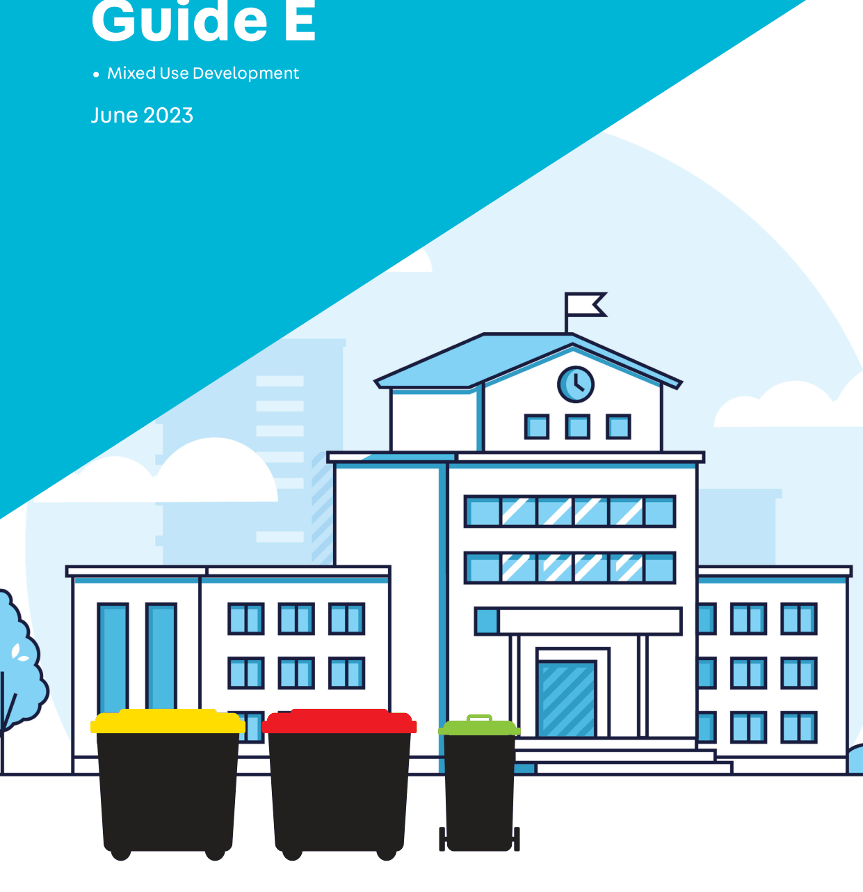

# Canterbury-Bankstown Development Control Plan 2023 - Waste Design for New Developments - Guide E - Mixed Use Development

> This chapter is split into 11 section file(s), one per numbered heading, in the order they appear in the PDF.

Source PDF: [2023.06.23 - DCP 2023 - CONSOLIDATED - Waste Design for New Developments - Guide E.pdf](https://planfortomorrow.sharepoint.com/sites/Planfortomorrow/Shared%20Documents/00%20NSW-Planning-Resources/dcp/canterbury-bankstown-development-control-plan-2023/supporting-guides/waste-design-for-new-developments-guide-e-mixed-us/2023.06.23%20-%20DCP%202023%20-%20CONSOLIDATED%20-%20Waste%20Design%20for%20New%20Developments%20-%20Guide%20E.pdf)

Waste Design for

### New Developments –

> [Picture on page 1: a picture, saved as a picture (images/waste-design-for-new-developments-guide-e-mixed-us-page-1-3.gif, 150 dpi).]

### Guide E

#### •	 Mixed Use Development

### June 2023

> The PDF's contents list (page numbers of the printed document) is not repeated here - see Sections below.

<!-- sections -->
## Sections

1. [1 Introduction](01-introduction.md)
2. [2 Waste Management and the](02-waste-management-and-the.md)
3. [3 Demolition and Construction](03-demolition-and-construction.md)
4. [4 Waste Management](04-waste-management.md)
5. [5 Residential Waste Management](05-residential-waste-management.md)
6. [6 Residential Waste](06-residential-waste.md)
7. [22 Waste Design for New Developments – Guide C](07-22-waste-design-for-new-developments-guide.md)
8. [7 Commercial Waste](08-7-commercial-waste.md)
9. [8 Advanced Waste](09-8-advanced-waste.md)
10. [9 Treatment and Management](10-9-treatment-and-management.md)
11. [10 Glossary of Terms](11-10-glossary-of-terms.md)
