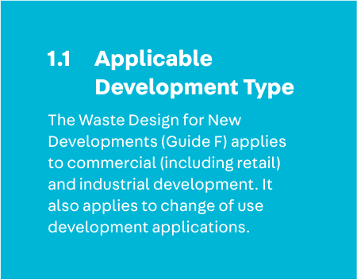

## 1. Introduction

> [Picture on page 3: a picture, saved as a picture (images/waste-design-for-new-developments-guide-f-commerci-page-3-2.gif, 150 dpi).]

### 1.1 Applicable

### Development Type

The Waste Design for New Developments (Guide F) applies to commercial (including retail) and industrial development. It also applies to change of use development applications.

### 1.2	 Objectives of the Guide

The City of Canterbury Bankstown (Council) aims to integrate waste management into the design fabric of urban planning to support effective collection and management of waste as an essential service. This includes identifying sustainable waste outcomes in all developments that are safe and efficient, reduction in waste generation, increase recycling and resource recovery and contribute to the built form and liveability of the community.

It is important that a building’s waste

management systems are not overlooked in the design process. There is a need for adequate consideration of waste management requirements early in the site planning and design stage of the development. Poor site planning and design decisions can have significant impacts on the ongoing operation of the development at occupancy stage and can impact how efficiently the building can be serviced.

Considering waste management requirements early in the design stage of the development and site planning process also ensures costly and timely delays are avoided during the assessment process.

This Guide is a valuable resource to improve the design and functionality of waste management systems within all new commercial (including retail) and industrial development.

This Guide has been prepared to assist you to achieve the following objectives and comply with Council’s planning controls:

1\.	 To maximise resource recovery and encourage source separation of waste, reuse and recycling by ensuring development provides adequate and appropriate bin storage areas and collection facilities;

2\.	To ensure development incorporates well– designed and responsive bin storage areas and collection facilities that are convenient and accessible to occupants;

3\.	To maximise residential amenity and minimise adverse environmental and health related impacts associated with waste management such as odour from bin storage areas and noise from collection facilities;

4\.	To ensure bin storage areas and collection facilities are designed to integrate with and meet the minimum requirements for Council’s domestic waste services;

5\.	To ensure development facilitates all waste streams being handled, stored and collected in a manner to reduce risk to health and safety of all users including maintenance (such as caretakers), collection staff and contractors (and required vehicles and equipment);

6\.	To integrate bin storage areas and collection facilities with the building form and landscape to avoid adverse visual impacts on the streetscape and neighbourhood; and

7\.	 To assist in achieving Federal and State Government waste minimisation and diversion targets as set by relevant legislation, regulations and strategies.

In addition, the design and ongoing management of waste management facilities encourages greater participation with separation of waste streams, reduction in waste generation, increased resource recovery and minimal contamination of recyclables and organics.

This can also significantly reduce the likelihood of illegal dumping.

### 1.3	 Waste Reduction and

### Resource Recovery Targets

In 2019, Council sent 68% of its waste to landfill, with 32% diverted from landfill through recycling and composting. The waste generated per person was 214kg.

Canterbury-Bankstown currently has an estimated population of 382,000 and is growing quickly, with the population expected to reach 500,000 by 2036. Also, with the decreasing availability of landfill space in Greater Sydney, reducing waste to landfill through resource recovery is essential.

By 2036, Council’s targets for waste reduction and resource recovery are:

•	 Divert 80% of waste from landfill

•	 200kg waste generation per person per year To help Council achieve these targets, all developments are required to achieve best practise in the design, construction and maintenance of waste services and infrastructure. This will ensure that garbage, recycling, organic and bulky waste produced on-site are treated in the best possible way to improve resource recovery along with enhancing the amenity, ease of use, environmental performance and ultimately the reputation of developments with well managed waste facilities.

Council is looking for and will support developments with innovative new ideas and technologies to reduce or treat waste on-site.
