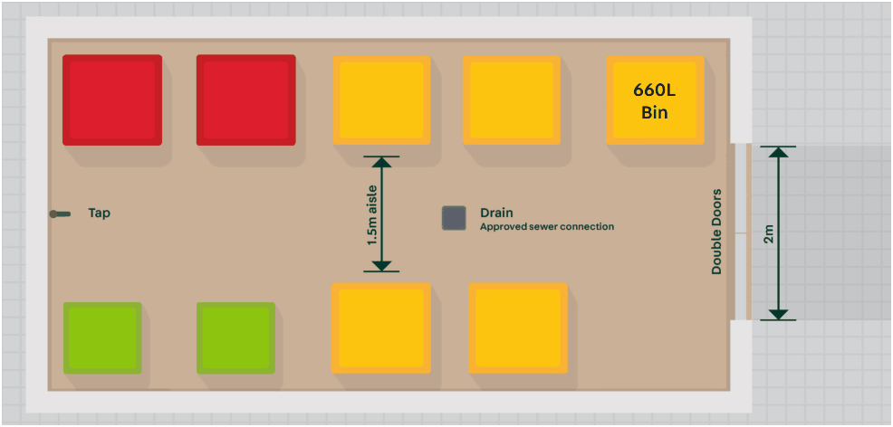
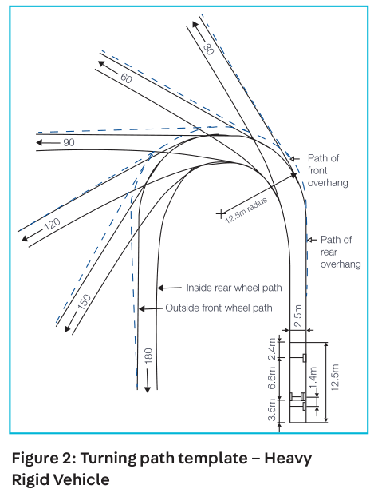

## 5. Specific Requirements

### 5.1	 Bin Storage Area

When designing developments it is recommended consideration of the intended and future uses is undertaken to reduce any costly retrofitting that may be required at the operational stage of the development.

Bin storage areas are to be designed so they can be constructed to the following requirements:

#### Size

•	 The size of the bin storage area must be sufficient to cater for all likely waste generation and the required bins for all waste streams. Waste generation is to be determined in accordance with Table 1.

#### Location

•	 Equal and convenient access for all tenants is to be provided, with each tenant to have their own allocated area for bin storage;

•	 Sited behind the development building line and incorporated within the development footprint;

•	 In areas that will not reduce the amenity for tenants and existing users adjoining the development; and

•	 Located within 10m of the nominated collection point, to minimise bin-carting routes.

#### Design

•	 As a minimum, the design should allow for the separate collection of general waste, recycling, paper and cardboard, food waste and pallets;

•	 Bin storage areas can be a stand-alone structure for smaller commercial and industrial developments. Where a stand-alone structure is to be provided it is to be designed and integrated into the overall look of the development in regards to materials and finishes; and

•	 For larger developments (particularly with a high number of individual tenancies) a bin storage area should be provided within the development footprint.

#### Layout

•	 The layout of the bin area must prevent obstructions that impact on bin movement, maintenance and cleaning as well as any servicing requirements.

#### Construction

•	 Floors must be constructed of concrete at least 75mm thick and graded and drained to a Sydney Water approved drainage fitting;

•	 Floors must be finished so that it is non-slip and has a smooth and even surface;

•	 Walls and floors must be must be constructed of solid impervious material;

•	 Ceilings must be finished with a smooth faced, non-absorbent material capable of being cleaned;

•	 Walls, ceilings and floors must be finished in a light colour; and

•	 If a room or is integrated within the building, a minimum 2.1m unobstructed room height is required in accordance with the Building Code of Australia.

> [Picture on page 12: a picture, saved as a picture (images/waste-design-for-new-developments-guide-f-commerci-page-12-1.gif, 150 dpi).]
> Words printed on the picture (title and legend, copied from the PDF):
> Bin

#### Figure 1: Communal bin storage area

### 5.2	 Collection Point

For commercial and industrial developments, all allocated bins are required to be presented to a nominated on-site collection point and not on the kerbside. The site is to allow an HRV to enter the site and collect all bins directly from the bin storage area, a loading dock or a separate on-site bin presentation area.

On-site collection points need to be located so they do not interfere with car parking, vehicle manoeuvring areas or pedestrian areas.

When designing for an HRV to access the site and designated loading area the following factors are to be taken into consideration early in the design phase:

#### 660L

•	 The route of travel (including vehicle manoeuvring areas and ramps) for the waste collection vehicle to the collection point is to satisfy the dimensions of an HRV as per AS2890.2, and includes adequate vehicle clearances for the vehicle. An extract from

AS2890.2 is provided on the next page;

•	 An HRV must be able to enter and exit the site in a forward direction. The collection point should be located to minimise manoeuvring within the site (only one reverse movement allowed);

•	 The route of travel is to be adequately surfaced and of sufficient strength to support the waste collection vehicle at maximum capacity (approximately

#### General:

•  Within 10m of a layback to the nominated collection point;

•  Doorway a minimum 2m;

• Only temporarily store bins so they can be serviced;

•  Be located fully within the development site;

•  Be located within the front setback of the development but suitably screened so it is not visible from the public domain;

•  Be of sufficient size to accommodate all bins with additional room for manoeuvring (approximately 15cm between bins); and

•  Be clearly separated from car parking bays, footpaths and landscaped areas.

#### Bin-carting route:

•  Be located to minimise manual handling for both

flat buildings:

#### Loading area:

•  A waste collection vehicle loading area is to be nominated on the submitted plans. The loading area is to be within 10m of the bin storage area;

•  Located so as not to impede or restrict other vehicle and pedestrian movements during collection times;

•  Clearly separated from car parking bays, footpaths, and landscaped areas; and

•  Located to minimise impact on residents within and adjoining the development site. It is not to be located near sensitive land uses or any habitable room windows.

#### Bin-carting route:

•  Ensure bin transfer complies with requirements of Work Health and Safety legislation; and

Table 3: An extract of dimensions and turning circles from the Australian Standard 2890.2 Parking

•  The bin-carting route to the loading area from the storage area:

caretaker and collection staff. Plans are to outline when Facilities Part 2: Off Street Commercial Vehicle Facilities for Heavy Rigid Vehicles.

bin-handling equipment will be used (e.g.bin tugs);

• The bin-carting route from the bin storage area to

• Wholly within property boundaries;

•  To be solid, concrete and non-slip;

•  A minimum of 2m wide;

30 tonnes);

•  Free from obstructions and steps; and

•  To be a maximum grade of 1:30.

#### 3.6.4 On-site collection

•	 A turntable is acceptable to facilitate safe and adequate manoeuvring on-site provided it is suitable for the specifications of the HRV; and

•	 The designated loading area is be located off the turntable or it is not shared by other vehicles requiring a loading dock access.

For RFB developments where kerbside collection may not be operationally feasible, all allocated bins may be collected on-site. This means the waste collection vehicle will be required to enter the property and service the development within the property boundary from a designated loading area.

The development will be required to provide safe vehicle access and designed to enable the waste collection vehicle to manoeuvre and load all allocated bins. The development will be required to nominate a loading area for the waste collection vehicle.

Swept paths for an HRV must be shown on submitted plans which illustrates the vehicle entering/exiting in a forward direction and access to the nominated loading area and/or bin storage area/s. Scaled plans accompanying the development application are to illustrate:

On-site collection proposals should be discussed with Council during the early planning stages.

•	 Manoeuvring, gradients, clearance heights and turning paths for the route of travel that comply with AS 2890.2 for HRV; and

RFB developments proposed on arterial roads must provide for an on-site collection. It is unsafe for the collection vehicle to stop on an arterial road in order to perform the standard collect and return service.

•	 An HRV can park safely within a designated loading area on-site whilst servicing the bins.

•  Be direct and as short as possible;

| the temporary complies Overall with Safety length • The bin-carting | holding area requirements Overall legislation; width route from | is to ensure of Wheel Work Health base the bin storage | bin transfer Design and turning radius area to | • Swept • circle • | Wholly within Is Clearance to be solid, Is a minimum height | property Maximum boundaries; concrete roadway/ramp and non-slip; of 2m wide; grade | Maximum rate of change of grade |
|---|---|---|---|---|---|---|---|
| the temporary • 12.5m To be direct | holding area and 2.5m as short | is: as possible; 6.6m | 12.5m | • 27.8m • | Free from Is to be 4.5m a designated | obstructions and steps; maximum 1:6.5 distance (15.4%) of 10m truck loading area and | and to 1:16 the (6.25%) in a maximum 7m of travel |

grade of 1:30.

> [Picture on page 13: a map, saved as a picture (images/waste-design-for-new-developments-guide-f-commerci-page-13-85.gif, 150 dpi); the street names and other small labels are on the picture.]
> Words printed on the picture (title and legend, copied from the PDF):
> Inside rear wheel path
> 150 Outside front wheel path
> - Heavy rigid vehicle

Figure 3: Turning path template

Figure 2: Turning path template – Heavy

#### Rigid Vehicle

### 5.3	 Land Use and

### Development Requirements

If contaminated sharps are generated, non-reusable sharps containers should be provided in accordance with relevant Australian Standards for disposal. Final disposal must be undertaken by licensed contaminated waste contractors.

#### Food Premises, including food retailers, cafes and restaurants

•	 Food premises are to comply with the requirements of AS 4674-2004 Design, construction and fit-out of food premises, including the general waste and recyclable materials requirements. The Guide is not intended to alter obligations under that Standard, and in the event of any conflict between this Guide and the Australian Standard, the Standard prevails;

•	 Individual tenancies are to be provided with appropriate space to store bins and containers that can store up to two days of estimated generated waste;

•	 A bunded and graded on-site storage area for liquid waste is to be provided so it can be drained to a grease trap to satisfy Sydney Water requirements;

•	 Additional space in the waste area to accommodate reusable items like pallets and crates; and

•	 Commercial tenancies producing more than 50 litres of meat, seafood or poultry waste must have daily waste collection or be designed with a dedicated refrigerated room for waste storage between collections. These sites are encouraged to consider on site processing of food waste to limit collection costs.

#### Multiple Tenancies Retail Premises

•	 A centralised waste storage area for the development for all required bins awaiting collection;

•	 Where individual tenancies are proposed within a commercial development, each tenancy is to be provided with appropriate space to store bins and containers that can store up to two days of estimated generated waste;

•	 A waste service area on each level is to be provided, that can store a minimum one day’s waste and recycling generated by the tenancies on that level. Cleaners will be required to move the waste to a centralised waste storage area for collection;

•	 Additional space for the storage of bulky items in the centralised waste service area;

•	 Additional space for the separation of waste and recycling in the centralised waste service area;

•	 Waste and recycling from the waste service areas must be transferred to the centralised waste area daily by cleaners; and

•	 Commercial premises that provide trolleys must have a trolley restriction system in place to stop any trolley leaving the property boundaries.

#### Office Premises

•	 A centralised waste storage area for the development for all required bins awaiting collection;

•	 Where individual offices are proposed within a development, each office is to be provided with appropriate space to store bins and containers that can store up to one day of estimated generated waste;

•	 A waste service area on each level that can store a minimum, one day’s waste, recycling and paper/cardboard generated by the tenancies on that level. Cleaners will be required to move the waste to a centralised waste storage area for collection;

•	 Additional space for the storage for bulky items in the centralised waste service area;

•	 Additional space for the separation of waste and recycling in the centralised waste service area; and

•	 Waste and recycling from the waste service area must be transferred to the centralised waste room daily.

#### Industrial Development Including warehouses

•	 Where individual tenancies are proposed within an industrial development, they are to be provided with appropriate space to store bins and containers that can store up to two days of estimated generated waste;

•	 A bunded and graded storage area for liquid waste so that it can be drained to a grease trap to satisfy Sydney Water requirements; and

•	 Additional space (minimum 10m2) in the waste rooms to accommodate reusable items like pallets and crates.
