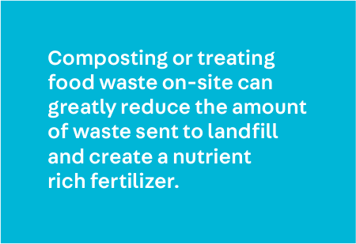
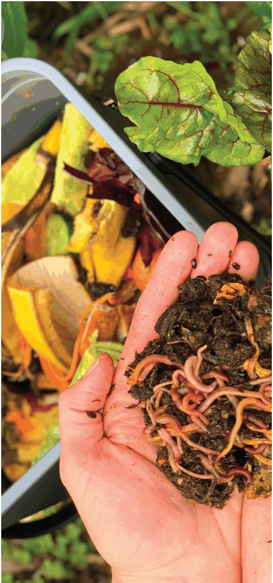

## 7. Treatment and Management

### of Food Waste

> [Picture on page 18: a picture, saved as a picture (images/waste-design-for-new-developments-guide-f-commerci-page-18-3.gif, 150 dpi).]

Council supports and encourages a reduction in food waste to landfill. Architects, designers and developers are encouraged to discuss these developments with Council early in the planning process.

#### Composting or treating

#### food waste on-site can

#### greatly reduce the amount

#### of waste sent to landfill

#### and create a nutrient

#### rich fertilizer.

The viability of the systems that treat and manage food waste and whether they may be suitable for any particular development depends on such factors as:

•	 Size of the development and number of commercial premises;

•	 Amount and type of food waste produced;

•	 Availability of trained people to manage and operate systems;

•	 Availability of suitable space;

•	 Ability to source separate food waste; and

•	 Availability and cost of food services.

### 7.1 Composting

Compost bins are a way of processing food waste and garden organic material on-site. This not only reduces the volume of waste but also creates a nutrient fertilizer (compost).

Compost bins are more versatile than worm farms, as they can process a wider range of materials including garden organics and citrus. Compost bins are best placed in full sun.

### 7.2	 Worm Farms

Worm farms are an effective method of managing food waste, with an output of vermicast (worm castings) and vermiliquid (liquid extract from the worm farm) that can be used in gardens. Seafood, meat or bones, dairy products, garlic, onion and citrus should not be placed in worm farms.

Worm farms need to be placed in a shaded position and can occupy a small footprint on balconies or in gardens.

### 7.3	 Macerators

Macerators are grinders that reduce the volume of food waste by turning solid food waste into pulp slurry. This is pumped to a holding tank and collected by a licensed contractor and taken to a licensed treatment facility (eg. anaerobic digester or commercial composter).

### 7.4	 Dehydraters

These systems reduce the volume of food waste by removing most of the water it holds by heating and agitating the food waste over 24 hours. They do not produce compost, only dehydrate waste. These containers need a sewer connection to dispose of the waste water and/or a filter for the vapours vented to the air. This may require additional Council approval. The outputs from these containers can be sent to a lawful facility such as a commercial composting facility.

### 7.5	 Anaerobic Digester

On-site anaerobic digesters use bacteria to break down food waste in an oxygen-free environment. The resulting biogas that is produced during this process can be used as an on-site energy source.

> [Picture on page 19: a picture, saved as a picture (images/waste-design-for-new-developments-guide-f-commerci-page-19-26.gif, 150 dpi).]
