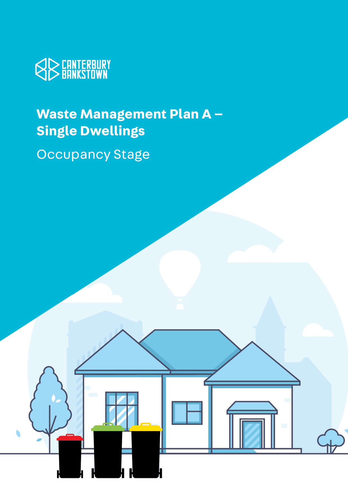
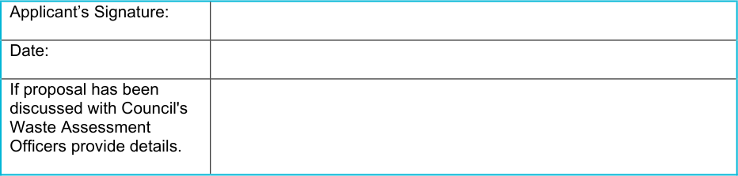

# Canterbury-Bankstown Development Control Plan 2023 - Waste Management Plan A - Single Dwellings Form

> This chapter is split into 2 section file(s), one per main heading, in the order they appear in the PDF.

Source PDF: [Waste Management Plan A - Single Dwellings - 2022-06-22.pdf](https://planfortomorrow.sharepoint.com/sites/Planfortomorrow/Shared%20Documents/00%20NSW-Planning-Resources/dcp/canterbury-bankstown-development-control-plan-2023/supporting-guides/waste-management-plan-a-single-dwellings-form/Waste%20Management%20Plan%20A%20-%20Single%20Dwellings%20-%202022-06-22.pdf)

> [Picture on page 1: a picture, saved as a picture (images/waste-management-plan-a-single-dwellings-form-page-1-1.gif, 150 dpi).]

The applicable sections of this Waste Management Plan (WMP) must be completed and submitted with your Development Application.

Completing this Plan will assist you in identifying the type(s) of waste that will be generated and will inform Council how you intend to reuse, recycle or dispose of this waste. The more detail you provide with your application will assist Council in reviewing your application. The amount of detail you provide with your application impacts the number of revisions and time taken with processing the DA.

The information you provide will be assessed against the objectives of the Development Control Plan 2021.

If you require assistance completing your WMP, please contact Council's Waste Assessment Officers in the Resource Recovery Team on 9707 9000.

If there is insufficient space within this template, please provide attachments.

| Site address: |  |
|---|---|
| Suburb: | Postcode: |
| Applicant's name: |  |
| Company name: |  |
| Applicant's address: |  |
| Suburb: | Postcode: |
| Phone: | Mobile: |
| Email: |  |

Has a Demolition and Construction WMP been completed?  The application will not be accepted if this WMP has not been completed.

Yes No

Provide a detailed description of the proposed development (e.g. dwelling type, number of bedrooms and additional structures such as granny flats).

> [Picture on page 2: a picture, saved as a picture (images/waste-management-plan-a-single-dwellings-form-page-2-18.gif, 150 dpi).]
> Words printed on the picture (title and legend, copied from the PDF):
> Applicant’s Signature:
> Date:
> If proposal has been
> discussed with Council's
> Waste Assessment
> Officers provide details.

<!-- sections -->
## Sections

1. [Standard service frequencies (as per Waste Design for New Developments Guide A)](01-standard-service-frequencies-as-per.md)
2. [Generation rate and bin sizes](02-generation-rate-and-bin-sizes.md)
