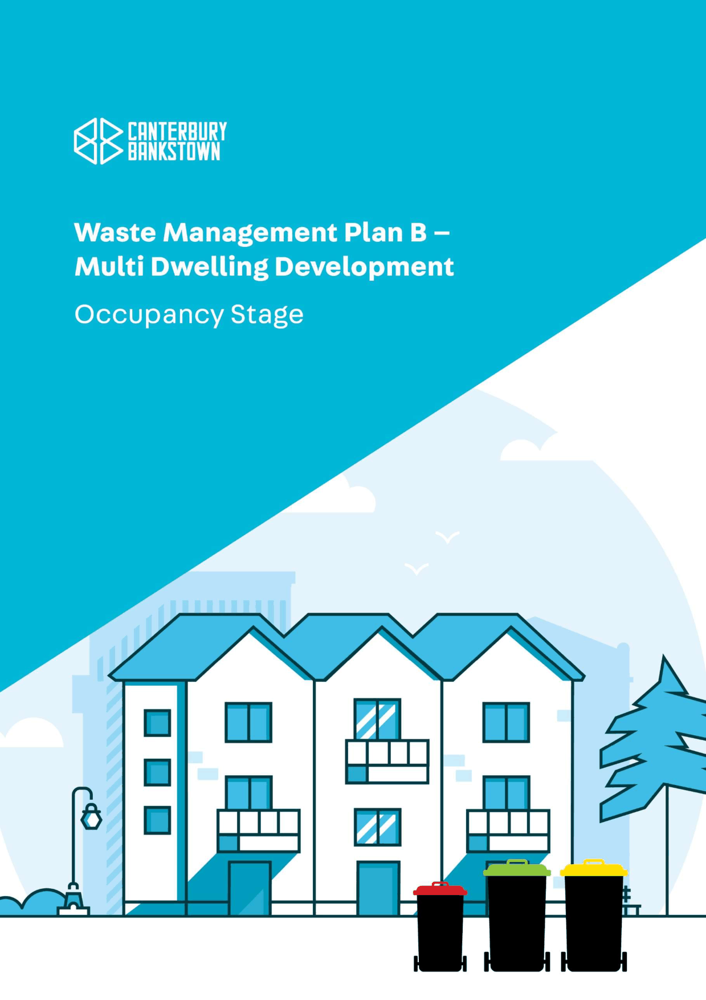
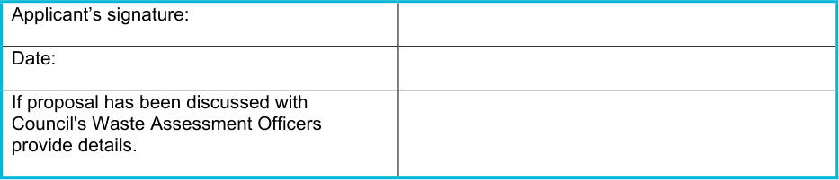

# Canterbury-Bankstown Development Control Plan 2023 - Waste Management Plan B – Multi Dwelling Housing Form

Source PDF: [Waste Management Plan B - Multi Dwelling - 2022-06-22.pdf](Waste%20Management%20Plan%20B%20-%20Multi%20Dwelling%20-%202022-06-22.pdf)

> [Picture on page 1: a picture, saved as a picture (images/waste-management-plan-b-multi-dwelling-housing-for-page-1-1.gif, 150 dpi).]

The applicable sections of this Waste Management Plan (WMP) must be completed and submitted with your Development Application.

Completing this Plan will assist you in identifying the type(s) of waste that will be generated and will inform Council how you intend to reuse, recycle or dispose of this waste. The more detail you provide with your application will assist Council in reviewing your application.  The amount of detail you provide with your application impacts the number of revisions and time taken with processing the DA.

The information you provide will be assessed against the objectives of the Development Control Plan 2021

The WMP will need to be amended if changes are made to the development during the assessment process (e.g. changes to number of dwellings and relocation of the bin room).

If you require assistance completing your WMP, please contact Council's Waste Assessment Officers in the Resource Recovery Team on 9707 9000.

If there is insufficient space within this template, please provide attachments.

Postcode:

Site address:

Suburb:

| Applicant's name: |  |
|---|---|
| Company name: |  |
| Applicant's address: |  |
| Suburb: | Postcode: |
| Phone: | Mobile: |
| Email: |  |

Has a Demolition and Construction WMP been completed?  The application will not be accepted if this WMP has not been completed. Yes No

Provide a detailed description of the proposed development, please include dwelling type and number of dwellings as a minimum.

> [Picture on page 2: a picture, saved as a picture (images/waste-management-plan-b-multi-dwelling-housing-for-page-2-23.gif, 150 dpi).]
> Words printed on the picture (title and legend, copied from the PDF):
> Applicant’s signature:
> Date:

If proposal has been discussed with Council's Waste Assessment Officers provide details.

Standard service frequencies (as per Waste Design for New Developments Guides B)

| General waste | Recycling | Garden waste | Bulky waste (per calendar year) |
|---|---|---|---|
| One collection per week | One collection per fortnight | One collection per fortnight * | Developments with five or less dwellings – two collections Developments with six to 50 dwellings – four collections ** Developments with 51 dwellings or more – six collections ** |

#### Notes:

\* Alternative week to recycling service. ** Bookings to be made by building’s caretaker, building manager or strata manager on behalf of the whole building.

#### Generation rates and bin sizes

Council allocates bins at the rates prescribed in the Waste Design for New Developments Guide B. Standard bin dimensions are also detailed in the Guide.  Bin allocations are rounded up to the next whole number (for example a calculation of 4.1 bins will be rounded to 5 bins).

| Service | Weekly generation rate/dwelling | Number of dwellings | Total weekly waste generation rate (weekly generation rate x number of dwellings) |
|---|---|---|---|
| Garbage | 140L |  |  |
| Recycling | 120L |  |  |
| Garden waste | 120L |  |  |

| Service | Bin size | Number of bins required | Standard collection frequency * | Approved alternate collection frequency *** |
|---|---|---|---|---|
| Garbage | 140L** / 660L / 1,100L / Hook Lift |  | Weekly |  |
| Recycling | 240L** / 660L / 1,100L |  | Fortnightly |  |
| Garden waste | 240L |  | Fortnightly | N/A |

#### Notes:

\* Collection frequencies and bin selections are at Council's discretion. ** Individual bins are only accepted for developments with five or less dwellings. *** Alternate collection frequencies must be approved by Council prior to lodgement. Where this has been discussed with and approval given by Waste Assessment Officers, please provide details of the Council contact:

| Council Officer name: |  |  |  |
|---|---|---|---|
| By: | Phone | Email | Date discussed: |

Management of Waste at Occupancy Stage (Applicants should provide a description to show the requirements have been met)

| 1. Internal storage of waste |  |  |  |
|---|---|---|---|
| Is there sufficient space allocated within each dwelling kitchen for two day's capacity of waste and recycling? | Yes | No | Specify location: |
| Is there sufficient space allocated within each dwelling kitchen for a caddy to collect food waste? | Yes | No | Specify location: |
| Is there sufficient space for the storage of bulky waste, textile waste and other problem waste? | Yes | No | Specify location: |
| Are the above storage and separation facilities shown plans accompanying the DA? | Yes | No |  |
| 2. Food and garden organic waste – composting and worm farm |  |  |  |
| How is food or garden waste managed on-site? (e.g. composting and/or worm farming, food waste processing system) | Specify location and type: |  |  |
| Has the area been nominated on plans accompanying the DA? | Yes |  | No |

For developments of five or less dwellings that are suitable individual bin storage areas and kerbside collection, complete sections 3, 4 and 9.  For developments with six or more dwellings or communal bins, proceed to section

#### 5.

| 3. Individual bin storage areas (five or less dwellings) |  |  |
|---|---|---|
| Behind the building line of the dwelling where it is screened or cannot be viewed from the public areas? | Yes | No |
| Away from habitable windows and doors of adjoining dwellings to reduce noise and odour? | Yes | No |
| Such that residents can conveniently carry their waste to the correct bin from their dwelling? | Yes | No |
| Such that the bin-carting route to the collection point does not pass through any internal rooms of the dwelling? | Yes | No |
| Such that the bin-carting route to the collection point avoids steps and slopes? | Yes | No |
| Such that the bins can be moved safely to the collection point? | Yes | No |
| Bin-carting route from the bin storage area to the collection point has a maximum distance of 50m? | Yes | No |
| 4. Kerbside collection (five or less dwellings) |  |  |
| Has a kerbside collection point been nominated on the plans accompanying the DA? | Yes | No |
| Kerbside collection points are to be located so they: Present all allocated bins in single file with a 30cm gap between bins; Allow a minimum of 2m (l) x 1m (w) per dwelling for bins to be presented to the kerb side-by-side; Ensure all allocated bins are placed within the site’s allocated frontage, not in the driveway and not in front of neighbouring lots; and Have a separation distance of 2m from street trees, bus stops, street furniture, intersections and road infrastructure such as round-a-bouts and speed humps; and | Yes | No |

| Have a height clearance of 4.2m from overhanging tree branches, powerlines and other obstructions. |  |  |
|---|---|---|
| If the development cannot meet the requirements for kerbside collection, the development is to include a communal waste bin area and serviced by collect and return. |  |  |
| 5. Communal bin storage area (six or more dwellings) |  |  |
| Has a communal bin storage area been provided to store all waste and recycling bins? | Yes | No |
| Has a scaled plan been submitted that illustrates the layout of the bin storage area and that it meets Section 5.3.1 of the Waste Design for New Developments Guide B? | Yes | No |
| 6. Collect and return service (six or more dwellings) |  |  |
| Is the communal bin storage area located within 10 metres of a layback to the kerbside collection point? | Yes | No |
| If no, has a temporary bin holding area been provided within 10 metres of a layback to the nominated kerbside collection point? | Yes | No |
| Has a scaled plan been submitted that illustrates the temporary holding area layout and that it meets Section 5.3.2 of the Waste Design for New Developments Guide B? | Yes | No |
| Has the bin-carting route been identified on plans accompanying the DA? | Yes | No |
| Is the bin-carting route? |  |  |
| a) Non-slip, free from steps or obstructions; | Yes | No |
| b) Minimum 2m wide hard surface; | Yes | No |
| c) Does not pass through any internal walkways, doors or rooms; | Yes | No |
| d) Maximum grade of 1:30 (3%); | Yes | No |
| e) Not within a driveway or carpark; and | Yes | No |
| f) Compliant with Work, Health and Safety for collection staff. | Yes | No |
| 7. On-site collection of waste (six or more dwellings) |  |  |
| Is on-site collection required? On-site collection is required if the development has been deemed by Council to be unsuitable for collect and return. | Yes | No |
| Has the development been designed to ensure that access to the collection point can be undertaken by a Heavy Rigid Vehicle as per AS 2890.2 and in accordance with Section 5.3.3 and 5.3.4 of the Waste Design Guide for New Developments B?? | Yes | No |
| Specify location of the dedicated collection or loading bay: |  |  |
| Is the DA accompanied by scaled AutoCAD swept path diagrams for a Heavy Rigid Vehicle, which demonstrates the waste collection vehicle can enter and exit in a forward direction, minimises manoeuvring within the site and can access the nominated loading area? | Yes | No |
| Is the DA accompanied by a traffic statement confirming the on-site collection point has been designed to comply with the Heavy Rigid Vehicle requirements in AS 2890.2? | Yes | No |

## 8. Temporary collection area (on-site collection)

| Is a temporary collection area needed? | Yes | No |
|---|---|---|
| Is the temporary collection area within 5m of the on-site collection point? | Yes | No |
| Has a scaled plan been submitted that illustrates the temporary holding area layout and that it meets Section 5.3.5 of the Waste Design for New Developments Guide B? | Yes | No |

| 9. Ongoing use |  |  |
|---|---|---|
| Will there be a caretaker on-site responsible for managing waste? | Yes | No |
| How often are they on-site and what are their duties in relation to waste management facilities? |  |  |
| Will bin-handling equipment be provided to assist the caretaker with bin-carting (to comply with WH&S requirements)? | Yes | No |
| Is the bin storage area/s accessible to waste collection staff (no security locks or devices)? | Yes | No |
| Do you agree to provide a deed of agreement and indemnity to Council and its collection contractors for the provision of residential collection service? | Yes | No |
| Additional information: |  |  |
