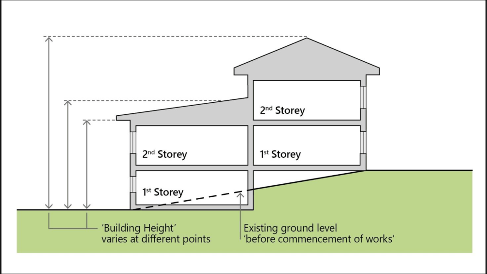
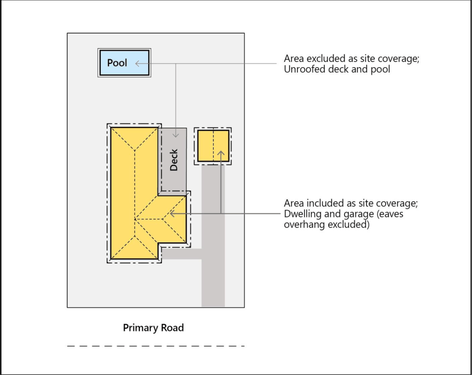

#### 2.1.2 BUILDING SCALE

#### 2.1.2.1 Building Height

The construction of a dwelling house, secondary dwelling or ancillary structure is restricted to a maximum building height. This height is measured from the existing ground level, which is the ground level of a site at any point, before any earthworks (excavation or fill) has taken place.

#### OBJECTIVES

▪ To ensure that buildings are compatible with the height, bulk and scale of the existing and desired future character of the locality

▪ To ensure that the height of buildings protects the amenity of neighbouring properties in terms of visual bulk, access to sunlight, privacy and views

▪ To ensure that building height is compatible with the scenic qualities of hillside and ridgetop locations and respects the sites natural topography

#### REQUIREMENTS

a Central Coast LEP 2022 contains a Height of Building Map for certain areas within the Local Government Area (LGA). In accordance with Clause 4.3 (2) of Central Coast LEP 2022, the height of a building in these areas is not to exceed the maximum height indicated on this map except as provided for by Central Coast LEP 2022 Clause 5.6-Architectural Roof Features.

Note: any proposed variation to the requirements of Central Coast LEP Clause 4.3 must be justified with a written request for variation addressing the provisions of Central Coast LEP Clause 4.6- Exception to Development Standards and the OBJECTIVES stated above.

b The maximum building height for dwellings in areas not specifically mapped by the Central Coast LEP 2022 is 10m.

c Building Height shall generally not exceed two storeys. Three storey dwellings will generally only be supported on steeply sloping sites, where the three-storey component extends for only a small section of the dwelling or where the lowest storey is contained predominantly within a basement level below natural ground and the maximum building heights are not exceeded.

d The maximum building height for outbuildings and detached ancillary development is:

i 4.8m on land zoned R1, R2, R3 or RU5

ii 7m on land zoned RU1, RU2, RU6, R5, C3, C4 or C2 (where permissible)

Note: Proposals for development within land use zones not listed above where a dwelling house is considered a lawful existing use are to be considered with regard to their setting i.e.- rural or residential and the appropriate standards applied. Contact Council for further information with regard to the particular property.

Definition: storey means a space within a building that is situated between one floor level and the floor level next above, or if there is no floor above, the ceiling or roof above, but does not include:

(a) a space that contains only a lift shaft, stairway or meter room, or

(b) a mezzanine, or

(c) an attic.

Note: For the purposes of calculating the number of storeys in a dwelling under this chapter, any basement (including a garage) is to be counted as a storey.

> [Picture on page 3: a picture, saved as a picture (images/ch-02-01-dwelling-houses-secondary-dwellings-and-ancillary-page-3-1.gif, 150 dpi).]

#### Figure 1- Building Height

#### 2.1.2.2 Site Coverage

Site coverage is the proportion of a site that is covered by buildings and ensures that there is an appropriate area of the site that is not built upon. The amount of the site that can be built upon varies depending on the size of a lot. The following definitions are relevant for the calculation of site coverage: Site coverage means the proportion of a site area covered by buildings. However, the following are not included for the purpose of calculating site coverage:

(a) any basement,

(b) any part of an awning that is outside the outer walls of a building and that adjoins the street frontage or other site boundary,

(c) any eaves,

(d) unenclosed balconies, decks, pergolas and the like For the purpose of this Chapter, swimming pools are excluded from any site coverage calculation. Site area is defined under Central Coast LEP 2022. Generally if the proposed development is to be carried out on only one lot, then the site area is the area of that lot. Basement means the space of a building where the floor level of that space is predominantly below the existing ground level and where the floor level of the storey immediately above is less than 1 metre (at any point) above existing ground level.

> [Picture on page 4: a picture, saved as a picture (images/ch-02-01-dwelling-houses-secondary-dwellings-and-ancillary-page-4-1.gif, 150 dpi).]

#### Figure 2 - Site Coverage

#### OBJECTIVES

▪ To ensure that the density, bulk and scale of development is appropriate for a site

▪ To ensure that the density, bulk and scale of development integrates with the streetscape and character of the area in which the development is located

▪ To provide an appropriate area on site for landscaping, outdoor activities and stormwater infiltration

#### REQUIREMENTS

a The site coverage shall be a maximum of:

i if the lot has an area of less than 450m2—60% of the site area

ii if the lot has an area of at least 450m2 but less than 900m2—50% of the site area

iii if the lot has an area of at least 900m2 but less than 1,500m2—40% of the site area

iv if the lot has an area of 1,500m2 or more —30% of the site area

Note: site cover on lots having an area of greater than 1500m2 in a rural, environmental or conservation zone must ensure that buildings and structure do not visually dominate the landscape.  This may mean that a site cover of less than 30% is appropriate in certain instances.

#### 2.1.2.3 Floor Space Ratio

Central Coast LEP 2022 contains a Floor Space Ratio (FSR) Map that applies to certain areas within the LGA. In accordance with Clause 4.4 (2) of Central Coast LEP 2022, the FSR of a development in these areas is not to exceed the FSR indicated on this map.

#### OBJECTIVES

▪ To ensure that the density, bulk and scale of development is appropriate for a site

▪ To ensure that the density, bulk and scale of development integrates with the streetscape and character of the area in which the development is located

#### REQUIREMENT

a In accordance with Clause 4.4 (2) of Central Coast LEP 2022, the maximum floor space ratio for building on any land is not to exceed the floor space ratio shown for the land on the Floor Space Ratio Map.

Note: any proposed variation to the requirements of Central Coast LEP Clause 4.4 must be justified with a written request for variation addressing the provisions of Central Coast LEP Clause 4.6- Exception to Development Standards and the OBJECTIVES stated above.
