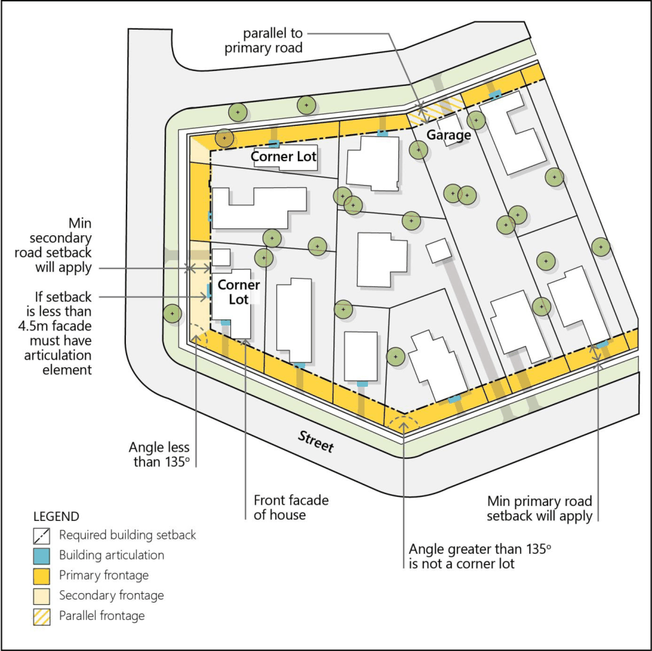
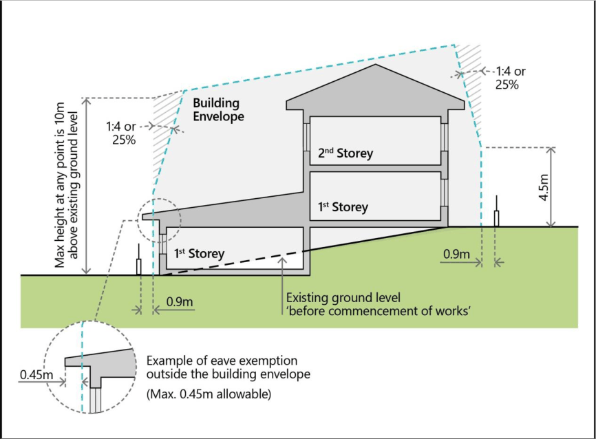
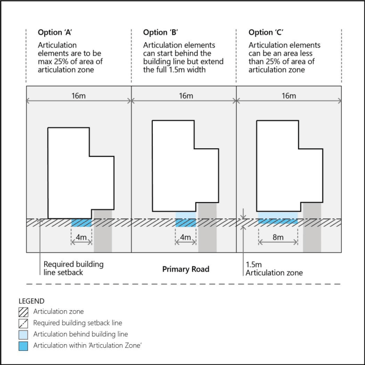

#### 2.1.3 SETBACKS

A building line or setback is the shortest horizontal distance between the property boundary or other stated boundary (measured at 90 degrees from the boundary) and:

▪ a building wall, or

▪ the outside face of any balcony, deck or the like, or

▪ the supporting posts of an open roofed structure such as a carport, verandah or the like

The following definitions are relevant for the calculation of setbacks:

primary road means the road to which the front of a dwelling house, or a main building, on a lot faces or is proposed to face.

secondary road means, in the case of a corner lot that has boundaries with adjacent roads, the road that is not the primary road.

parallel road means, in the case of a lot that has boundaries with parallel roads, the road that is not the primary road (the rear boundary) and must be 7m or more in width.

lane (laneway) for the purposes of this Chapter means a public road, with a width greater than 3m but less than 7m, that is used primarily for access to the rear of premises

foreshore area means the land between a foreshore building line and the mean high water mark of an adjacent waterbody (natural).

foreshore building line A line fixed by Council on the water side of which a building may not be erected except as may be provided by this plan.

The following diagram provides the most common examples of typical residential sites and identifies the location and requirements for type of road frontage, setbacks and articulation and how they are applied to those sites.

> [Picture on page 6: a picture, saved as a picture (images/ch-02-01-dwelling-houses-secondary-dwellings-and-ancillary-page-6-1.gif, 150 dpi).]

Figure 3 – Site Layout explanation for types of Road Frontages, Setbacks & Articulation Zones

Source- Department of Planning and Environment

#### OBJECTIVES

▪ To ensure that setbacks are compatible with adjacent development and complements the character, streetscape, public reserve, or coastal foreshore

▪ To ensure the visual focus of a development is the dwelling, not the garage

▪ To protect the views, privacy and solar access of adjacent properties

▪ To maintain view corridors to coastal foreshores and other desirable outlooks

▪ To maintain the scenic and environmental qualities of natural waterbodies and their foreshores and respond to site attributes such as topography

▪ To provide deep soil areas sufficient to conserve existing trees or accommodate new landscaping

▪ To provide appropriate articulation of facades and horizontal elements reduce the appearance of bulk and provides visual interest to the building and subsequent streetscape where they face a street frontage/s.

#### 2.1.3.1 Setbacks – Residential Lots

The following setback requirements apply to dwellings and all ancillary development on a lot zoned R1, R2,

R3 or RU5:

#### REQUIREMENTS

| Aspect |  | Minimum Setback |
|---|---|---|
| a Front boundary (from the primary frontage) for primary and secondary dwellings and ancillary development (including outbuildings) Note: front setback provisions above exclude permissible articulation – refer to Section 3.2 below. | (i) To a local roadway on lots with a site area greater than 300m2 (ii) To a Classified Road. (iii) To a local roadway on lots with a site area up to 300m2 (iv) The minimum required setback for garage and carport structures and the like | The average distance of the setbacks of the nearest 2 dwelling houses having the same primary road boundary and located within 40m of the lot on which the dwelling house is erected, or If 2 dwelling houses are not located within 40m of the lot - 4.5m Note: For the purpose of calculating the setbacks of the nearest 2 dwelling houses • any ancillary development is to be disregarded, and • building elements that are permitted in the articulation zone are not included 7.5m 3.0m A minimum of 1m behind the front boundary setback |
| b Rear boundary setbacks for primary and secondary dwellings and ancillary development (excluding outbuildings) | (i) To a private allotment (ii) To a parallel road or public reserve Note: Setbacks to Public Reserves adjoining a Natural Waterbody are specified below (iii) Where a property is within the Coastal Hazard Planning Area | • For single storey development - 0.9 m for a maximum width 50% of the length of the rear boundary and • For any part of the building with a height of up to 4.5m - 3m For any part of the building with a height greater than 4.5m – 6m 3.0m As per Chapter 3.2 Coastal Management |

| Aspect |  | Minimum Setback |
|---|---|---|
| c Side Boundary setback for primary and secondary dwellings and ancillary development (excluding outbuildings) | (i) all lots greater than 12.5m wide at the building line (ii) for lots up to 12.5m wide at the building line (iii) for lots less than 8m wide at the building line (iv) carports that comply with the BCA exemption provisions (iv) Where a property is within the Coastal Hazard Planning Area | • for any part of the building with a height of up to 4.5m—0.9m, and • for any part of the building with a height of more than 4.5m—0.9m plus one-quarter of the height of the building above 4.5m (Refer to figure 4) • 0 (Zero) to one side only for a maximum length of 10m and • as per point c(i) above for the remainder • 0 (Zero) for 20m or 50% of the depth of the lot whichever is the lesser and • as per point c(i) above for the remainder • for any part of the building with a height of up to 3.3m— 0 (zero) and • for any part of the building with a height of more than 3.3m—one- quarter of the height of the building above 3.3m As per Chapter 3.2 Coastal Management |
| d Secondary boundary setback (on corner lots) | Note: a corner lot must have an interior angle at the corner less than 135o, otherwise it’s a continuation of an irregular front boundary (see figure 3) | 2m |
| e Waterfront setback (absolute water frontage) |  | In accordance with the Foreshore Building Line Map and the provisions of Clause 7.3 of Central Coast LEP 2022. Where a setback is not specified as outlined above, development is to be setback from the waterbody or from land that is unzoned land or zoned public recreation or open space which adjoins the waterway as follows: a 6m for the ground storey b 10m for any storey above the ground storey c 30m from the Hawkesbury River or any of its tributaries |
| f Boatsheds |  | 2m from mean high watermark A deck, whether roofed or unroofed, is not permitted on any boatshed |

| Aspect |  | Minimum Setback constructed within 6m of any creek, bay, lake, lagoon, river or any other waterway or unzoned land, or land zoned open space, land zoned recreation or reserved for waterfront public reserve |
|---|---|---|
| g Outbuildings rear and side boundary setbacks | (i) on lots with an area up to 300m2 (ii) lots with an area greater than 300m2 (iii) to a laneway (iv) To a parallel road or public reserve (v) Where a property is within the Coastal Hazard Planning Area | • for any part of the building with a height of up to 3.3m— 0 (Zero) and • for any part of the building with a height of more than 3.3m—one- quarter of the height of the building above 3.3m • for any part of the building with a height of up to 3.8m— 0.5m and • for any part of the building with a height of more than 3.8m—0.5m plus one-quarter of the height of the building above 3.8m • 0 (Zero) for 50% of the length of that boundary and • as and as per point g (i) and g(ii) above for the remainder • 3.0m As per Chapter 3.2 Coastal Management |

#### Table 1- Setbacks – Residential Lots

Note: reference to any point of a building with regard to side and rear setbacks excludes an eave up to 450mm wide and other permissible associated structures in accordance with the BCA.

> [Picture on page 10: a picture, saved as a picture (images/ch-02-01-dwelling-houses-secondary-dwellings-and-ancillary-page-10-1.gif, 150 dpi).]

Figure 4 – Side Setback Building Envelope Explanation (residential sized allotments)

#### 2.1.3.2 Setbacks - Large Lots

#### REQUIREMENTS

The following setback requirements apply to dwellings and all ancillary development on a lot zoned RU1, RU2, RU6, C3, C4 or R5 or C2 ( where permissible):

| Aspect |  | Minimum Setback |
|---|---|---|
| a Front boundary (primary frontage) for dwellings and all ancillary development ( including outbuildings) | (i) lots with a site area up to 4000m2 (ii) lots with a site area greater than 4000m2 | 10m 20m |
| b Rear boundary setbacks Note: for irregular shaped lots with 3 or less boundaries they do not have a rear boundary | (i) for dwellings and ancillary development (excluding outbuildings) (ii) outbuildings – exclusively used for agricultural purposes (iii) outbuildings – other | 10m 10m 5m |
| c Side Boundary setback | (i) for dwellings and ancillary development (excluding outbuildings) on lots with a site area up to 4000m2 (ii) for dwellings and ancillary development (excluding outbuildings) on lots with a site area greater than 4000m2 (iii) outbuildings – exclusively used for agricultural purposes (iv) outbuildings – other | 2.5m 10m 10 m 5m |
| d Secondary boundary setback (on corner lots) | (i) lots with a site area up to 4000m2 | 5m |

| Aspect |  | Minimum Setback |
|---|---|---|
| Note: a corner lot must have an interior angle at the corner less than 135o, otherwise it’s a continuation of an irregular front boundary (see figure 3) | (ii) lots with a site area greater than 4000m2 | 10m |
| e Waterfront setback (absolute water frontage) | Note. Generally, new dwellings are prohibited from this area whilst alterations, additions or other structures such as boat sheds can be considered. | 40m or as mapped 30m from the Hawkesbury River or any of its tributaries |
| g Ridgelines | from crest, highest point or prominent brow | 50m |

#### Table 2- Setbacks – Large Lots

Note: Proposals for development within land use zones not listed under Sections 2.1.3.1 or2.1.3.2 above, where a dwelling house is considered a lawful existing use are to be considered with regard to their setting i.e.- rural or residential and the appropriate standards applied. Contact Council for further information with regard to the particular property.

#### 2.1.3.3 Articulation Zones

#### 2.1.3.3.1 Primary Road Articulation for Dwelling Houses

Articulation zones can be provided to the front of a dwelling house which provides an allowance (bonus) for an entry and other design features to be positioned within the designated minimum setback area.

> [Picture on page 11: a picture, saved as a picture (images/ch-02-01-dwelling-houses-secondary-dwellings-and-ancillary-page-11-11.gif, 150 dpi).]

#### Figure 5 - Articulation Zones (site view)

Note: articulation zone means an area of a lot forward of the building line within which building elements are permitted to be located, being an area measured from one side boundary of the lot to the opposite side boundary of the lot.

Architectural elements which address the street frontage and permitted in the articulation zone include the following:

▪ entry feature or portico,

▪ a balcony, deck, patio, pergola, terrace or verandah,

▪ a window box treatment such as a bay window or similar feature,

▪ an awning or other sun shading feature over a window.

#### REQUIREMENTS

a An articulation zone within the designated setback area is only available to the primary road frontage and is measured 1.5m from the building to the minimum required setback from the subject road.

b The maximum total area of all building elements within the articulation zone must not be more than 25% of the area of the articulation zone in accordance with Figure 5 above.

c Dwellings and all ancillary development on a lot zoned R1, R2, R3 or RU5 must have elevations facing road frontages articulated as follows:

i elevations when within 7.5m and facing a primary road frontage with unbroken lengths of walls that exceed 10m in length.

ii elevations facing and less than 4.5m from a secondary or parallel road frontage with unbroken lengths of walls that exceed 10m in length.

Note: unbroken lengths of walls that exceed 10m in length can either be articulated with architectural elements as permitted in primary road articulation zones or wall projections and or indentations (min. 0.45m x 1.5m in length) to ensures that a wall is not blank and has design elements that improve the streetscape.

Note: secondary and parallel road articulation is to occur behind the required minimum setback not within the designated setback as permitted with primary road articulation.

#### 2.1.3.3.2 Garage Door Articulation

To ensure the visual focus of a development is the dwelling, not the garage doors facing and dominating the streetscape, the need to limit garage door openings when within close proximity of a road frontage is required. a The total width of all garage doors openings when within 7.5m and facing a primary road or parallel road on a lot zoned R1, R2, R3, or RU5 must not exceed: i 6m if the lot has a width measured at the building line of 12m or less, or

ii 6m, or 60% of the width of the building (whichever is the greater) if the lot has a width measured at the building line of more than 12m.
