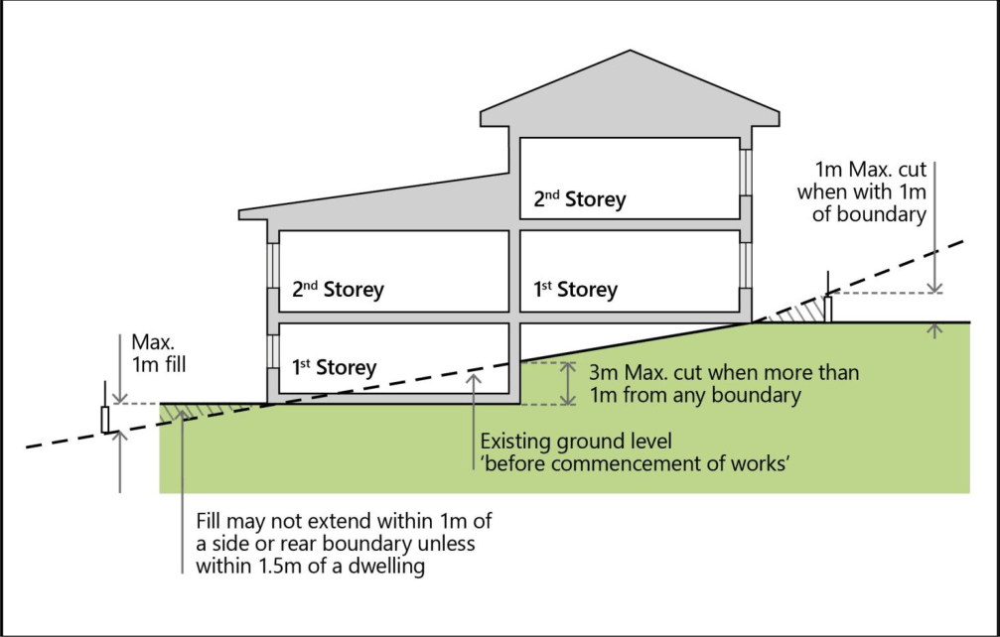

#### 2.1.6 EARTHWORKS, STRUCTURAL SUPPORT AND DRAINAGE

Sloping sites as opposed to relatively flat sites presents design consideration for development to manage fall in land which may take the form of benching or stepping the site and or development depending on the severity in the fall/slope of land.

#### OBJECTIVES

▪ To accommodate development on a site without the need for excessive excavation and fill or construction of high retaining walls adjacent to site boundaries

▪ To ensure that building designs conform to natural land forms and site constraints

▪ To manage stormwater discharge in a manner that minimises impacts on adjoining properties or public land

▪ To ensure that the amenity of adjoining residents and the streetscape is not adversely affected

▪ To restrict the siltation of waterways and erosion of land disturbed by the development

> [Picture on page 16: a picture, saved as a picture (images/ch-02-01-dwelling-houses-secondary-dwellings-and-ancillary-page-16-1.gif, 150 dpi).]

#### Figure 6 - Cut and Fill

#### REQUIREMENTS

#### 2.1.6.1 Earthworks

a Excavation for the purposes of development must not exceed a maximum depth measured from existing ground level of 1m if less than 1m from any boundary, or 3m if located more than 1m from any boundary.

b Fill for the purpose of erecting a dwelling must not exceed 1m above existing ground level. No retaining wall for fill is to be within 1m of a side or rear boundary unless within 1.5m of any external wall of a dwelling.

c Where a property is burdened by stormwater or water and sewerage mains then Council will generally preclude any excavation or filling within that easement

Note: Fill for development other than for a dwelling is to generally comply with the exempt provisions Codes SEPP.

Note: Fill to flood lots generally is not supported and would be subject to meeting the objectives and requirements of Chapter 3.1 Floodplain Management.

#### 2.1.6.2 Retaining Walls and Structural Support

a Retaining walls that are more than 600mm above or below existing ground level and within 1m of any boundary, or more than 1m above or below existing ground level in any other location, must be designed by a professional engineer.

Note: The height of a retaining wall is measured from the base of the retaining wall to its uppermost portion and may include a combination of height above and below ground level (existing).

b Earthworks not structurally supported by a retaining wall having an unprotected sloping embankment or batter must: i not have an embankment slope greater than that required by the BCA for its soil type

ii generally not extend by more than 3m from the dwelling or have the toe of the embankment or batter within 1m from a side or rear boundary.

Note: Retaining walls or earthworks not structurally supported shall be designed so as not to redirect the flow of any surface water onto adjoining land.

#### 2.1.6.3 Drainage

All stormwater drainage collecting as a result of the erection of, or alterations or additions to, a dwelling, outbuilding or ancillary development must be conveyed by a gravity fed or charged system to a public drainage system, or an inter-allotment drainage system, or an on-site disposal system.
