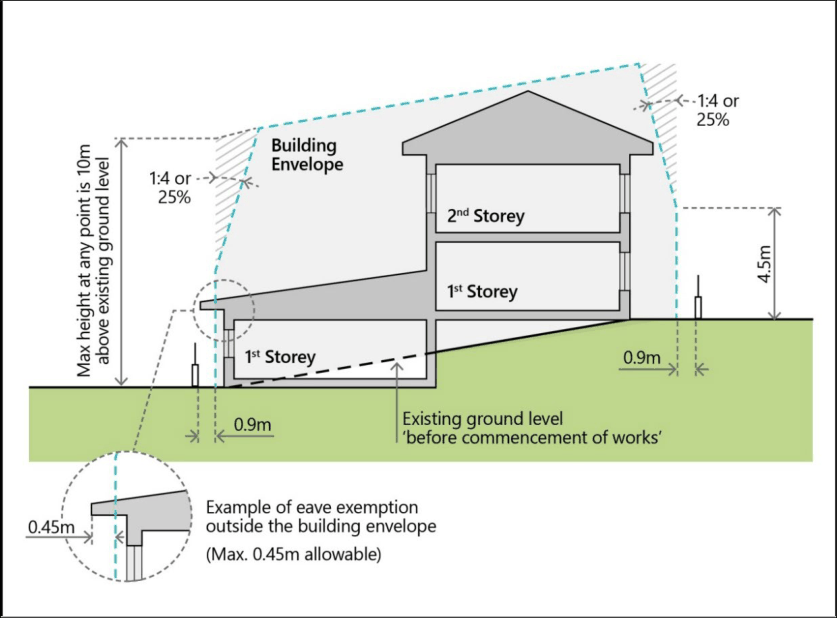

#### 2.2.5 BUILDING SETBACKS

#### OBJECTIVES

To ensure that setbacks are compatible with adjacent development and complements the character,

streetscape and natural areas To ensure the visual focus of a development is the dwelling, not the garage To ensure views, privacy and solar access of adjacent properties are reasonably maintained To reasonably maintain view corridors to coastal foreshores and other desirable outlooks To maintain the scenic and environmental qualities of natural waterbodies and their foreshores and

respond to site attributes such as topography To provide deep soil areas sufficient to provide new landscaping To provide appropriate articulation of facades and horizontal elements reduce the appearance of bulk

and provides visual interest to the building and subsequent streetscape where they face a street

frontage/s.

#### REQUIREMENTS

For all development proposed under this chapter the following setbacks shall apply:

| Aspect | Minimum Setback Required |
|---|---|
| a Front setbacks | i Classified roads: 7.5m ii Local roads: The average distance of the front setbacks of the nearest 2 dwelling houses having the same primary road boundary and located within 40m of the lot on which the dwelling house is erected, or if 2 dwelling houses are not located within 40m of the lot - 4.5m Note: For the purpose of calculating the setbacks of the nearest 2 dwellings any ancillary development is to be disregarded iii Roads where the road reserve is less than 12m wide: 6.0m Note: Dwellings must have direct access to a public road for pedestrian access, mail and waste collection. |
| b Side setbacks Refer to figure 1. | i for any part of the building with a height of up to 4.5m—0.9m, and ii for any part of the building with a height of more than 4.5m—0.9m plus one-quarter of the height of the building above 4.5m Note: Unbroken lengths of wall exceeding 10m in length and 3 m in height shall not be permitted. |

| Aspect | Minimum Setback Required |
|---|---|
| c Rear setbacks | (i) 4.5 m (ii) To a parallel road or public reserve-3.0m Note: Setbacks to Public Reserves adjoining a Natural Waterbody are specified below (iii) Where a property is within the Coastal Hazard Planning Area as per Chapter 3.2 Coastal Management |
| d Garages | i Local Roads 5.5m applies to garages where they are accessed directly from the road system, except ii Classified roads - 7.5m applies |
| e Corner Allotments side street – dual occupancy Note: On corner allotments the side street is generally taken to be the boundary with the greater frontage. | i 2.0m, plus compliance with sight preservation lines |
| f Detached dual occupancy on a corner allotment | i A detached dual occupancy on a corner lot is required to address both street frontages. Each dwelling will have a frontage to a "nominated" primary road. Setbacks to the other boundaries on the site will be considered side boundary setbacks. |
| g Corner Allotments side street -multi dwelling housing | i 3.0m, plus compliance with sight preservation lines |
| h Waterfront setback (absolute water frontage) | i In accordance with the Foreshore Building Line Map and the provisions of Clause 7.3 of Central Coast LEP 2022 ii Where a setback is not specified as outlined above, development is to be setback from the waterbody or from land that is unzoned land or zoned public recreation or open space which adjoins the waterway as follows: 6m for the ground storey 10m for any storey above the ground storey 30m from the Hawkesbury River or any of its tributaries Where a property is affected by coastal hazards additional setbacks may apply. |

#### Table 3 – Setbacks

> [Picture on page 7: a picture, saved as a picture (images/ch-02-02-dual-occupancy-and-multi-dwelling-housing-page-7-1.gif, 150 dpi).]

#### Figure 1 – Side Setback and Building Envelope

Note: Maximum height as shown in Figure 1, only applies to land not mapped under the height of building map under

CCLEP 2022.
