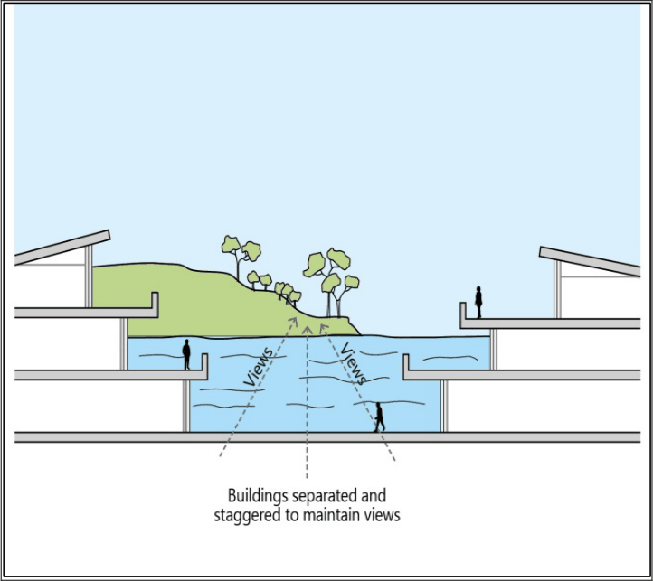
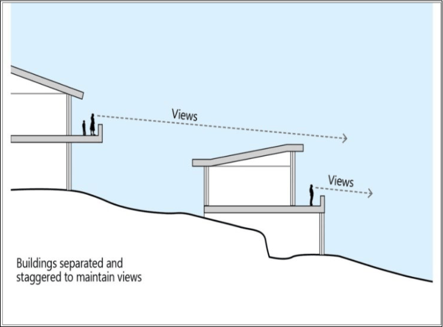
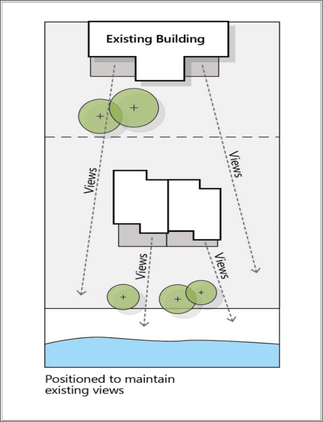
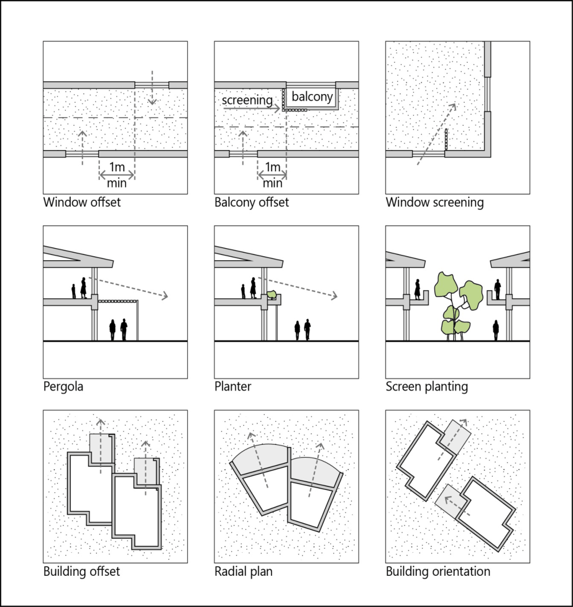

#### 2.2.7 RESIDENTIAL AMENITY

#### 2.2.7.1 Views

#### OBJECTIVES

To facilitate view sharing outcomes To have opportunities for public vistas and public views from streets and public places protected and

enhanced through building design, location and landscape design To protect views by permitting development which minimises the obstruction of such views where

enjoyed from internal and external living areas

#### REQUIREMENTS

a Development is to be sited and designed to enable a sharing of views with surrounding private

properties, particularly from habitable rooms.

b The design of the roof form is to provide for view sharing. This may be achieved by consideration of

the roof pitch and type (including flat roofs), increasing the setback on an upper level or by lowering

the proposal in whole or in part.

c Applicants shall demonstrate that buildings have been designed ‘from the ground up’, with floors

located at or near to natural ground level and incorporating reasonable ceiling heights and roof pitch.

d A visual analysis illustrating the impacts of the proposed development upon views may be required for

developments which have the potential to obstruct views. The analysis will be required to outline the

impact of the development on the views of all affected properties.

e Where there is a potential loss of view for nearby properties, applications are to address the NSW Land

and Environment Court Planning Principles relating to view sharing.

> [Picture on page 10: a picture, saved as a picture (images/ch-02-02-dual-occupancy-and-multi-dwelling-housing-page-10-1.gif, 150 dpi).]

#### Figure 2A - Examples of potential solutions to maintain views

> [Picture on page 10: a picture, saved as a picture (images/ch-02-02-dual-occupancy-and-multi-dwelling-housing-page-10-3.gif, 150 dpi).]

#### Figure 2B - Examples of potential solutions to maintain views

> [Picture on page 11: a picture, saved as a picture (images/ch-02-02-dual-occupancy-and-multi-dwelling-housing-page-11-1.gif, 150 dpi).]

#### Figure 2C Examples of potential solutions to maintain views

#### 2.2.7.2 Privacy

#### OBJECTIVES

To provide and maintain reasonable levels of visual privacy both internally and externally, during day

and night To maximise outlook and views from living rooms and private open space without compromising

visual privacy To ensure a high level of amenity by protecting the privacy of residents both within dwellings and in

private open space areas

#### REQUIREMENTS

#### 2.2.7.2.1 Visual Privacy

a Direct overlooking of internal living areas and private open space and from surrounding dwellings

must be minimised by building layout, location and design of windows and balconies, screening

devices and landscaping.

b Where living area windows or balconies of dwellings are proposed within 12 metres of and facing

living area windows or balconies of adjacent dwellings, windows should offset from the edge of the

opposite window and balconies be screened or oriented to ensure visual privacy. Window openings at first floor level and above should be orientated or designed to minimise the

potential for overlooking of adjacent properties and this consequent loss of privacy. Windows which are orientated towards adjoining properties and do not adequately restrict

overlooking will be required to be opaque finish or located at appropriate heights above floor level to

minimise overlooking of adjoining properties. See Figure 3.

> [Picture on page 12: a picture, saved as a picture (images/ch-02-02-dual-occupancy-and-multi-dwelling-housing-page-12-9.gif, 150 dpi).]

#### Figure 3 Examples of potential solutions for maintaining privacy

#### 2.2.7.2.2 Acoustic Privacy

a Site layout should separate active recreational areas, parking areas, vehicle access ways and service

equipment areas from bedroom areas of dwellings.

b Development adjacent to potential sources of high levels of external noise shall minimise the entry of

that noise through building design window placement, noise attenuation measures and external wall

treatment.

#### 2.2.7.3 Private Open Space Areas

#### OBJECTIVES

To ensure private open space areas are functional and responsive to the environment, thereby

promoting the enjoyment of outdoor living for residents To ensure private open space areas (in particular balconies) integrate with the overall architectural

form and detail of the development

#### REQUIREMENTS

a Private open space for each dwelling is to have with a minimum area of 45 square metres and a

minimum dimension of 4.5 metres. These areas are required to be generally located at ground level,

directly accessible from a living area within the dwelling.

b Required private courtyards shall not exceed a maximum grade of 1:14 to optimise useability for

residents.

c Wherever a dimension is less than the required minimum width (i.e. 2 metres for balconies or 4.5

metres for courtyards) it shall not be counted as part of the calculation for private open space areas.

d Required ground level private open space may be provided in up to two locations for each dwelling,

subject to compliance with the minimum dimension.

e Ground level courtyards are not permitted within the front building setback area fronting local roads.

#### 2.2.7.4 Common Open Space – Multi Dwelling Housing and Attached

### Dwellings

#### OBJECTIVES

To ensure adequate open space areas is provided for the enjoyment of residents in larger

developments To encourage a greater sense of community within larger developments providing a gathering point

for residents To ensure common open space areas are functional and responsive to the environment, thereby

promoting the enjoyment of outdoor living for residents

#### REQUIREMENTS

a Communal open spaces is to be provided for developments with more than ten dwellings b Communal open space shall be provided in no more than two locations at a minimum rate of 10

square metres per dwelling and with a minimum width of 5 metres.

c The location and design of communal open space shall: i protect the privacy of adjoining dwellings ii provide for both sunlight access and shaded areas

iii be usable and accessible to all occupants iv include landscaping works and planting

#### 2.2.7.5 Sunlight Access

#### OBJECTIVE

To facilitate solar access to the living areas and private open space areas of the dwelling and

neighbouring dwellings

#### REQUIREMENTS

a On June 21, 50% of the required principal private open space area for all dwellings should receive at

least 3 hours of unobstructed sunlight access between 9am and 3pm.

b Dwellings should be orientated to allow optimum solar access for internal living areas. c On June 21, 50% of the required principal private open space on adjoining land should receive at least

3 hours of unobstructed sunlight access between 9am and 3pm. Any proposed variation to this

provision must demonstrate: i the proposed development complies with the building height and building setback

requirements of this chapter

ii the proposal adequately considers site constraints including slope and site orientation iii that the adjoining development has not sufficiently considered likely future development and

site constraints such as lot orientation in the location of private open space.

d Developments that are 2 or more storeys in height or greater shall provide shadow diagrams based on

a survey of the site and adjoining development, showing shadow casting at 9 am, 12 noon and 3 pm

on June 21 (winter solstice). The shadow diagrams must show the impact of shadowing from the

proposed development, fencing, cut and fill as well as existing development, on the proposed

development and adjoining properties.
