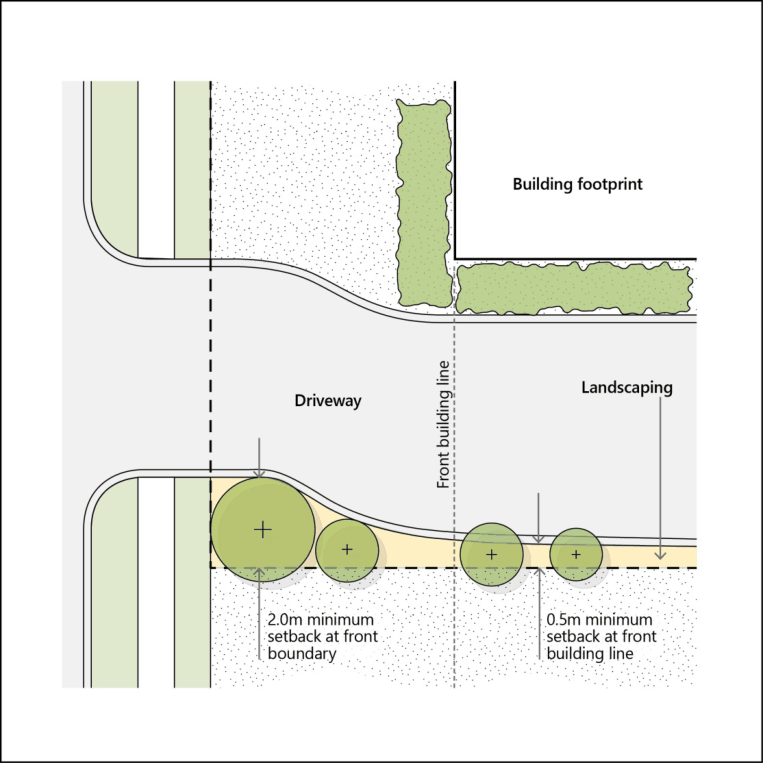

#### 2.2.8 PARKING AND ACCESS

#### 2.2.8.1 Car Parking

#### OBJECTIVES

To have car parking designed in sympathy with the development without becoming the dominant

feature on the streetscape. To provide adequate on-site parking that relates to the environmental and physical constraints of the

site To have car parking areas that minimise the potential for pedestrian and vehicle conflict To design connections to alternative transport modes such as walking, cycling and public transport To provide adequate on-site parking relative to the occupancy of the dwelling.

#### REQUIREMENTS

a Car parking within setbacks to classified roads shall not be permitted.

b Where parking is proposed within a side or rear building setback and is exposed to adjoining

properties, suitable landscaping shall be provided along the boundary to soften the visual impact of

the parking and to provide for stormwater infiltration.

c One of the required resident car parking spaces shall be provided in the form of an enclosed space for

each dwelling with minimum dimensions of 3 metres width by 5.5 metres length and a minimum

opening of 2.7 metres width.

d Consideration should be given to separate access driveways on corner allotments. e All car parking calculations are to be rounded up to the next whole number. f Resident car parking is to be provided in accordance with the parking rates identified in Chapter 2.13

Transport and Parking

g Visitor parking shall be provided for all multi dwelling housing and attached dwelling development at

the rate of 1 space per 5 units, with a minimum of 1 visitor space per development. In addition: i Visitor parking must be clearly identifiable, delineated by stencilling “VISITOR” on the space(s)

and is to remain available for use at all times.

ii One (1) visitor space where required is to be available for car washing and have appropriate tap

and drainage facilities provided for that purpose.

iii Visitor car parking is generally not encouraged within the front setback. Where this is

considered to be the only feasible alternative, the space(s) shall be setback a minimum of 3.0

metres from the frontage and only where suitably screened by landscaping.

h All geometric standards applicable to site access and car parking layout shall be in accordance with

Chapter 2.13 – Parking and Access and Australian Standard AS/NZS 2890.1. Applicants should obtain a

copy of the relevant vehicle turning circles from Australian Standard AS/NZS 2890.1 to ensure

compliance with the 85th percentile vehicle.

i For sites to be accessed from a classified road or where car parking is proposed along or at the end of

a common driveway, an adequate manoeuvring area must also be provided on-site so that the vehicles

of residents can enter and leave the site in a forward manner using no more than a 3 point turn.

Applications should include turning templates on the plans to demonstrate compliance.

Note: Council may require forward egress where local conditions such as average vehicle speed, sight lines and

traffic volume cause a safety concern j An adaptable parking space is to be provided for any adaptable unit.

#### 2.2.8.2 Access Design

#### OBJECTIVES

To position street vehicular crossings and driveways to minimise adverse visual impact To use existing rear lanes for vehicular access where appropriate To ensure safe entry and exit from the site

#### 2.2.8.2.1 General Requirements

a Driveways and vehicular access shall be designed in accordance with relevant Australian Standard and

provisions of Council’s Civil Works Specification

b Use of plain concrete for driveways and open car parking areas is not supported by Council. Details of

the proposed treatment shall be provided in the development application.

c Where appropriate, parking may be accessed from a laneway however no reliance can be given to a

laneway for the purposes primary pedestrian access, waste collection and mail collection.

#### 2.2.8.2.2 Ground Level Parking

a Fully enclosed garages must not visually dominate any building elevation. b Driveways must not be continuous straight lines and shall be offset by landscaped sections c A minimum pavement width of 3m is required d Driveways shall be offset from any side boundary by 2 metres at the front boundary and may taper

back to 500mm side setback within the front building line as illustrated in Figure 1. This offset area,

and side setback for the length of the remaining driveway must be landscaped with trees and shrubs

to soften the hardstand areas and provide for infiltration and provide visual appeal to the streetscape.

> [Picture on page 16: a picture, saved as a picture (images/ch-02-02-dual-occupancy-and-multi-dwelling-housing-page-16-16.gif, 150 dpi).]

#### Figure 4: Driveway Offset

e The subdivision of a dual occupancy development into a battle-axe arrangement, where permitted will

only be supported where a minimum access way width of 3.5 metres is available.

f Parking or access which is visible from any street or laneway elevation must not visually dominate the

street and must respect the architectural qualities of the building and integrate with the overall

presentation of the development.

#### 2.2.8.2.3 Basement Car parking

a Driveway access to basement car parking must be designed to minimise adverse visual impacts on the

streetscape and should be complimented by the landscape design for the site.

b Basements may extend up to 1m above ground level existing, provided that they are integrated with

architectural and landscape design of the development.

c Basement car parking must be setback from site boundaries so as not to interfere with the provision of

deep soil planting zones at ground level.

d Basement car parking must not create inappropriate streetscape impacts due to tall retaining walls, or

entrances that create the appearance of a third storey in areas where development is limited to only

two storeys.
