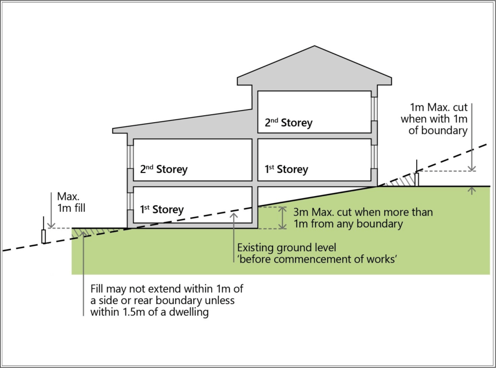

#### 2.2.9 EARTHWORKS AND STRUCTURAL SUPPORT

#### OBJECTIVES

To accommodate the proposed development on site, without the need for excessive cutting and filling

of the site or construction of high retaining walls To control surface water and / or stormwater on the subject land with any changes to water flows, as a

result of cut or fill, not impacting upon any adjoining properties To ensure that the design of the development is appropriate for site conditions with consideration

given to slope, stability of the land and the privacy of adjoining properties To ensure all boundary fencing is erected at natural ground level, permitting light and ventilation to

ensure reasonable amenity to adjacent developments

#### REQUIREMENTS

#### 2.2.9.1 Earthworks

a Excavation for the purposes of development must not exceed a maximum depth measured from

existing ground level of 1m if less than 1m from any boundary, or 3m if located more than 1m from

any boundary.

b Fill for the purpose of erecting a dwelling must not exceed 1m above existing ground level. No

retaining wall for fill is to be within 1m of a side or rear boundary unless within 1.5m of any external

wall of a dwelling.

c Where a property is burdened by stormwater or water and sewerage mains then Council will generally

preclude any excavation or filling within that easement

#### 2.2.9.2 Retaining walls and structural support

a Retaining walls that are more than 600mm above or below existing ground level and within 1m of any

boundary, or more than 1m above or below existing ground level in any other location, must be

designed by a professional engineer.

Note: The height of a retaining wall is measured from the base of the retaining wall to its uppermost

portion and may include a combination of height above and below ground level (existing).

b Earthworks not structurally supported by a retaining wall having an unprotected sloping embankment

or batter must: i not have an embankment slope greater than that required by the BCA for its soil type

ii generally not extend by more than 3m from the dwelling or have the toe of the embankment or

batter within 1m from a side or rear boundary.

> [Picture on page 18: a picture, saved as a picture (images/ch-02-02-dual-occupancy-and-multi-dwelling-housing-page-18-12.gif, 150 dpi).]

#### Figure 5 - Cut and Fill
