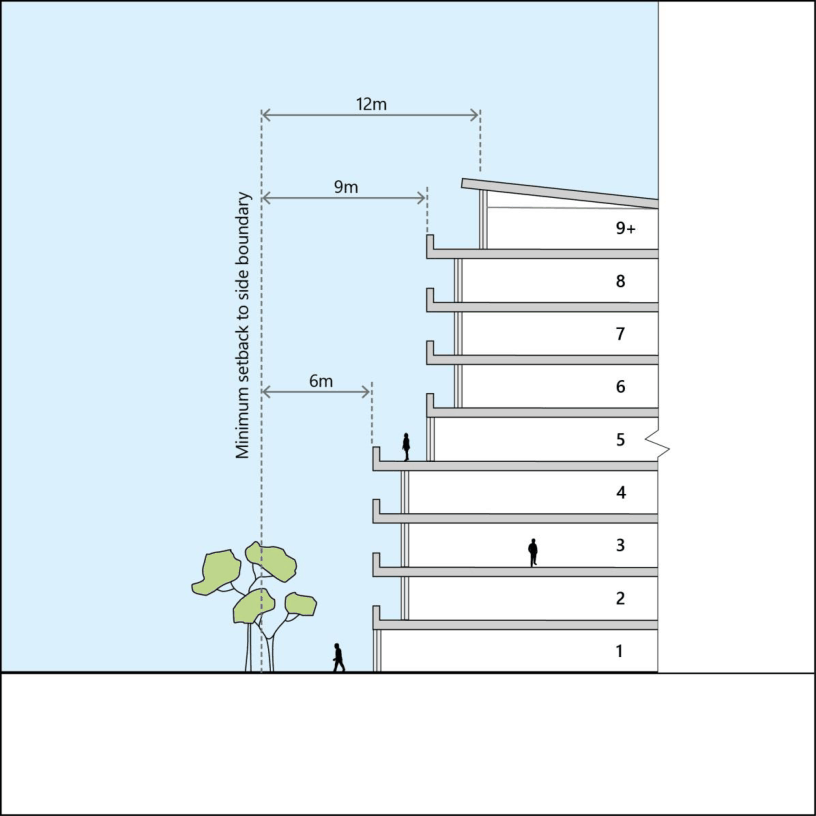

### 2.3.4 1 Setbacks for Residential Flat Buildings – 3 Storeys or more

| Aspect | Minimum Setback Required |
|---|---|
| a Front setbacks | 6 metres applies to all aspects of the development, with the exception of a portico, or an approved structure required for a waste collection area. |
| b Side & rear setbacks | i First to fourth Storey: 6.0 m ii Fifth to eighth Storey: 9.0 m iii Ninth storey & above: 12.0 m Note: No more than 4 consecutive storeys of the building shall be at the same setback. |
| c Corner Allotments | Same as side and rear setbacks, plus comply with the sight preservation lines. |
| d Foreshore | 20m or as mapped under Central Coast LEP 2022 Where a setback is not specified as outlined above, development is to be setback from the waterbody or |

#### Aspect

#### Minimum Setback Required

from land that is unzoned land or zoned public recreation or open space which adjoins the waterway as follows:

▪ 6m for the ground storey

▪ 10m for any storey above the ground storey

▪ 30m from the Hawkesbury River or any of its tributaries

Note: Where a property is affected by coastal hazards additional setbacks may apply.

#### Table 1 – setbacks for residential flat buildings- 3 or more storeys

> [Picture on page 4: a picture, saved as a picture (images/ch-02-03-residential-flat-buildings-page-4-13.gif, 150 dpi).]

#### Figure 1 Setbacks for residential flat buildings

Note: These setback requirements do not apply to any commercial portion of the proposal. The setback requirements for commercial development is specified in Chapter 2.5 Retail Centres and/or and relevant Location Specific Chapters under Parts 4 and 5 of this DCP.
