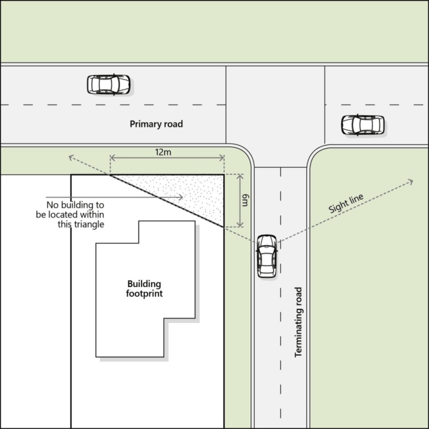

### 2.3.4 3 Setbacks – General Considerations

a Setbacks are to be considered with the Visual Privacy Design Criteria listed under Objective 3F-1 of the ADG. Where only non-habitable rooms front an external boundary Council may consider a reduction in the setback requirements in accordance with the ADG visual privacy provisions.

b Where a property is affected by coastal hazards additional setbacks may apply (refer to Chapter 3.2).

c Setback areas shall be suitably landscaped to enhance the appearance of the development and soften hardstand areas of the site

d Special setback and access location requirements may apply in relation to sites adjacent to roundabouts, relating to the roundabout geometry and the design speeds of the adjacent roads. Enquiries should be made with Council prior to preparing design plans for development on sites adjacent to roundabouts or other traffic calming devices.

e On corner allotments the side street is generally taken to be the boundary with the greater frontage.

f No building is to be erected within the triangle from the intersection of the two street boundary lines formed by a sight line 12m along the primary road frontage and 6m along the terminating road frontage, as illustrated in Figure 1.

Note: a corner lot must have an interior angle at the corner less than 135o; otherwise it’s a continuation of an irregular front boundary)

> [Picture on page 6: a picture, saved as a picture (images/ch-02-03-residential-flat-buildings-page-6-18.gif, 150 dpi).]

#### Figure 2 – Corner lot setbacks
