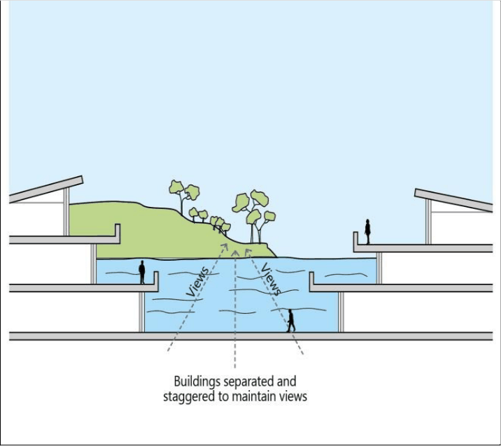
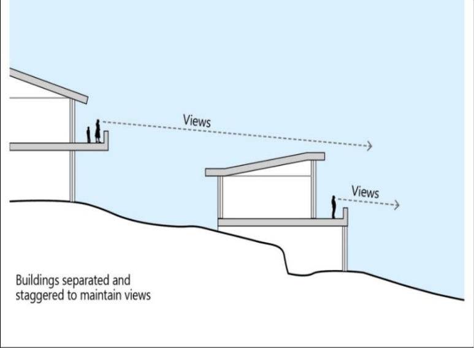
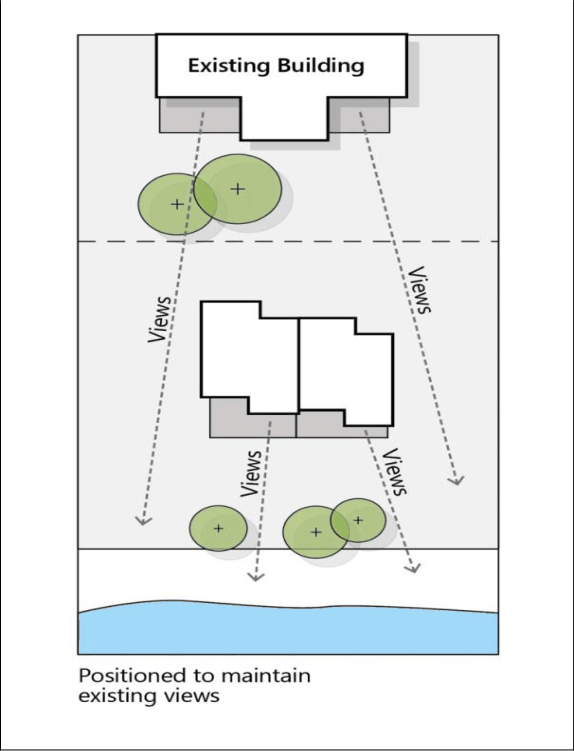

#### 2.3.6 RESIDENTIAL AMENITY

#### 2.3.6.1 Views

#### OBJECTIVES

▪ To facilitate view sharing whilst not restricting the reasonable development potential of a site

▪ To have opportunities for public vistas and public views from streets and public places protected and enhanced through building design, location and landscape design

▪ To protect views by permitting development which minimises obstruction of such views where enjoyed from internal and external living areas

#### REQUIREMENTS

a New development shall be designed to minimise loss of views from adjoining and adjacent properties identified in the site analysis process, while still providing opportunities for views from the proposed development.

b Design solutions must respond graphically to the site analysis outcomes through the issue of plans, elevations, photographs and photomontages to demonstrate how view sharing is to be achieved.

c A visual analysis illustrating the impacts of the proposed development upon views may be required for developments which have the potential to obstruct views. This analysis will be required to outline the impact of the development on the views of all affected properties.

d Measures to be used to maintain views include building setbacks, gaps between buildings, minimal floor to ceiling heights, raked ceilings to upper floors, gabled or hipped roofs, splay corners, and use of transparent materials for balustrades.

e Important public views and vistas beyond the site shall be protected and maintained where possible, through responsive building form and treatment including roof design and increased setbacks.

f Where there is a potential loss of view for nearby properties, applications are to address the NSW Land and Environment Court Planning Principles relating to view sharing.

> [Picture on page 8: a picture, saved as a picture (images/ch-02-03-residential-flat-buildings-page-8-21.gif, 150 dpi).]

#### Figure 3A - Examples of potential solutions to maintain views

> [Picture on page 9: a picture, saved as a picture (images/ch-02-03-residential-flat-buildings-page-9-1.gif, 150 dpi).]

#### Figure 3B - Examples of potential solutions to maintain views

> [Picture on page 9: a picture, saved as a picture (images/ch-02-03-residential-flat-buildings-page-9-3.gif, 150 dpi).]

#### Figure 3C - Examples of potential solutions to maintain views

#### 2.3.6.2 Visual Privacy

#### OBJECTIVES

▪ To provide and maintain reasonable levels of visual privacy both internally and externally, during day and night

▪ To maximise outlook and views from living rooms and private open space without compromising visual privacy

▪ To ensure a high level of amenity by protecting the privacy of residents both within the apartments and in private open space areas

#### REQUIREMENTS

a Direct overlooking of internal living areas and private open space to surrounding dwellings shall be minimised by building layout, location and design of windows and balconies and screening devices.

b Where living area windows or balconies of dwellings are proposed within close proximity of living area windows or balconies of adjacent dwellings, they shall be offset by a minimum of 1 metre from the edge of the opposite window and balconies be screened or oriented to ensure visual privacy.

Window openings at first floor level and above should be orientated or designed to minimise the potential for overlooking of adjacent properties and this consequent loss of privacy.

Windows which are orientated towards adjoining properties and do not adequately restrict overlooking will be required to be opaque finish or located at appropriate heights above floor level to minimise overlooking of adjoining properties.

c Building separation distances are identified within Table 3 below:

| Building Height | Between Habitable Rooms | Between Habitable Room and Non-Habitable Room | Between Non-Habitable Rooms |
|---|---|---|---|
| Up to 4 storeys | 12 metres | 9 metres | 6 metres |
| 5 to 8 storeys | 18 metres | 13 metres | 9 metres |
| 9 storeys + | 24 metres | 18 metres | 12 metres |

#### Table 3 Recommended building separation distances

d Where applying separation to buildings on adjoining sites, apply half the minimum separation distance measured to the boundary. At the boundary of a change in zone from apartment buildings to a lower density area, building setback from the boundary may need to be increased.

#### 2.3.6.3 Acoustic Privacy

#### OBJECTIVES

▪ To ensure a high level of amenity by protecting the privacy of residents both within the apartments and in private open space areas

▪ To minimise the impacts of noise on the amenity of occupants through sensitive design

▪ To design new developments so that reasonable levels of acoustic privacy are provided to dwellings in shop top housing.

#### REQUIREMENTS

a Site layout should separate active recreational areas, parking areas, vehicle accessways and service equipment areas from bedroom areas of dwellings.

b Development adjacent to potential external noise sources shall minimise the entry of that noise through building design and external wall treatment. Measures can include sensitive window and balcony placement and offsets, window screening, room orientation and thoughtful location.

c For mixed use development, site layout should separate active recreational areas, parking areas, vehicle access ways, and service equipment areas from bedroom areas of dwellings.

d Details regarding plant and equipment room locations, air conditioning arrangements and waste collection arrangements are to be provided and shall address potential noise impacts.

#### 2.3.6.4 Private Open Space and Balconies

#### OBJECTIVES

▪ To provide dwellings with individual private open space areas

▪ To ensure private open space areas are functional and responsive to the environment, thereby promoting the enjoyment of outdoor living for residents

▪ To ensure private open space areas (in particular balconies) integrate with the overall architectural form and detail of the development.

#### REQUIREMENTS

a All apartments are required to have primary balconies as follows:

| Dwelling Type | Minimum Area | Minimum Depth |
|---|---|---|
| i Studio | 4m2 |  |
| ii 1 bedroom | 8m2 | 2m |
| iii 2 bedroom | 10m2 | 2m |
| iv 3 or more bedroom | 12m2 | 2.4m |
| v Ground level or podium | 15m2 | 3m |

#### Table 4 Private open space

b Courtyards shall not exceed a maximum grade of 1:14 to optimise useability for residents.

c Wherever a dimension is less than the required minimum it shall not be counted as part of the calculation for private open space areas.

d Private open space areas are to be directly accessible from a living area within the dwelling.

#### 2.3.6.5 Sunlight Access

#### OBJECTIVES

▪ To provide adequate natural lighting and minimise the need for artificial lighting during daylight hours

▪ To ensure that a minimum standard of solar access is available to private open space areas and internal living areas during the winter solstice to provide for a reasonable standard of residential amenity

#### REQUIREMENTS

a Living rooms and private open spaces for at least 70% of apartments in a building receive a minimum of 3 hours direct sunlight between 9 am and 3 pm at mid-winter.

b New development shall have due regard for maintaining solar access to adjoining properties and not cause excessive overshadowing. At least 50% of required private open space areas on adjoining lands shall receive at least three hours unobstructed sunlight between the hours of 9 am and 3 pm on June 21 (winter solstice).

c Dwellings should be orientated to allow optimum solar access for internal living areas.

d A weather protected entrance shall be provided to each dwelling.

e Consideration should be given to the provision of natural light and ventilation for excavated car parking areas

#### 2.3.6.6 Communal (and public) Open Space

#### OBJECTIVES

▪ To provide residents with both active and passive recreational opportunities

▪ To allocate an area on site that enables soft landscaping as well as deep soil planting

▪ To ensure that communal open space is consolidated, configured and designed to be useable and attractive

#### REQUIREMENTS

a Communal open spaces is to be provided for developments with more than ten dwellings

b Communal open space shall be provided in no more than two locations at a minimum rate of 10 square metres per dwelling and with a minimum width of 5 metres.

c Minimum 25% of the site area at ground level shall be soft landscaping (planted areas).

d Communal open space areas shall be landscaped and include the provision of facilities such as barbecues, outdoor seating, tennis court, playground equipment or a swimming pool, as appropriate to the scale of the development. Details are to be included in the development application.

e The required communal open space area shall not be provided within the front building setback area. Front setback areas are to be generally reserved for landscaping works.

f Roof-top communal open space may be considered for residential flat developments only where proposed in addition to the required communal open space at ground level. The implications of rooftop open space areas on the overall design of the development, and on privacy and view sharing shall be addressed in the development application.

#### 2.3.6.7 Storage

#### OBJECTIVE

To ensure that adequate, well designed storage is provided in each apartment

#### REQUIREMENTS

Internal design of dwellings shall incorporate adequate storage space relative to the number of bedrooms within the dwelling, to cater for the needs of occupants. This may be provided in the form of an internal cupboard, or alternatively as a designated area within the garage (refer Table 5):

| Dwelling Type | Required Storage Space |
|---|---|
| i 1 – 2 bedrooms | 3m3 floor area |
| ii 3 or more bedrooms | 6m3 floor area |

#### Table 5 Storage areas

#### 2.3.6.8 Common Circulation and Spaces

Common circulation and spaces within a building are shared communally by residents. They include lobbies, internal corridors and external galleries, vertical circulation such as lifts and stairs, as well as community rooms and other spaces

#### OBJECTIVE

▪ Common circulation spaces achieve good amenity and properly service the number of apartments

#### REQUIREMENT

a The maximum number of dwellings off a circulation core on a single level should generally not be greater than eight.

#### 2.3.6.9 Apartment Size and Layout

#### OBJECTIVE

▪ The layout of rooms within an apartment is functional, well organised and provides a high standard of amenity

#### REQUIREMENTS

a Apartments are required to have the following minimum internal areas:

| Dwelling Type | Required internal area |
|---|---|
| i Studio | 35m2 |
| ii 1 bedroom | 50m2 |
| iii 2 bedroom | 70m2 |
| iv 3 bedroom or more | 90m2 and an additional 12 m2 for each additional bedroom (greater than 3) |

#### Table 6 Apartment Size

#### 2.3.6.10 Ceiling Heights

#### OBJECTIVES

▪ Ceiling height achieves sufficient natural ventilation and daylight access

#### REQUIREMENTS

a Apartments are required to have the following ceiling heights:

| Dwelling Type | Height |
|---|---|
| i Habitable rooms | 2.7m |
| ii Non-habitable 2.4m | 2.4m |
| iii 2 storey apartments | 2.7m for main living area floor and 2.4m for second floor, where its area does not exceed 50% of the apartment area |
| iv Attic spaces | 1.8m at edge of room with a 30 degree minimum ceiling slope |
| v Where located in mixed used areas | 3.3m for ground and first floor above to promote future flexibility of use |

#### Table 7 Ceiling Heights

#### 2.3.6.11 Natural Ventilation

#### OBJECTIVES

▪ The number of apartments with natural cross ventilation is maximised to create a comfortable indoor environment for residents

#### REQUIREMENTS

a At least 60% of apartments are naturally cross ventilated

b Overall depth of a cross-over or cross-through apartment is not to exceed 18m.

Note: Refer to the ADG for apartment style definitions
