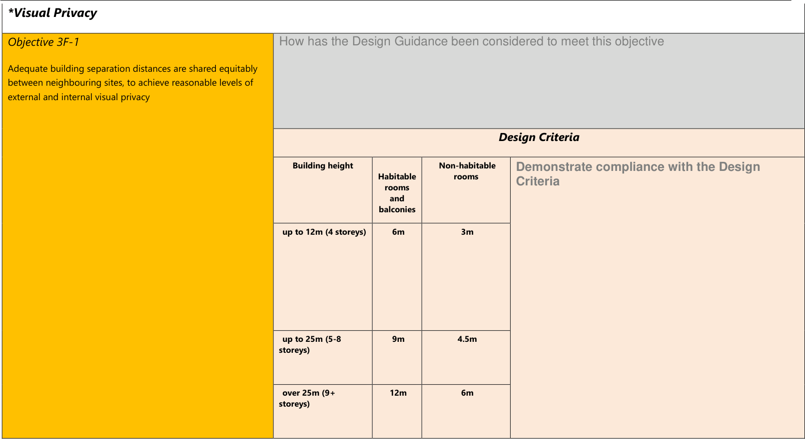

#### 2.3.12. SOCIAL DIMENSIONS

Good design responds to the social context and needs of the local community in terms of lifestyles, affordability, and access to social facilities.  New developments should optimise the provision of housing to suit the social mix and needs in the neighbourhood or, in the case of precincts undergoing transition, provide for the desired future community.

#### 2.3.12.1 Housing Choice

#### OBJECTIVES

▪ To provide a diversity of apartment types, which cater for different household requirements now and in the future

▪ To maintain equitable access to new housing by cultural and socio-economic groups

▪ To encourage housing designs which meet the broadest range of occupants’ needs

▪ To encourage adaptive re-use

#### REQUIREMENTS

a A variety of dwelling types is encouraged between one, two, three and four bedroom apartments; particularly in large residential flat developments and on the ground floor.

b 10% of units in residential flat developments shall be designed as suitable for adaptation for occupation by disabled / aged persons, as outlined in AS 4299: Adaptable Housing. A higher rate of adaptable housing of 15% is encouraged.

#### 2.3.12.2 Facilities and Amenities

#### OBJECTIVES

▪ To have adequate provision made for site facilities

▪ To have facilities that are functional and accessible to all residents and easy to maintain

▪ To have site facilities carefully and sensitively integrated into development so as not to be obtrusive, noisy or unsightly

a A meeting place for residents is encouraged in all developments to avoid social isolation. In smaller developments this could simply be a seat and small shelter within the common open space. Other examples could include within an enlarged entry area, or adjacent to the letterbox area, etc.

b Larger developments should include a reasonably sized common/meeting room.

c An individual laundry shall be provided within each dwelling which may be separate or included as part of another room.

d Drying areas shall be provided in common open space areas, in accordance with the requirements of the Building Code of Australia.

e Within each development, provision shall be made for a car washing facility. This may be:

i In the case of development with basement car parking, a covered visitor car parking space, which is bunded and connected with Council's sewerage system. This will necessitate locating a tap, bunding and drain in a position that will not interfere with traffic movement and requires a trade waste application.

ii In the case of development without basement car parking, a paved area having minimum dimensions of 5m x 2.7m, directly accessible from the driveway, upon which car washing should be encouraged by way of an appropriate sign.  The car washing area is to be located and designed to drain to a grassed or landscaped area located within a common area and sufficient in size to absorb wastewater from car washing. This may be provided in a visitor space.

### APPENDIX A – SUBMISSION INFORMATION

| Documentation | Required information – all applications | Additional Required Information SEPP 65 Applications |
|---|---|---|
| Statement of Environmental Effects | Addressing the requirements of the Environmental Planning and Assessment Regulation 2021 | • An explanation of the design in terms of the design quality principles set out in Schedule 1 of State Environmental Planning Policy No 65 - Design Quality of Residential Apartment Development – see Appendix B • Evidence from a qualified designer that the “objectives” listed under Part 3A to 3J and Part 4A to Part 4X of the ADG have been addressed. This can be achieved by following the guidance provided under Appendix C as follows: 1. Demonstrating compliance with the development provisions listed under Design criteria and the direction provided under Design guidance for the relevant Objectives. 2. In instances where any variation is sought for any of the Design criteria it must be justified that the intent of the relevant Objective(s) has been met. by responding to each relevant component of Design guidance 3. In instances where there is no Design criteria provided, for an Objective(s) responding to each element of Design guidance demonstrating how the proposal meets the relevant Objective(s). Note: Some provisions under Appendix C differ from those in the ADG where it is considered specifically appropriate for the Central Coast Local Government Area or where it is considered additional guidance is required. 4. Evidence from a qualified designer that he or she designed or directed the design of the proposed development |

| Documentation | Required information – all applications | Additional Required Information SEPP 65 Applications |
|---|---|---|
| Site and context analysis | The following is an indicative checklist of issues to be addressed by the Site Analysis Plan: • orientation: north point and aspect, consider the movement of the sun, particularly at winter solstice; • topography: slope of the land at 0.2m intervals where cut and fill or benching of the site is proposed, (otherwise 1.0m intervals) and direction of fall; • streetscape: setback patterns, position and form of existing houses and developments on adjacent and opposite lands; overall height and shadows from adjacent buildings; • context: location of the site in relation to transport, nearby schools, community facilities or shops. (Special consideration for prominent sites including elevated or rural land, corner sites, heritage and cultural issues); • vegetation: existing trees and vegetation on the land, on adjoining land and in the street / locality and their true canopy spread within or onto the site; • privacy: any windows or private areas of neighbouring developments facing the land; • noise and light: location and extent of nearby sources of noise or light impacts (e.g. major roads, intersections, sports fields or commercial areas); • views: consideration of view corridors to and from the site and neighbours’ views; • prevailing winds: these can vary for a particular site, e.g. coastal areas. Orientation to take advantage of prevailing breezes for natural ventilation can add greatly to comfort levels within the dwelling; • services: location of utility services (including stormwater drainage lines, electricity poles and kerb crossings); • vehicle access: best position for a driveway; • survey constraints: surveyed location of any easements, rights of way or other relevant restrictions; • security: any natural surveillance opportunities to and from the site; • existing structures: including details of existing fences, retaining walls and buildings on site. A contextual analysis shall be submitted with applications, addressing the following: • the social context; • the economic context; • the environmental context; • the urban design context, including consideration of existing | As per Appendix 1 of the ADG |
| Site plan | A scale built form drawing and showing: predominant streetscape pattern. • any proposed site amalgamation or subdivision • location of any proposed buildings or works in relation to setbacks, building envelope controls and building separation dimensions • proposed finished levels of land in relation to existing and proposed buildings and roads • pedestrian and vehicular site entries and access • interface of the ground floor plan with the public domain and |  |

| Documentation | Required information – all applications with open spaces within the site • areas of communal open space and private open space • indicative locations of planting and deep soil zones including retained or proposed significant trees | Additional Required Information SEPP 65 Applications |
|---|---|---|
| Landscape plan | A scale drawing showing: • the building footprint of the proposal including pedestrian, vehicle and service access • trees to be removed shown dotted • trees to remain with their tree protection zones (relative to the proposed development) • deep soil zones and associated tree planting • areas of planting on structure and soil depth • proposed planting including species and size • details of public space, communal open space and private open space • external ramps, stairs and retaining wall levels • security features and access points • built landscape elements (fences, pergolas, walls, planters and water features) • ground surface treatment with indicative materials and finishes • site lighting • water management and irrigation concept design |  |
| Floor plans | A scale drawing showing: • all levels of the building including roof plan • layout of entries, circulation areas, lifts and stairs, communal spaces, and service rooms with key dimensions and RLs shown • apartment plans with apartment numbers and areas, all fenestration, typical furniture layouts for each apartment type, room dimensions and intended use and private open space dimensions • accessibility clearance templates for accessible units and common spaces • visual privacy separation shown and dimensions where necessary • vehicle and service access, circulation and parking • storage areas |  |
| Elevations | A scale drawing showing: • proposed building height and RL lines • building height control • setbacks or envelope outline • building length and articulation • the detail and features of the facade and roof design • any existing buildings on the site • building entries (pedestrian, vehicular and service) • profile of buildings on adjacent properties or for 50m in each direction, whichever is most appropriate |  |

| Documentation | Required information – all applications | Additional Required Information SEPP 65 Applications |
|---|---|---|
| Sections | A scale drawing showing: • proposed building height and RL lines • building height control • setbacks or envelope outline • adjacent buildings • building circulation • the relationship of the proposal to the ground plane, the street and open spaces particularly at thresholds • the location and treatment of car parking • the location of deep soil and soil depth allowance for planting on structure (where applicable) • building separation within the development and between neighbouring buildings • ceiling heights throughout the development • detailed sections of the proposed facades |  |
| Solar access study | Graphic documentation at winter solstice (21 June) at a minimum of hourly intervals showing: • number of hours of solar access to the principal communal open space • number of hours of solar access to units within the proposal and tabulation of results • overshadowing of existing adjacent properties and overshadowing of future potential development where neighbouring sites are planned for higher density • elevation shadows if shadow is likely to fall on neighbouring windows, openings or solar panels |  |
| Cross ventilation study | Where required, graphic documentation of unobstructed path of air movement through dual aspect apartments and tabulation of results |  |
| Material and finishes board | A sample board of the proposed external materials, finishes and colours of the proposal, keyed to elevations |  |
| Illustrative views | Photomontages or similar rendering or perspective drawings illustrating the proposal in the context of surrounding development. |  |
| Models |  | A three dimensional computer generated model showing views of the development from adjacent streets and buildings A physical model that shows the massing of the proposal that includes relevant context (particularly for developments of 20 apartments or more, or on contentious sites) if required by the consent authority |

### APPENDIX B – SEPP 65 DESIGN PRINCIPLES

#### Principle 1: Context and Neighbourhood Character

#### How has this design principle been considered?

Good design responds and contributes to its context. Context is the key natural and built features of an area, their relationship and the character they create when combined. It also includes social, economic, health and environmental conditions.

Responding to context involves identifying the desirable elements of an area’s existing or future character. Well-designed buildings respond to and enhance the qualities and identity of the area including the adjacent sites, streetscape and neighbourhood. Consideration of local context is important for all sites, including sites in established areas, those undergoing change or identified for change

#### Principle 2: Built Form and Scale

Good design achieves a scale, bulk and height appropriate to the existing or desired future character of the street and surrounding buildings.

#### How has this design principle been considered?

Good design also achieves an appropriate built form for a site and the building’s purpose in terms of building alignments, proportions, building type, articulation and the manipulation of building elements. Appropriate built form defines the public domain, contributes to the character of streetscapes and parks, including their views and vistas, and provides internal amenity and outlook.

#### Principle 3: Density

Good design achieves a high level of amenity for residents and each apartment, resulting in a density appropriate to the site and its context.

#### How has this design principle been considered?

Appropriate densities are consistent with the area’s existing or projected population. Appropriate densities can be sustained by existing or proposed infrastructure, public transport, access to jobs, community facilities and the environment.

#### Principle 4: Sustainability

#### How has this design principle been considered?

Good design combines positive environmental, social and economic outcomes. Good sustainable design includes use of natural cross ventilation and sunlight for the amenity and liveability of residents and passive thermal design for ventilation, heating and cooling reducing reliance on technology and operation costs. Other elements include recycling and reuse of materials and waste, use of sustainable materials, and deep soil zones for groundwater recharge and vegetation.

#### Principle 5: Landscape

#### How has this design principle been considered?

Good design recognises that together landscape and buildings operate as an integrated and sustainable system, resulting in attractive developments with good amenity. A positive image and contextual fit of well-designed developments is achieved by contributing to the landscape character of the streetscape and neighbourhood.

Good landscape design enhances the development’s environmental performance by retaining positive natural features which contribute to the local context, co-ordinating water and soil management, solar access, micro-climate, tree canopy, habitat values, and preserving green networks. Good landscape design optimises usability, privacy and opportunities for social interaction, equitable access, respect for neighbours’ amenity, provides for practical establishment and long term management.

#### Principle 6: Amenity

Good design positively influences internal and external amenity for residents and neighbours. Achieving good amenity contributes to positive living environments and resident well being.

#### How has this design principle been considered?

Good amenity combines appropriate room dimensions and shapes, access to sunlight, natural ventilation, outlook, visual and acoustic privacy, storage, indoor and outdoor space, efficient layouts and service areas, and ease of access for all age groups and degrees of mobility.

#### Principle 7: Safety

#### How has this design principle been considered?

Good design optimises safety and security, within the development and the public domain. It provides for quality public and private spaces that are clearly defined and fit for the intended purpose. Opportunities to maximise passive surveillance of public and communal areas promote safety.

A positive relationship between public and private spaces is achieved through clearly defined secure access points and well-lit and visible areas that are easily maintained and appropriate to the location and purpose.

#### Principle 8: Housing Diversity and Social Interaction

Good design achieves a mix of apartment sizes, providing housing choice for different demographics, living needs and household budgets.

#### How has this design principle been considered?

Well-designed apartment developments respond to social context by providing housing and facilities to suit the existing and future social mix. Good design involves practical and flexible features, including different types of communal spaces for a broad range of people, providing opportunities for social interaction amongst residents.

#### Principle 9: Aesthetics

Good design achieves a built form that has good proportions and a balanced composition of elements, reflecting the internal layout and structure. Good design uses a variety of materials, colours and textures.

#### How has this design principle been considered?

The visual appearance of well-designed apartment development responds to the existing or future local context, particularly desirable elements and repetitions of the streetscape.

### APPENDIX C – CONSIDERATIONS

| Site Analysis |  |
|---|---|
| Objective 3A-1 Site analysis illustrates that design decisions have been based on opportunities and constraints of the site conditions and their relationship to the surrounding context | How has the Design Guidance been considered to meet this objective? |
| Orientation |  |
| Objective 3B-1 Building types and layouts respond to the streetscape and site while optimising solar access within the development | How has the Design Guidance been considered to meet this objective? |
| Objective 3B-2 Overshadowing of neighbouring properties is minimised during mid-winter | How has the Design Guidance been considered to meet this objective? |
| Public domain interface |  |
| Objective 3C-1 Transition between private and public domain is achieved without compromising safety and security | How has the Design Guidance been considered to meet this objective? |
| Objective 3C-2 Amenity of the public domain is retained and enhanced | How has the Design Guidance been considered to meet this objective? |

| Communal and public open space |  |  |
|---|---|---|
| Objective 3D-1 An adequate area of communal open space is provided to enhance residential amenity and to provide opportunities for landscaping | How has the Design Guidance been considered to meet this objective? Design Criteria |  |
|  | Communal open space has a minimum area equal to 25% of the site (see figure 3D.3) | Demonstrate compliance with the Design Criteria |
|  | Developments achieve a minimum of 50% direct sunlight to the principal usable part of the communal open space for a minimum of 2 hours between 9 am and 3 pm on 21 June (mid-winter) | Demonstrate compliance with the Design Criteria |
| Objective 3D-2 Communal open space is designed to allow for a range of activities, respond to site conditions and be attractive and inviting | How has the Design Guidance been considered to meet this objective? |  |
| Objective 3D-3 Communal open space is designed to maximise safety | How has the Design Guidance been considered to meet this objective? |  |

#### How has the Design Guidance been considered to meet this objective?

Objective 3D-4 Public open space, where provided, is responsive to the existing pattern and uses of the neighbourhood

#### Deep soil zones –

Note: Council requirements differ from the ADG for this control

#### How has the Design Guidance been considered to meet this objective?

Objective 3E-1 Deep soil zones provide areas on the site that allow for and support healthy plant and tree growth. They improve residential amenity and promote management of water and air

quality

#### Design Criteria

#### Deep soil zone (50% of required

#### Site area Minimum

dimensions

soft landscape

area)

less than 650m2

#### Demonstrate compliance with the Design

#### Criteria

#### 650m2 - 1,500m2 3m

greater than 6m

#### 1,500m2

#### 6m

greater than 1,500m2 with significant existing

tree cover

> [Picture on page 33: a map, saved as a picture (images/ch-02-03-residential-flat-buildings-page-33-1.gif, 150 dpi); the street names and other small labels are on the picture.]
> Words printed on the picture (title and legend, copied from the PDF):
> Adequate building separation distances are shared equitably
> between neighbouring sites, to achieve reasonable levels of
> external and internal visual privacy
> up to 12m (4 storeys) 6m
> up to 25m (5-8
> over 25m (9+

#### *Visual Privacy

#### How has the Design Guidance been considered to meet this objective

#### Design Criteria

#### Demonstrate compliance with the Design

#### Criteria

| Objective 3F-2 | How has the Design Guidance been considered to meet this objective? |
|---|---|
| Site and building design elements increase privacy without |  |
| compromising access to light and air and balance outlook and |  |
| views from habitable rooms and private open space |  |
| Pedestrian access and entries |  |
| Objective 3G-1 | How has the Design Guidance been considered to meet this objective? |
| Building entries and pedestrian access connects to and |  |
| addresses the public domain |  |
| Objective 3G-2 | How has the Design Guidance been considered to meet this objective? |
| Access, entries and pathways are accessible and easy to |  |
| identify |  |
| Objective 3G-3 | How has the Design Guidance been considered to meet this objective? |
| Large sites provide pedestrian links for access to streets and |  |
| connection to destinations |  |

#### Vehicle Access

| Objective 3H-1 | How has the Design Guidance been considered to meet this objective? |
|---|---|
| Vehicle access points are designed and located to achieve |  |
| safety, minimise conflicts between pedestrians and vehicles |  |
| and create high quality streetscapes |  |
| Bicycle and Car Parking (also refer to Chapter2.13 Parking and Access) |  |
| *Objective 3J-1 | How has the Design Guidance been considered to meet this objective? |
| Car parking is provided based on proximity to public transport |  |
| in metropolitan Sydney and centres in regional areas |  |
|  | Design criteria |

|  | Car parking is to be provided in accordance with the following: i 1.5 spaces per dwelling ii 1 space per dwelling if the site is located within 400m walking distance of a train station iii Visitor spaces, calculated on the basis of 0.2 spaces per dwelling, rounded up to the next whole number Properties within 400 metres of train stations at nominated Regional Centres (Metropolitan Sub-Regional Centres - Gosford, Tuggerah and Wyong) adopt the parking rates identified under the RMS Guide to Traffic Generating Development (in accordance with the SEPP 65 Apartment Design Guide). | Demonstrate compliance with the Design Criteria |
|---|---|---|
| Objective 3J-2 Parking and facilities are provided for other modes of transport | How has the Design Guidance been considered to meet this objective? |  |
| Objective 3J-3 Car park design and access is safe and secure | How has the Design Guidance been considered to meet this objective? |  |
| Objective 3J-4 Visual and environmental impacts of underground car parking are minimised | How has the Design Guidance been considered to meet this objective? |  |
| Objective 3J-5 Visual and environmental impacts of on-grade car parking are minimised | How has the Design Guidance been considered to meet this objective? |  |
| Objective 3J-6 Visual and environmental impacts of above ground enclosed car parking are minimised | How has the Design Guidance been considered to meet this objective? |  |
| *Solar and Daylight Access |  |  |

| Objective 4A-1 To optimise the number of apartments receiving sunlight to habitable rooms, primary windows and private open space | How has the Design Guidance been considered to meet this objective? Design criteria |  |
|---|---|---|
|  | Living rooms and private open spaces of at least 70% of apartments in a building receive a minimum of 3 hours direct sunlight between 9 am and 3 pm at mid- winter A maximum of 15% of apartments in a building receive no direct sunlight between 9 am and 3 pm at mid-winter | Demonstrate compliance with the Design Criteria |
| Objective 4A-2 Daylight access is maximised where sunlight is limited | How has the Design Guidance been considered to meet this objective? |  |
| Objective 4A-3 Design incorporates shading and glare control, particularly for warmer months | How has the Design Guidance been considered to meet this objective? |  |
| *Natural Ventilation |  |  |
| Objective 4B-1 All habitable rooms are naturally ventilated | How has the Design Guidance been considered to meet this objective? |  |

| Objective 4B-2 The layout and design of single aspect apartments maximises natural ventilation | How has the Design Guidance been considered to meet this objective? |  |  |
|---|---|---|---|
| Objective 4B-3 The number of apartments with natural cross ventilation is maximised to create a comfortable indoor environment for residents | How has the Design Guidance been considered to meet this objective? Design criteria |  |  |
|  | At least 60% of apartments are naturally cross ventilated in the first nine storeys of the building. Apartments at ten storeys or greater are deemed to be cross ventilated only if any enclosure of the balconies at these levels allows adequate natural ventilation and cannot be fully enclosed |  | Demonstrate compliance with the Design Criteria |
|  | Overall depth of a cross-over or cross-through apartment does not exceed 18m, measured glass line to glass line |  | Demonstrate compliance with the Design Criteria |
| *Ceiling Heights |  |  |  |
| Objective 4C-1 Ceiling height achieves sufficient natural ventilation and daylight access | How has the Design Guidance been considered to meet this objective? Design criteria |  |  |
|  | Habitable rooms | 2.7m | Demonstrate compliance with the Design Criteria |
|  | Non-habitable | 2.4m | Demonstrate compliance with the Design Criteria |
|  | For 2 storey apartments | 2.7m for main living area floor 2.4m for second floor, where its area does not exceed 50% of the apartment area | Demonstrate compliance with the Design Criteria |
|  | Attic spaces | 1.8m at edge of room with a 30 degree minimum ceiling slope | Demonstrate compliance with the Design Criteria |

|  | If located in mixed used areas | 3.3m for ground and first floor to promote future flexibility of use | Demonstrate compliance with the Design Criteria |
|---|---|---|---|
| Objective 4C-2 Ceiling height increases the sense of space in apartments and provides for well-proportioned rooms | How has the Design Guidance been considered to meet this objective? |  |  |
| Objective 4C-3 Ceiling heights contribute to the flexibility of building use over the life of the building | How has the Design Guidance been considered to meet this objective? |  |  |
| *Apartment Size and Layout |  |  |  |
| Objective 4D-1 The layout of rooms within an apartment is functional, well organised and provides a high standard of amenity | How has the Design Guidance been considered to meet this objective? Design criteria |  |  |
|  | Apartment type | Minimum internal area |  |
|  | Studio | 35m2 | Demonstrate compliance with the Design Criteria |
|  | 1 bedroom | 50m2 | Demonstrate compliance with the Design Criteria |
|  | 2 bedroom | 70m2 | Demonstrate compliance with the Design Criteria |
|  | 3 bedroom | 90m2 | Demonstrate compliance with the Design Criteria |
|  | Every habitable room must have a window in an external wall with a total minimum glass area of not less than 10% of the floor area of the room. Daylight and air may not be borrowed from other rooms |  | Demonstrate compliance with the Design Criteria |
|  | How has the Design Guidance been considered to meet this objective? |  |  |

| Objective 4D-2 Environmental performance of the apartment is maximised |  |  |
|---|---|---|
|  | Design criteria |  |
|  | Habitable room depths are limited to a maximum of 2.5 x the ceiling height | Demonstrate compliance with the Design Criteria |
|  | In open plan layouts (where the living, dining and kitchen are combined) the maximum habitable room depth is 8m from a window | Demonstrate compliance with the Design Criteria |
| Objective 4D-3 Apartment layouts are designed to accommodate a variety of household activities and needs | How has the Design Guidance been considered to meet this objective? Design criteria |  |
|  | Master bedrooms have a minimum area of 10m2 and other bedrooms 9m2 (excluding wardrobe space) | Demonstrate compliance with the Design Criteria |
|  | Bedrooms have a minimum dimension of 3m (excluding wardrobe space) | Demonstrate compliance with the Design Criteria |
|  | Living rooms or combined living/dining rooms have a minimum width of: 3.6m for studio and 1 bedroom apartments 4m for 2 and 3 bedroom apartments | Demonstrate compliance with the Design Criteria |
|  | The width of cross-over or cross-through apartments are at least 4m internally | Demonstrate compliance with the Design Criteria |
| *Private Open Space and Balconies |  |  |

| Objective 4E-1 Apartments provide appropriately sized private open space and balconies to enhance residential amenity | How has the Design Guidance been considered to meet this objective? Design criteria |  |  |  |
|---|---|---|---|---|
|  | Dwelling type | Minimum area | Minimum depth | Demonstrate compliance with the Design Criteria |
|  | Studio apartments | 4m2 | - | Demonstrate compliance with the Design Criteria |
|  | 1 bedroom apartments | 8m2 | 2m | Demonstrate compliance with the Design Criteria |
|  | 2 bedroom apartments | 10m2 | 2m | Demonstrate compliance with the Design Criteria |
|  | 3+ bedroom apartments | 12m2 | 2.4m | Demonstrate compliance with the Design Criteria |
| Objective 4E-2 Primary private open space and balconies are appropriately located to enhance liveability for residents | How has the Design Guidance been considered to meet this objective? |  |  |  |
| Objective 4E-3 Private open space and balcony design is integrated into and contributes to the overall architectural form and detail of the building | How has the Design Guidance been considered to meet this objective? |  |  |  |
| Objective 4E-4 Private open space and balcony design maximises safety | How has the Design Guidance been considered to meet this objective? |  |  |  |

| *Common circulation and spaces |  |  |
|---|---|---|
| Objective 4F-1 | How has the Design Guidance been considered to meet this objective? |  |
| Common circulation spaces achieve good amenity and |  |  |
| properly service the number of apartments |  |  |
|  | Design criteria |  |
|  | The maximum number of apartments off a circulation | Demonstrate compliance with the Design |
|  | core on a single level is eight | Criteria |
|  | For buildings of 10 storeys and over, the maximum | Demonstrate compliance with the Design |
|  | number of apartments sharing a single lift is 40 | Criteria |
| Objective 4F-2 | How has the Design Guidance been considered to meet this objective? |  |
| Common circulation spaces promote safety and provide for |  |  |
| social interaction between residents |  |  |

| *Storage |  |  |  |
|---|---|---|---|
| *Objective 4G-1 | How has the Design Guidance been considered to meet this objective? |  |  |
| Adequate, well designed storage is provided in each |  |  |  |
| apartment |  | Design criteria |  |
|  | Dwelling type | Storage size volume |  |
|  | Studio apartments | 4m3 | Demonstrate compliance with the |
|  |  |  | Design Criteria |
|  | 1 bedroom apartments | 6m3 | Demonstrate compliance with the |
|  |  |  | Design Criteria |
|  | 2 bedroom apartments | 8m3 | Demonstrate compliance with the |
|  |  |  | Design Criteria |
|  | 3+ bedroom apartments | 10m3 | Demonstrate compliance with the |
|  |  |  | Design Criteria |
| Acoustic Privacy |  |  |  |

| Objective 4H-1 Noise transfer is minimised through the siting of buildings and building layout | How has the Design Guidance been considered to meet this objective? |
|---|---|
| Objective 4H-2 Noise impacts are mitigated within apartments through layout and acoustic treatments | How has the Design Guidance been considered to meet this objective? |
| Noise and Pollution |  |
| Objective 4J-1 In noisy or hostile environments the impacts of external noise and pollution are minimised through the careful siting and layout of buildings | How has the Design Guidance been considered to meet this objective? |
| Objective 4J-2 Appropriate noise shielding or attenuation techniques for the building design, construction and choice of materials are used to mitigate noise transmission | How has the Design Guidance been considered to meet this objective? |

| Apartment Mix |  |
|---|---|
| Objective 4K-1 A range of apartment types and sizes is provided to cater for different household types now and into the future | How has the Design Guidance been considered to meet this objective? |
| Objective 4K-2 The apartment mix is distributed to suitable locations within the building | How has the Design Guidance been considered to meet this objective? |
| Ground floor apartments |  |
| Objective 4L-1 Street frontage activity is maximised where ground floor apartments are located | How has the Design Guidance been considered to meet this objective? |
| Objective 4L-2 Design of ground floor apartments delivers amenity and safety for residents | How has the Design Guidance been considered to meet this objective? |
| Facades |  |
| Objective 4M-1 Building facades provide visual interest along the street while respecting the character of the local area | How has the Design Guidance been considered to meet this objective? |
| Objective 4M-2 Building functions are expressed by the facade | How has the Design Guidance been considered to meet this objective? |

#### Roof design

| Objective 4N-1 | How has the Design Guidance been considered to meet this objective? |
|---|---|
| Roof treatments are integrated into the building design and |  |
| positively respond to the street |  |
| Objective 4N-2 | How has the Design Guidance been considered to meet this objective? |
| Opportunities to use roof space for residential accommodation |  |
| and open space are maximised |  |
| Objective 4N-3 | How has the Design Guidance been considered to meet this objective? |
| Roof design incorporates sustainability features |  |
| Landscape Design |  |
| Objective 4O-1 | How has the Design Guidance been considered to meet this objective? |
| Landscape design is viable and sustainable |  |
| Objective 4O-2 | How has the Design Guidance been considered to meet this objective? |
| Landscape design contributes to the streetscape and amenity |  |

#### Planting on structures

| Objective 4P-1 | How has the Design Guidance been considered to meet this objective? |
|---|---|
| Appropriate soil profiles are provided |  |
| Objective 4P-2 | How has the Design Guidance been considered to meet this objective? |
| Plant growth is optimised with appropriate selection and |  |
| maintenance |  |

| Objective 4P-3 Planting on structures contributes to the quality and amenity of communal and public open spaces | How has the Design Guidance been considered to meet this objective? |
|---|---|
| Universal Design |  |
| Objective 4Q-1 Universal design features are included in apartment design to promote flexible housing for all community members | How has the Design Guidance been considered to meet this objective? |
| Objective 4Q-2 A variety of apartments with adaptable designs are provided | How has the Design Guidance been considered to meet this objective? |
| Objective 4Q-3 Apartment layouts are flexible and accommodate a range of lifestyle needs | How has the Design Guidance been considered to meet this objective? |
| Adaptive re-use (where applicable) |  |
| Objective 4R-1 New additions to existing buildings are contemporary and complementary and enhance an area's identity and sense of place | How has the Design Guidance been considered to meet this objective? |
| Objective 4R-2 Adapted buildings provide residential amenity while not precluding future adaptive reuse | How has the Design Guidance been considered to meet this objective? |

| Mixed-use (where applicable and refer to Chapter 5.5) |  |
|---|---|
| Objective 4S-1 Mixed use developments are provided in appropriate locations and provide active street frontages that encourage pedestrian movement | How has the Design Guidance been considered to meet this objective? |
| Objective 4S-2 Residential levels of the building are integrated within the development, and safety and amenity is maximised for residents | How has the Design Guidance been considered to meet this objective? |
| Awnings and Signage (also refer to Chapter 5.5 and Chapter 2.12) |  |
| Objective 4T-1 Awnings are well located and complement and integrate with the building design | How has the Design Guidance been considered to meet this objective? |
| Objective 4T-2 Signage responds to the context and desired streetscape character | How has the Design Guidance been considered to meet this objective? |
| Energy Efficiency |  |
| Objective 4U-1 Development incorporates passive environmental design | How has the Design Guidance been considered to meet this objective? |
| Objective 4U-2 Development incorporates passive solar design to optimise heat storage in winter and reduce heat transfer in summer | How has the Design Guidance been considered to meet this objective? |
| Objective 4U-3 Adequate natural ventilation minimises the need for mechanical ventilation | How has the Design Guidance been considered to meet this objective? |

Water management and conservation (read in conjunction with Council’s Civil Works Specification)

| Objective 4V-1 | How has the Design Guidance been considered to meet this objective? |
|---|---|
| Potable water use is minimised |  |
| Objective 4V-2 | How has the Design Guidance been considered to meet this objective? |
| Urban stormwater is treated on site before being discharged |  |
| to receiving waters |  |
| Objective 4V-3 | How has the Design Guidance been considered to meet this objective? |
| Flood management systems are integrated into site design |  |

Waste Management (read in conjunction with –the Waste Management Chapter and Guidelines)

| Objective 4W-1 | How has the Design Guidance been considered to meet this objective? |
|---|---|
| Waste storage facilities are designed to minimise impacts on |  |
| the streetscape, building entry and amenity of residents |  |
| Objective 4W-2 | How has the Design Guidance been considered to meet this objective? |
| Domestic waste is minimised by providing safe and convenient |  |
| source separation and recycling |  |

#### Building Maintenance

| Objective 4X-1 | How has the Design Guidance been considered to meet this objective? |
|---|---|
| Building design detail provides protection from weathering |  |
| Objective 4X-2 | How has the Design Guidance been considered to meet this objective? |
| Systems and access enable ease of maintenance |  |

| Objective 4X-3 | How has the Design Guidance been considered to meet this objective? |
|---|---|
| Material selection reduces ongoing maintenance costs |  |
