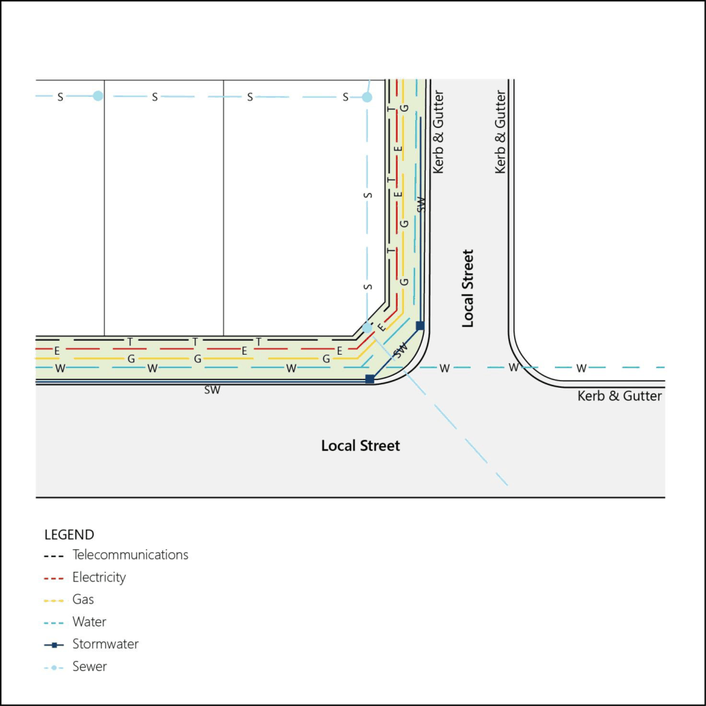
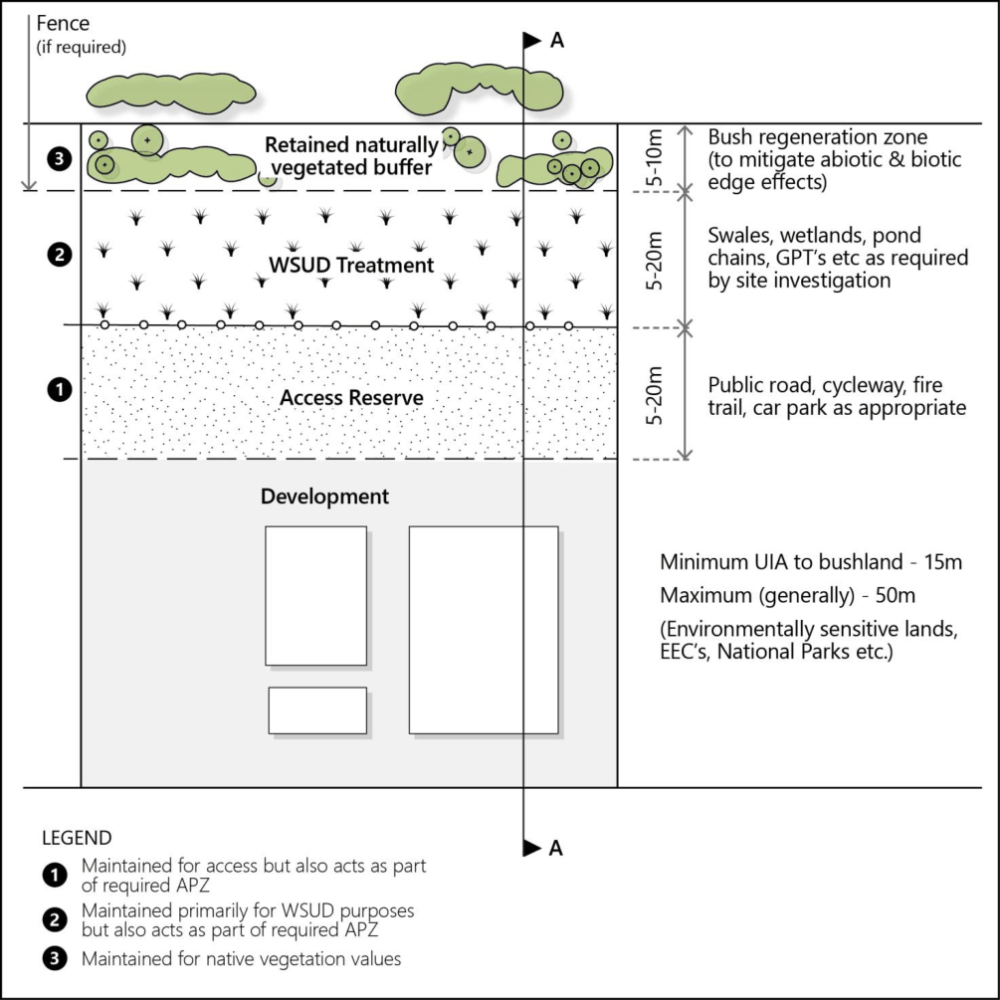
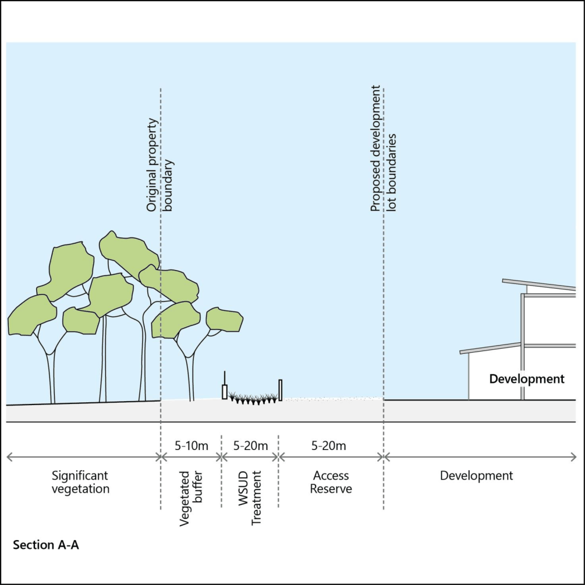

#### 2.4.2 GENERAL DESIGN PRINCIPLES

#### 2.4.2.1 Stormwater Management and Flooding

#### OBJECTIVES

▪ To ensure that land can be adequately drained of storm water so as not to impact on adjacent sites and that the development does not contribute to drainage or flooding problems.

▪ To provide direction with regard to Council’s requirements for the management with regard to both the quality and quantity of stormwater runoff.

▪ To provide a stormwater system that can be economically maintained and managed.

#### REQUIREMENTS

a All development must comply with the requirements of Council’s Civil Works Specification.

b Development works are not to obstruct or divert overland flows from upstream properties.

c Adequate provision for gravitating storm water drainage is to be demonstrated for each of the proposed lots. Subdivisions may require inter-allotment drainage provision, with appropriate easements to be created.

d Subdivision proposal will generally be required to provide storm water detention to limit post development flow to predevelopment flow conditions.

e Where easements to drain storm water over downstream properties are required for the storm water drainage system, evidence of agreement with the relevant property owners must be submitted with the development application.

f A storm water drainage management concept plan and report accompanied by water quality modelling and runoff routing modelling will be required to accompany a development application for subdivision. The plan, report and modelling shall demonstrate that the requirements of Council’s Civil Works Specification will be achieved by the subdivision Development.

g The Subdivision of land on the floodplain is unlikely to be supported. In general, the filling of land to permit the subdivision of land on the floodplain will not be accepted. All subdivision proposals must consider Chapter 3.1 – Floodplain Management.

Note: The level of information to be submitted with a development application to demonstrate suitable stormwater management will depend on the size of the subdivision and the sensitivity of downstream environments.

#### 2.4.2.2 Services

#### OBJECTIVES

▪ To ensure that all subdivision development sites have adequate services for water supply, sewerage systems, telecommunications, electricity supply and gas supply (where available) to cater for future developments on the subdivided property and their occupants

▪ To provide lighting of public spaces for the safety of pedestrians and road users

#### REQUIREMENTS

a Services must be provided in accordance with Council’s Civil Works Specification, the Service Authority’s requirements, and the Guide to Codes and Practices for Street Openings (SOC) 2009.

b In urban release areas and subdivisions proposed at the end of existing service lines, provision of services in a shared (common) trench is to be achieved.

c In established areas, where services are in place, new service provision is to have regard to the existing mode of installation.

d All services must be provided underground. Where overhead electricity wiring exists in established areas, Council may vary this standard to provide for reasonable connection to the existing system.

e Telecommunications and National Broadband Network (NBN) infrastructure are to be provided underground for all new subdivisions.

f The location of utility services must not adversely affect the viability of significant vegetation and waterways.

g Appropriately located lighting is required to be installed in streets and proposed public spaces.

h The provision of service for subdivisions shall be demonstrated by a preliminary services plan prepared following consultation with each Service Authority. This plan and supporting documentation from Service Authorities shall be provided as part of the development application.

> [Picture on page 3: a picture, saved as a picture (images/ch-02-04-subdivision-page-3-1.gif, 150 dpi).]

#### Figure 1 Typical Service Plan

#### 2.4.2.3 Cut, Fill and Earthworks

#### OBJECTIVES

▪ To minimise earthworks in order to preserve, where practicable, the existing topography, drainage and catchment areas, trees and amenity of the site

▪ To protect the stability and amenity of adjoining lots

▪ To ensure cut and fill requirements do not compromise a high standard of development

#### REQUIREMENTS

a Earthworks for subdivisions are to be designed and constructed in accordance with Council’s Civil Works Specification.

b Disturbance to natural drainage patterns must be avoided where possible.

c Boundary retaining walls for cut or fill must not exceed 900mm in height for residential zones and not extend for more than 2 lots.

d All fill is to be contained within the boundaries of the subdivision development site.

e Proposed lots, following subdivision construction, must be suitable for construction of building types and any ancillary development permitted within the zone.

f Where vehicular access to proposed lots requires cut and fill, terracing of sites or construction of retaining walls, sufficient vehicular access design shall be provided with the development application to demonstrate the suitability of the access associated elements. Difficult vehicle accesses to proposed lots may be required to be constructed as part of the subdivision works,

g Retaining walls must be designed and constructed using a high-quality decorative concrete or masonry product.

h A plan showing the extents of proposed earthworks and retaining walls shall be provided as part of the development application. This plan shall show proposed finished surface levels, batter slopes and retaining walls. This includes earthworks relating to property boundaries as well as those earthworks required for civil works such as roads and parks.

i A Geotechnical Investigation and Assessment report shall be prepared and submitted as part of the development application for subdivision. The Geotechnical Investigation and assessment shall provide:

i. A description of the assessment process and the work undertaken to provide the assessment

ii. A description of the site including but not limited to vegetation, rock outcrops, water courses, existing development, slope and general topography etc.

iii. A description of the site sub-strata and identification of the geological formations

iv. Test hole / bore hole at sufficient spacing to generally establish soil profile, depth to rock and depth to ground water

v. Assessment of the stability of the site and surround land and any stability issues with the proposed development

vi. Assessment of the proposed site earthworks and the likely site classification (AS2870) where residential lots are proposed or the likely suitability for building other structure allowable in the zoning following completion of subdivision works

vii. Recommendations for the design and construction of proposed earthworks (cut and fill), proposed retaining walls, batter stabilisation and civil engineering structures proposed,

viii. Recommendations for further investigation, testing and assessment prior to completion of designs and during construction of the subdivision works.

Note: This report may not be required for small infill subdivision and proposed subdivision within recently completed subdivisions where site disturbance for the subdivision works are minor. If considered relevant, this should be discussed with Council’s Development Engineering Staff.

#### 2.4.2.4 Street Trees and Landscaping

#### OBJECTIVES

▪ To encourage a streetscape that provides amenity, shade and environmental benefits to the community without compromising the street’s function or maintenance

▪ To preserve mature trees and significant landscape elements and contribute to the urban canopy of the Central Coast

#### REQUIREMENTS

a Subdivisions are to incorporate street tree plantings at a minimum rate of one (1) semi-advanced tree per 15 metres of frontage.

b A street tree planting plan is to be included in the development application and is to be prepared by a suitably qualified landscape professional.

c Street trees are to be maintained and nurtured for 12 months by the developer. A maintenance inspection report prepared by a qualified landscape professional is to be submitted to Council at six months and at the end of the maintenance period.

d Where infill subdivision is proposed, existing street trees must remain.

e Trees are to be appropriate size and form for the streetscape and suitable for the environmental conditions of the area. Council aims to get ‘the right tree in the right place’ When selecting street trees, the following functional issues must be considered:

i. safe pedestrian use and movement within the street;

ii. safe traffic movement;

iii. intersection sight lines;

iv. micro climate amenity;

v. likely scale of adjacent structures; and

vi. selection of trees with a growth habit appropriate to the overhead and below ground services, potential driveway locations and the selected road pavement.

#### 2.4.2.5 Local Open Space and Parks

#### OBJECTIVES

▪ To provide sufficient local open space primarily suitable or adaptable for the active recreational needs of residents

▪ To enhance the appearance, amenity and energy efficiency of urban development through integrated open space and landscape design

▪ To ensure adequate provision and distribution of public open space in convenient locations and of a quality to meet the recreation needs of the community

▪ To encourage dual use of open space for recreation and major drainage networks, where appropriate and provided the land is suitable for both purposes

#### REQUIREMENTS

a Subdivisions shall provide Open Space in accordance with the requirements of the applicable Contributions Plan, Location Specific DCP provisions or Council adopted Masterplan.

#### 2.4.2.6 Land Clearing, Vegetation Management and Threatened Species

#### OBJECTIVES

▪ To incorporate existing vegetation on site into the subdivision landscape design

▪ To retain natural vegetation where possible, to maintain the level of biodiversity of native flora and fauna

▪ To have regard to the likely impacts of urban development and to incorporate buffer requirements to remnant vegetation on adjacent land

#### REQUIREMENTS

a If the subdivision requires the removal of trees or native vegetation in excess of the relevant Biodiversity Offset Scheme Threshold, it is recommended that the NSW Local Land Service (LLS) is contacted to determine if consent is required under the Biodiversity Conservation Act (2016) prior to lodging a development application with Council. The proposal to clear land in excess of the relevant Biodiversity Offset Scheme Threshold will require an ecological assessment, referred to as a Biodiversity Development Assessment Report (BDAR), pursuant to Section 1.7 of the Environmental Planning and Assessment Act, 1979 which is to be prepared by an accredited person. Further information regarding clearing and approval can be obtained from the LLS’s website.

b Should consent for clearing not be required from the LLS consent for clearing is still required from Council. Information to be submitted with the application is contained Chapter 3.5 - Tree and Vegetation Management.

c Some sites are potential locations for threatened species, or threatened ecological communities, or habitats to occur on site or adjacent areas. In these cases an assessment under section 1.7 of the Environmental Planning and Assessment Act, 1979 is required to be submitted, to determine whether there will be a significant effect on the threatened species, ecological communities or their habitats.

d Subdivisions are to be designed appropriately so as not to affect any threatened species or ecological communities on site or on adjoining land.

#### 2.4.2.7 Urban Interface Area (UIA) Requirements

The UIA is a generic model which is to be applied site specifically to all development across the Central Coast where future urban development interfaces with significant vegetation.

#### OBJECTIVES

▪ To manage edge effects on retained vegetation

▪ To suitably locate bushfire protection and water sensitive urban design (WSUD) infrastructure

▪ To provide appropriate access to public lands

▪ To provide suitable buffers to retained natural watercourses

▪ To streamline the requirements of diverse regulatory regimes and expedite NSW State Government approvals

▪ To provide assistance to developers in estimating lot yield and purchase of land for subdivision

▪ To improve and simplify ongoing management of retained native vegetation and related maintenance costs

#### REQUIREMENTS

a An Urban Interface Area (UIA) will be required for each subdivision on land that contains and/or adjoins significant vegetation.

b The UIA model is only applicable where development is proposed that directly contains and/or adjoins significant vegetation. In many cases this will be National Parks, State Forests and Council reserves but in some cases will include private land with particular elements of environmental value such as Endangered Ecological Communities, natural watercourses or native vegetation that is of landscape significance.

c The UIA model must be applied with particular reference to the specific characteristics of the site, type of development proposed, type of adjoining vegetation and the ultimate tenure and purpose of retained vegetation (e.g. National Park, Community Land – Bushland, Operational Land – Drainage, or private land).

d The UIA model is primarily designed to be applied on greenfield site land subdivisions for residential, industrial and commercial purposes, but may also provide a solution for the redevelopment of larger sites.

e The detailed application of the UIA model is not generally suitable for small scale infill subdivision or boundary adjustments, unless that landforms part of a wider bushland corridor strategy. The objectives detailed above however, are to be applied as appropriate.

f Correct application of the UIA model will generally satisfy all relevant legislative and regulatory requirements and will streamline obtaining the various approvals required by State Government Departments.

g The UIA consists of three components:

i access:  5-20 metres width - from the proposed lot boundary to be cleared and utilised for access for a range of purposes (public access, maintenance, bushfire protection etc.). This area generally consists of a formed road or trail and permanently cleared verges, and forms part of the Asset Protection Zone (APZ) required for most development;

Note: Where the Access does not form part of a dedicated road, suitable connections will be required to the public road system.  Where community title or other arrangements are used to manage the UIA the Access may be utilised for car parking.  This is generally defined by a suitable kerb and/or bollards.

ii WSUD infrastructure:  5-20 metres width - from the Access to the retained bushland used for WSUD treatment including swales, wetlands, pond chains, gross pollutant traps, etc., as required by onsite investigation and Council’s Civil Works Specification. This forms part of any required APZ;

Note: Where WSUD is not required a minimum width of 5m will be required, forming part of any required APZ and acting as an additional buffer to the retained significant vegetation to reduce edge effects.  This is generally defined by a fence or bollards to delineate the APZ maintenance area if WSUD measures are not required.

iii retained naturally vegetated buffer: 5-10 metres minimum width from the WSUD infrastructure to the boundary of the lot containing significant vegetation to be retained (or the natural watercourse) is to be retained as a naturally vegetated buffer zone.  No vegetation removal or modification apart from bush regeneration will be permitted within this area.

Note: This buffer exists to minimise both biotic (impacts of drainage infrastructure, weed invasion, nutrient increase etc.) and abiotic (noise, wind, dust, light, litter etc.) edge effects on land adjoining the proposed development site, thereby mitigating environmental impacts.

> [Picture on page 8: a picture, saved as a picture (images/ch-02-04-subdivision-page-8-4.gif, 150 dpi).]

#### Figure 2 Plan View of UIA Model for subdivision abutting significant vegetation

> [Picture on page 9: a picture, saved as a picture (images/ch-02-04-subdivision-page-9-1.gif, 150 dpi).]

Figure 3 Section view of UIA Model for residential subdivision abutting significant vegetation

#### 2.4.2.8 Roads, paths and cycleways

#### OBJECTIVES

▪ To ensure that road and associated works meet the required standard and specification

#### REQUIREMENTS

a Design and construction of road geometry, road components, paths and cycleways are to be in accordance with Council’s Civil Works Specification and the requirements of any site-specific development controls applying to the land.

b Where kerb and guttering, associated street drainage, pavement construction and foot paving across the street frontages does not currently exist, they shall be required to be constructed as part of the subdivision works, unless:

i it is technically impractical to construct kerb and guttering due to uncertainty as to the appropriate levels to be adopted or an isolated section will present a hazard to road traffic safety; or

ii the street drainage necessary to provide kerb and guttering is an unreasonable imposition on the development; or

iii an alternative treatment is preferred by Council having regard to Water Sensitive Urban Design (WSUD) principles; or

iv kerb and guttering is not the most suitable streetscape treatment for the area on the basis of existing and anticipated development. In these cases, an alternative treatment to kerb and gutter such as mountable kerb, concrete dish drain, cemented paving stones or other treatment will be required with the exact type based upon the characteristics of the site.
