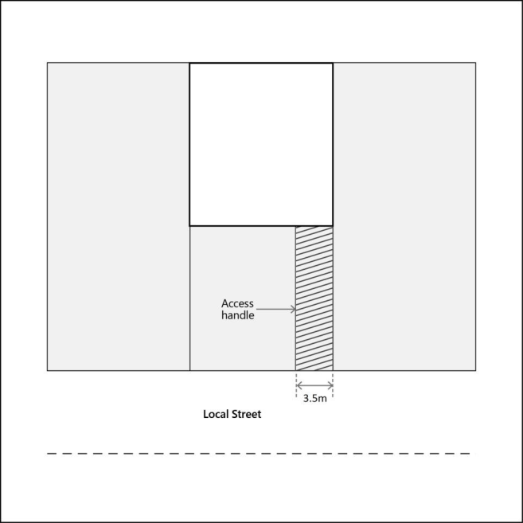
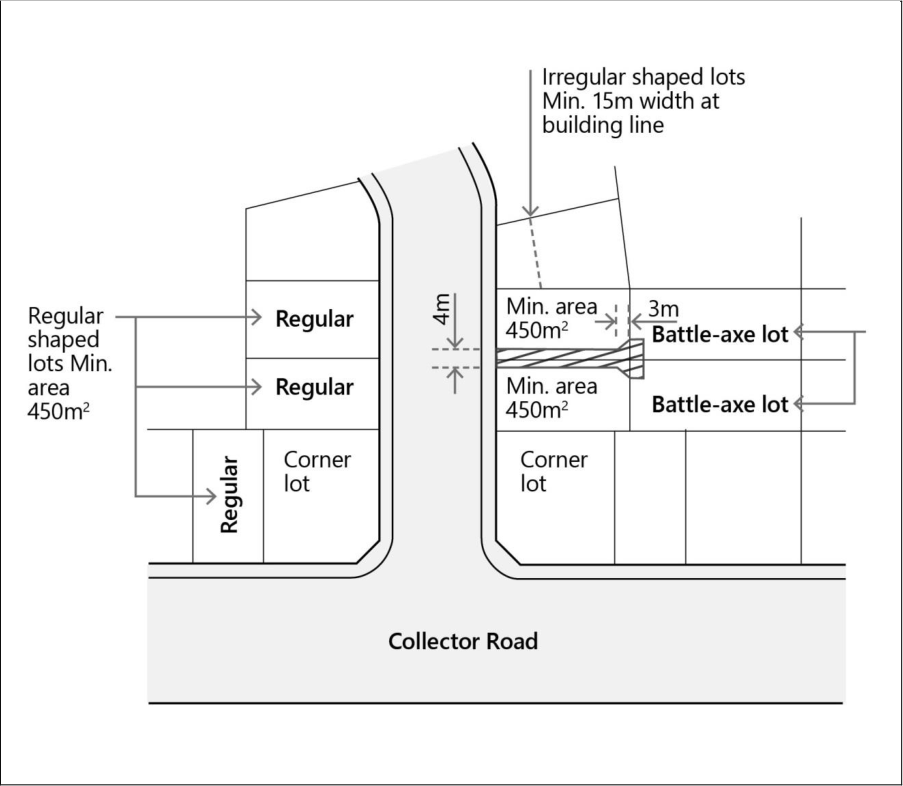
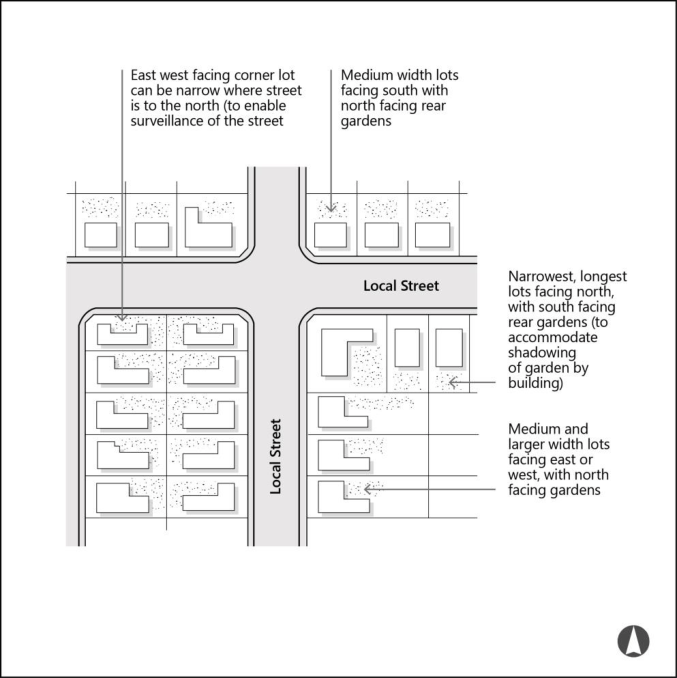
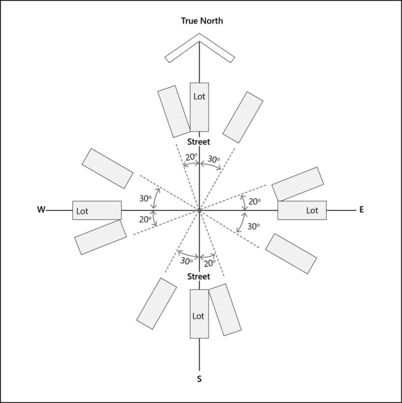

#### 2.4.3 RESIDENTIAL SUBDIVISION

#### 2.4.3.1 Lot Size

#### OBJECTIVES

▪ To encourage a variety of allotments to cater for the different housing needs within the community

▪ To ensure that elements of the site including size, slope, orientation, etc. provide maximum opportunities for future building design, privacy, orientation, solar access and useable outdoor living space on site

▪ To ensure that lot size takes account of the natural features of a site and locality

▪ To ensure that geotechnical constraints are taken into consideration

▪ To minimise the adverse impacts of subdivision on the environment

#### REQUIREMENTS

a Central Coast LEP 2022 contains a Minimum Lot Size Map for land within the Central Coast Local Government Area. For the residential subdivision of land where the minimum lot size is not mapped the appropriate minimum lot size is considered to be 450m2. Any proposals that involve residential lots with an area of less than 450m2 are to consider Clause 4.1 to 4.1F of Central Coast LEP 2022 and where relevant s.2.4.4 Small Lot Housing Development below.

b The minimum lot size is to be increased in response to environmental constraints and topography, in accordance with the slope provisions as stated under s2.4.3.2 below.

c Lots adjoining a Public Reserve, where a side or rear boundary abuts an existing or proposed public open space reserve, foreshore, lagoon or waterway, are to have a lot size of at least 100m2 greater than the recommended or required minimum lot size.

d Corner lots are to have a lot size of at least 150m2 greater than the recommended or required minimum lot size.

#### 2.4.3.2 Slope

#### OBJECTIVES

▪ To ensure that lot size takes account of the natural features of a site and locality

▪ To ensure that geotechnical constraints are taken into consideration

▪ To minimise the adverse impacts of subdivision on the environment

#### REQUIREMENTS

a Lot sizes should be increased as slope increases in accordance with the standards specified below in Table 2. Table 2 refers to land subdivision (Deposited Plan) and Community Plan subdivision. It does not relate to Strata Plan subdivision.

b The slope of the land is measured as the average slope perpendicular to the contours.

c Levels shown on plans are to be relative to Australian Height Datum.

d The subdivision of lands with slopes exceeding 25% is generally discouraged. Where subdivision is proposed, lots need to be of sufficient size to accommodate a building platform, appropriate access and servicing with minimal site and vegetation disturbance.

e There are additional requirements for corner and battle-axe allotments which must be considered and may exceed the minimum requirements detailed below.

f Table 3 identifies additional information requirements to be submitted in accordance with the different slope categories identified in Table 2.

| Zone | Slope % | Slope Category (refer to Table 3) | Minimum Area per Lot Created | Minimum Width in any Direction |
|---|---|---|---|---|
| All Residential Zones for single dwelling lots and subject to the minimum lot size requirements of the CCLEP Battle axe and shared access handles are excluded from the minimum lot area | 0-10% 11% -15% 16% - 20% 21% -25% > 25% | A B C D | 450m2 600m2 1,000m2 1,200m2 Generally discouraged (refer to point e. above) | 15m 18m 20m 25m |

Note: For slope considerations for small lot housing – refer to s 2.4.4 Note: For slope considerations for dual occupancy development refer to Chapter 2.2

#### Table 2 Recommended lot size requirements for various slopes and lot types

| Slope Category | Requirements |
|---|---|
| Category A | ▪ Details of any retaining walls (including height, location and extent of cut and/or fill) required to permit construction of a dwelling. |
| Category B | ▪ Matters required under Category A ▪ Identification of a building footprint satisfying the objectives and requirements of the design element ▪ Vehicular access details and accommodation for 2 cars satisfying the objectives and performance requirements of residential subdivision. |
| Category C & D | ▪ Matters required under Category B ▪ Demonstrate driveway details to the building line from property boundary if fill is to be greater than 300 millimetres. ▪ On-site drainage details |

#### Table 3 Required information to be submitted for the various slope categories

#### 2.4.3.3 Corner Lots

#### REQUIREMENTS

a Safe intersection sight distance and essential sight distance are to be provided in accordance with Austroads Part 5 and 6 for conventional intersections and roundabouts respectively.

b A 5 metres x 5 metres corner boundary splay must be provided on every corner lot to improve sight lines for vehicles and pedestrians in accordance with AS2890 Parking Facilities.

c Driveways for corner lots at non-signalised intersections are to be set back as far as possible from the intersection and must be a minimum of 6 metres from the tangent point of the kerb return.

d Driveways for corner lots at signalised intersections are to be generally set further back to beyond the influence of queue lengths or are required to be serviced by alternate means, e.g. an access handle or right of carriageway from another street.

e Driveways for corner lots adjacent to roundabouts or channelled intersections are to be generally clear of the intersection islands and pavement marking unless the intersection can be safely designed to accommodate access to the lots. Alternatively, an access handle or right of carriageway from another street will be required.

f Corner lots are to have a lot size of at least 150m2 greater than the recommended or required minimum lot size.

#### 2.4.3.4 Battle Axe Lots

Battle Axe or Hatchet shaped allotments are those which are located at the rear of street frontage lots and which obtain or share street access via an access corridor.

#### REQUIREMENTS

a For the purpose of calculating the minimum lot area the area of any access corridor is to be excluded.

b Access corridors shall be created in the plan of subdivision as a “Right of Access” and “Easement for services” in favour of the benefitted lots where the access corridor services more than one lot.

c Minimum access width is specified in Table 4 as follows:

| No. of Dwellings Served | Minimum 1 Constructed Width (m) | Minimum Corridor Width Including Services (m) | Width Reducing With No. of Dwellings Served | Turning Area at End 2 |
|---|---|---|---|---|
| 1 | 3.0 | 3.5 | N/A | No |
| 2 | 3.0 | 4.0 | Yes | No |
| 3 | 4.0 | 5.5 | Yes | No |
| 4 | 4.0 | 6.0 | Yes | No |
| 5 | 4.0 | 6.5 | Yes | No |
| 6 to 15 | 6.0 | 8.0 | No | Yes |

#### Table 4 - Access Requirements for Battle-Axe Lots

Notes:

• provision of passing bays at regular intervals may be required

• where no end turning area is provided, then each lot must accommodate its own turning area; and

• subject to satisfactory arrangements being made with service authorities, e.g. Waste Management and Rural Fire Services

• the access corridor shall be unencumbered no building encroachments (including eaves) with a minimum height clearance of 4.5 metres

d Service conduits to service all lots benefitted by the access corridor are to be provided by the developer for the length of the access corridor.

e Passing bays may be required where an access handle contains a bend.

f Where the access corridor is to a collector road or where it serves more than 3 lots, pavement and access handle widening will be required to provide for vehicle swept paths for the queuing and the simultaneous entry of vehicles.

g Where the handle serves three or more dwellings or is greater than 50m in length, vehicles must be able to enter and exit the access handle in a forward direction. Turning heads must be provided at the end of the handle. The turning head must be supported by a right of access.

h The egress point from the access corridor to the road must provide adequate sight distance in accordance with the relevant standard for vehicles and pedestrians on the frontage road.

i Blind bends are not permitted for new subdivisions. Consideration may be given to these for infill development provided a suitable traffic control treatment is provided.

j Proposed lots must meet the site slope provisions of s.2.4.3.2 above.

> [Picture on page 14: a picture, saved as a picture (images/ch-02-04-subdivision-page-14-1.gif, 150 dpi).]

#### Figure 4 Battle axe lot with a right of access serving one lot

#### 2.4.3.5 Lot Layout Plan

#### OBJECTIVE

▪ To ensure the Lot Layout Plan reflects the site’s opportunities and constraints as well as identifying service requirements and vegetation retention for the site

#### REQUIREMENTS

a Access Corridors (battle-axe handles) are not permitted to be located within the restricted areas to intersections as defined in AS/NZS 2890, Parts 1 and 2.

b Vehicle Access crossing/driveways must not be located over or in the vicinity of Pedestrian or School Crossings or other traffic management facilities.

c The street design and lot layout is to consider the likely location of lot accesses, with regards to the provision of adequate sight distances in accordance with ASNZS 2890 and the Austroads Guidelines, Part 5.

> [Picture on page 15: a picture, saved as a picture (images/ch-02-04-subdivision-page-15-1.gif, 150 dpi).]

#### Figure 5 Variety of lot sizes - Category A slope

#### 2.4.3.6 Street Orientation and Lot Design for Solar Access

#### OBJECTIVES

▪ To promote energy conservation principles

▪ To ensure lots are oriented to maximise their potential to receive solar access

▪ To enable lot shape and orientation which facilitates the design and construction of development which is:

- energy efficient;

- attractive and functional;

- environmentally sustainable; and

- has capacity to provide a quality lifestyle which encourages community interaction

#### REQUIREMENTS

a Streets are to be aligned generally east-west and north-south where possible.  Refer to Figures 6 and 7.

b The design shall provide for lot orientation which maximises solar access by providing:

i lots with a north - south orientation (within the range of 30 degrees east of north and 20 degrees west of north), enabling the provision of north facing living areas within the dwelling and north facing private open space;

ii lots on the south side of east - west running streets shall have increased width to prevent overshadowing, and to provide for north-east and north-west facing private open space;

iii narrower and smaller lots are best suited on the northern side of east-west running streets, with north facing private open space; and

iv the midpoint of each lot shall have access to a minimum of 3 hours sunshine between 9 am and 3 pm on June 21 (the winter solstice).

c Where streets are not orientated N-S and E-W, lots shall be angled to achieve better solar access and achieve maximum exposure to cooling breezes in summer.

d Where possible, driveways should be on the western or southern side of any future dwelling, in areas less suitable for recreation spaces.

> [Picture on page 16: a picture, saved as a picture (images/ch-02-04-subdivision-page-16-15.gif, 150 dpi).]

#### Figure 6 Lot orientation and design for solar access

> [Picture on page 17: a picture, saved as a picture (images/ch-02-04-subdivision-page-17-1.gif, 150 dpi).]

#### Figure 7 Solar access wheel

#### 2.4.3.7 Urban Design

#### OBJECTIVES

▪ To ensure quality design is achieved through subdivision ensuring allotments promote attractive amenity and visual privacy

▪ To ensure subdivision design is consistent with any established streetscape and the desired future character of the precinct / area

#### REQUIREMENTS

a The subdivision shall demonstrate best practice design in terms of individual elements including lot orientation, street scape and landscape design.

b The design is to encourage and enable the development of a community focus through the design of public places and public art projects to generate community interest.

c The design is to achieve public and private landscaped areas which are reflective of the character of the area.

d The design promotes ordered but varied development.

e In new areas, the design allows for a mix of housing opportunities within a locality.

f In established areas, the design preserves the essential character of the locality while providing for contemporary housing needs in keeping with community expectations.
