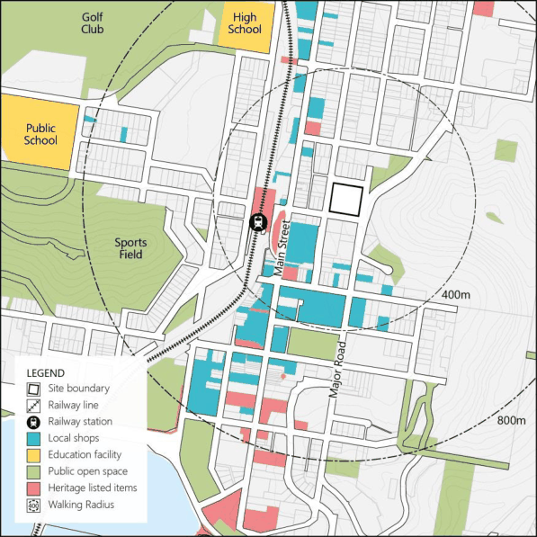
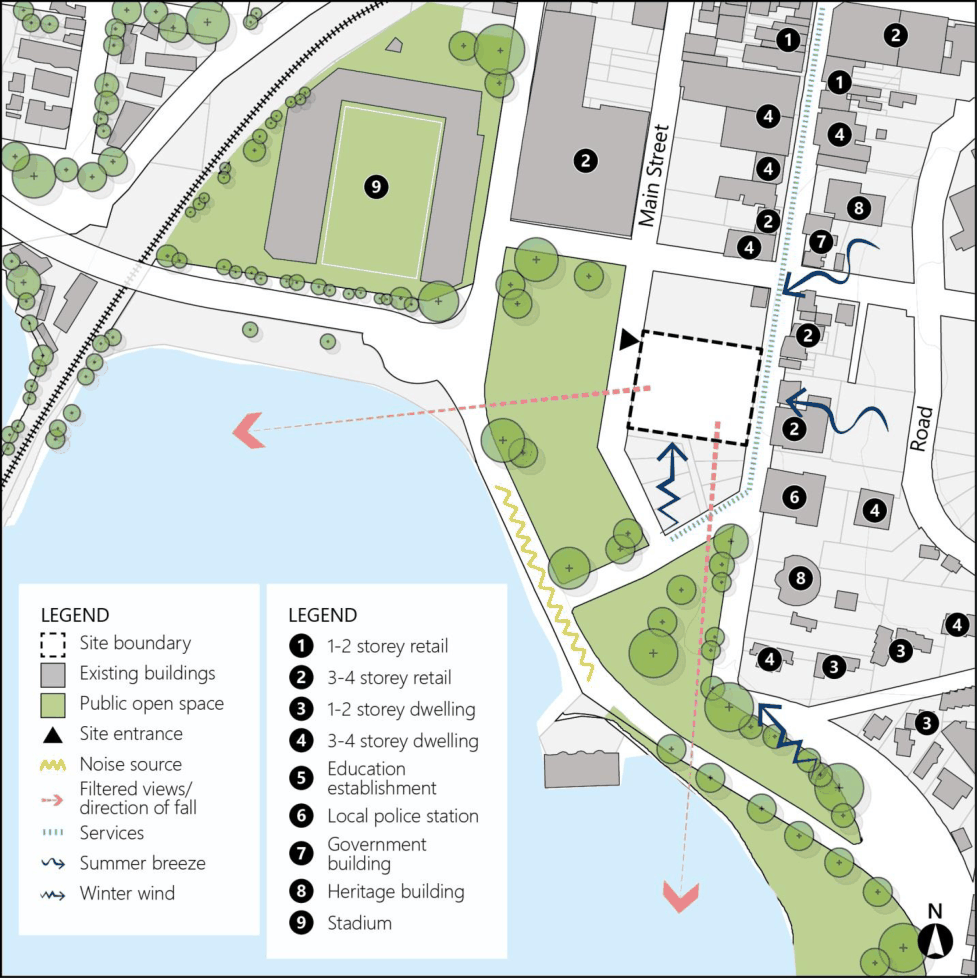

#### 2.5.2 CHARACTER AND CONTEXT

#### 2.5.2.1 Context Analysis

Context is everything that has a bearing on an area and comprises its key natural and built features. The process of defining the context’s setting and scale has direct implications for design quality in larger developments.

#### OBJECTIVE

To encourage good design in commercial development that responds to and contributes to its context.

#### REQUIREMENTS

a For new commercial development a Context Analysis must be carried out as the first step in the design process and the outcomes of that analysis must be reflected in the design of the development. A Context Analysis identifies existing conditions in the area that will influence design choices, for example major pedestrian routes, transport nodes, built and urban features, topography.

b For development on sites that are smaller than 3000m² in area, the details of the context analysis can be included in the Site Analysis Plan that is required for all new commercial development in Section

2.5.2.2 of this Chapter.

c For development on sites that are 3000m² or larger in area, a separate Context Analysis Plan must be submitted in A3 size with the Development Application. The detail of the plan is to be tailored to the size and complexity of the proposed development

d Where a separate Context Analysis Plan is required to be submitted, it must cover sufficient area surrounding the site as appropriate to gaining an understanding of the context. As a guide, a 400 metre radius around the site will capture the surrounding context that is within an easy short walk.

> [Picture on page 2: a picture, saved as a picture (images/ch-02-05-commercial-development-page-2-22.gif, 150 dpi).]

#### Figure 1 Wider context plan showing a 400 metre walking radius

e The following is an indicative checklist of issues to be addressed in a Context Analysis Plan:

i Pedestrian Networks: existing circulation patterns and key destination points;

ii Public Transport: location of closest bus stop, train station or ferry wharf;

iii Public Car Parking: designated at-grade or multi storey public car parking sites;

iv Public Open Space: parks, reserves, and natural open space areas;

v Loading and Service Access: laneways, secondary roads, access ways, and public loading parking bays;

vi Landmarks: heritage items, significant places, main street precincts in the vicinity;

vii Adjacent Development of Similar Uses: for example supermarkets;

viii Land Use Zones: are these business, residential, industrial;

#### 2.5.2.2 Site Analysis

#### OBJECTIVE

To encourage good design that results from a genuine analysis of the site, its character and capacity, and its suitability for the proposed development.

#### REQUIREMENTS

a For all new commercial development, a Site Analysis must be carried out as one of the initial steps in the design process and the outcomes of that analysis must be reflected in the design of the development.

b The Site Analysis Plan must identify existing conditions relating to the development site and existing design constraints on adjacent sites, which are likely to influence design choices.

c The site analysis plan is to be submitted in A3 size with any Development Application. The detail of the plan is to be tailored to the size and complexity of the proposed development.

d The following is an indicative checklist of issues to be addressed by the Site Analysis Plan:

i Orientation: north point and aspect, consider the movement of the sun, particularly in summer and winter;

ii Streetscape: setback patterns, position and form of existing development on surrounding land, overall height and shadows from adjacent buildings;

iii Topography: where cut and fill or benching of the site is proposed, slope of the land is to be shown at 0.2 metre intervals with direction of fall, in other instances at 1.0 metre intervals;

iv Accessibility: accessible paths of travel and access points around the site.

v Services: location of utility services including stormwater drainage lines, electricity poles and kerb crossings;

vi Vehicle access: best position for vehicular access driveway(s), proximity to laneways and/or loading zones for service vehicles, suitable locations for off-street parking;

vii Survey constraints: surveyed location of any easements, rights of way, or other restrictions;

viii Security: any natural surveillance opportunities to and from the site;

ix Views: consideration of view corridors to and from the site as well as the impact of development on the views currently enjoyed by adjoining development.

x Vegetation: existing trees and vegetation on the land, on adjoining land, and in the street or locality with the true canopy spread within or onto the site;

xi Privacy: any windows or private areas of neighbouring developments facing the site;

xii Prevailing winds: breezes in summer are an attractive site feature while winter winds are not contributory to the enjoyment of outdoor dining and public open space;

xiii Existing structures: including details of existing buildings, fences and retaining walls on site.

xiv Context Analysis: for sites smaller than 3000m², include any other existing features in the area that will influence design choices as listed in the indicative checklist in Part 2.1 of this Chapter.

> [Picture on page 4: a picture, saved as a picture (images/ch-02-05-commercial-development-page-4-11.gif, 150 dpi).]

#### Figure 2 Sample Site Analysis Plan

#### 2.5.2.3 Statement of Environmental Effects

A Statement of Environmental Effects (SEE) is a report outlining the likely impacts of the proposal, and the proposed measures that will mitigate these impacts. The SEE includes written information about the proposal that cannot be readily shown on plans and drawings.

#### OBJECTIVE

To encourage appropriate commercial development that is developed as a result of understanding the local context.

#### REQUIREMENTS

a A Statement of Environmental Effects (SEE) must be submitted with any Development Application.

b In addition to the standard information required in an SEE, an application for new commercial development must also provide the following justifications:

i Urban Design:

▪ Identify the urban context for the development, that is, what kind of setting is the development located in? E.g. a neighbourhood centre, town centre, strategic centre, bulky goods area, etc;

▪ Existing built form and scale;

▪ Demonstrate how the development’s built features will contribute positively to the local context on all facades.

ii Social:

▪ Appropriate location in terms of services, transport and facilities;

▪ Accessibility of the development to all members of the community; for example existing pedestrian networks & accessible paths of travel.

▪ How the development will maximise positive social impacts (e.g. community, identity, heritage) and minimise negative social impacts (e.g. safety, undesirable activity).

iii Economic:

▪ Potential economic benefits and impacts of the proposal;

▪ Employment opportunities;

▪ Impacts of the proposal on existing commercial developments in the catchment (local and/or regional).

c The detail of the information contained in the SEE is to be tailored to the size and complexity of the proposed development.
