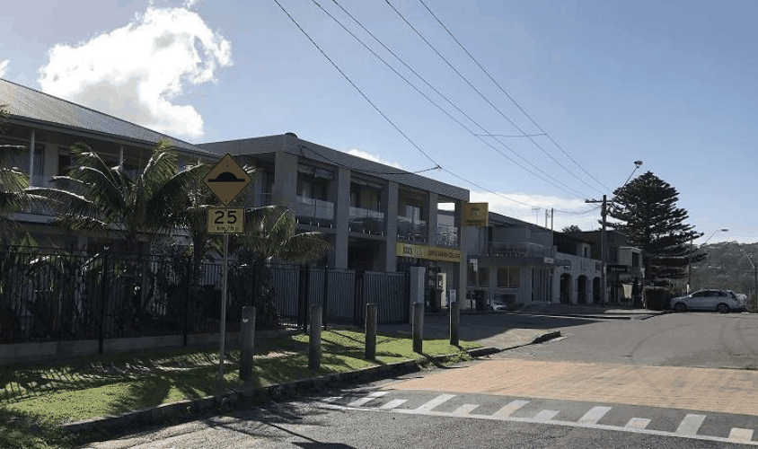
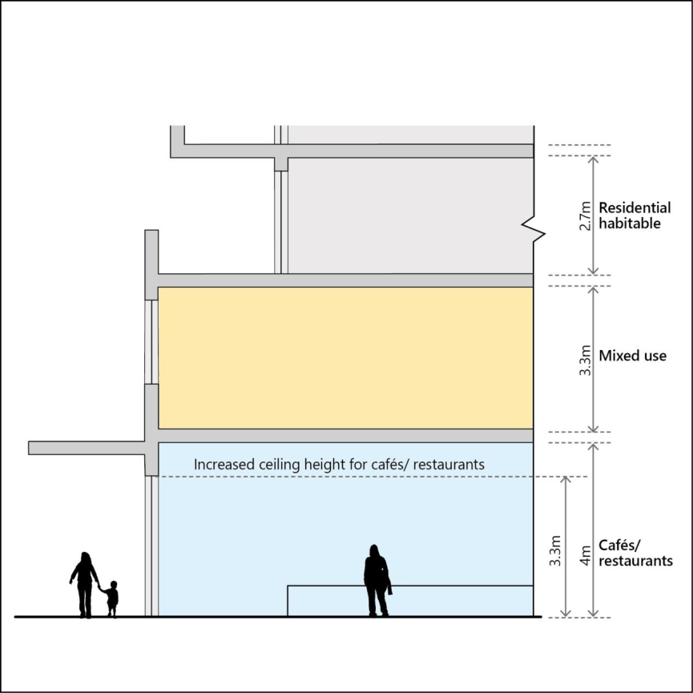

#### 2.5.3 BUILDING SCALE

#### 2.5.3.1 Building Height

Building height helps shape the desired future character of a place relative to its setting and topography. It defines the proportion and scale of streets and public spaces and has a relationship to the physical and visual amenity of both the public and private realms.

#### OBJECTIVES

▪ To ensure an appropriate relationship between new commercial development, street width and surrounding dwellings.

▪ To allow the height of new commercial development to reflect the desired future scale of the area, while also respecting the existing built fabric, streetscape character, and level of amenity.

▪ To achieve a pedestrian scale and a consistent built height at the street boundary.

#### REQUIREMENTS

a The maximum building height of new development is to be in accordance with the height of building maps contained within Central Coast LEP 2022.

b The proposed building height for the new development must ensure that adequate daylight and solar access is maintained to existing apartments, required private open space and common open space of adjoining properties, and significant public open space. Shadow diagrams must be provided for certain development applications in accordance with Section 6.2 Shadow Diagrams.

c In local centres with zero front boundary setbacks, the height of commercial development should be stepped down at the boundary to give the appearance of a two storey wall height to the street.

d Where the site adjoins existing low-scale residential development, the building height must be stepped down near the boundary to a maximum of two storeys.

e All ancillary buildings fronting laneways must have a maximum height of not more than 6 metres.

> [Picture on page 6: a picture, saved as a picture (images/ch-02-05-commercial-development-page-6-24.gif, 150 dpi).]

Figure 3 Retail development relating to existing two storey residential development

#### 2.5.3.1 Ceiling Heights

Ceiling height is measured internally from finished floor level to finished ceiling level. Ground floors of commercial development often need to accommodate a range of uses such as retail, cafes and restaurants. Cafes and restaurants generally require increased ceiling heights to allow for additional servicing requirements.

#### OBJECTIVE

To ensure appropriate floor to ceiling heights within commercial buildings, and to enable flexibility of uses through higher floor to ceiling heights for ground floor development.

#### REQUIREMENTS

a Ground floor ceiling heights in commercial development are to be a minimum of 4 metres to allow for servicing and permit flexibility of use.

b First floor level ceiling heights in commercial development are to be a minimum of 3.3 metres to ensure longer term adaptability for other uses.

c The ceiling heights of other storeys are to be appropriate to their use.

> [Picture on page 7: a picture, saved as a picture (images/ch-02-05-commercial-development-page-7-15.gif, 150 dpi).]

#### Figure 4 Minimum ceiling heights for commercial development
