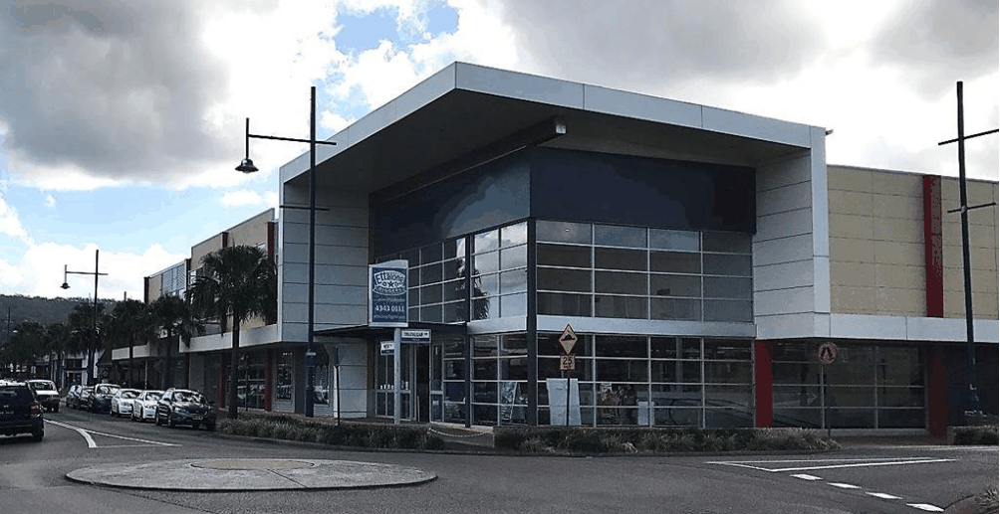
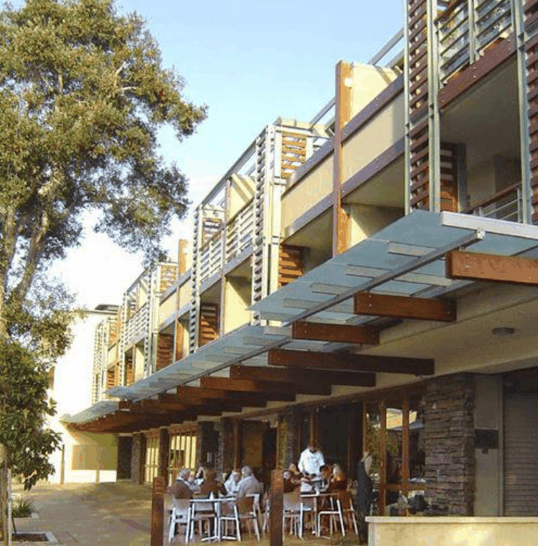
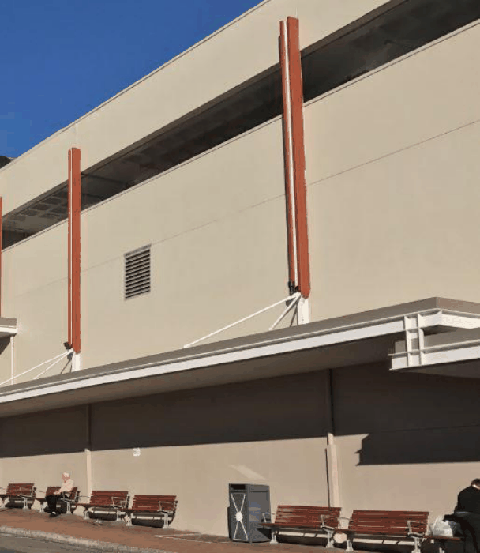
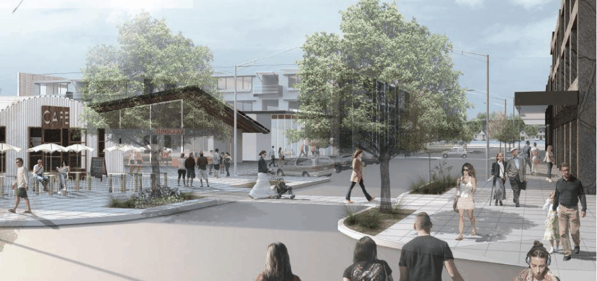
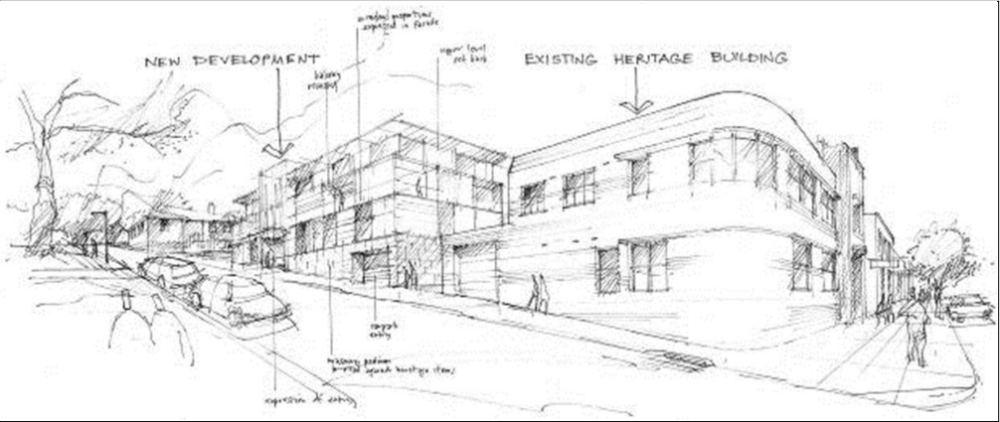
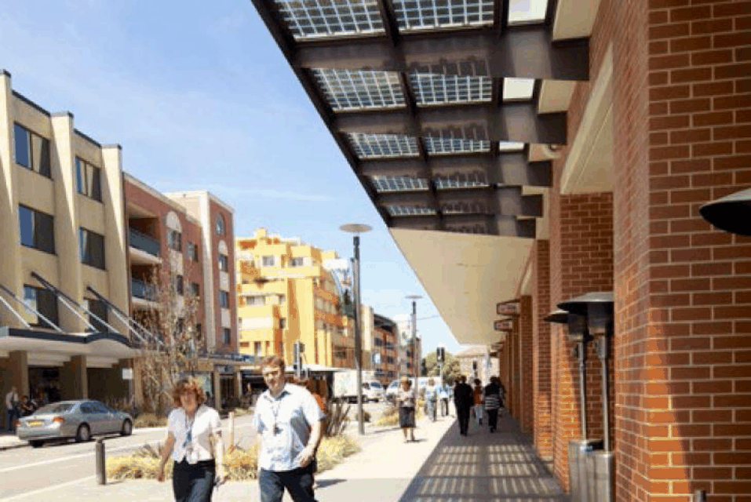

#### 2.5.5 BUILT FORM AND ARTICULATION

#### 2.5.5.1 Construction and Appearance

#### OBJECTIVES

▪ To encourage new commercial development with building form that is appropriate to its location.

▪ To provide new commercial development that creates well-defined streets, street corners and public spaces.

▪ To ensure that new commercial development on corner sites is appropriately articulated considering the highly visible position.

#### REQUIREMENTS

a All commercial development should address the main and secondary street frontages through the appropriate location of activities, building form, and building entrances.

b Mixed use buildings should be arranged to maximise passive surveillance of the street by locating:

i Retail activities on the ground floor to activate the street, maximise merchandise display opportunities, and provide visual interest and safety for pedestrians;

ii Commercial office activities on the first floor; and

iii Residential development on the floors above.

c Corner buildings must address both streets and provide some architectural distinction on the corner.

> [Picture on page 10: a picture, saved as a picture (images/ch-02-05-commercial-development-page-10-1.gif, 150 dpi).]

Figure 5 Example of building form addressing the corner at a street intersection

d Where appropriate in the urban context, buildings located on intersections should provide an address to the corner with additional floors or façade treatments to accentuate the importance of street corners as places of pedestrian interaction and to provide visual landmarks for pedestrians.

e For sites with rear lane access, new development must have a 1 metre minimum setback from the rear boundary. This includes ancillary development and car parking structures (e.g. hardstand car space areas), loading manoeuvring areas, and waste management areas.

#### 2.5.5.2 Active Frontages

Active frontages display a variety of land uses or building elements which are visible and attractive to pedestrians. Active frontages at street level include building entrances or lobbies, and premises with substantial display windows such as business premises, food and drink premises, and shops. Active frontages on the second storey include residential balconies or windows, and premises that accommodate substantial numbers of customers, e.g. outdoor areas associated with clubs or restaurants.

Active street frontages are a vital contributing factor to the economic viability and vitality of a commercial centre. An active street frontage enables passive surveillance which enhances public security and encourages pedestrian activity. Retail spaces directly benefit from this foot traffic, and the commercial centre becomes more attractive to business as a result.

> [Picture on page 11: a picture, saved as a picture (images/ch-02-05-commercial-development-page-11-1.gif, 150 dpi).]

#### Figure 6 Active frontages orientated towards the street

#### OBJECTIVES

▪ To achieve a well-designed streetscape that engages and activates the commercial centre and contributes to its economic viability.

▪ To encourage active uses and pedestrian orientated development at ground level in commercial development.

▪ To optimise social interaction and economic development through a focus on urban environments which encourage pedestrian activity.

▪ To identify activities or building elements that would interrupt or compromise desired levels of pedestrian activity.

#### REQUIREMENTS

a Active frontages are to be provided at street level along footpaths and public open space, in accordance with the following:

i New commercial development facing public open space must have active frontages for at least 75% of the length of the facade;

ii New commercial development facing significant streets within a commercial centre must have active frontages for at least 50% of the length of the facade; and

iii New commercial development facing minor streets or laneways are not required to have active frontages, but are encouraged to provide some opportunities for passive surveillance of the area through windows or balconies.

b Elements which interrupt the continuity and effectiveness of active frontages should not be located along significant streets and public open space within a commercial centre:

i Vehicle access driveways, unless no alternative is available;

ii Service areas and delivery docks, unless no alternative is available;

iii At-grade or multi-storey car parking that is not screened or appropriately landscaped; and

iv “Big box” retailers and entertainment facilities that are enclosed by blank walls.

> [Picture on page 12: a picture, saved as a picture (images/ch-02-05-commercial-development-page-12-10.gif, 150 dpi).]

Figure 7 Example of an undesirable building façade that is not an active frontage

c Large retail or commercial floor spaces not requiring continuous and direct connection to the street (e.g. supermarkets) should be “wrapped” by smaller commercial buildings to avoid blank walls and create an active street frontage.

d Internal retail arcades detract from pedestrian activity on streets in commercial centres and are not encouraged unless otherwise identified in a site specific Chapter as part of a major pedestrian linkage.

e Doors must not encroach over the footpath when open. Pivot, stacking or bi-fold doors and windows are encouraged.

f Where security shutters are necessary on main streets, they should be visually permeable (75% permeability) to allow viewing of windows and allow light to spill out onto the footpath.

#### 2.5.5.3 Facades

The design of facades contributes greatly to the visual interest of a building and the character of the local

area. Facades that face the street have an impact on the public domain, while side and rear facades influence the amenity of neighbouring buildings and communal and private open space.

Façade articulation provides character and human scale to commercial buildings. The placement of windows, doors, and awnings, and the treatment of blank walls allow vertical and horizontal proportions to be obvious or subtly incorporated into the façade. Design techniques can reduce a building’s visual impact and provide visual interest.

The composition and detailing of a façade is not only important to the appearance of the building, it also influences its perceived scale. The pattern and repetitions of the façade, the proportions and articulation of external walls and the detailed design of façade elements are all important considerations.

> [Picture on page 13: a picture, saved as a picture (images/ch-02-05-commercial-development-page-13-12.gif, 150 dpi).]

#### Figure 8 Varied facades provide an interesting streetscape

#### OBJECTIVES

▪ To encourage building facades which provide visual interest along the street while respecting the character of the local area.

▪ To provide legible design where building functions are expressed by the façade.

▪ To encourage a ‘fine grain’ character in building facades where appropriate to local centres.

▪ To ensure that corner buildings respond to the characteristics of the two streets they address.

#### REQUIREMENTS

a Provide high quality facades in commercial development that are a balanced composition of building elements, textures, materials and colour selections.

b Deliver legibly designed buildings where the functions are expressed in the facade:

i Building entries are clearly defined;

ii Separate and differentiated entries for different users are provided in mixed use buildings;

iii Parts of the site fronting street corners are given special treatment, e.g. change in articulation, materials, colour, roof expression, height; and

iv Retail or commercial parts of the development are expressed differently to residential parts.

c For large commercial development the treatment of the façade should be designed to provide character, visual legibility and human scale and to delineate the distinct uses.

d Materials and finishes chosen for the façade must be compatible with the public nature of commercial development. The following materials and finishes are considered incompatible:

i Curtain glass walls;

ii Highly reflective or mirror glass;

iii Surfaces that are easily damaged or vandalised, and not easily cleaned;

iv Large areas of highly reflective materials; and

v Rendered or bagged finishes that are not highly durable.

e Public entrances to large buildings should be clearly expressed in the façade.

f Special attention should be given to heritage buildings through careful design of the facades of development that adjoins them.

> [Picture on page 14: a picture, saved as a picture (images/ch-02-05-commercial-development-page-14-16.gif, 150 dpi).]

Figure 9 The character of a heritage building is respected in the adjoining development

g Where new commercial development is located on a site with two street frontages, each façade treatment must be articulated and respond to the buildings in those streets.

h Shopfronts on corner sites should be extended to the side street frontage to enhance the commercial potential of the space and minimise blank walls to the street front.

i Design shopfronts, including entries and windows, to reinforce any prevalent character in the local area.

j Use of one colour over a whole building is discouraged. Colour should be used to express features, define storeys and relate to adjacent buildings and places.

#### 2.5.5.4 Awnings

Awnings are prominent streetscape elements in commercial development. Continuous awnings encourage pedestrian activity, and in conjunction with active frontages, support and enhance the vitality of the local

area. Combined with building entries, awnings provide a public address which contributes to the identity of the development.

#### OBJECTIVES

▪ To provide shelter and amenity for pedestrians on public streets.

▪ To provide continuity in the streetscape.

#### REQUIREMENTS

a Awnings should be provided on all building frontages facing public open space, streets, footpaths, and circulation areas.

b Generally awnings should be a minimum of 3 metres deep and setback a minimum of 0.6 metres from the kerb, to allow for street signage, lighting and street tree planting.

c The design of new awnings is to be integrated with the overall building design. Awnings should provide a human scale to larger commercial developments.

d Design new awnings to be complementary with their neighbours and in keeping with the general alignment of existing awnings in the street.

e Provide under awning lighting to improve public safety.

f Ensure all awnings are structurally sound and safe and comply with relevant building codes.

> [Picture on page 15: a picture, saved as a picture (images/ch-02-05-commercial-development-page-15-20.gif, 150 dpi).]

#### Figure 10 Continuous awnings provided along a main street

#### 2.5.5.5 Roof Elements

Parapets and roofs are important elements in the overall composition of commercial development. Quality roofs and parapets provide a positive addition to the character of an area and form an important part of the skyline. Roofs and parapets can also provide opportunities for private open space, sustainable design features, and concealment of services.

#### OBJECTIVES

▪ To ensure the roof form contributes to the overall design and performance of the building.

▪ To reinforce existing parapet features in neighbourhood centres.

▪ To ensure that roof plant and service areas are incorporated into the roof design and not visible from adjoining public roads or private property.

▪ To provide attractive views of commercial development when seen from surrounding vantage points.

#### REQUIREMENTS

a In locations where parapet forms are prevalent, for example along main streets, commercial development should include parapets that reflect the rhythm, scale and detailing of existing parapets.

b Design roof forms to generate a visually interesting skyline, while minimising apparent bulk and potential for unnecessary overshadowing.

c Relate roof forms to the size and scale of the building, the building elevation, and the three dimensional building form.

d Minimise the visual intrusiveness of service elements by integrating them into the design of the roof. These elements could include lift overruns, service plant, ventilation stacks, gutters, and signage.
