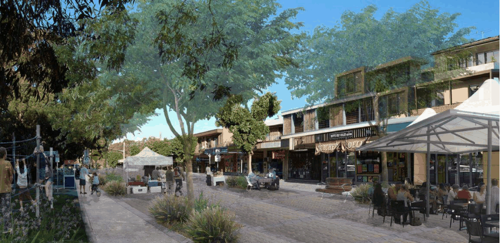

#### 2.5.6 PUBLIC DOMAIN

#### 2.5.6.1 Public Domain

The public domain includes public areas such as parks, streets, footpaths and also privately owned areas accessible to the public like building forecourts, arcades, shopping centres and car parks. Future commercial development must create gathering places that enhance and connect with those already existing. Shared public areas should be accessible to all community members and visitors. As a setting for community life they need to be attractive, safe, interesting, comfortable, well defined and easily accessible.

> [Picture on page 17: a picture, saved as a picture (images/ch-02-05-commercial-development-page-17-1.gif, 150 dpi).]

#### Figure 11 Attractive pedestrian friendly street plaza

#### OBJECTIVES

▪ To provide a safe walkable environment around commercial development, with visual interest, pedestrian amenity, and opportunities for social interaction.

▪ To promote commercial development that is well connected to the street and contributes to the functionality of the public domain.

▪ To ensure that commercial development is accessible to all members of the community.

#### REQUIREMENTS

a Buildings, street furniture and landscaping are to contribute to the definition and amenity of the area.

b Landscaped areas shall be integrated within the overall design to soften dominance of buildings and to provide shade, meeting places, resting areas and playgrounds.

c Benches and other forms of seating should be provided both inside and outside buildings to provide places for passive enjoyment of the space.

d Street furniture and paving shall take into account the needs of people with a disability or decreased mobility (e.g. seats to have arms and not be too low, slip resistant paving should be utilised).

e Pedestrian routes are to be clear, safe, well-lit and legible to all. Particular attention should be given to linking areas of the public domain and to improve safety at potential conflict points between different transport modes.

f Pedestrian and vehicle access ways are to be separated and clearly distinguishable.

g Pedestrian areas should minimise any changes in levels where possible.

h Pedestrian areas surrounding commercial development should allow for wheelchair, scooter or pram access from public areas and car parking to any retail areas, including at the threshold of shops.

#### 2.5.6.2 Shadow Diagrams

#### REQUIREMENTS

a New commercial development that is 2 storeys in height or greater, and that is adjacent to public open space, existing residential development, or residential zones, must provide shadow diagrams in accordance with the following:

i Based on a survey of the site and adjoining development;

iv Showing shadows cast at 9am, 12 noon and 3pm on June 21 (winter solstice);

v Showing shadows at these times resulting from the proposed development, any ancillary structures, any cut and fill;

vi Showing the impact of shadowing on adjoining properties or public open space.

In assessing the impact of shadow on adjoining properties or public open space, Council shall have regard for the standards stated in Sections 2.5.3 Building Scale, 2.5.4 Building Setbacks, and 2.5.6 Public Domain.

Note: The results of a shadow study should inform the design (including the height, massing and setbacks) of new development adjacent to public open space or residential areas.

#### 2.5.6.3 Lighting

#### REQUIREMENTS

a New commercial development must provide external lighting so that the surrounding public domain appears safe and inviting at night.

b Under-awning lighting must be provided in accordance with relevant building codes and standards.

c Lighting in larger commercial developments should:

i Accentuate entrances, both vehicular and pedestrian;

ii Highlight special features or elements;

iii Assist navigation around the development at night; and

iv Contribute to activation of the area after hours.

d Where residential development is located above or adjoins commercial development, proponents must provide the location and design details demonstrating that lighting is directed away from residences.
