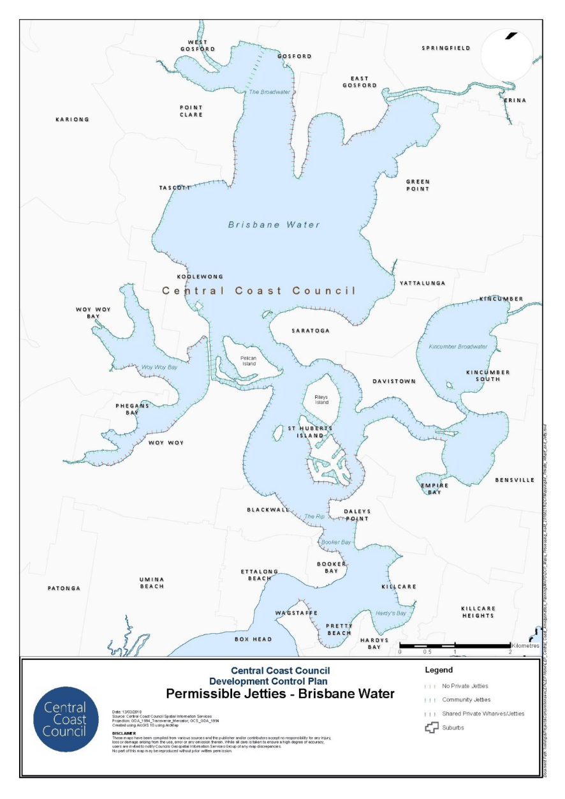

#### 2.12.2 BRISBANE WATER

#### 2.12.2.1 General Requirements Related to Brisbane Water

a Development should improve opportunities and the ability to obtain easy access to the waterway to improve fishing, boating, walking and other general recreational and educational pursuits. Development must not extend into or restrict any navigation area or channel.

b Assessment of the visual impact of a proposed development on land to which this plan applies will be made on the basis of the requirements set out in the Character and Scenic Quality Guidelines.

c Building materials used both in and for the construction shall include plantation grown timber and timber removed with the approval from State Forests. Mesh decking is acceptable. Buildings and structures should be non-reflective and use colours appropriate to the setting.

d Any existing solid fill structure which is the subject of an application for additions, alterations or replacement are to be reconstructed on piers in accordance with Clause 2.1(c) above, unless the existing structure has been identified as a heritage item. If not so identified, then the old solid fill structure must be removed.

e Water recreation structures under this Chapter are only intended to facilitate access for private boating where a reasonable depth of water can be achieved without the necessity for an extended structure. Larger vessels or keep vessels which cannot achieve water access to water recreation structures approved in accordance with those dimensions outlined within this policy are not appropriate for berthing and will need to make other arrangements.

f Where an existing facility could be relocated to a common boundary to be used as a shared facility, Council will give consideration to permitting a facility of the same length as the previous structure depending on its merits.

g The length of any water recreation structure shall:

i Not exceed the average length of water recreation structures within 100 metres on either side of the subject site

ii Achieve the ‘basic’ length necessary to provide a water depth of a minimum 900mm or maximum 1.5 metres at mean low water at the ‘jetty head’

iii Not exceed a maximum ‘basic’ length of a possible 50 metres with a possible 5 metres additional length (refer Figure 3 in Appendix) and subject to approval under item (iv) below, and

iv With regard to iii) above, Council may consider minor extensions (up to a maximum 5 metres increase) to the length subject to the concurrence of the NSW Roads and Maritime, Department of Primary Industries (Fisheries), and the Department of Planning and Environment

Note: If a water recreation structure cannot reach a depth of 900mm at mean low water and with a ‘basic’ length of 50 metres (plus any 5 metre approved extension) it will not be approved.

h A water recreation structure must not be constructed of solid fill but must be constructed on piles with a minimum longitudinal spacing of three metres along the structure.

i Water recreation structure platforms are to be constructed to a minimum height of 750 mm above the mean high-water level (1.15m AHD approximately). Excessively high jetties will not be permitted.

j The width of a water recreation structure is to be minimum 900mm and a maximum 1.2 metres, except for community or public water recreation structures.

k A single hand rail may be provided on one side of the structure only, with the design and construction to be such that access along the foreshore is not restricted. Handrails may be omitted for appearance where appropriate.

l The construction of an “L”, “T”, or similar type configuration on the “water end” or ‘jetty head’ of the structure is permitted with an area not exceeding 9m² for a single owner or 12m² for a shared ownership (refer Figure 2 in Appendix). The widened end of a ‘jetty head’ (indicated as “Y” in Figure 2 in Appendix) shall not exceed 4m for a single owner or 6m for a shared ownership.

m A pontoon may be permitted instead of the widened end of a jetty or wharf. The dimensions of a pontoon shall not exceed the dimensions permitted for a solid structure. The length of a jetty or wharf permitted shall include the pontoon.

n Gates or similar devices are not permitted.

o Lighting on any water recreation structure is to be minimal and will only be permitted where it can be shown to be essential for the safe use of the structure. Such lighting shall be neither red nor green.

p Davits and derricks will not be permitted.

#### 2.12.2.2  Additional Development Controls – Shared Private Use Jetties (Figure 1)

a Favourable consideration will be given for the provision of an additional water recreation structure where there is an agreement between adjoining owners to share the use and responsibility for the facility.

b Where the operation of a shared water recreation structure would result in an individual property being isolated and unable to submit to a shared water recreation structure proposal, Council may consider permitting a single water recreation structure.

c Where approval is sought to rebuild or replace an existing structure, an agreement must be made for adjoining owners to equally share use of and responsibility for the facility.

d Approval may not be given to rebuild or replace an existing structure where it is practical for the owner to share with an adjoining facility.

e Legal access is to be available or provided to / from the facility for each property involved in a shared facility (e.g. right-of-way easement, adjustment of common boundary etc.).

#### 2.12.2.3  Community Jetties (Figure 1)

a Community water recreation structures may be permitted, subject to Council approval. Community water recreation structures, if approved, will be permitted to abut foreshore land between the private properties and mean high water mark which is a public reserve or proposed public reserve and is an area of freehold waterfront foreshore land where private water recreation structures (whether shared or not) will not in general be permitted.

b A community water recreation structure may be permitted, subject to approval, beyond the basic length limit of 50 metres subject to the development complying with the requirements of Section

2.12.2.2(a)(i),(ii) & (iv) and Section 2.12.2.1 – General Requirements Related to Brisbane Water of this Chapter.

c Such consent will be subject to the sharing of costs and on-going responsibilities for the community water recreation structure between at least 7 owners. The responsibility shall be its land access, maintenance and management in a safe operating condition and the provision for safe and secure public access which is available at all times. The owners shall live adjacent to the public reserve or in the immediate vicinity for the proposed community water recreation structure.

d A community water recreation structure shall be available for authorised use and access by the general public. However, public mooring will be prohibited.

e A community water recreation structure must be designed, constructed and maintained to the requirements of Australian Standard AS4997-2005 Guidelines for the Design of Maritime Structures and shall include appropriate lighting for public safety and in respect to actual users and vessels using the adjacent waters.

f A person(s) holding the licence from the Crown for a community or an individual water recreation structure abutting public land must enter a Deed with Council, and 88E under the Conveyancing Act 1919 (if necessary), relating to an indemnity and have an insurance contract to protect Council from possible claims from any party, should that party be injured, suffer property damage or economic loss as a result of the construction or use of the community or individual water recreation structure which are to be prepared in accordance with Council’s requirements and to the satisfaction of Council.

g Indemnity and restrictions under 88E shall be prepared by Council’s solicitors but subject to the cost of the applicant(s) / licensee(s). Pursuant to Section 4.16(3) of the Environmental Planning and Assessment Act 1979 as a condition precedent to the consent taking effect to any development application for a community or individual water recreation structure.

h Any water recreation structure required to be made available for public access may be permitted to provide adequate signage on the deck and located as the entrance to the water recreation structure stating “No unauthorised use of this jetty / wharf is permitted”

#### 2.12.2.4 Foreshores Designated as “No Private Jetties” (Figure 1)

Private and community water recreation structures may not be permitted by Council on the Foreshores Designated by an Unbroken Heavy Black Line on the ‘Permitted Jetty Types’ Diagram (Figure 1).

#### 2.12.2.5 Positive Covenant and Licence for Development Relating to Brisbane Water

Prior to construction of any water recreation structure, the owner shall:

a Submit a copy of the licence agreement issued by the Department of Industry – Lands for the use of Crown Land; and.

b Create a positive covenant which is attached to the land owned by the person who receives the benefit of a licence and requires the landowner to:

i Maintain public liability insurance for the life of the structure;

ii Maintain the structure in a safe condition at all times;

iii Provide an identification and licence number; and,

iv If (i) and (ii) are not complied with the structure(s) shall be removed.

c Where appropriate, allow right-of-access to others who share the facility.

d The owner shall be responsible for Council’s legal and administrative costs in relation to the preparation of the positive covenant.

> [Picture on page 7: a picture, saved as a picture (images/ch-02-12-waterfront-structures-page-7-1.gif, 150 dpi).]

#### Figure 1: Permitted Wharf and Jetty Types – Brisbane Water
