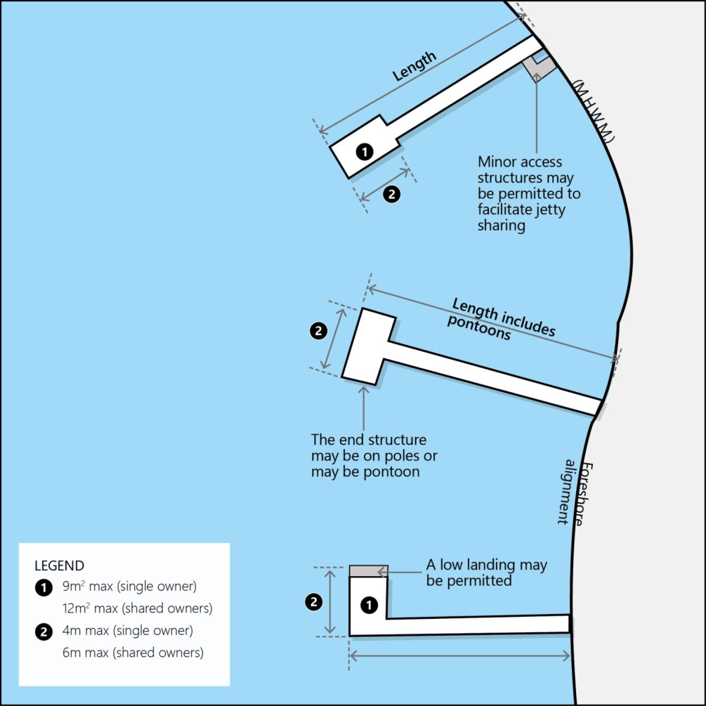
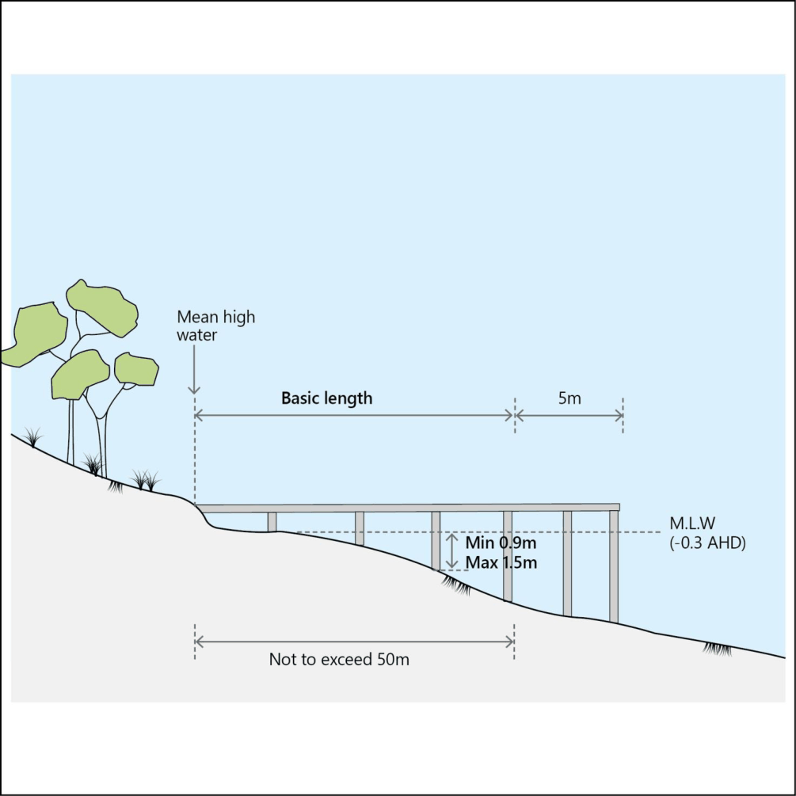

#### 2.12.4 TUGGERAH LAKES ESTUARY & LAKE MACQUARIE

#### 2.12.4.1  General Requirements Related to the Tuggerah Lakes Estuary and Lake Macquarie

a Any material excavated from below low tide or the natural water table must be tested for potential acid-sulphate soils and, if found, treated to neutralise prior to disposal.

b Water recreation structures under this Section are only intended to facilitate access where a reasonable depth of water can be achieved without the necessity for an extended structure. Larger vessels or keep vessels which cannot achieve water access to water recreation structures approved in accordance with those dimensions outlined within this section of the policy are not appropriate for berthing and will need to make other arrangements.

c Building materials used both in and for the construction shall include plantation grown timber and timber removed with the approval from State Forests. Mesh decking is acceptable. Buildings and structures should be non-reflective and use colours appropriate to the setting.

#### 2.12.4.2  Requirements for Boat Ramps and Slipways

a The recommended maximum length of a boat ramp is 5 metres when measured from the deemed high-water mark into the waterway.

b The recommended maximum width of a boat ramp is 3 metres.

c Boat ramps should be constructed directly on the bed of the waterway. Reclamation of the bed of the waterway is not permitted. Minor excavation of the waterway bed so as to produce an even grade is permitted.

d A boat ramp shall be constructed flush with the natural level of the foreshore. That part of the boat ramp which is below the mean high-water mark shall not project more than 150mm above the bed of the waterway.

e Boat ramps are to be constructed of concrete with a grooved non-slip surface.

f A boat ramp shall enter the waterbody at the property boundary where it meets the mean high-water mark.

g Where retaining walls have been / are to be constructed the foreshore is to be accessible to pedestrians therefore batters should not be greater than 1:8.

h The length of a slipway is to be the lesser of:

i The length necessary to achieve a depth of 1.2m at Indian Spring Low Water

ii The length of the jetty to be used in conjunction with the slipway.

i Slipways must achieve a depth of at least 600mm at Indian Spring Low Water.

j Slipways are to be a maximum of 2m wide

#### 2.12.4.3 Requirements for Domestic Jetties

a Council encourages the shared use and entitlement of a jetty between two or more adjoining waterfront properties.

b The maximum length of a jetty as measured from the deemed high-water mark into the waterway is:

iii the minimum length necessary to provide a water depth of 1.2 metres at mean high water mark

iv Not exceed a maximum ‘basic’ length of a possible 30 metres

c Legal access to the jetty must be available from each participating allotment. Legal access can be achieved by constructing the jetty from the common side boundary in the case of shared use between two parties or by the creation of a legal right-of-way.

d A jetty should generally form a right angle with the shoreline but may form some other angle where it is demonstrated that this is appropriate to the circumstances.

e The construction of an “L”, “T”, or similar type configuration on the “water end” or jetty head of the structure is permitted with an area not exceeding 9m² for a single owner or 12m² for a shared ownership. The dimension “Y” as shown in Figure 2 shall not exceed 4m for a single owner or 6m for a shared ownership.

f The width of a jetty is to be minimum 900mm and a maximum 1.2 metres, except for community and public water recreation structures.

g Jetties are to be constructed to a minimum height of 750 mm above the mean high-water level. Excessively high jetties will not be permitted.

h A jetty / wharf must not be constructed of solid fill but must be constructed on piles with a minimum longitudinal spacing of three (3) metres along the jetty / wharf.

i A single hand rail may be provided on one side of the structure only, with the design and construction to be such that access along the foreshore is not restricted. Handrails may be omitted for appearance where appropriate.

j Gates or similar devices are not permitted.

k Lighting on any jetty / wharf structure is to be minimal and will only be permitted where it can be shown to be essential for the safe use of the structure. Such lighting shall be neither red nor green.

l Davits and derricks will not be permitted.

#### 2.12.4.4 Requirements for Commercial Use Jetties

a Merit based assessments will be undertaken where the objectives of the Chapter are demonstrative to be delivered and using the provisions of this section of the Chapter as a guide.

b Favourable consideration will be given for the provision of an additional jetty / wharf where there is an agreement between adjoining owners to share the use and responsibility for the facility.

c Where the operation of a shared jetty or wharf policy results in an individual property being isolated and unable to submit to a shared jetty proposal, Council may consider permitting a single jetty.

d Where approval is sought to rebuild or replace an existing structure, an agreement must be made for adjoining owners to equally share use of and responsibility for the facility.

e Legal access is to be available or provided to / from the facility for each property involved in a shared facility (e.g. right-of-way easement, adjustment of common boundary etc.)

#### 2.12.4.5  Requirements for Retaining Walls

a Retaining walls should be located wholly within private land above the deemed high-water mark and not exceed 1 metre in height.

b Retaining walls are to be designed by an appropriately qualified and practising structural engineer.

c Retaining walls are to be designed with a minimum life expectancy of 50 years.

d The design of the retaining wall is to consider and provide appropriate stormwater management.

#### 2.12.4.6 Positive Covenant and Licence for Development in Tuggerah Lakes Estuary

Prior to construction of any water recreation structure, the owner shall:

a Submit a copy of the licence agreement issued by the Department of Industry – Lands for the use of Crown Land; and.

b Create a positive covenant which is attached to the land owned by the person who receives the benefit of a licence and requires the landowner to:

i Maintain public liability insurance for the life of the structure;

ii Maintain the structure in a safe condition at all times;

iii Provide an identification and licence number; and,

iv If (i) and (ii) are not complied with the structure(s) shall be removed.

c Where appropriate, allow right-of-access to others who share the facility.

d The owner shall be responsible for Council’s legal and administrative costs in relation to the preparation of the positive covenant.

### APPENDIX

> [Picture on page 14: a picture, saved as a picture (images/ch-02-12-waterfront-structures-page-14-2.gif, 150 dpi).]

#### Figure 2: Typical Jetty Layout – Plan View

> [Picture on page 15: a picture, saved as a picture (images/ch-02-12-waterfront-structures-page-15-1.gif, 150 dpi).]

#### Figure 3: Typical Jetty Elevation (Brisbane Water)
