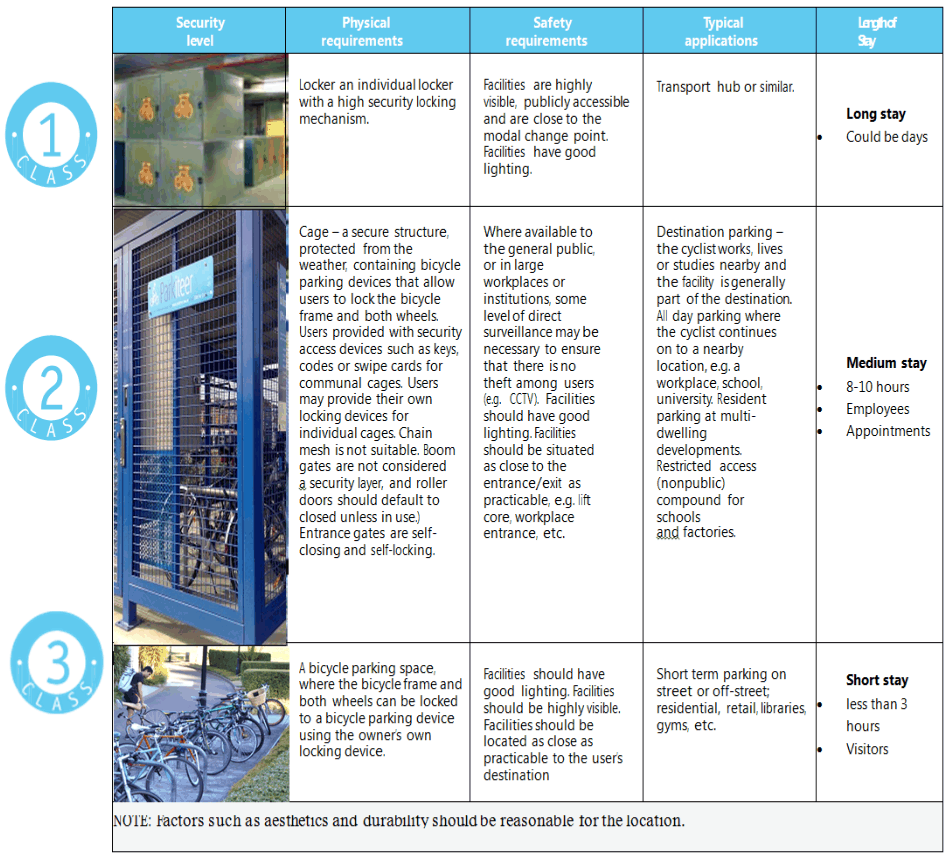

# Central Coast Development Control Plan 2022 - Chapter 2.13 Transport and Parking

> This chapter is split into 4 section file(s), one per numbered heading, in the order they appear in the PDF.

Source PDF: [2.13_Transport_and_Parking.pdf](2.13_Transport_and_Parking.pdf)

#### 2.13.1 INTRODUCTION

The purpose of this Chapter is to ensure that sufficient, well designed on-site car and bicycle parking provisions are made in all new developments and when changes occur to the existing use/development of premises. The Chapter provides details of Council’s requirements and guidelines for the planning and design of on-site parking facilities which satisfy the demand resulting from the development of the site.

This Chapter is principally based on the relevant Australian Standards/ New Zealand Standards; Austroads Guide to Traffic Management Part 11: Parking, 2017 (as amended); and, the Roads and Maritime Services. Adjustments have been made to take into account local factors based on surveys of particular types of development on the Central Coast with the aim to encourage use of public transport, cycling and walking in all areas, especially in locations of high accessibility.

#### 2.13.1.1 Objectives of this Chapter

To provide Council’s requirements in relation to development, and:

▪ Provide safe and convenient access to car parking areas associated with development

▪ Establish an appropriate environmental quality for parking facilities associated with development

▪ Ensure adequate parking provision for new developments and encourage the use of public transport, cycling and walking

▪ Ensure that a balance is achieved between the needs of the proposed development and its use and vehicular, bicycle and pedestrian traffic

▪ Reduce car parking demand over time

▪ Promote the efficient use of car parking spaces through the consolidation of available car parking facilities

#### 2.13.1.2 Land to which this chapter applies

This chapter applies to the entire Central Coast Council Local Government Area. Development should facilitate use of all modes of transport including cycling, walking, public transport, car share and vehicle access.

#### 2.13.1.3 Glossary

Gross Floor Area (GFA) means the same as defined in Central Coast LEP 2022

Medical staff for hospitals and nursing homes means doctors and other specialist medical practitioners. It does not include nurses, who are considered to be “employees”.

Net Floor Area means the total floor area used for the purpose of a specific use.

Off-street parking means parking which is not within the road reserve.

Overflow carpark means an area identified to accommodate car parking on special occasions (outside the normal requirements) and needs to be adequate for all weather but not necessarily sealed.

Traffic Impact Study means a study prepared in accordance with Appendix A of this Chapter.

Transport Management Plan means a plan prepared in accordance with Appendix B of this Chapter.

#### 2.13.2 GENERAL PRINCIPLES

The following principles are used when considering transport and parking associated with development:

▪ The likely demand for on-site parking to be generated by the development.

▪ The availability of public transport in the vicinity to service the likely demands to be generated by the development.

▪ Traffic volumes on the surrounding street network including, where relevant, likely future traffic volumes.

▪ The probable mode of transport of the users of the development.

▪ The likely peak usage times of the development.

▪ The provision of alternative private transport arrangements (e.g. free courtesy buses to licensed premises).

#### 2.13.3 CALCULATION OF CAR PARKING SPACES

#### 2.13.3.1 General Requirements

#### OBJECTIVE

▪ To ensure that adequate off-street parking is provided for new development

#### REQUIREMENTS

a The number of car parking spaces for a development is to be determined from Table 1. Where a variation to the number of spaces required in Table 1 is proposed, a Traffic Management Plan (TMP) is to be provided (refer Appendix B). The reasons and justification for any variation are to be included in the TMP for Council’s consideration.

b Where the number of parking spaces required by this chapter does not equal a whole number, the number of spaces is to be rounded up to the nearest whole number.

#### 2.13.3.2 Car Parking Requirements

| Land Use | Requirements |  |
|---|---|---|
| a Dwellings | i 3 or fewer bedrooms ii 4 or more bedrooms | 1 space per dwelling 2 spaces per dwelling |
| b Dual Occupancy | i 3 or fewer bedrooms ii 4 or more bedroom dwellings | 1 space per dwelling At least one fully enclosed garage per dwelling is required 2 spaces per dwelling At least one fully enclosed garage per dwelling is required |
| c Multi Dwelling Housing | i spaces per dwelling ii Visitor spaces | 1.5 spaces rounded up to the next whole number 0.2 spaces per dwelling rounded up to the next whole number |

| Land Use | Requirements |  |
|---|---|---|
| d Residential Flat Buildings | i not within 400m of a train station ii within 400m of a train station iii Visitor spaces iv For properties within 400 metres of train station at nominated Regional Centres (Metropolitan Sub-Regional Centres - Gosford, Tuggerah and Wyong) - Up to 20 units iv For properties within 400 metres of train station at nominated Regional Centres (Metropolitan Sub-Regional Centres - Gosford, Tuggerah and Wyong) - 20 or more units | 1.5 spaces per dwelling 1 space per dwelling 0.2 spaces per dwelling, rounded up to the next whole number 1 space per unit +1 space for every 5 x 2 bedroom unit +1 space for every 2 x 3 bedroom unit +1 space for 5 units (visitor parking) 0.6 spaces per 1 bedroom unit 0.9 spaces per 2 bedroom unit 1.4 spaces per 3 bedroom unit +1 space per 5 units (visitors |
| e Shop-Top Housing ( residential component – commercial component dealt with elsewhere in this table) *does not apply to shop-top housing that is defined as a residential flat building | i up to 3 bedrooms ii dwelling of 4 or more bedrooms | 1 car space per dwelling 2 spaces per dwelling |
| f Residential Care Facility (Nursing Home) *applicable to development applications not using SEPP provisions |  | 1 space per 5 beds and 1 space per 2 employees and Adequate spaces to be provided for staff Service Requirements (including Ambulance): 2 spaces |
| g Boarding Houses |  | at least 0.5 parking spaces are provided for each boarding room |
| h Exhibition Home |  | For single exhibition homes: 1 on-site space for staff PLUS 2 spaces on-site for visitors Spaces are not to be provided within the front building setback which includes setback to both streets on corner lots For an exhibition village, 2 off-street spaces per exhibition home |
| i Hotel (Pub) or Motel accommodation and Serviced Apartments |  | 1 space per accommodation unit, plus 1 space for every 2 persons employed in connection with the development and on duty at any one time |
| j Backpacker’s accommodation |  | 1 space for each 5 occupants/lodgers plus 1 space for any resident manager, plus 1 space for each 2 employees. |

| Land Use | Requirements |  |
|---|---|---|
| k Bed and Breakfast and Farm stay accommodation |  | 1 space per visitor bedroom plus 2 spaces for permanent residents |
| l Caravan Parks and Camping Grounds |  | Rates for residents and visitors are set by Local Government (Manufactured Home Estates, Caravan Parks, Camping Grounds and Movable Dwellings) Regulation 2005. |
| m Tennis, Squash Courts |  | 3 spaces per court |
| n Bowling Greens |  | 30 spaces for the first green then 15 spaces for each additional green |
| o Gymnasium |  | 7 spaces per 100m² GFA |
| p Golf Course |  | 4 spaces per hole on the course |
| q Sporting Fields |  | 50 spaces per field |
| r Swimming Pools |  | 30 spaces per 500m² GFA (water area only) |
| s Medical Centres and Health Consulting Rooms |  | 3 spaces per surgery or consulting room, plus 1 space for each professional practitioner and other staff present at any one time. The rate applicable to office premises applies to where the site is a centre listed in Appendix D of this chapter. |
| t Hospital |  | 1 space per 2 beds PLUS 1 space per 2 employees PLUS Adequate spaces to be provided for staff Service requirements (including ambulance): 2 spaces |
| u Veterinary Hospital |  | 3 spaces per surgery or consulting room, plus 1 space for each professional practitioner and other staff present at any one time. |
| v Centre Based Child Care Facilities |  | 1 space per person employed in connection with the use, plus a temporary stand area at the rate of 1 car for each 6 children (a minimum of 5 temporary stand spaces). |
| w School / Education Establishments | i Primary School ii Secondary School | 1 space per staff member and 14 drop off spaces (can be on-street) per 100 students 1 space per staff and 7 drop off spaces (maybe on- street) Minimum of 2 spaces for disabled students to be provided on site for Primary and Secondary and 1 space for Pre-schools 1 space per 8 senior/adult students for student parking Bus standing areas, parent drop-off and set-down are to be provided subject to a Transport Management Plan (TMP) based on anticipated mode split Adequate ‘Kiss-and-Ride’ facility is to be provided at all education establishments and is to be addressed in the TMP. |

| Land Use | Requirements |  |
|---|---|---|
| x Community Facility: Hall, Neighbourhood Centre, Youth Centre or similar |  | 1 space per 10 seats or 1 space per 20m² (whichever is greater) Additional parking is dependent on location and size of centre and nature of activities provided 1 space is required for service vehicles depending on location and intended use |
| y Place of Public Worship and Place of Public Entertainment (not elsewhere mentioned) |  | 1 space per 20m² gross floor area or 1 space per 10 seats, whichever is the greater. |
| z Commercial Premises |  | 1 space per 40m² GFA |
| aa Office Premises |  | 1 space per 40m² GFA |
| bb Office Premises (Call-centres, data entry and uses with employment density greater than 1 employee per 15m² GFA)* | i in major centres ii not in major centres | 1 space per 25m² GFA in major centres (town and major), provided that TMP approved by Council Service Requirements: Up to 200m² GFA - 1 space Greater than 200m² GFA - 1 space per 2,000m² * Note: Increases may be imposed depending on the proposed use of the development, e.g. number of parking spaces will increase where continuity of shifts occur. 1 space per 20m² GFA in major centres (town and major), provided that TMP approved by Council Service Requirements: Up to 200m² GFA - 1 space Greater than 200m² GFA - 1 space per 2,000m² * Note: Increases may be imposed depending on the proposed use of the development, e.g. number of parking spaces will increase where continuity of shifts occur. |
| cc Home Business |  | Minimum of one parking space per dwelling PLUS 1 space per non-resident employee PLUS 1 space per client using the site at any one time On street car parking where available can be assumed to provide 1 space per dwelling |
| dd Shops |  | 1 space per 30m² GFA |
| ee Shopping Centres | i 0-5,000: GFA (m²) spaces per 100m² GFA ii 5,000-10,000 GFA (m²) spaces per 100m² GFA | 3 spaces 6.1 spaces |

| Land Use | Requirements |  |
|---|---|---|
|  | iii 10,000-20,000 GFA (m²) spaces per 100m² GFA | 5.6 spaces |
|  | iv 20,000-30,000 GFA (m²) spaces per 100m² GFA | 4.3 spaces |
|  | v over 30,000 GFA (m²) spaces per 100m² GFA | 4.1 spaces |
| ff Service stations and convenience stores |  | 1 space per 20m² GFA of convenience store Driveways to petrol pumps must provide sufficient space for a minimum of 2 cars to queue for each pump Space for refuelling tankers without impeding other traffic |
| gg Car tyre retail outlets |  | whichever is the greater of: 3 spaces per 100m² GFA, or 3 spaces per work bay |
| hh Plant nurseries and landscaping material supplies |  | Whichever is greater of: 15 spaces; or, 0.5 spaces per 100m² of site area |
| ii Markets |  | 2.5 spaces per stall (customers only) |
| jj Bulky Goods Premises |  | 1 space per 50m² GFA Service Requirements: 1 space per 2,000m² GFA or 1 space for each separate unit in a development (whichever is greater) |
| kk Hardware and Building Supplies |  | 1 space per 50m² GFA Service Requirements: 1 space up to 2,000m² GFA then 1 space per 1,000m² GFA |
| ll Take Away Food & Drink Premises: | i With No Seating and No Drive Through ii With Seating and No Drive Through iii With Seating and Drive Through | 12 spaces per 100m² GFA. The greatest of 12 spaces per 100m² GFA or 1 space per 5 seats (internal and external) or 1 space per 2 seats (internal) The greater of 1 space per 2 seats (internal) or 1 space per 3 seats (internal and external) Drive Through: queuing area for 10 car lengths. Queues must be able to extend an additional 2 car lengths without unreasonably disrupting car parking operations or extending into street. A minimum of 2 waiting bay spaces to pick up orders are required. Spaces may be required for buses and cars with trailers Service Requirements: 1 space |
| mm Restaurants |  | Whichever is greater of: 15 spaces per 100m² GFA, or 1 space per 3 seats For sites identified in Appendix D of this Chapter, the applicable rate is 1 space per 30m² GFA |

| Land Use | Requirements |  |
|---|---|---|
| nn Pub / Registered Club | i Gross floor area up to 5000m² (including outside seating areas) ii Gross floor area over 5000m² (including outside seating areas) | 1 space per 10m² 1 space per 20m² |
| oo Drive In Liquor |  | 2 spaces plus 1 space per person employed in connection with the use and on duty at any one time |
| pp Industrial | i industrial floor space ii warehouse/bulk stores/self- storage units. iii ancillary office space. iv ancillary retail space. | 1 space per 100m² 1 space per 300m² 1 space per 40m² 1 space per 30m² |
| qq Vehicle repair station and vehicle body repair workshop |  | 3 spaces per 100m² gross floor area or 3 spaces per work-bay whichever is the greater. |
| rr Vehicle sale or hire premises |  | 1.5 spaces per 200m2 site area used for this purpose, plus 6 spaces per service bay or 1 space for every 2 persons employed in connection with the use. |
| ss Sex Services Premises |  | 1 per 2 working rooms |
| tt Entertainment Facility and/or Cinema |  | 1 space per 10 seats The required number of spaces may be reduced in a major or town centre subject to approval of a TMP |

#### Table 1 – Car Parking Rates

#### 2.13.3.3 Dimensions of Parking Spaces

#### OBJECTIVE

To provide for parking spaces and aisles in a development that is adequate and has appropriate dimensions for safe and efficient operation of the carpark

#### REQUIREMENTS

a The dimensional requirements for on-site car parking spaces and driveways giving access to parking spaces shall generally be set out in accordance with the Australian Standard – AS 2890.1 and 2980.6 as amended as a minimum except where the requirements are specifically defined in this plan.

b For all residential dwellings and units a garage or enclosed carport, where required, is to have clear internal dimensions of a minimum of 3.0 metres x 5.4 metres (excluding support columns located away from car door access points).

#### 2.13.3.4 Stacked Parking

#### OBJECTIVE

To ensure that parking areas are designed in such a way that vehicle movements both on-site and off-site are not impeded by parked vehicles.

#### REQUIREMENTS

a For dwelling houses, stack parking may be permitted in the front setback area provided that it does not extend beyond the property boundary and does not impact on sight lines, particularly on corner lots.

b For dual occupancies, stack parking may be provided where it does not extend beyond the property boundary, and does not interfere with sight lines, parking or manoeuvring for other residents.

c With the exception of dwelling houses and dual occupancies, stack parking will not be recognised for the purpose of car parking calculations.

#### 2.13.3.5 Delivery / Service Vehicles and Emergency Vehicles

#### OBJECTIVE

To provide for the safe and efficient operation of delivery/service vehicles and emergency vehicles

#### REQUIREMENTS

a Requirements for delivery/service vehicles and other vehicles unless identified in this chapter, are to be based generally on the Roads and Traffic Authority “Guide to Traffic Generating Developments”, as amended, and the Australian Standards relating to the specific needs of each development. Regard needs to be given to the type and scale of the development. Some details are provided in Table 1; however, a statement is required with the application establishing the needs of the particular development.

b Manoeuvring and reversing areas for delivery/service vehicles are not to conflict with general parking and pedestrian requirements.

c Provision should also be made for appropriate access for emergency vehicles.

#### 2.13.3.6 Bus and Coach Parking

#### OBJECTIVE

To provide for adequate and safe access and parking for buses and coaches

#### REQUIREMENTS

a Large developments, such as shopping centres (town or major), schools, sporting complexes and tourist resorts require parking on-site for regular passenger buses (and taxis), shopper-coaches, tourist coaches etc. Parking for sufficient numbers of vehicles at convenient places (usually at main entrance points) should be provided on-site. These facilities should be safe, functional and conveniently located especially where used by the disabled and aged. They may also include appropriate shelters.

b Setting down and picking up may be permitted on-street where legally permitted; however, parking of buses must be provided on-site. Bus facilities should also be designed to cater for any future growth or increased demand for bus services.

c Refer to AS 2890.2, as amended, and to the Austroads Guide to Traffic Management, as amended, for all requirements for bus parking facilities. Variation/additions to these standards may be required if coaches are likely to use the facilities.

#### 2.13.3.7 Parking and access for the disabled

#### OBJECTIVE

To provide for the safe access and parking for people with a disability.

#### REQUIREMENTS

a Parking for people with a disability is to be located as close as possible to the nearest access for the disabled within a particular building. The path of travel from the parking area is to be a safe route with adequate width, manoeuvring, circulation area and gradients to allow satisfactory access, as a minimum in accordance with AS 1428.1 as amended. If possible, this access path should be covered for all weather use.

b The total number of accessible car parking spaces for the disabled required for a development is to be determined in accordance with the Building Code of Australia. Generally, this rate is 1-2% of total parking provided is to be for disabled parking. For carparks containing more than 10 car spaces then a rate of 1 Disabled space is to be provided for every 100 spaces additional spaces. For developments like hospital and medical then at least 2 Disabled spaces are to be provided for every 100 additional spaces.

c The design of the accessible parking spaces is required to comply with the provisions of AS/NZS 2890.6.

d All parking spaces for the disabled are to be appropriately and effectively marked and identified.

e Ramps should be provided at locations that are easily accessible and provide appropriate, coherent and direct connectivity.

f In any residential development, consideration should be given to providing garages in accordance with the dimensions for Class 4 spaces under AS2890.1. This would provide flexibility in making such facilities available for occupants with disability, or if not so used, provide domestic storage space.

#### 2.13.3.8 Bicycle Parking

Provision of adequate bicycle facilities and parking encourages trips by cycling, which reduces congestion and overall demand for car parking.

#### OBJECTIVE

Provide safe access and adequate facilities for cyclists.

#### REQUIREMENTS

a Consideration is to be given to the type of parking facility to be provided, security arrangements, access and ease of use, having regard to the anticipated users and their length of stay as summarised in Table 2.

b Bicycle parking facilities can be classified into three categories (as per Austroads Part 14, Bicycles) according to level of security required for each user. These are:

Class 1

1\.  All Day parking is for employees and residents. Locked enclosures are reasonably secure if they are provided in a basement carpark or a similar enclosed space. Details of these facilities are to be provided with the development application.

Class 2

Class 3

2\. All-day or part of day parking is for regular employees and commuters at stations. Locked compounds require management of their use and are most suited to employees or regular clients. Users would have communal access using duplicate keys or electronic swipe cards. Details of these facilities are to be provided with the development application.

3\. Short term parking for visitors to shopping centres, offices, shops. Use bike racks, lockers or a locked enclosure. Racks are more suitable for customers on a short visit to the development, they do not prevent vandalism/theft of accessories.

c The number of bicycle parking facilities required has been summarised into two broad user types: Short Stay Visitor / Shopper and Long Stay Employee / Resident. These parking rates are provided, where applicable, for each land use in Tables 2 and 3.

d Bicycle parking areas should be provided where passive surveillance will frequently occur providing a reasonable level of security.

e AS 2890.13:2015 Parking Facilities suggests a 10% mode share is a reasonable starting point to accommodate cyclist trips in urban environments. Usually with bicycle parking facilities Class 1 and Class 2 - showers and clothes lockers are provided at developments that could generate a significant number of employee cycle trips. For these locations the following provision is suggested:

i. One shower for the first five bike spaces plus an additional shower for each additional 10 bike spaces.

ii. One change room for every shower where two or more changes are provided then separate male and female facilities.

Note:  Refer to Austroads Guide to Traffic Management Part 11: Parking, 2017 (as amended) for planning guidelines and cycling facilities and design requirements for bicycle parking and end-of-trip facilities.

#### 2.13.3.8.1 Bicycle Parking Rates – Short Term

| Land Use | Bicycles – Short Stay |
|---|---|
| a Multi Dwelling housing and Residential Flat Buildings | 1 space per 12 dwellings |
| b Shop-Top Housing | 1 space per 3 dwellings |
| c Residential Care Facility | 1 space per 60 beds |
| d Hotel (Pub) or Motel accommodation | Bar: 1 space per 25m² of net drinking or seating area; and, Lounge and outdoor: 1 space per 100 m² of seating area |
| e Boarding house, Backpackers & Hostels accommodation | 1 space per 16 lodging rooms |
| f Tennis, Squash Courts | 1 space per court |
| g Gymnasium | 1 space per 200m² GFA |
| h Swimming Pools | 1 space per 200m² GFA |
| I Medical Centres and Health Consulting Rooms | 1 space per 4 practitioners |
| j Hospital | 1 space / 30 beds. Min 2 spaces |
| k Veterinary Hospital | 1 space per 4 practitioners |
| l Community Facility: Hall, Neighbourhood Centre, Youth Centre | 1 space per 200m² GFA Min 2 spaces |
| m Place of Public Worship and Place of Public Entertainment | 1 space per 100m² seating area Min 2 spaces |
| n Commercial Premises | 1 space per 750m² GFA |
| o Office Premises | 1 space per 750m² GFA |
| p Shops | 1 space per 150m² GFA Min 2 spaces |
| q Shopping Centres | 1 space per 500m² GFA Min 6 spaces |
| r Service stations and convenience stores | 2 spaces |
| s Markets | 1 space per 20 stalls |
| t Take Away Food & Drink Premises | 1 space/ 50m² GFA (Minimum of 2 spaces) |
| u Restaurants | 2 |
| v Pub / Registered Club | Bar: 1 space per 25m² of net drinking or seating area and Lounge and outdoor: 1 space per 100m² of seating area |
| w Drive In Liquor | 1 space per 500m² sales floor area |

#### Table 2 Bicycle Parking – Short Term

#### 2.13.3.8.2 Bicycle Parking Rates – Long Term

| Land Use | Bicycles - Long Stay |
|---|---|
| a Multi Dwelling housing and Residential Flat Buildings | 1 space per 5 dwellings |
| b Shop-Top Housing | 1 space per 3 dwellings |
| c Residential Care Facility | 1 space per 30 beds |
| d Hotel (Pub) or Motel accommodation | 1 space per 100 m² GFA of bars and public areas including lounges, beer gardens and restaurants |
| e Boarding house, Backpackers & Hostels accommodation | 1 space per 4 lodging rooms |
| f Tennis, Squash Courts | 1 space per court |
| g Gymnasium | 1 space per 400m² GFA |
| h Swimming Pools | 1 space per 400m² GFA |
| I Hospital | 1 space per 15 beds |
| j Veterinary Hospital | 1 space per 8 practitioners |
| k Child Care Centres | 1 |
| l Educational Establishments | 1 space /5 students over Year 4 1 space per 20 students |
| m Community Facility: Hall, Neighbourhood Centre, Youth Centre | 1 space per 200m² GFA Min 2 spaces |
| n Commercial Premises | 1 space per 200m² GFA |
| o Office Premises | 1 space per 200m² GFA |
| p Shops | 1 space/ 300m² GFA Min 2 spaces |
| q Shopping Centres | 1 space/ 1000m² GFA Min 6 spaces |
| r Service stations and convenience stores | 1 space per 800m² GFA |
| s Car tyre retail outlets | 1 space / 750m² sales floor area |
| t Take Away Food & Drink Premises: | 1 space/ 300m² of sales floor area |
| u Restaurants | 1 space 100m² of public area |
| v Pub / Registered Club | Bar: 1 space per 100m² of net drinking or seating area, and Lounge and outdoor: 1 space per 100m² of seating area |
| w Drive In Liquor | 1 space per 300m² sales floor area |
| x Industrial | 1 space per 1000m² GFA |

#### Table 3 – Bicycle Parking – Long Stay

> [Picture on page 13: a picture, saved as a picture (images/ch-02-13-transport-and-parking-page-13-1.gif, 150 dpi).]

#### Table 4: Examples of acceptable bicycle parking facilities

#### 2.13.3.9 Motorcycles and motor scooters

Provision of adequate motorcycle/motor scooter parking on site will encourage trips that use less road space and consume less energy than trips by private car.

#### OBJECTIVE

To provide for safe access and parking for motorcycles and motor scooters

#### REQUIREMENTS

a Parking is to be provided at a ratio of at least 1 motorcycle space per 50 car spaces. The minimum dimension for a motorcycle space is 2.5m x 1.35m.

b Motorcycle parking areas should be provided where passive surveillance will frequently occur providing a reasonable level of security. Consideration should be given to access and ease of use for motorcycles, having regard to the anticipated users and their length of stay.

#### 2.13.3.10 Visitor Parking

Visitor parking is generally required to be provided for multiple dwelling residential development and tourist accommodation, as well as establishments such as hospitals, nursing homes and Government Agencies.

#### OBJECTIVE

To provide for safe access and parking for visitors

#### REQUIREMENTS

a Visitor parking is to be provided in accordance with Table 1 as required. Parking for visitors (general public) is to be accessible at all times and external to any security arrangements.

b To achieve an acceptable level of amenity and a satisfactory relationship between adjoining land uses, the location of the parking area(s) within the site shall have regard to:

i. Site conditions such as slope and drainage

ii. The relationship of the building to the parking area

iii. The proximity of the parking area to any neighbouring residential areas

#### 2.13.3.11 Dual and Complementary Use of Facilities

For large scale multiple use developments, dual and complementary uses of parking areas may warrant a reduction in the cumulative parking allowances.

#### OBJECTIVE

To allow applicants the ability to reduce parking numbers where a dual or complementary use of facilities within a development is proposed.

#### REQUIREMENTS

a Where dual and/or complementary use of facilities within a development is expected to reduce the total parking demand, this should be identified in the Traffic Impact Study/Traffic Management Plan with specific details for justification for any discount in parking numbers for consideration by Council.

b Where it is proposed to use this approach it is recommended that applicants contact Council to discuss whether the proposal is appropriate for adjustment in car parking requirements prior to preparation of the final design or lodgement of a development application.

#### 2.13.3.12 Change of Use or Additions to Existing Development

#### OBJECTIVE

To ensure that a development that is proposed to be expanded or undergo a change of use will provide adequate access and parking

#### REQUIREMENTS

a Where a use is to be changed to another similar use generating no increase in the peak volume of traffic and parking requirements and has the same traffic characteristics, including delivery/service vehicle requirements, and no structural alteration, extension, enlargement or rebuilding is proposed, no additional parking provision is required.

b Where extension, expansion or enlargement of an existing development is proposed, this Chapter is to apply to the parking requirements for the proposed extension of the development.

c Where a change of use for an existing development is proposed, not generating a similar volume of traffic or with different traffic characteristics, this Chapter will apply for the whole of the new use.

d Nothing in this plan shall be applied to require that additional parking be required for the conversion of existing businesses / office floor space to either retail or restaurant land use in the Gosford Regional

City Centre. This saving provision only applies to the Gosford Regional City Centre because of the Gosford Parking Loan Rate which applies to this area.

#### 2.13.3.13 Special events or Regular Casual Uses

#### OBJECTIVE

To ensure that safe and efficient access and parking are provided for special events and regular casual uses.

#### REQUIREMENTS

a Organisers of special events (such as Mardi Gras, Parades, Festivals etc.) or regular casual uses (such as Circuses, Fairs, Annual Festivals, religious festivities etc.) are to provide details to Council on how the demand for car parking will be met, e.g. provision of overflow carparks, and how any special provisions for parking will be implemented.

b A traffic management plan may be required for any event that is likely to have a significant impact on safe traffic movement and efficient parking. This includes special events and the opening period of the development and peak trading times if applicable.

c For special events appropriate details are to be provided addressing pedestrian access to and from the site, routes to and from public transport, and pedestrian safety.

#### 2.13.3.14 Contributions to Satisfy Car parking Requirements

#### OBJECTIVE

To ensure that parking is provided through Development Contributions for those developments that do not provide the required amount of on-site parking.

#### REQUIREMENTS

a Parking required to meet demand is expected to be provided on site. However, where an appropriate Contributions Plan for Car parking is in place and the required amount of car parking for a development is not able to be provided on site, Council may permit the payment of a contribution for the number of parking spaces that are deficient. This will depend on the availability of other parking options as determined by the relevant Section 7.11 Contributions Plan and a satisfactory proportion of spaces being provided on-site. The sum payable in respect of a parking space in areas identified is determined periodically by the Council. The centres where cash contributions are required are:

▪ Avoca Beach

▪ East Gosford

▪ Ettalong Beach

▪ Terrigal

▪ Umina Beach

▪ Woy Woy

In the following commercial centres, no less than two thirds of the calculated parking requirement is to be provided on site, the balance of which is to be provided by way of a cash Section 7.11 contribution.

▪ Terrigal

▪ Woy Woy

The two thirds is to be calculated on the total number of spaces required after allowance (if any) for existing developments under s.2.13.3.13 of this Chapter or any similar adjustment.

b A voluntary planning agreement for a major development may propose the provision of the required number of parking spaces on a site that is accessible to the development, including facilities that improve pedestrian access between the parking area and the development. The developer should submit a Traffic Impact Study and Transport Management Plan that demonstrates the impacts of the proposal would be acceptable.

c Although the customers of such development may find it more convenient to use short-term on-street parking spaces, the Traffic Impact Study and Transport Management Plan should ensure that:

i. long-stay parking for staff is provided on-site or in an off-street parking area;

ii. any demand for on-street parking is compensated by provision of off-street spaces (or payment of a contribution for such spaces).

#### 2.13.4 DEVELOPMENT PROVISIONS – ACCESS DESIGN

#### 2.13.4.1 General design guidelines

This section deals with the design of the access to the development and internal access and parking areas within the development.

Safety is a major consideration in planning and designing a carpark and access to the development. This is influenced by the legibility and coherence of the layout of loading areas, vehicle access routes, pedestrian routes and desire paths, generally being a path of the most easily navigated direct route between an origin and destination.

Cars, delivery and service vehicles, other vehicles (e.g. buses, bicycles, mobility scooters) and pedestrians are to be accommodated by off-street access and parking provisions located close and convenient to the development. Complex or large car park layouts and/or accesses/intersections to developments would benefit from and in some instances will require a formal Road Safety Audit in accordance with Austroads guidelines. Such an audit may dictate major revision to the layout of the development.

For smaller or less complex layouts, the principles of road safety should be applied in the design process.

Development applications are to include details of parking area layouts, including accesses, intersections, general gradients, pedestrian facilities, traffic and speed control devices, landscape areas, acoustic treatments and lighting (where applicable). The following factors are to be addressed as a minimum:

i. the type and characteristics of the road fronting the development and the access point/s;

ii. sight distances for all users;

iii. intersections/accesses;

iv. potential conflicts of users;

v. stormwater management (quality and quantity);

vi. adjoining infrastructure, intersections, accesses etc;

vii. gradients where such information is critical in assessing the development;

viii. vehicle turning path including overhangs and setbacks/clearances for specific manoeuvres. These will vary significantly for difference development types and motorists.

#### 2.13.4.2 Details required in parking design

#### OBJECTIVE

To ensure that parking designs for a development include adequate information for the assessment of the parking requirements of that development.

#### REQUIREMENTS

Car parking designs, to scale and dimensioned, should include:

a property boundaries;

b parking space dimensions and any pillar encroachment details;

c turning paths for the different design vehicles, with appropriate clearances. Vehicles may require an envelope greater than specified in AS 2890 due to drivers with potentially impaired sight/judgement;

d aisle width;

e disabled spaces;

f vehicle circulation;

g clear and obvious circulation patterns;

h clarity at intersections:

i. no intersection legs are to be less than 70 degrees or greater than 110 degrees; and

ii. no “Dead Areas” are permitted;

i access into major carparks are to provide long aisles prior to the provision of parking spaces so not to stop vehicle flow due to manoeuvring backing up into the access/intersections;

j traffic and speed control devices;

k pedestrian requirements, including safe pedestrian movement through the carpark to the entry of the development;

l Delivery and service vehicle requirements. Avoid conflicts with other users, pedestrians, cyclists and general parking. Entry and departure to delivery/service areas to be in forward direction only;

m bicycle requirements;

n signage, pavement marking and raised pavement markers;

o gradients and cross falls;

p sight distance availability and compliance with AS 2890.1, as a minimum. Increased reaction time or other user characteristics or site constraints may warrant increased requirements;

q provision of shade trees and landscaped areas (including irrigation systems);

r shopping trolley bays where appropriate;

s acoustic treatments;

t headlight barriers;

u pavement types;

v lighting – where applicable. Lighting design should consider the mature height of all proposed tree planting and comply with the relevant standards for overspill lighting to adjoining properties;

w access to parking areas;

x queuing areas and grade;

y security;

z column locations;

aa vertical clearance – see requirements for disabled parking spaces;

bb vehicle overhangs/ wheel stop requirements. Eliminate damage to landscaping and interference with pedestrian routes;

cc ramps – gradients, widths and alignments. Two-way curved ramps are not supported;

dd locations of nearby intersections, traffic facilities and/or accesses that adjoin or are close to the proposed carpark.

#### 2.13.4.3 Access design

#### OBJECTIVE

To provide for safe and efficient access to the development and operation of the carpark through adequate design, gradient and dimensions of accesses and access intersections.

#### REQUIREMENTS

a The location of access points to developments and their car parking is critical and needs to be carefully selected based on a number of criteria. The design of accesses to off-street parking areas, queuing areas, etc. shall comply with AS 2890.1, the RTA’s (RMS) “Guide to Traffic Generating Developments” (October 2002 and as amended), Austroads Guide to Road Design and Council’s Civil Works Specification (as amended).

b Safety is a primary consideration in planning for development. In this regard the safety aspects of all users are to be carefully considered and the development access/es are to be designed accordingly.

c Sight distances at driveway exits are to be in accordance with AS2890.1.

d Where a range of widths are shown for accesses, the maximum width is to be used. This may differ depending on turning requirements of the design vehicle.

e Parking areas with boom gates or locked gates operated by key pads or similar should have a queuing length sufficient to accommodate the peak demand without adversely affecting traffic or pedestrian movements on the frontage road, with a minimum queue length of two vehicles (12 metres) and not exceeding 10%. The grade at the key pad or similar (control point) is not to exceed 5%. A Traffic Impact Study should determine the length of the queuing area by consideration of the traffic volume in the frontage road, the capacity and design of the parking area, likely peak flow and access time at entry/exit gates.

f For smaller parking areas with gated entries, AS 2890.1 is to be used to provide guidance on the queuing length for such facilities, which should allow for a minimum of two cars (as specified above).

g The gradient of the access driveway should be in accordance with AS 2890.1.

#### 2.13.4.4 Manoeuvring

#### OBJECTIVE

▪ To ensure that parking areas and access ways are designed for safe and efficient manoeuvring of vehicles; and,

▪ To limit the number of manoeuvres when entering and exiting a development,

#### REQUIREMENTS

a All developments shall be designed so that entry and exit from parking areas to a public road is in a forward direction excepting:

i. Single dwelling houses; and

ii. Dual occupancies (side by side) located on local roads

Note: Council may require forward egress for all land uses where local conditions such as average vehicle speed, sight lines and traffic volume cause a safety concern

b For developments where car parking is proposed along or at the end of a common driveway, or access handle/right of way, an adequate manoeuvring area must also be provided on-site so that the vehicles of residents can enter and leave the site in a forward manner using no more than a 3 point turn.

c Particular attention is to be given to circulation within the parking area and to the facilities required to ensure that a safe and efficient circulation pattern is achieved. Right of way at intersections is to be clearly defined. There should be no accesses or intersections with adjoining roads with angles less than 70 degrees or greater than 110 degrees.

d Turning areas are to be designed in accordance with AS 2890 (section 2.4). Generally, the maximum widths identified for accesses are to be used (sections 2.5 and 3.2). Potentially impaired eyesight/judgement or other user characteristics may warrant increased requirements, particularly with developments for seniors.

#### 2.13.4.5 Delivery and service vehicle requirements

The type, size and frequency of delivery and service vehicles for a development are to be identified. This should include the details of the likelihood of multiple deliveries and services occurring concurrently. Service areas are to be designed to suit the particular vehicles and operations in the service areas.

#### OBJECTIVE

To provide for the safe and efficient operation of delivery and service vehicles through the appropriate location and design of loading bays, service areas and access ways in a development

#### REQUIREMENTS

a There must be adequate provision made for the manoeuvring, loading and unloading of vehicles on the site. Ensuring the safety of the public and employees is maintained is the major consideration in the design of loading and service areas. Conflicts with other users, pedestrians, cyclists, general parking and manoeuvring areas as well as associated accesses are to be avoided.

b The development is to provide satisfactory on-site areas for delivery and service operations. On street loading/offloading will not be permitted.

c Service areas are to be defined areas that are generally not to be used for any other purpose.

d Delivery/service vehicles are to be separated from other uses (such as pedestrians, cyclists and cars).

e Entry and departure to delivery/service areas are to be in a forward direction only.

f Any reversing of delivery/service vehicles is to be performed in areas remote from pedestrians, cycle and car movements. The design vehicle shall be able to manoeuvre into and dock with its service bay with only one reverse movement and without the vehicle infringing the boundary of the service area.

g The internal accesses are to be sized to cater for manoeuvrability of the largest vehicle likely to utilise the area or the vehicle likely to require the largest manoeuvring area.

h Access for emergency vehicles is to be provided and maintained at all times.

i Designs for commercial and industrial developments are to identify the location of loading facilities. Where internal loading bays are proposed, minimum opening height of 3.5 metres is required. This shall be increased, depending on size of the largest anticipated vehicle.

j All industrial and commercial developments have a need for access by delivery/service vehicles. As a minimum, these developments are to provide loading facilities for a small rigid vehicle (SRV). Loading bays for SRV’s are to have minimum dimensions of 6.4 metres x 3.5 metres.  Where larger than small rigid vehicles are anticipated, provision must be made for that size vehicle supported by documentation from goods suppliers as to the size of vehicles that will service the development.

k Where a town or major centre is adjacent to a B-Double route, provision is to be made for B-Double access, manoeuvring and parking of trailers including uncoupling areas/s. Details of such arrangements are to be submitted for Council and RMS approval.

Note:  AS 2890.2 provides further information on the requirements of delivery vehicle areas. These will vary depending on the vehicles to be accommodated and the geometry of the loading area/s.

#### 2.13.4.6 Materials

#### OBJECTIVE

To ensure that the materials and construction of parking areas (including loading areas) and accesses are adequate for the intended loading and operational conditions of the carpark.

Note: Refer to Council’s Civil Works Specification for further details regarding pavements, construction and material requirements.

#### REQUIREMENTS

a For any parking areas and accesses the materials of construction are to have regard for the applicable intended loadings (including increased loadings for tight turns), pavement design life and surface and sub-surface drainage.  A non-slip finish is to be provided. Decorative treatments are to blend with the surrounding development and landscaping but they should not mask the pavement markings. The kerb types in parking areas are to be low enough to permit vehicle overhang where designed, but provide approved wheel stops. Concept details are to be provided with a development application.

b The surfaces are to be either concrete or sealed in accordance with Council’s Civil Works Specification. For minor parking areas in rural areas, Council may not require sealing of a carpark provided it is stable, dust free, does not present a slip hazard and is suitable for all weather.

c Car park pavements should be designed by a geotechnical or structural engineer taking into account soil conditions, soil permeability (in the case of porous pavements) and reactivity. Details of proposed finishes and construction details (including the results of geotechnical investigations and a pavement design report) are to be incorporated in the Construction Certificate.

#### 2.13.4.7 Signage and pavement marking

#### OBJECTIVE

To ensure that the signage and pavement marking for parking areas comply with RMS “Signs Database” and “Delineation”

#### REQUIREMENTS

a Parking areas shall be delineated with approved standard signs and pavement markings as a minimum. These are to comply with RMS Traffic Signs Database and Delineation Manual. Additional signage and pavement marking may be required to convey information relating to the facility to carpark users. Raised pavement markers may be required to reinforce the line marking.

b Visitor parking spaces, spaces for the disabled and spaces for mothers with prams are to be clearly delineated with pavement marking and signage.

#### 2.13.4.8 Pedestrian facilities

#### OBJECTIVE

To provide for the safe movement of pedestrians and the provision of pedestrian facilities within parking areas

#### REQUIREMENTS

a There are to be well-defined and obvious pedestrian lines/facilities in parking and access areas. In the design of accesses, internal roads, loading areas and parking areas, conflicts with pedestrians are to be avoided. Facilities which cater specifically for pedestrians, such as pedestrian crossings, raised crossings, pedestrian islands and signals, shared traffic zones and other pedestrian facilities are to be identified and implemented so that pedestrian access is delineated and the priority is placed upon their safe movement in the parking area.

b Pedestrian footpaths are to be provided in large carparks i.e. carparks with more than four rows and/or more than 40 metres in length. Signage directing pedestrians to the paths is also to be provided. Vehicle overhang, signposts and landscaping are to be located so as not to conflict with pedestrian movement.

c Adequate sight distance throughout the development and associated accesses is to be provided to improve the safety of pedestrians. This is to include sight distance from pedestrians to vehicles and vice versa.

d If the development is to operate after dark, lighting in accordance with the AS/NZS 1158.3.1, Lighting for roads and public spaces – Pedestrian area lighting, is to be provided. Any impacts on adjoining properties should be managed and the requirements of AS 4282 should be satisfied. Lighting considerations should include the provision of LED lighting, part/full solar power supply or other current sustainable lighting options.

e Kerb stops may be required where overhang of vehicles will inhibit the pathway for pedestrian use.

f The above requirements are also applicable for carparks where there has been a change of use for the development irrespective of the traffic volumes or characteristics of the proposed development.

#### 2.13.4.9 Shopping trolleys

#### OBJECTIVE

To allow for shopping trolleys to be collected and stored so that they do not impede the safe and efficient movement of pedestrians and vehicles; and,

To provide shopping trolley facilities that encourages their return to trolley bays.

#### REQUIREMENTS

a Shopping trolley collection bays are to be provided in all local, town and major shopping centres as a minimum.

b Shopping trolley bays are to be provided so that no parking space is more than 20 metres from a trolley collection bay.

c Systems should be implemented to contain shopping trolleys to the site (and associated parking areas) of the shopping centre that provides them.

#### 2.13.4.10 Landscaping

#### OBJECTIVE

▪ To ensure that developers consider landscape design in association with proposed parking areas as early as possible to reduce their visual impact; and,

▪ To encourage adequate landscaping in parking areas to provide shade cover for 50% of the carpark in the long term.

#### REQUIREMENTS

a Parking areas are to be landscaped appropriately, while providing adequate vision for all users. Landscaping is to be maintained so that site lines are not impeded.

b Landscaping is required along accesses and carparks where they adjoin private property.

c In large car parking areas, such as those in shopping centres, the provision of shade trees, with appropriate species selection, is mandatory. An adequate provision would be one shade tree per four parking spaces and the minimum provision should be one tree per six spaces. The aim of the landscape plan should be to provide shade cover for a minimum of 50% of the paved area of the carpark after 15 years of suitable growing conditions.

d Kerbs and clearances from vehicle doors are to be provided to prevent vehicles from damaging the landscaping or hitting trees, islands or walls and overhangs of footpaths. It should be noted that radiated heat from vehicle engines causes significant damage to landscaping. Adequate setbacks are required to provide separation of landscaping from radiated heat.

e All clearances to vehicles, pedestrians, cyclists, etc. are to be from the mature size of the proposed landscaping. Should an appropriate maintenance plan be provided such clearances may be reduced to provide for landscaping pruning.

f Any lighting is to be designed to allow for the mature height of the landscaping.

g Plants used for landscaping carpark areas should, wherever possible, be:

i. Native to the region

ii. Suitable for the eco-climate produced within the carpark

iii. Able to provide foliage at the appropriate height / spread to avoid creating sight distance in security problems and be able to provide shade to vehicles and pavement areas

iv. Species which will not damage car surfaces by dropping of fruits etc.

Note: A list of plants suitable for landscaping in carpark areas is included in Appendix C of this Chapter.

#### 2.13.4.11 Stormwater and water sensitive urban design

#### OBJECTIVES

▪ To ensure that stormwater systems for parking areas are designed to minimise the downstream impacts of stormwater and to control the water quality; and,

▪ To ensure that carparks and their drainage systems are designed to minimise water nuisance such as flows across pedestrian routes or ponding along them.

#### REQUIREMENT

Requirements for drainage and Water Sensitive Urban Design are specified in Council’s Civil Works Specification.

#### 2.13.4.12 Safer by design

#### OBJECTIVE

To ensure that car parking areas and pedestrian facilities are designed to reduce the opportunities for crime and anti-social activity.

#### REQUIREMENTS

a The design of carpark and pedestrian facilities is to have regard for the NSW Police Service “Safer By Design” Principles, which include:

i. Opportunities for natural and or technical surveillance;

ii. Appropriate access control;

iii. Territorial reinforcement;

iv. Appropriate space management.

### APPENDIX A TRAFFIC IMPACT STUDY

As part of the Study, a report is to be prepared by a Traffic Engineer, who is or is entitled to membership of the Australian Institute of Traffic Planning & Management (AITPM). The Traffic studies are to be carried out at the developer's expense.

<!-- sections -->
## Sections

1. [A1 Issues to be addressed](01-a1-issues-to-be-addressed.md)
2. [A2 Parameters to be included in the Report](02-a2-parameters-to-be-included-in-the-report.md)
3. [A3 Outline of Traffic Impact Report A3.1 Introduction](03-a3-outline-of-traffic-impact-report-a3-1.md)
4. [B4 How will the demand for parking be managed on or off the site?](04-b4-how-will-the-demand-for-parking-be.md)
