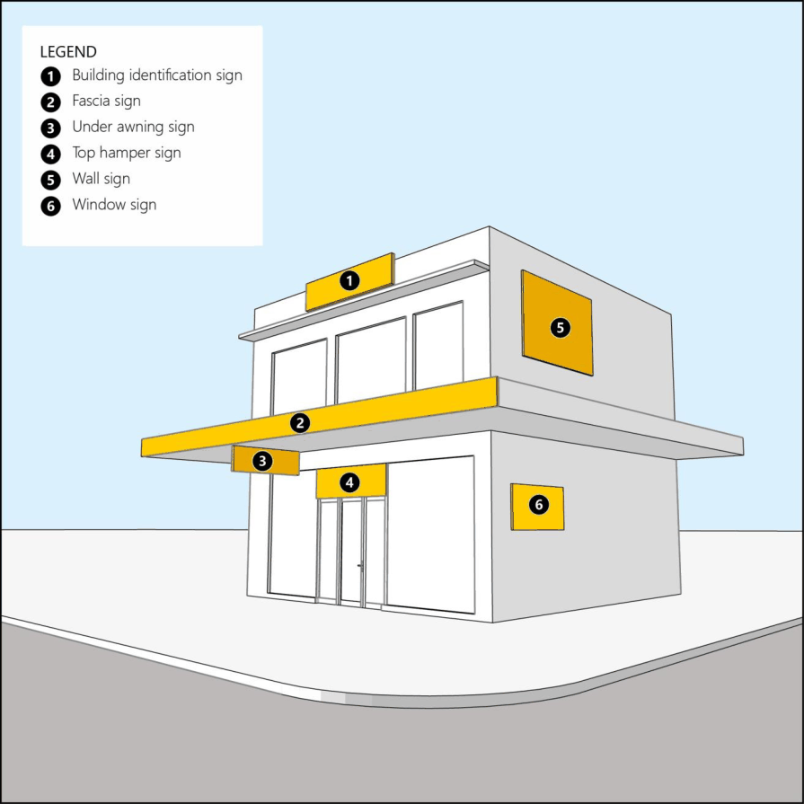
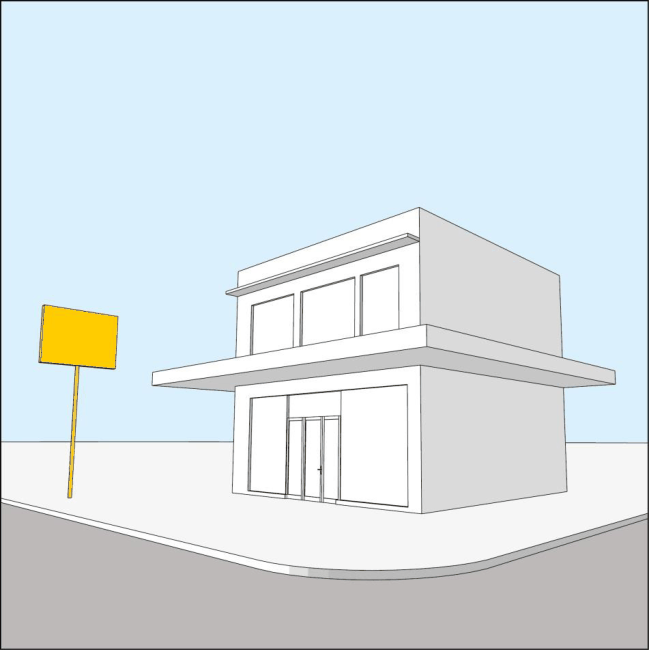
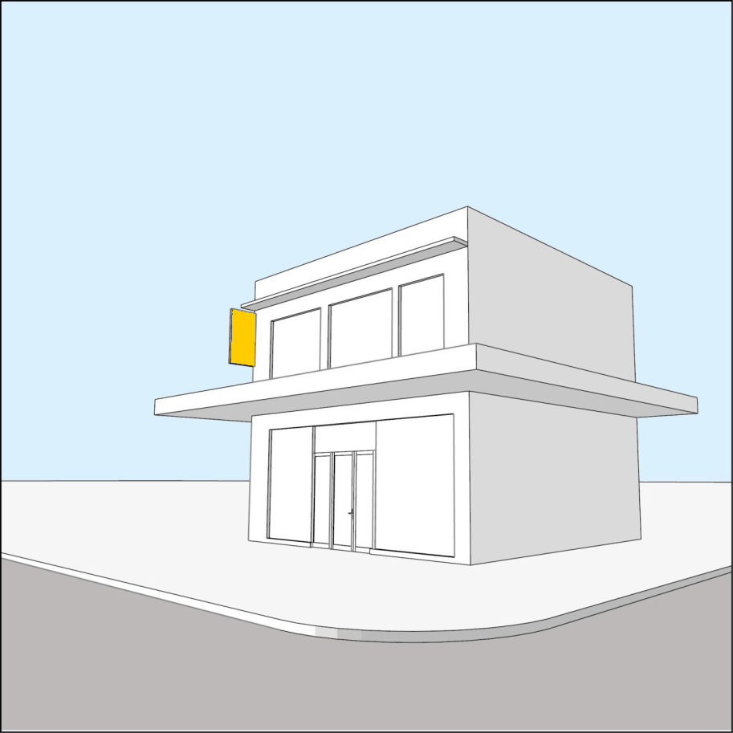
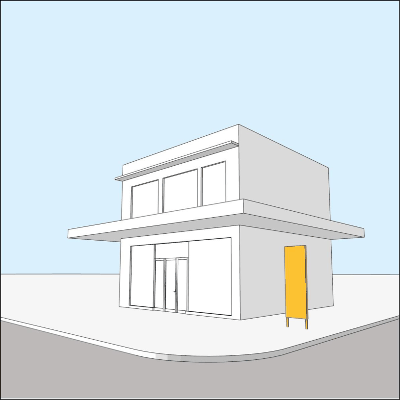

#### 2.15.2 BUSINESS AND BUILDING IDENTIFICATION SIGNAGE

> [Picture on page 4: a picture, saved as a picture (images/ch-02-15-signage-and-advertising-page-4-2.gif, 150 dpi).]

Figure 1 – Examples of typical building and business identification signage (Source: Department of

#### Planning Industry and Environment)

#### OBJECTIVES

▪ To ensure that signage does not dominate the skyline or compromise important views and that the scale, proportion and form of the proposal appropriate for the streetscape, setting or landscape

▪ To promote the reduction of clutter by rationalising and simplifying existing signage (where applicable)

▪ To ensure that the proposal is compatible with the scale, proportion and other characteristics of the site or building, or both, on which the proposed signage is to be located

▪ To ensure that any proposed signage considers the positioning of lawful existing signage

▪ To ensure that signage is compatible with the existing or desired future character of the area or locality in which it is proposed to be located

▪ To ensure that signage does not detract from the amenity or visual quality of any environmentally sensitive areas, natural or other conservation areas, open space areas, waterways, rural landscapes or residential areas (where applicable)

▪ To ensure illumination (where applicable) does not create a safety issue or detract from the amenity

▪ To ensure that the proposal does not create a safety issue through causing obstruction or by creating uncertainty

#### 2.15.2.1 Building Identification Signs

The construction or installation of a building identification sign on the facade of a building for the purpose of identifying or naming a building.

#### REQUIREMENTS

a Have only one sign displayed on each street frontage.

b Not be more than 2.5m2 in area.

c Be mounted flat against an exterior wall or parapet and must not protrude more than 300mm from the face of the wall or parapet.

d Not be located higher than the parapet or eaves of the building.

e Not cover any window, door or architectural feature.

f Not include any advertising of goods, products or services.

g Shall not cover any mechanical ventilation inlets or outlets located on any building on which it is carried out.

h All Illuminated signage must comply with the Australian Standard AS4282 - Control of the Obtrusive Effects of Outdoor Lighting.

#### 2.15.2.2 Wall Signs

The construction or installation of a business identification sign (including a business identification sign for a home business) which is flat mounted or painted on the exterior wall of an existing building, or on an existing boundary fence or wall.

#### REQUIREMENTS

a Must be attached to the building in which the business identified in the sign is located.

b If it is a sign that is located in a residential, rural or environment protection zone:

i for a sign for a home business, home industry or home occupation—not be more than 1m2 in area;

ii for a sign for any other use—not be more than 2.5m2 in area.

c If it is a sign that is located in an industrial zone:

i not be more than 16m2 in area if the sign is a wall sign attached or fixed to a building (other than a wall sign referred to in subparagraph ii);

ii not be more than 25% of the surface area of the wall of the building if the sign is a wall sign painted or applied by adhesive material on a building.

d If it is a sign that is located in a business zone or RU5 zone, not more 6m2.

e Not project beyond the parapet or eaves of the building to which it is attached.

f Not be more than 2.5m above ground level (existing) in a residential zone, and not be more than 8m above ground level (existing) in any other zone.

g Not cover any window, door or architectural feature.

h Shall not cover any mechanical ventilation inlets or outlets located on any building on which it is carried out.

i Shall not obstruct or interfere with any traffic sign.

j All Illuminated signage must comply with the Australian Standard AS4282 - Control of the Obtrusive Effects of Outdoor Lighting.

#### 2.15.2.3 Fascia Signs

The construction or installation of a business identification sign on the fascia of the awning of a building.

#### REQUIREMENTS

a Be mounted flat and securely fixed to the fascia.

b Involve a rigid signboard or a signboard within a rigid frame.

c Not project more than 300mm below or above the fascia.

d Shall not obstruct or interfere with any traffic sign.

e All Illuminated signage must comply with the Australian Standard AS4282 - Control of the Obtrusive Effects of Outdoor Lighting.

#### 2.15.2.4 Under Awning Signs

The construction or installation of a business identification sign below the awning of a building.

#### REQUIREMENTS

a Must be not more than 1.5m2 in area.

b Must be not more than 2.5m in length.

c Must be erected with the lower edge at least 2.6m above ground level (existing).

d Must be suspended at right angles to the building.

e Must not project beyond the awning fascia.

f Shall not obstruct or interfere with any traffic sign.

g All Illuminated signage must comply with the Australian Standard AS4282 - Control of the Obtrusive Effects of Outdoor Lighting.

#### 2.15.2.5 Top Hamper Signs

The construction or installation of a business identification sign above a display window or attached to the transom of a doorway.

#### REQUIREMENTS

a Must be not more than 2.5m2 in area.

b Must be not more than 600mm in height.

c Must be erected with the lower edge at least 2.6m above ground level (existing).

d All Illuminated signage must comply with the Australian Standard AS4282 - Control of the Obtrusive Effects of Outdoor Lighting.

#### 2.15.2.6 Window Signs

The construction or installation of a business identification sign inside any window of an existing building.

#### REQUIREMENT

Must not cover more than 20% of the surface of the window in which it is displayed or 6m2, whichever is the lesser.

#### 2.15.2.7 Freestanding Pylon Signs

The erection of a business identification sign that is displayed on a freestanding structure that is mounted on the ground.

> [Picture on page 8: a picture, saved as a picture (images/ch-02-15-signage-and-advertising-page-8-1.gif, 150 dpi).]

#### Figure 2 – Freestanding Pylon Sign

#### REQUIREMENTS

a Must not result in more than one such freestanding sign for each street frontage

b Must not be greater in height than 7m from ground level (existing).

c Must not have an area for the sign of more than 8m2 unless paragraph point d applies.

d If the development is located on premises with more than one commercial tenant, must not have an area for the sign of more than 16m2.

e Shall not obstruct or interfere with any traffic sign.

f All Illuminated signage must comply with the Australian Standard AS4282 - Control of the Obtrusive Effects of Outdoor Lighting.

#### 2.15.2.8 Projecting Wall Signs

> [Picture on page 9: a picture, saved as a picture (images/ch-02-15-signage-and-advertising-page-9-2.gif, 150 dpi).]

#### Figure 3 – Projecting Wall Sign

The construction or installation of a business identification sign that projects from the exterior wall of an existing building.

#### REQUIREMENTS

a Must be not more than 3m2 in area.

b Shall not cover any mechanical ventilation inlets or outlets located on any building on which it is carried out.

c Shall not obstruct or interfere with any traffic sign.

d All Illuminated signage must comply with the Australian Standard AS4282 - Control of the Obtrusive Effects of Outdoor Lighting.

#### 2.15.2.9 Directory Board Signs

A business identification sign for multiple occupancies that is displayed on a freestanding structure that is mounted on the ground on one or more supports.

> [Picture on page 10: a picture, saved as a picture (images/ch-02-15-signage-and-advertising-page-10-4.gif, 150 dpi).]

#### Figure 4 – Directory Board Sign

#### REQUIREMENTS

a Must not result in more than one such freestanding sign for each street frontage of the lot on which the development is located that is more than 15m in width.

b Must not be greater in height than 7m from ground level (existing).

c Must not have an area for the sign of more than 8m2 unless paragraph point d (below) applies.

d If the development is located on premises with more than one commercial tenant, must not have an area for the sign of more than 16m2.

e Shall not obstruct or interfere with any traffic sign.

f All Illuminated signage must comply with the Australian Standard AS4282 - Control of the Obtrusive Effects of Outdoor Lighting.
