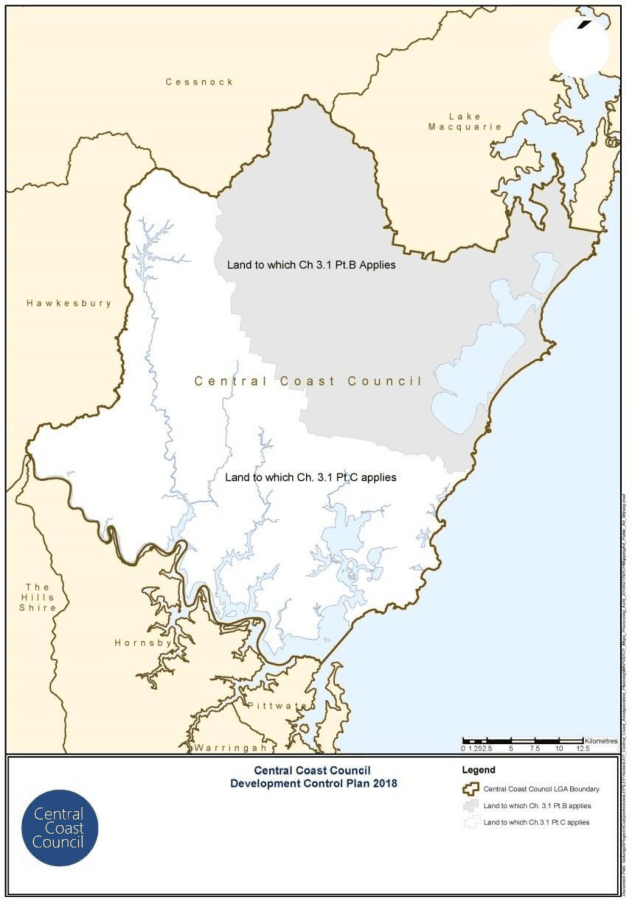

#### 3.1.1 INTRODUCTION

As the former Wyong and Gosford Councils had adopted different methodology for the mapping of hazard zones and the treatment of risk, this Chapter is structured in the following manner:

• Part A: General

• Part B: Northern Area (Former Wyong LGA); and

• Part C: Southern Area (Former Gosford LGA).

It is intended that a consolidated and consistent approach will be developed in a revision of this Chapter.

> [Picture on page 1: a picture, saved as a picture (images/ch-03-01-floodplain-management-and-water-cycle-management-page-1-11.gif, 150 dpi).]

### PART B: NORTHERN AREA FLOODPLAIN MANAGEMENT (FORMER WYONG LGA)
