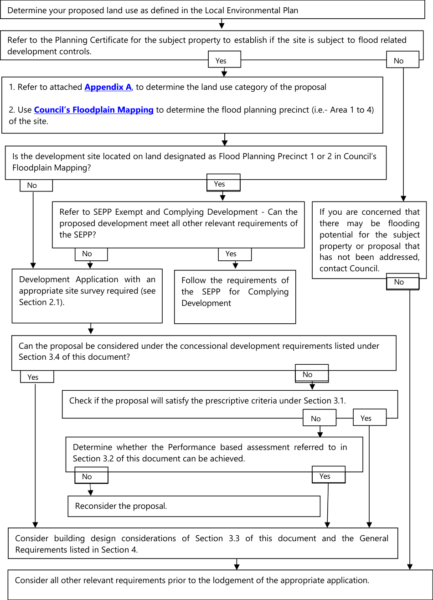

#### 3.1.2 INTRODUCTION

#### 3.1.2.1 Objectives of this Chapter

▪ To minimise the risk to human life and damage to property by controlling development on flood prone land

▪ To apply a performance and merit based approach to all development decisions taking into account ecological, social, engineering safety and environmental considerations to ensure development is appropriate and sustainable

▪ To ensure that the development or use of floodplains waterways and riparian corridors does not adversely impact upon aesthetic, recreational and ecological values

▪ To ensure that all land uses and essential services are appropriately sited and designed in recognition of all potential floods

▪ To promote flood compatible building design that considers requirements for the development of flood prone land and does not adversely impact on adjoining properties

▪ To establish guidelines for the development of flood prone land that are consistent with the NSW Flood Policy and NSW Floodplain Development Manual (2005) and as updated by the associated Floodplain Risk Management Guides

#### 3.1.2.2 Application

This plan has been prepared in accordance with the Environmental Planning and Assessment Act, 1979 having regard to the provisions of the NSW Flood Policy and NSW Floodplain Development Manual (2005). In circumstances where there may be any inconsistency between the requirements contained in this Chapter and any other Chapter within this Development Control Plan, with regard to floodplain management, the provisions of this Chapter apply.

#### 3.1.2.3 Relationship to other Chapters and Policies

This chapter is to be read in conjunction with other relevant Sections of this Development Control Plan.

#### 3.1.2.4 Using this Chapter

The flow chart that follows has been prepared to assist in the use of this document:

> [Picture on page 3: a picture, saved as a picture (images/ch-03-01-floodplain-management-and-water-cycle-management-page-3-3.gif, 150 dpi).]
> Words printed on the picture (title and legend, copied from the PDF):
> Determine your proposed land use as defined in the Local Environmental Plan
> Refer to the Planning Certificate for the subject property to establish if the site is subject to flood related
> development controls.
> Yes
> No
> 1\. Refer to attached Appendix A, to determine the land use category of the proposal
> 2\. Use Council’s Floodplain Mapping to determine the flood planning precinct (i.e.- Area 1 to 4)
> of the site.
> Is the development site located on land designated as Flood Planning Precinct 1 or 2 in Council’s
> Floodplain Mapping?
> No
> Yes
> Refer to SEPP Exempt and Complying Development - Can the
> proposed development meet all other relevant requirements of
> the SEPP?
> No
> Yes
> If you are concerned that
> there may be flooding
> potential for the subject
> property or proposal that
> has not been addressed,
> contact Council.
> Development Application with an
> appropriate site survey required (see
> Section 2.1).
> No
> Follow the requirements of
> the SEPP for Complying
> Development
> Can the proposal be considered under the concessional development requirements listed under
> Section 3.4 of this document?
> Yes
> No
> Check if the proposal will satisfy the prescriptive criteria under Section 3.1.
> No Yes
> Determine whether the Performance based assessment referred to in
> Section 3.2 of this document can be achieved.
> No
> Yes
> Reconsider the proposal.
> Consider building design considerations of Section 3.3 of this document and the General
> Requirements listed in Section 4.
> Consider all other relevant requirements prior to the lodgement of the appropriate application.
