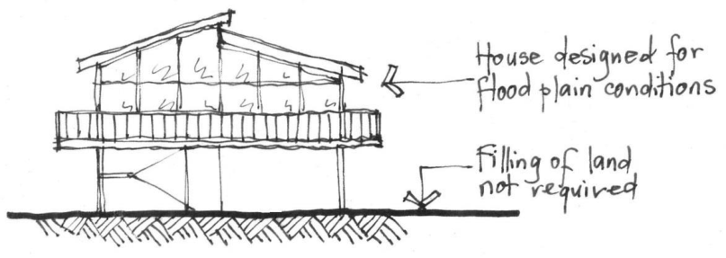
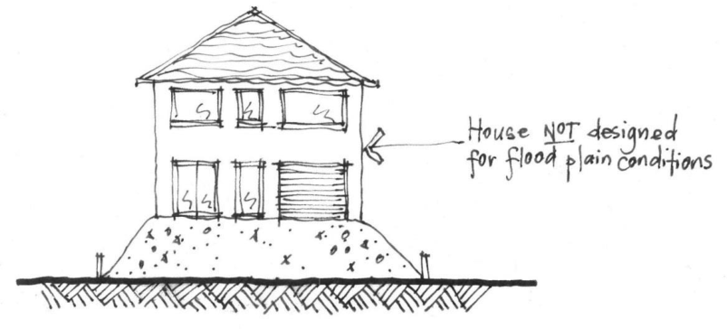

#### 3.1.4 DEVELOPMENT PROVISIONS

#### 3.1.4.1 Prescriptive Criteria

The Prescriptive Provisions shown within the following table indicate where flood related development controls:

▪ can be met through the implementation of provisions as indicated (yellow and numbered);

▪ are not required (shown in green)

▪ in the view of Council, cannot be met through the use of reasonable development controls and will require further justification to be supported - see Section 3.1.4.2 (shown in orange).

▪

| Proposed Land use | Precinct 1 FPL to PMF | Precinct 2 Below FPL | Precinct 3 Flood Storage and Flow Paths (up to 10% AEP) | Precinct 4 High Hazard (up to 50% AEP) |
|---|---|---|---|---|
| 1 Single Dwelling Houses |  | 1, 9 | 2, 5, 7 |  |
| 2 Agriculture & Recreation |  | 2 | 2, 5, 7 |  |
| 3 Sheds / Garages / ancillary Residential |  | 1 | 2, 5, 7 |  |
| 4 Commercial and Industrial Uses |  | 2, 6 |  |  |
| 5 Medium to High Density Residential |  |  |  |  |
| 6 Critical or Sensitive Facilities | 3 |  |  |  |
| 7 Land Subdivision | 4 |  |  |  |
| 8 Tourist Development |  |  |  |  |
| 9 Caravan parks - short-term sites |  | 6 | 5, 6 |  |
| 10 Permissible Earthworks |  | 8 |  |  |
| Flood related development controls do not apply |  |  |  |  |
| Flood related development controls apply (refer to numbered prescriptive criteria below) |  |  |  |  |
| If the proposal is to be pursued further, a performance based assessment is to be provided demonstrating that the proposed development is compatible with the flooding characteristics of the site (refer to Section 3.2 and Appendix C). |  |  |  |  |

1 = (a) Assessment indicating that the proposal can meet the relevant requirements of the BCA.

(b) Consideration of the impacts of climate change.

2 = Joint report by a professional engineer who specialises in floodplain management and a professional engineer who specialises in civil engineering to certify that the development provides:

(a) Minimum Habitable Floor Levels = 1% AEP flood level plus 500mm freeboard (Flood Planning Level)

(b) Minimum Non-Habitable Floor Levels = 5% AEP flood level

(c) Minimum level requirements for electrical fittings, internal sewer fixtures, and external overflow gully risers apply as per Building Code of Australia

(d) Minimum levels of open car parking spaces, carports and driveways = 5% AEP flood level

(e) Mine subsidence allowance to be added to levels (a), (b), (c) & (d) above, if applicable.

(f) Low flood hazard access and egress for pedestrians during a 1% AEP flood to an appropriate area of refuge located above the Flood Planning Level.

(g) Low flood hazard emergency vehicle road access (Ambulance, SES, RFS) during a 1% AEP flood event.

(h) All proposed structural components that can withstand the forces of floodwater including hydrostatic pressure, hydrodynamic pressure, impact of debris and buoyancy forces up to the flood planning level.

(i) Building materials and surface finishes at or below the flood planning level are all capable of withstanding prolonged immersion in water.

(j) Negligible flood affectation elsewhere in the floodplain for a full range of flood events up to the 1% AEP flood event, having regard to: a) loss of flood storage, b) changes in flood levels, flows and velocities upstream, downstream and adjacent to the site, c) cumulative impact of multiple development in the vicinity.

(k) Consideration of the impacts of climate change.

3 = Joint report by a professional engineer who specialises in floodplain management and a professional engineer who specialises in civil engineering to certify that the development provides:

(a) Minimum floor levels = PMF level plus mine subsidence allowance, if applicable.

(b) Low flood hazard access and egress for pedestrians during a PMF flood to an appropriate area of refuge located above the PMF.

(c) Low flood hazard emergency vehicle road access (Ambulance, SES, RFS) during a PMF flood event.

(d) Consideration of the impacts of climate change.

4 = Joint report by a professional engineer who specialises in floodplain management and a professional engineer who specialises in civil engineering to certify that the development provides:

(a) Minimum height of building footprints, open car parking areas, driveways and new public roads = 5% AEP flood level plus mine subsidence allowance, if applicable

(b) Low flood hazard access and egress for pedestrians during a 1% AEP flood to an appropriate area of refuge located above the Flood Planning Level.

(c) Low flood hazard emergency vehicle road access (Ambulance, SES, RFS) during a 1% AEP flood event.

(d) Risk assessment of flood hazard during a PMF flood event; including consideration of changes to flood behaviour, and location of floodways, to ensure that the consequences of the increased flood hazard are acceptable and manageable.

(e) Negligible flood affectation elsewhere in the floodplain for a full range of flood events up to the PMF, having regard to: a) loss of flood storage, b) changes in flood levels, flows and velocities upstream, downstream and adjacent to the site, c) cumulative impact of multiple development in the vicinity.

(f) Consideration of the impacts of climate change.

5 = No filling allowable apart from area of building footprint, open car parking areas and driveway

6 = Joint report by a professional engineer who specialises in floodplain management and a professional engineer who specialises in civil engineering to include:

(a) An Evacuation Plan demonstrating that permanent, failsafe, and maintenance free measures are incorporated in to the development to ensure the timely and safe evacuation of people from the development in a 1% AEP Flood event, without significant cost or risk added to emergency services personnel. Signage of the plan must be prominently displayed around the development.

7 = Maximum size of ancillary structure is 50m2. Appropriate signage on a minimum of one prominent internal or external wall indicating flood hazard of the area. Sign to be a minimum size 600mm x 600mm.

8 = Report by a professional engineer who specialises in floodplain management to certify that the development provides: Negligible flood affectation elsewhere in the floodplain for a full range of flood events up to the 1% AEP flood event, having regard to: a) loss of flood storage, b) changes in flood levels, flows and velocities upstream, downstream and adjacent to the site, c) cumulative impact of multiple development in the vicinity.

9 = Where a proposal involves the use of the dwelling is for short term rental accommodation, an Evacuation Plan demonstrating the timely and safe evacuation of people from the development in a

1% AEP Flood event, without significant cost or risk added to emergency services personnel is to be provided. Signage of the plan must be prominently displayed around the development. Note: this provision also applies to any lawfully approved dwellings located on the floodplain where approval for use as short-term rental accommodation is considered appropriate.

#### 3.1.4.2 Performance Based Assessment

Council will consider development proposals that do not meet the prescriptive requirements of this DCP only if a report prepared by a suitably qualified engineering professional accompanies the application and addresses the following:

a is compatible with the established flood hazard of the land. In areas where flood hazard has not been established through previous studies or reports, the flood hazard must be established in accordance with the Floodplain Development Manual.

b will not significantly adversely affect flood behaviour resulting in detrimental increases in the potential flood affectation of other development or properties;

c incorporates appropriate measures to manage risk to life and property from flood;

d will not significantly adversely affect the environment or cause avoidable erosion, siltation, destruction of riparian vegetation or a reduction in the stability of river banks or watercourses;

e is not likely to result in unsustainable social and economic costs to the community as a consequence of flooding.

f is consistent with the principles of Ecologically Sustainable Development.

g adequately considers the impact of climate change. i It is to be noted that with regard to climate change, appropriate benchmarks based on the best available current information have been used in producing the flood risk management studies and plans that inform this document.

ii Some prescriptive requirements such as flood planning level requirements may be relaxed if Council can be satisfied that the projected life of the proposed development is for a relatively short-term and therefore does not warrant the imposition of controls that consider impacts beyond the cessation of the proposed development. This will only be considered for uses where the residual risk to the occupation of the development is considered to be low. This may include certain temporary or demountable structures but would not include residential developments.

Note 1: The information listed above can be used to justify minor variations to the prescriptive provisions. Appendix C provides further detail with regard to applying the Performance Criteria mentioned above and will need to be addresses in full for large scale proposals and/or significant variations. Note 2: The prescriptive controls have been developed to ensure that proposals that meet the requirements of the relevant Prescriptive Control Schedule will meet the objectives of this Plan. A performance based assessment is likely to involve the submission of independent studies and reports. It is recommended that you should discuss the level of detail required and the likelihood of achieving a successful outcome using a performance based assessment with Council staff using the pre-application process prior to making any decision to purchase and/or develop flood prone land

#### 3.1.4.3 Building Design Considerations

In any case, building design, whether relying on the Prescriptive Controls or Performance Criteria, should not result in significant impacts upon the amenity of an area by way of:

a overshadowing of adjoining properties that does not meet the requirements of the relevant development controls adopted by Council;

b privacy impacts (e.g. by unsympathetic house-raising);

c being incompatible with the streetscape or character of the locality. A request to raise the overall building height to beyond the prescribed building heights to achieve the appropriate minimum floor level will not be considered adequate. Building design is to be appropriate to the constraints of the site;

d filling of land to permit the construction of a building that has not been specifically designed in consideration with conditions that may be experienced on the floodplain. Slab on ground construction is generally not considered appropriate on a floodplain.

> [Picture on page 8: a picture, saved as a picture (images/ch-03-01-floodplain-management-and-water-cycle-management-page-8-10.gif, 150 dpi).]

#### Figure 2 Floodplain development (where considered acceptable)

> [Picture on page 8: a picture, saved as a picture (images/ch-03-01-floodplain-management-and-water-cycle-management-page-8-12.gif, 150 dpi).]

#### Figure 3 Inappropriate floodplain development

#### 3.1.4.3 Concessional Development – Minor Additions

a Council acknowledges that in some instances, relatively minor building additions will have a minimal impact on the floodplain and will not present an unmanageable risk to life. Council will give consideration for the following forms of development on suitable sites:

i single dwelling house additions of up to 40m2 of habitable floor area at or above the same level as the existing adjoining approved floor level for habitable floor area. The allowance for additions shall be made no more than once for any given development. Proposals for dwelling additions that exceed 40m2 of habitable floor area are to refer to the provisions for single dwellings under Section 3.1;

ii additions to Commercial and Industrial Uses of up to an additional 100 m2 or 20% (whichever the

less) of the Gross Floor Area of the existing building at no less than the same level as the existing adjoining approved floor level. The allowance for additions shall be made no more than once for any given development. Proposals for additions that exceed 100 m2 or 20% (whichever the less) of the Gross Floor Area are to refer to the provisions for commercial and industrial uses under Section 3.1;

b Any proposal to be considered as concessional development must:

i be supported with appropriate information at the development application stage that the proposed development can meet the requirements of the Building Code of Australia.

Note: The additional costs in achieving the requirements of the BCA for development below the flood planning level needs to be considered by the proponent prior to the submission of a Development Application.

ii comply with Section 3.3– Building Design Considerations, Section 4 – General Requirements, and any other relevant provisions of the DCP.

b As part of any consent issued pursuant to this Section Council may require: i a restriction on use placed on the property title limiting the further development of the site ; ii the existing development to be suitably upgraded to address the potential impacts of flooding.

Note: Due to concerns for safety and the consequences of prolonging poor land use practices, concessional development or other site redevelopment will not be supported within High Hazard areas
