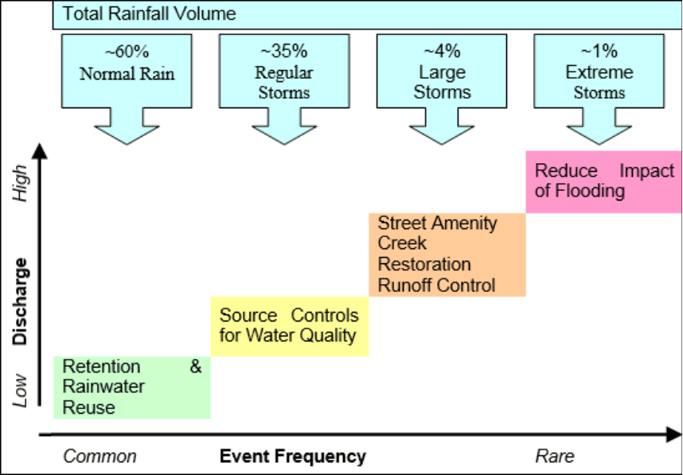

#### 3.1.9 BACKGROUND

Urbanisation has led to increased stormwater flows in urban creeks and the consequent impact on flooding, creek degradation and public safety.

Stormwater management has traditionally been focused on conveying stormwater runoff safely away from developed areas through pipes and drains. With progressive development, natural waterways in urbanising catchments have become increasingly taxed in their ability to convey the significant increases in quantity and rate of stormwater runoff generated, with bank erosion and increased frequency of flooding the obvious symptoms (ARQ 2006, p.1-1). Continued increase in the size of pipes and channels is not ecologically sustainable or financially sustainable, and it can lead to even greater levels of hazard.

In recognition of this issue Council has adopted Water Sensitive Urban Design (WSUD) as a new way of thinking for managing stormwater management (Argue 2004). It recognises:

▪ Flooding and stormwater runoff that can cause risk to life and damage to property, as the issue of first importance.

▪ Rainfall mobilises significant quantities of sediment, heavy metals, hydrocarbons and nutrients, which must be appropriately managed before it enters urban waterways and recreational receiving waters.

▪ Stormwater runoff is a valuable, readily available resource, which, when properly managed, can replace significant quantities of mains water.

Fundamental to the principles of WSUD is that of source control of stormwater. It is through controlling stormwater runoff at the source, whether that source is the massive roof area of a commercial development or the carriageway of a major road or the site of a typical residential development, that the objectives of WSUD are achieved.

This plan seeks to use source control to replicate, as practically as possible, the pre-development water cycle of the development site. The objective is to retain part of the runoff from rainfall events on site and redirect it to better mimic the natural water cycle. The retained water can be redirected for domestic use, industrial use, or the natural processes of infiltration, percolation, evaporation, or transpiration. The remaining surface

runoff leaving the development site will then better mimic the predevelopment runoff in terms of quantity, rate and water quality.

Water cycle management focus changes depending on the size or frequency of storm events, as shown below in Figure 1, which provides the scope for this plan.

> [Picture on page 22: a picture, saved as a picture (images/ch-03-01-floodplain-management-and-water-cycle-management-page-22-5.gif, 150 dpi).]

#### Figure 1 - Water Cycle Management Focus Areas
