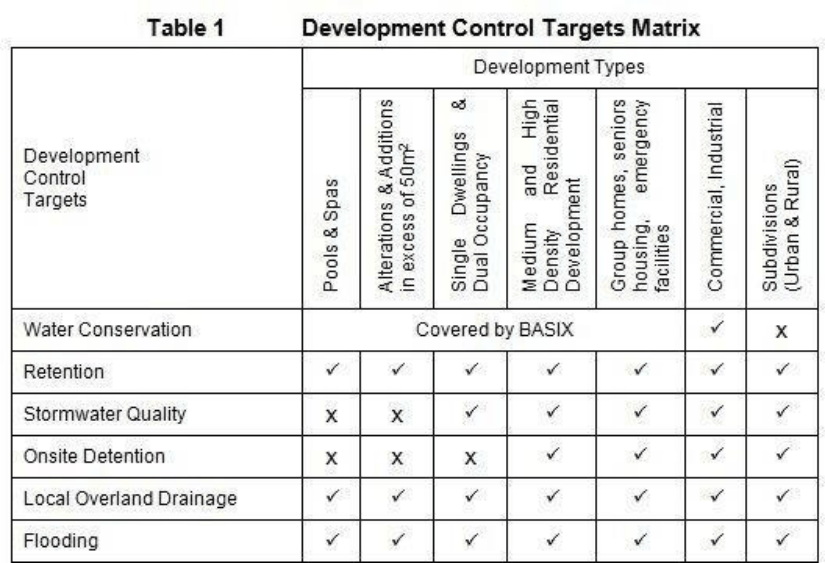

#### 3.1.10 WATER CYCLE MANAGEMENT PLAN

#### 3.1.10.1 Intent

All developments that require consent will be required to demonstrate compliance with the targets in Table 1.

> [Picture on page 23: a picture, saved as a picture (images/ch-03-01-floodplain-management-and-water-cycle-management-page-23-4.gif, 150 dpi).]

#### 3.1.10.2 Objective

The Water Cycle Management Plan (WCMP) is required for all developments with the exception of exempt developments and is to demonstrate compliance with the development control targets listed in Table 1 and described throughout this chapter.

#### 3.1.10.3 Application Requirements

Applicants are encouraged to discuss development proposals with Council’s Development Assessment staff at an early concept stage, prior to lodgement of a development application. This pre-lodgement discussion will assist in identifying and addressing any matters that may otherwise increase processing time. The following matters are to be taken into consideration during the preparation of WCMPs:

▪ safety – public safety and WH&S considerations; and

▪ maintenance – development of maintenance and monitoring regime for the management of WSUD elements.

Requirements for Water Cycle Management information required in support of a Development Application vary for different scales of proposed development, and the mechanism or approach adopted in the determination of management elements required to comply with applicable development control targets. The options available to proponents of different types / scales of development are described below.

#### Type 1 - Smaller Scale Developments

Type 1 - Smaller Scale Developments includes the following development:

▪ Alterations, additions, ancillary structures & second storey additions with regard to all works to any existing building or development where the net proposed development area is equal to or greater than 50m2 for other than exempt development. After 01/03/2007 (date of operation of the superseded DCP 165 - Water Cycle Management), each site will be restricted to a one-off development approval of less than 50m2 not requiring rainwater tanks. Once the combined total of all applications submitted after the date of operation of this plan reaches 50m2 then the requirements of this chapter of the DCP shall be applied.

▪ Single residential dwellings & dual occupancy

▪ Medium density or high density developments that create less than 10 dwellings or involve the development of 2000m2 of land or less.

▪ Rural subdivisions that create less than 10 lots.

▪ Urban subdivisions that create less than 10 residential lots or involve the development of 2000m2 of land or less.

▪ Industrial / Commercial Development that involves the development of 2000m2 of land or less.

Proponents of developments in the Type 1 category are required to demonstrate compliance against applicable stormwater targets through one of the following options:

▪ adoption of Council’s Deemed to Comply criteria, as outlined in Section 3.1.10.4 or

▪ submission of a detailed WCMP Strategy, as described in Section 3.1.10.5.

#### Type 2 - Significant Developments

Type 2 - Significant Development includes the following development:

▪ Medium density or high density developments that create equal to or more than 10 dwellings and / or involve the development of 2000m2 of land or more.

▪ Rural subdivisions that create equal to or more than 10 lots.

▪ Urban subdivisions that create equal to or more than 10 residential lots and / or involve the development of 2000m2 of land or more.

▪ Industrial / Commercial developments including alterations or additions that exceed 2000m2.

Development applications for all Type 2 developments require the preparation and submission to Council of a detailed WCMP Strategy. Guidance on the scope and content of a WCMP Strategy is presented in Section 3.1.10.5.

#### 3.1.10.4 Deemed to Comply

Proponents of small-scale developments may avoid the requirement for site stormwater modelling by adopting one of the following ‘deemed to comply’ solutions

#### Standard Design Parameters for Deemed to Comply solutions

Standard design parameters for Deemed to Comply solutions are provided in the following chapter.

#### Supporting Information

If a deemed to comply solution is adopted, the following information (if applicable) should be submitted as part of the development application:

▪ Site plan showing roofed, other impervious areas, topography and the location of easements & underground services,

▪ Drainage plan showing catchments, drainage systems, and discharge point including calculations of runoff (with and without blockage),

▪ Overland runoff flow paths (across the site and beyond the site boundaries clearly shown)

▪ Setback distances from buildings to infiltration devices and drainage easements,

▪ Demonstrate setback distances from buildings to top of bank of creeks,

▪ Water Saving Target: demonstrate compliance

▪ Retention target: Show rainwater tank/s, infiltration devices, and any stormwater capture, storage and slow release devices (including a table showing sizes, and details for each, along with calculations which demonstrate achievement of stormwater capture volumes and replenishment times for each device and for the overall site.

▪ On Site Detention Target: Detail the OSD device including size, outlet control and configuration, along with calculations which demonstrate the achievement of the predevelopment peak flowrates

▪ Stormwater quality target: Show location of each landscaping pollution retention measure (including a table showing calculations, sizes, and details for each; along with a table showing calculations of the overall Site Discharge Index).

▪ Local Overland Drainage Target: Show raised floor levels, cut & fill, overland flow paths, and discharge points.

▪ Flooding Targets: Show details of applicable targets, including: floor levels, flood impacts, access & parking (if applicable).

▪ BASIX certificate for residential developments,

▪ for commercial and industrial sites a summary of water conservation measures to be applied on site, including an estimate of total water demands and expected savings associated with water conservation measures / alterative water sources , as well as detail on how water demands will be managed and monitored,

▪ plans and cross-sectional drawings of stormwater treatment systems, showing inlets, outlets and overflow points (these may be prepared from standard drawings, with site-specific levels and dimensions included).

Further assistance in the preparation of a Deemed to Comply Solution is outlined in this chapter of the DCP and contained within the supporting documents:

HECREMS (2007) Practice Notes

#### 3.1.10.5 WCMP Strategy

Discussions with Council are encouraged at an early stage in the development application process to discuss and agree on the overall design approach before a detailed WCMP Strategy is prepared. The intent is to have the locality analysis available so that parameters can be agreed rather than providing the analysis only at the development application stage, thus saving time and costs associated with revisions and major modifications.

The aim of the consultation process is to provide direction and guidelines to the applicant, and to provide advice on Council’s requirements. The level of consultation required will largely depend on the size and the complexity of the development.

#### Water Sensitive Urban Design Strategy

A WCMP Strategy is a written report and associated plans detailing potable water saving and stormwater /flooding management measures that are to be implemented on the site. The strategy is to include, at a minimum, the following detail:

▪ Background information- Summarise any background information available, including previous studies, concurrent studies, mapping data.

▪ Site context– identify catchments, drainage lines and receiving environments (both within and downstream of the site). Characterise the ecological values of the site and its receiving environments.

▪ Proposed development- Describe the proposed development at the site, including site boundaries, proposed land uses, densities, population, infrastructure, development staging.

▪ Water Cycle Management objectives- Identify the Water Cycle Management (including flooding / overland flow) objectives and targets that apply to the proposed development.

▪ Constraints and opportunities- Identify the key constraints and opportunities for water management on the site, including flooding. This should include the identification of natural watercourses and other sensitive environments within the site that should be preserved and/or remediated by the development.

▪ Best planning practices– the capital and life-cycle costs of infrastructure required to meet Water Cycle Management targets can be minimised by considering site planning opportunities early in the planning process.

▪ Water conservation- This section should demonstrate how the potable water conservation targets will be met, and how potable water will be supplemented with roofwater, treated stormwater and/or wastewater.

▪ Stormwater management- This section should demonstrate how the WCMP stormwater quality targets will be met. It should include stormwater quality and flow modelling results and identify the location, size and configuration of stormwater treatment measures proposed for the development.

▪ Integration with the urban design- The WCMP Strategy should outline how management elements will integrate with the urban design.

▪ Costs- Prepare capital and operation and maintenance cost estimates of proposed water cycle management measures. Both typical annual maintenance costs and corrective maintenance or renewal/adaptation costs should be included.

▪ Operation and Maintenance Plan– should outline inspection and maintenance requirements to ensure proposed measures remain effective.

Assistance in the preparation of a WCMP Strategy is contained within the supporting documents:

▪ HECREMS (2007) Practice Notes

Modelling parameters for the determination of the size and configuration of WSUD elements must be in accordance with the guidance titled:

▪ MUSIC Modelling Guidelines for New South Wales (eWater, 2009)

Guidance on meeting the DCP objectives is contained in the supporting technical guidelines:

▪ Managing Urban Stormwater: Treatment Techniques (IPWEA, 2008)

▪ Australian Runoff Quality (Engineers Australia, 2005)
