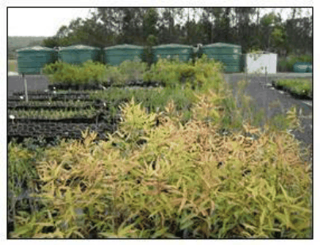
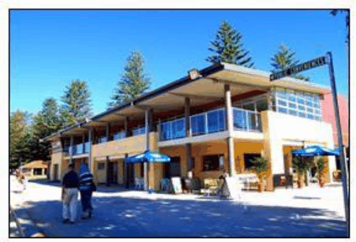
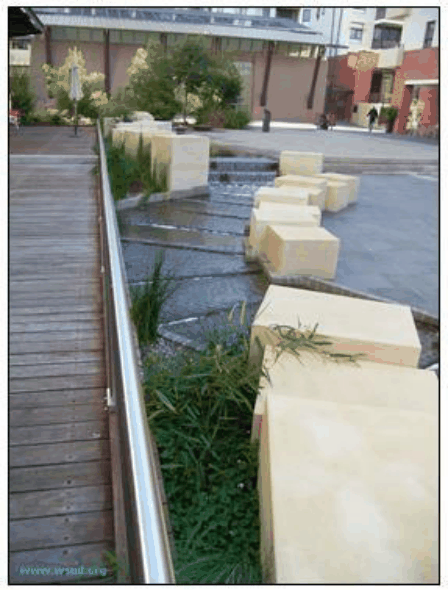
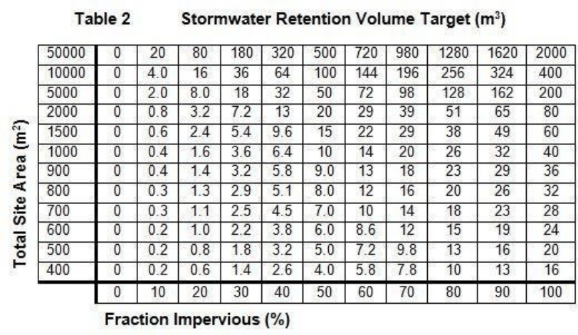
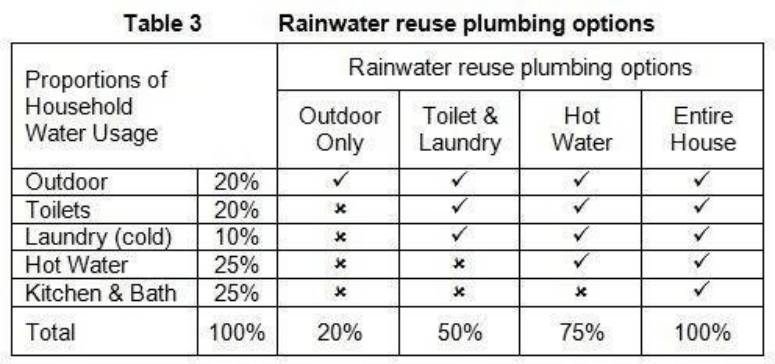
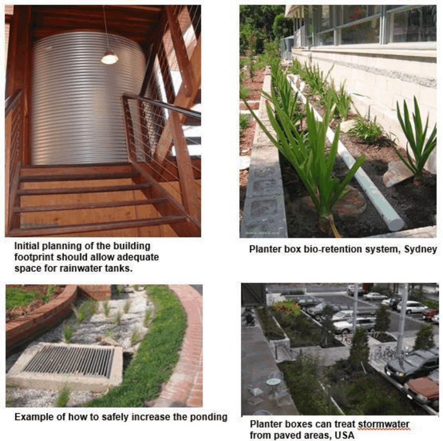
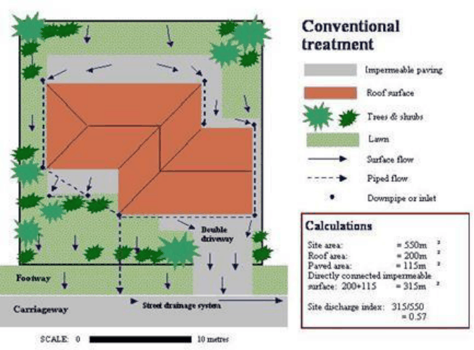
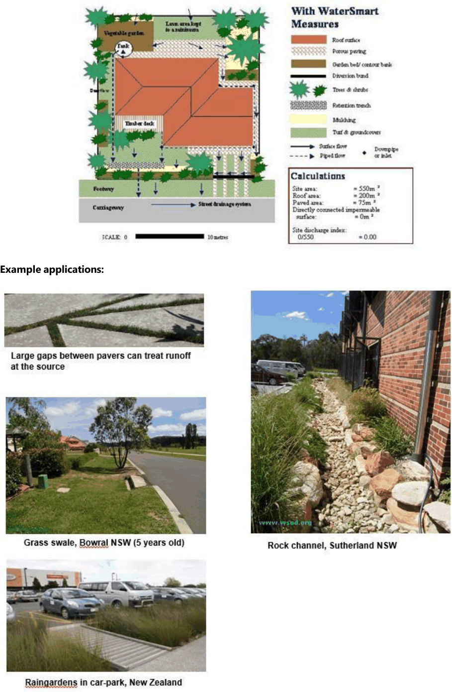
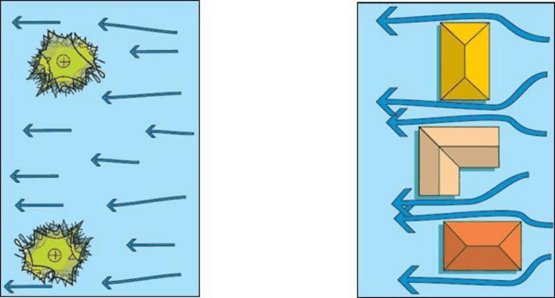
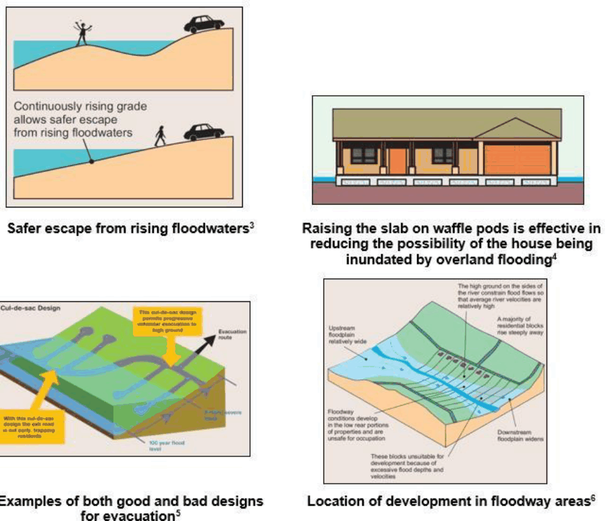

#### 3.1.11 DEVELOPMENT CONTROL TARGETS

#### 3.1.11.1 Water Conservation Target

#### 3.1.11.1.1 Intent

Reduce potable water demand by 40%

#### 3.11.1.1.2 Recommended Application

Specify water saving devices and potable water substitution option, where applicable, for new developments.

#### 3.11.1.1.3 Deemed to Comply

Any SEPP BASIX 2004 (BASIX) affected development is to demonstrate compliance with BASIX. Further information on details of types of development requiring a BASIX Certificate or to produce a certificate for your proposed development go to www.basix.nsw.gov.au.

Developments not affected by BASIX: a water saving target of 40% (consistent with the BASIX requirement), this must include the following:

▪ Ensure any water use fittings demonstrate minimum standards defined by the Water Efficiency Labelling and Standards (WELS) Scheme. Minimum WELS ratings are:

▪ 4 star dual-flush toilets

▪ 3 star showerheads

▪ 4 star taps (for all taps other than bath outlets and garden taps)

▪ 3 star urinals

▪ Water efficient washing machines and dishwashers are to be used wherever possible.

▪ Incorporate dual reticulation for toilet flushing, laundry, irrigation. Development within the Gosford CBD will be required to provide dual plumbing throughout.

> [Picture on page 28: a picture, saved as a picture (images/ch-03-01-floodplain-management-and-water-cycle-management-page-28-1.gif, 150 dpi).]

#### Example applications: Runoff recycling in nursery, Erina

> [Picture on page 28: a picture, saved as a picture (images/ch-03-01-floodplain-management-and-water-cycle-management-page-28-3.gif, 150 dpi).]

Recycled greywater - water from showers is treated and reused for toilet flushing at Terrigal Surf Life

#### Saving Club

> [Picture on page 28: a picture, saved as a picture (images/ch-03-01-floodplain-management-and-water-cycle-management-page-28-6.gif, 150 dpi).]

#### Harvested stormwater used in public open space, Kogarah, Sydney

#### 3.1.11.2 Retention Target

#### 3.1.11.2.1 Intent

To mimic the natural catchment hydrology from all development sites, in terms of:

▪ Quantity: the annual volume of stormwater reaching natural creeks and waterways.

▪ Rate: the peak flow rates leaving the site

▪ Response: the time it takes for rain to runoff the site.

In technical terms the intent is to mimic the pre-development runoff losses such that the post-development and pre-development runoff hydrographs are similar in terms of volume, peak and shape for the full range of design events.

#### 3.1.11.2.2 Objective

Capture and retain runoff from impervious surfaces (whether roof, paving or road carriageway), retain it for a relatively long time, and slowly release it elsewhere in the water cycle within 7 days.

#### 3.1.11.2.3 Recommended Application

The Stormwater Retention Volume may be adapted to individual site constraints, provided that the required volume from all impervious areas is captured before leaving the site. Management of captured stormwater will involve:

▪ Rainwater capture (from roof areas), storage (in rainwater tanks) and reuse (for domestic or industrial purposes )

▪ Stormwater capture (from external impervious areas), storage (in landscaping features, such as terraced gardens, bioretention - raingardens, or stormwater tanks) and slow release (through the natural processes of infiltration, percolation, evaporation, or transpiration)

#### 3.1.11.2.4 Deemed to Comply

Show on the Water Cycle Management Plan the Stormwater Retention Volume, which can be calculated by the formula below, or interpolated from Table 2, with the exception of pools and outdoor spas.

V = 0.01A(0.02F)2 V = Stormwater Retention Volume (m3)

A = Total Site Area (m2)

F = Fraction Impervious (%)

Show locations of each rainwater or stormwater capture device to treat each impervious area (whether rainwater tanks, stormwater tanks, raingardens, or soak away areas). Overflows from each device should preferably be via a suitably designed "natural" overland flow path.

Include a table summarizing sizes and details for each, along with calculations which demonstrate achievement of stormwater capture volumes and replenishment times for each device and for the overall site. Refer to example retention calculations below.

Installation of following require:

▪ a pool only - rainwater tank with a minimum volume of 2.0m3 (2000L).

▪ an outdoor spa - rainwater tank with a minimum volume of 1.0m3 (1000L)

▪ a pool and an outdoor spa - rainwater tank with a minimum 2.5m3 (2500L)hav

> [Picture on page 30: a picture, saved as a picture (images/ch-03-01-floodplain-management-and-water-cycle-management-page-30-4.gif, 150 dpi).]

> [Picture on page 30: a picture, saved as a picture (images/ch-03-01-floodplain-management-and-water-cycle-management-page-30-5.gif, 150 dpi).]

#### Notes

▪ For the purposes of this DCP household water usage is assumed to be related to the size of the roof area (including covered pergolas and awnings). For a typical dwelling the water use is 1000 litres per day for a roof area of 200m2. On this basis, the assumed water use per square metre of roof area is 5 L/day or 35 L/week.

▪ Higher levels of rainwater reuse help ensure that there will be adequate volume available in the rainwater tank to help retain the roof runoff without the tank overflowing.

▪ Retro-fitting an entire house to rainwater can be very cost-effective as it does not require dual-plumbing.

▪ The rainwater tank must be sized to have a rainwater storage volume not less than that required by any BASIX certificate issued for the development and configured in accordance with the requirements of that certificate.

▪ For the calculation of infiltration during the storm event, the design storm is assumed to be a 30mins duration event.

#### 3.1.11.2.5 Examples Retention Volume Calculations

1\. A house on an 800m2 block with a roof area of 250m2 and an external paved area of 150m2. The rainwater tank is plumbed to outdoor taps, toilets and the washing machine. External retention is proposed by directing runoff from paved areas into a terraced garden (Size 12m2; Soil: sandy loam; raised sides to temporarily contain runoff).

| Retention volume required | = 50% impervious on 800m2 block (Table 2) = 8000 L |
|---|---|
| Rainwater reuse over 1 week | = 35 L/m2 x 250m2 x 50% (Table 3) = 4375 L |
| Balance to be retained on site by infiltration or slow release | = 8000 - 4375 = 3625 L |

▪ This scenario shows that a volume of 3625 litres must be retained on site, assuming that a rainwater tank of at least 4375 litres useable capacity is available.

▪ The proposed landscaping of the site includes a terraced garden that will also act as an above ground retention storage, infiltration device and water quality treatment device.

Infiltration volume during the ½ hour storm

= 200mm/hr x ½ hr x 12m2

= 100 x 12 = 1200L

3625L - 1200L

Balance of retention to be stored and slowly released after the storm

= 2425L

Ponding Depth required in garden

= Volume / Area

= 2425L / 12m3

= 202mm

2\. A house on a 600m2 block with a roof area of 260m2 and an external paved area of 100m2. The rainwater tank is plumbed to the entire house (outdoor, toilets, laundry, hot water, bathroom and kitchen).

Retention volume required

= 60% impervious on 600m2 block (Table 2)

= 8600 L

| Rainwater reuse over 1 week | = 35 L/m2 x 260m2 x 100% (Table 3) = 9100 L |
|---|---|
| Balance to retained on site by infiltration or slow release | = 8600 - 9100 < 0 |

▪ This scenario shows that household rainwater reuse provides an adequate retention volume, providing that the tank size is at least 8600 litres.

3\. A factory on a 2000m2 block with a roof area of 1200m2 and an external paved area of 400m2. The rainwater tank plumbed to toilets and bathroom facilities and the factory identified an opportunity for potable water replacement as part of an industrial process, whereby the water use has been estimated at 6000 L/day.

| Retention volume required | = 80% impervious on 2000m2 block (Table 3) = 51000 L |
|---|---|
| Rainwater reuse over 1 week | = 6000 L/day x 5 days (working week) = 30000 L |
| Balance to be retained on site by infiltration or slow release | = 51000 - 30000 = 21000 L |

▪ This scenario shows that a volume of 21000 litres must be retained on site by infiltration or slow release, assuming that a rainwater tank of at least 30000 litres usable capacity is available.

Example applications:

> [Picture on page 33: a picture, saved as a picture (images/ch-03-01-floodplain-management-and-water-cycle-management-page-33-2.gif, 150 dpi).]

#### 3.1.11.3 Stormwater Quality Target

#### 3.1.11.3.1 Intent

Improve the quality of stormwater runoff, which will also improve the health of creeks and waterways and enhance urban amenity.

#### 3.1.11.3.2 Objective

Achieve the following minimum reductions in total pollutant load, compared to untreated runoff from the developed impervious areas of the site:

▪ 80% reduction in Solids: suspended solids and gross pollutants (grit, sediment. leaves, grass clippings, litter)

▪ 45% reduction in Nutrients: total phosphorus and total nitrogen

#### 3.1.11.3.3 Recommended Application

One Water Sensitive Urban Design concept involves landscaping practices that take advantage of natural site features to slow runoff and prevent the discharge of pollutants. The most effective way to treat stormwater runoff is through landscaping measures that are integrated into the site. These include:

▪ Rainwater water tanks to treat roof areas, for further information refer to HCCREMS (2007) Practice Note 4

▪ Infiltration and retention devices , for further information refer to HCCREMS (2007) Practice Note 5,

▪ Permeable paving , for further information refer to HCCREMS (2007) Practice Note 6

▪ Using crushed gravel or other treatments instead of paving

▪ Vegetated filter strips, vegetated swales, soak areas, rock basins or channels, raingardens, ponds, wetlands, and contour banks, for further information refer to HCCREMS (2007) Practice Note 4

▪ Sand/gravel filters for runoff from car parks and driveways

▪ Reducing the area of paving (for example, driveway strips)

The Site Discharge Index (SID) provides a very general indicator of the extent to which a development proposal will create unmanaged flows from impervious surfaces. If all runoff from impervious surfaces on a site will be managed by suitable stormwater source controls, the SID will be 0.0. The greater the area of impervious surface that is not managed by stormwater source controls, the higher the SID will be (up to a maximum of 1.0 on a site that is totally covered by impervious surfaces).

The SID is calculated by dividing the impervious area directly connected to the street drainage system (i.e. impervious area runoff which is not managed by an acceptable stormwater source control) by the total site. Refer to HECREMS (2007) Practice note 11 for further information regarding the SID. Figure 1 & 2 illustrate the SID calculation.

Landscaping measures must be placed and sized according to the amount of impervious area being treated. For each 100m2 of impervious area then the following treatment options are considered to achieve the targets:

▪ 2m2 of engineered bioretention device/rain garden/ or proprietary system,

▪ 4m2 of depressed soak area/rock basin/pond/ or wetland,

▪ 7m2 of garden/lawn/grass swale/vegetated filter strip (at <1% slope), or

▪ 15m2 of garden/lawn/grass swale/vegetated filter strip (at <5% slope).

▪ 25m2 of garden/lawn/grass swale/vegetated filter strip (at <20% slope).

Based on area ratios from pollutant removal efficiency graphs for various types of stormwater treatment measures in DECC (2007d)

Other types of stormwater treatment devices will be considered. However the pollutant removal efficiency of such devices will have to be adequately demonstrated by independent testing. Pollutant removal efficiencies claimed by manufacturers of proprietary devices are not considered sufficient without independent testing.

For Subdivisions landscaping measures must be provided to treat impervious areas within the road reserve, including road carriageways, footpaths, and driveway aprons. Consideration should be given to:

▪ Streetscape landscaping: planting of water efficient native vegetation and street trees for amenity and shade.

▪ Footpaths should be set back near the property boundary if a WSUD treatment is proposed along the edge of the road carriageway

#### 3.1.11.3.4 Deemed to Comply

Compliance with the water quality target for all developments must be demonstrated on the Water Cycle Management Plan as follows:

▪ Site Discharge Index: To reduce the directly connected impervious area to 10% or less

▪ Details of appropriately placed and sized landscaping measures to treat the runoff from impervious areas.

Figure 1 - Typical detached dwelling with no stormwater source controls - HECREMS (2007)

> [Picture on page 35: a picture, saved as a picture (images/ch-03-01-floodplain-management-and-water-cycle-management-page-35-12.gif, 150 dpi).]

#### Figure 2 - Stormwater source controls applied to the same site - HECREMS (2007)

> [Picture on page 36: a picture, saved as a picture (images/ch-03-01-floodplain-management-and-water-cycle-management-page-36-2.gif, 150 dpi).]

#### Example applications:

#### 3.1.11.4 Onsite Detention Target

#### 3.1.11.4.1 Intent

To protect downstream properties and infrastructure from increased stormwater flows from new development.

#### 3.1.11.4.2 Objective

▪ Ensure future development does not increase the impact of rainfall events.

▪ Stormwater management design that demonstrates a consideration for the existing capacity of the public drainage system.

#### 3.1.11.4.3 Recommended Application

On-site Stormwater Detention (OSD) shall be provided where required by Council in conjunction with a proposed development.

OSD will not be required on alterations, additions, ancillary structures, second storey additions, single dwelling & dual occupancies, except where:

▪ the volume of total retention storage provided does not correspond to the requirements in Section 3.1.11.2, in such instances the OSD system shall meet the short fall of retention volume and have a Permissible Site Discharge (PSD) of 8L/s, or

▪ it is required under a specific Council Plan of Management or other Council Plan.

OSD will be required for all other developments, except where:

▪ the development is located at a point within the catchment considered by Council not to warrant OSD, or

▪ an OSD system has been previously constructed to accommodate the proposed development, or

▪ the applicant undertakes a detailed total catchment analysis proving that the proposed development has no effect on properties and infrastructure downstream or upstream of the catchment. The study shall be undertaken by a Certified Practicing Engineer - The Institution of Engineers Australia, or

▪ the development is in a rural area and the following measures are implemented

o all runoff from rural buildings, tracks and paved areas is to be discharged into absorption trenches or onto heavily vegetated areas so as to prevent an increase in the rate of runoff into streams / drainage systems.

o all runoff is to be controlled so that it causes no nuisance or concentration of flow to watercourses or neighbouring properties.

o inclusion of other WSUD solutions that can be reasonably demonstrated to address stormwater flow and water quality issues to the required level.

o all runoff is to be controlled so as to prevent erosion.

Regardless of the points above, where Council considers development may adversely impact upon areas of environmental importance, drainage infrastructure or as deemed necessary, Council may determine that stormwater detention is required.

#### 3.1.11.4.4 Demonstrated Compliance

A stormwater detention report and accompanying plans shall be prepared by a person accredited as below and submitted with the development application.

The following general parameters apply to the design of the OSD:

▪ Limit post development flow from the proposed development site to less than or equal to predevelopment flows for all storm events up to and including the 1% YEP storm event; Predevelopment coverage shall be taken as the natural vegetation that would normally occur on the entire site with no impervious areas. Appropriate infiltration rates for the natural vegetated state and underlying soils shall be applied and provided in the calculation report;

▪ A maximum of 50% of the Volume of Rainwater/Stormwater Retention Tanks can be claimed as part of the OSD Volume;

▪ A Runoff Routing method is to be used for developments;

▪ Where no road pipe drainage system exists, the maximum permissible site discharge (PSD) from a development to either the kerb and gutter or table drain shall be 30 litres/sec unless otherwise advised by Council's Engineer; Discharged water shall not be concentrated onto adjoining properties, unless through a formalised (legal) drainage system;

▪ Site controls will sometimes overflow. Council requires that overland flows must be adequately directed so as to not to cause intensification, concentration or inappropriate flow over neighbouring properties;

▪ Additional Subdivision parameters include:

▪ OSD shall be designed as either a single device serving all lots and other impervious areas (including roads, paths and other hard stand) or as single devices servicing each separate lot and road system;

▪ A maximum of 50% of the total volume of rainwater tanks can be claimed a part of the OSD volume subject to a Positive Covenant and Restriction-as-to-User being placed on the title of the lots requiring a minimum size rainwater tank be installed with building works or further development;

▪ Where OSD is proposed on a lot basis the requirement to construct the OSD system can be deferred subject to a Positive Covenant and Restriction-as-to User being placed on the title of the lots requiring OSD facilities complying with these provisions to be constructed at the time of each allotment's development;

▪ Wherever possible Council will prefer the construction of privately owned community detention systems;

▪ Site controls will sometimes overflow. Council requires that overland flows must be adequately directed so as not to cause intensification, concentration or inappropriate flow over neighbouring properties;

▪ To the extent possible, OSD and drainage design should be integrated with other WSUD measures, such as landscaping, road design, development layouts, provision of habitat, recreational open space, etc.

All design is to conform to best engineering practice, Australian Standards and OH&S requirements, and shall be undertaken by a person who retains one of the following standings:

▪ Practicing Civil Engineer with appropriate qualifications and experience to be eligible for Membership to the Institution of Engineers Australia; Surveyors Certificate of Accreditation in On-site Detention and Drainage Design (Institute of Surveyors, NSW and the Association of Consulting Surveyors, NSW.

#### 3.1.11.5 Local Overland Drainage Target

#### 3.1.11.5.1 Intent

To manage local overland drainage problems.

#### 3.1.11.5.2 Objective

To effectively manage local overland drainage problems which may occur throughout urban areas and fall outside the definition of flooding.

Note that overland flows in the 100 Year Average Recurrence Interval Event in excess of 0.5m3/s or greater than 0.3m deep are defined as flooding whereby flooding targets would also apply (section 3.1.11.6).

#### 3.1.11.5.3 Recommended Application

▪ All finished floor levels above the finished surrounding ground levels are to comply with the minimum standard as set out in the Building Code of Australia to protect against any shallow water depths.

▪ Cut and/or fill is minimised on the site.

▪ Overland runoff generated by rain is to be directed into flow paths that follow the natural land slope to mimic the pre-development state as much as possible, which poses the least threat to residents2. The overland flow paths must not adversely affect adjoining properties. Overland flow paths must be shown on the Water Cycle Management Plan. They must not be obstructed by parked cars, retaining walls, landscaping, and where side passages are used they are to be kept clear of obstructions such as hot water heaters, air conditioners, solid fencing, rainwater tanks or garbage bins.

▪ Driveways: must not interfere with function of longitudinal drainage and must not provide spillway for stormwater runoff (either into the property if the road is higher, or on to the road if the road is lower).

▪ Minimum setbacks must be observed between buildings and watercourses (refer to Section 3.1.13)

#### 3.1.11.5.4 Demonstrating Compliance

The following must be shown on the Water Cycle Management Plan:

▪ All floor levels complying with the minimum requirements of the Building Code of Australia.

▪ Adequately sized clear overland flow paths, including special attention where the driveway connects to the public road.

▪ Details of cut and/or fill.

▪ Show location of all stormwater discharge points including overland flowpaths.

Figure 3 - The difference between greenfield and local velocity - HNFMSC (2006a)

> [Picture on page 40: a picture, saved as a picture (images/ch-03-01-floodplain-management-and-water-cycle-management-page-40-2.gif, 150 dpi).]

Figure 3 Illustrates, prior to development (left) there are few obstructions to concentrate flows. However following development (right) may concentrate flows and increase velocities, which may lead to local drainage problems.

#### Reference

2 HNFMSC 2006b, p.61

#### 3.1.11.6 Flooding Targets

#### 3.1.11.6.1 Intent

To reduce the impact of flooding on flood prone property.

#### 3.1.11.6.2 Objectives

▪ To reduce private and public losses resulting from floods.

▪ To enable safe access or evacuation of people to the existing public road network during flooding.

▪ To maintain the existing flood regime and flow conveyance capacity.

▪ To avoid significant adverse effects on the floodplain environment that would cause avoidable erosion, siltation, destruction of riparian vegetation or a reduction in the stability of any river bank or watercourse.

▪ To limit land uses to those compatible with flow conveyance function and flood hazard.

#### 3.1.11.6.3 Recommended Application

Council has identified flood planning areas adjacent to significant creeks and waterways. These areas can be viewed on Council's Development Constraints web portal. Council is able to provide Flood Planning Levels (FPLs) in these areas on enquiry.

However many areas subject to flooding have not yet been assessed. In these areas, Council will request a flood study to determine the effects of a proposed development on flooding or conversely, the effect of flooding on a proposed development. Flood studies will be required for any type of development where the development occurs in a floodplain or in areas of where overland flow is suspected.

Flood studies must be prepared by suitably qualified civil engineers. Both the 100 year ARI and PMF flood events must be adopted to assess the effects of flooding on the proposed development site and adjacent properties. In certain circumstances, it may be necessary to assess the effects from lesser storm events.

The hydraulic component of the analysis shall be undertaken in accordance with the current version of the Australian Rainfall & Runoff. Unless it can be demonstrated that it is not applicable, flood studies shall be prepared using a fully dynamic 1 or 2 dimensional computer model to determine the flood extents and hazards. The model chosen shall be calibrated against a recorded storm event if available. All input parameters and assumptions made must be clearly described and justified. A hard copy of the report, including all results, results summary table, and all the relevant information must be submitted with the application. This information is to include the following information plan form for the pre-developed and post-developed scenarios:

▪ Flood profiles/extents for the full range of events for total development including all structures and works (such as revegetation/culvert crossings).

▪ Water surface contours.

▪ Velocity and depth product contours.

▪ Delineation of flood hazard categories relevant to individual floodplains.

#### 3.1.11.6.4 Demonstrating Compliance

If flood related development controls apply, then the Water Cycle Management Plan must demonstrate compliance with the relevant flood control targets as listed in tables 4 & 5 below.

▪ Flood related development controls may apply for any development on flood prone land (up to the PMF) for the purposes of subdivision of land, earthworks, the erection of a building, the carrying out of a work or flood mitigation works.

▪ Flood related development controls will not apply for development for the purposes of residential accommodation (other than group homes and seniors housing) on land that is flood prone but is not in the flood planning area. (i.e. land that is above 1% AEP flood level + 0.5m freeboard but below the PMF).

#### Example applications:

> [Picture on page 42: a picture, saved as a picture (images/ch-03-01-floodplain-management-and-water-cycle-management-page-42-2.gif, 150 dpi).]

#### Table 4 Flood Control Target Matrix

| Development | Development Types |  |  |  |  |  |
|---|---|---|---|---|---|---|
| Control Targets | Pools & Spas | Residential Buildings (Rural) | Residential Buildings (Urban) | Group homes, seniors housing, emergency facilities | Commercial, Industrial | Subdivisions (Urban & Rural) |
| Floor levels | - | B | B | A | B | - |
| Flood Impacts | C | C | C | C | C | C |
| Subdivisions | - | - | - | - | - | D |
| Access Parking | - | E | - | F | E | E |
| Fencing | - | G | G | G | G | G |

#### A - Floor Levels

Floor levels whether habitable or non-habitable, are to be at or above the PMF flood level.

#### B - Floor Levels

Habitable floor levels are to be above the FPL for all new structures.

Rare floods will still occur, possibly well above the FPL, which may cause significant damage for some types of development. If the consequences of are likely to be high then consider raising floor levels well above the FPL.

Concession for building additions: where the existing habitable floor level is below the FPL then a one-off addition may be considered up to:

▪ 40m2 if the existing residential floor level is less than 500mm below the FPL, or

▪ 20m2 if the existing residential floor level is greater than 500mm below the FPL, or

▪ 10% increase in floor area for commercial or industrial additions

Non-habitable floor levels: Garage, laundry, or public toilets/sporting amenities to have floor levels at least 300mm (desirable 500mm) above surrounding finished ground level. Materials, equipment or contents are not to be stored below the FPL unless they are flood compatible, capable of withstanding the forces of floodwater, debris and buoyancy, and not prone to causing pollution or an environment hazard.

#### C - Flood Impacts i Floodplain Risk Management Plan

If the subject land falls within the area of an existing Floodplain Risk Management Plan, then the development must comply with specific conditions of the plan.

ii Flood Impacts

The development must not:

▪ Affect the safe occupation of any flood prone land.

▪ Be sited on the land such that flood risk is increased.

▪ Adversely affect flood behaviour by raising predevelopment flood level by more than 10mm.

▪ Result in an increase in the potential of flooding detrimentally affecting other development or properties.

▪ Significantly alter flow distributions and velocities to the detriment of other properties or the environment of the floodplain.

▪ Significantly and detrimentally affect the floodplain environment or cause avoidable erosion, siltation, destruction of riparian vegetation or a reduction in the stability of any riverbank or watercourse.

▪ Be likely to result in unsustainable social and economic costs to the flood affected community or general community as a consequence of flooding (including: damage to public property and infrastructure, such as roads, stormwater, water supply, sewerage, and utilities).

▪ Be incompatible with the flow of floodwaters on flood prone land (considering any structures, filling, excavation, landscaping, clearing, fences, or any other works).

▪ Cause or increase any potential flood hazard (considering the number of people, their frailty, as well as emergency service and welfare personnel).

iii Building components

▪ Limit use to that which is compatible with the level of flood hazard (considering likelihood and consequences of flooding).

▪ Building components located below FPL are to maintain strength and durability when wet, facilitate easy cleaning after inundation, and resist the forces of floodwater, debris and buoyancy7.

▪ All electrical fixtures (including meter box) to be above the FPL

▪ The sewer gully trap is to be located at or above the 100 year ARI flood level (without freeboard). All other internal sewer fixtures (floor waste, WC pans, rim of shower, bath, laundry tub, and basins) are to be located at least 150mm above this level.

▪ Free standing Rainwater tanks are to be elevated above 100 year ARI flood level (without freeboard) or anchored to resist buoyancy and impact forces.

iv Local Overland Flooding

▪ If any part of the land is affected by Local Overland Flooding8 then hydraulic calculations (by a skilled flood specialist) will be required as follows:

▪ Along all overland flowpaths that convey significant overland flows (≥ 0.5m3/s or deeper than 0.3m). Flow depths, velocities and flow rates and must be shown on the Water Cycle Management Plan.

▪ Overland flow paths shall be designed to limit 100y ARI flood velocities to a maximum of 2 metres per second. This may require the provision of regular drop structures (such as rough placed rock weirs) to reduce velocities.

▪ Flow conveyance along these overland flowpaths may be achieved through a combination of the following: naturally functioning streams, open channels incorporating natural features (i.e. pool & riffle sequences consisting of reeds, rocks and native vegetation), stream buffer zones, and swales. Details must be shown on the Water Cycle Management Plan.

▪ Pipes are typically prone to blockage. A minimum 50% blockage factor shall be applied to all pipe and culvert capacities as part of hydraulic calculations. As such pipes are considered appropriate for managing low flows, with the bulk of flood flows travelling safely overland.

▪ Overland flowpaths must not be obstructed by parked cars, retaining walls, landscaping, and where side passages are used they are to be kept clear of obstructions such as hot water heaters, air conditioners, fencing, rainwater tanks, and garbage bins.

▪ Where significant overland flow crosses a property boundary (≥ 0.5m3/s or deeper than 0.3m), flow-through fencing (pool type fencing) is to be provided in the bottom part of the fencing to a height required to pass the flow. The width and height of flow-through fencing shall make allowance for 50% blockage. The overland flow paths shall be dispersed where possible to limit the concentrated impact on downstream or down slope properties.

▪ Significant overland flow paths may be classified as creeks, whereby minimum setbacks must be observed between buildings and watercourses (refer to Section 3.1.13)

v Filling

▪ Filling is not to be undertaken within the Flood Planning Area without Council's approval, including any cut and fill works on site.

▪ Filling of the land within the Flood Planning Area is not permitted unless:

▪ It is allowable as part of an adopted Floodplain Risk Management Plan

▪ Or it can be demonstrated (by a skilled flood specialist) that the cumulative effect of filling the area would not raise the flood level by more than 10mm and that the land can be considered ‘flood fringe’

▪ Unless a Floodplain Risk Management Plan for the catchment has been adopted, which allows filling to occur, filling in flood prone areas is not permitted unless a report from a suitably qualified civil engineer is submitted to Council that certifies that the development will not increase flood affectation elsewhere.

▪ Filling of individual sites in isolation, without consideration of the cumulative effects is not permitted. The NSW Government’s Floodplain Development Manual states that a case by case decision making approach cannot take into account the cumulative impact of flooding behaviour, and associated risks, caused by individual developments. Any proposal to fill a site must be accompanied by an analysis of the effect on flood levels of similar filling of developable sites in the area.

▪ Any filling proposal must include adequate provision for drainage of surface water erosion and siltation control and be so placed and graded as to prevent the shedding of surface water direct to adjoining properties.

vi Sea Level Rise

Note: The following applies unless otherwise specified under an adopted Flood Risk Management Study/Plan or revised Policy of Council

▪ For low-lying land below RL 4.0m AHD the development applications must assess the ongoing viability of the land, including the viability of road access to the land, associated with the adopted sea level rise figure for planning purposes of +0.9m by the year 2100, assuming a design life for the development. This will be particularly relevant for low-lying coastal or estuarine development.

#### D - Subdivisions

▪ Consideration of the increased potential flood damage consequences should the lots be developed in future associated with large floods, up to and including the Probable Maximum Flood.9

▪ The development is not to exacerbate flood levels, velocities or flow distributions at any other location, including a consideration of the cumulative impact of incremental development, should all the lots be fully developed in future.

▪ Significant flows on road carriageways should be avoided to prevent compromising traffic ability, access and evacuation. Special consideration should be given in the following cases.10

▪ Roads in drainage depressions: are likely to be liable to flooding. Care should be taken not to compromise traffic ability, access and evacuation.

▪ Roads that are on grade: can develop high velocity flows, which need to be checked to see that they will not wash cars and people away and will not cause flotation.

▪ Roads running across the contours: are likely to be cut at points where they cross a creek or drainage lines, therefore need to be designed to ensure people and cars will not be at risk of being caught in floodwaters.

▪ Roads that follow ridges: run-off will need to be shed off at regular intervals and directed through or between lots via drainage swales or engineered overland flow paths.

▪ Stormwater should be shed from road carriageways as quickly and diffusely as possible, to reduce flood hazard. Where kerbs are not required then vegetated edge strips and associated swales can be an effective solution, as well as greatly assisting in the achievement of water quality targets and providing an attractive streetscape.11

▪ Subdivision of land will not be permitted for the purpose of creating additional lots within the flood planning area.

#### E - Access and Parking in 100 year ARI Flood Event

All access roads and driveways, and external parking areas to be above the 100 year ARI Flood Level (FPL less 0.5m) to provide the ability to safely receive and evacuate occupants or contents without having to cross floodwaters in most flood events (assuming 50% blockage of any pipes, culverts or bridges). For rural subdivision refer to section 3.1.15.

#### F - Access and Parking in PMF Event

All access roads and driveways, and external parking areas to be above the PMF to provide the ability to safely receive and evacuate occupants or contents without having to cross floodwaters of any depth in all flood events, assuming 50% blockage of any pipes, culverts or bridges of any size.

#### G - Fencing

▪ Fencing within a floodway will not be permissible except for security/ permeable/ open type/ safety fences of a type approved by Council. Fencing in certain areas may also be restricted by current Floodplain Risk Management Plans.

▪ Council will require a Development Application for all new solid (nonporous) and continuous fences above 0.6m high, within the 100 year ARI storm event extents unless otherwise stated by exempt and complying development provisions which may be incorporated into in State Environmental Planning Policies or Councils Environmental Planning Instruments from time to time. An applicant will need to demonstrate that the fence would create no impediment to the flow of floodwaters. Appropriate fences must satisfy the following:-

▪ An open collapsible hinged fence structure, or flow through fencing (pool type fencing) is to be provided in the bottom part of the fencing to a height required to pass the flow. The width and height of flow-through fencing shall make allowance for 50% blockage;

▪ Other than a brick or other masonry type fence (which will generally not be permitted); or

▪ A fence type and siting criteria as prescribed by Council.

▪ Other forms of fencing will be considered by Council on merit.

#### References

3 Taken from HNFMSC (2006b, P.44)

4 Taken from HNFMSC (2006a, P.78

5 Taken from HNFMSC (2006b, P.86)

6 Taken from HNFMSC (2006b, p.71) 7 Helpful guidance on building materials can be found in reference HNFMSC 2006a.

8 Refer to definition in Definition section of DCP.

9 HNFMSC 2006b, p.92.

10 HNFMSC 2006b, p.106.

11 HNFMSC 2006b, p.104.
