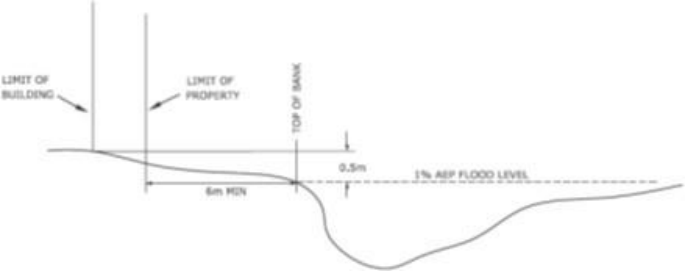
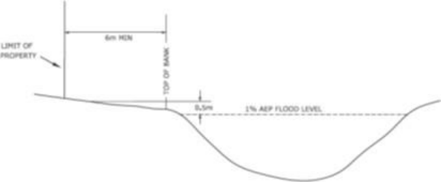
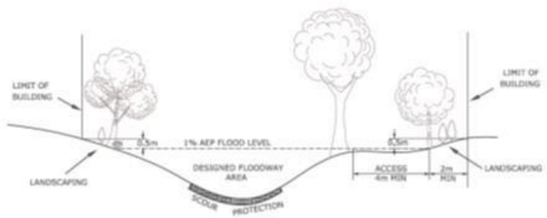
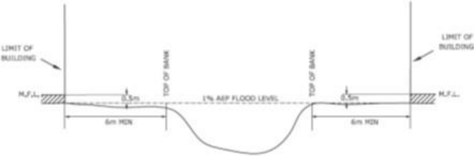

#### 3.1.13 SETBACK TO CREEKS, RIVERS AND LAGOONS

#### 3.1.13.1 Objective

To provide appropriate setbacks from creeks, rivers and lagoons in order to maintain ecological corridors, public access and drainage easements.

#### 3.1.13.2 Deemed to Comply

Where a building is to be located adjacent to a creek, waterway or lagoon, the building shall be set back from the creek, waterway or lagoon such that:

▪ For further development of greenfield sites, setbacks are to be determined during the planning process to ensure that land inundated by the 1% AEP flood including freeboard will not be developed. As well as this criterion, access shall be provided along the creekbanks to enable further maintenance and ongoing public accessibility along the reserve areas. At least six metres width between the top of the bank of the creek and the property boundary shall be provided. (See Figures No. 4 & 5)

▪ For development proposals in existing subdivided areas, the following provisions shall apply:

▪ For minor creeks defined as creeks with a catchment area of less than 7.5 hectares:

▪ If no easement exists over the minor creek the setback shall be 4 metres.

▪ If an easement exists over the creek, the normal building restrictions alongside an easement would apply.

▪ Where appropriate, the applicant may create and pipe the easement in order to remove the setback requirement. All pipework shall be to a Council approved design and construction specifications. Such works will also require the consent of other relevant Government authorities.

▪ For major creeks having a catchment area larger than 7.5 hectares a setback is to be provided to allow for:

▪ Future adequate waterway construction

▪ A 4m wide vehicular and machinery access along the waterway for maintenance where a suitable easement does not exist.

▪ An overbank floodway to pass a minimum of the 1% AEP design flood.

▪ Adequate landscaping to the bank area.

▪ See Setback Figure 6.

Where the future waterway does not have an approved design, the setback shall be a minimum of 6 metres on each side of the creek from the top of the natural bank of the creek. Where banks of the creek have been filled without authorisation, the Council may determine a larger setback as considered appropriate. (See Figure 7)

The setback to be provided shall enable a hydraulically satisfactory waterway alignment to be retained or created. Setbacks, which when examined in relation to adjoining or nearby properties, cause sharp changes in direction or constrictions to flow will not be permitted.

In addition to the above requirements, if the land is subject of a Floodplain Management Plan, the setback of the buildings will also need to adhere to any controls specified in the Management Plan.

It is desirable that a "Drainage Reserve" be created over all major creeks, including the area required for access and landscaping. Access to creeks may also require easements for access to ensure access is retained.

Setbacks from the top of the bank of the creek shall apply to properties adjoining public reserves where the land is flood liable up to the 1% design flood event

A developer may, subject to approval by Council, prepare engineering plans for a reach of a major creek and incorporate the provisions described above into the proposal. The setback shall then be provided to a varied distance as suitable providing the engineering works are carried out during development.

Subdivision of land adjacent to major and minor creeks shall take into account the need to provide setbacks as described in this Chapter.

Setbacks from creeks and lagoons shall also be affected by other regulatory authorities i.e. Department of Environment, Climate Change & Water with regard to the Controlled Activity provisions of the Water Management Act 2000, and the Department of Primary Industries with regard to the NSW Fisheries Management Act. Details of the affections should be sought by the applicants from these authorities or authorities that supersede these authorities.

#### Figure 4 - Setback from watercourse

> [Picture on page 50: a picture, saved as a picture (images/ch-03-01-floodplain-management-and-water-cycle-management-page-50-12.gif, 150 dpi).]

#### Figure 5 - Setback from watercourse

> [Picture on page 50: a picture, saved as a picture (images/ch-03-01-floodplain-management-and-water-cycle-management-page-50-14.gif, 150 dpi).]

#### Figure 6 - Setback from watercourse

> [Picture on page 50: a picture, saved as a picture (images/ch-03-01-floodplain-management-and-water-cycle-management-page-50-16.gif, 150 dpi).]

#### Figure 7 - Setback from watercourse

> [Picture on page 51: a picture, saved as a picture (images/ch-03-01-floodplain-management-and-water-cycle-management-page-51-2.gif, 150 dpi).]
