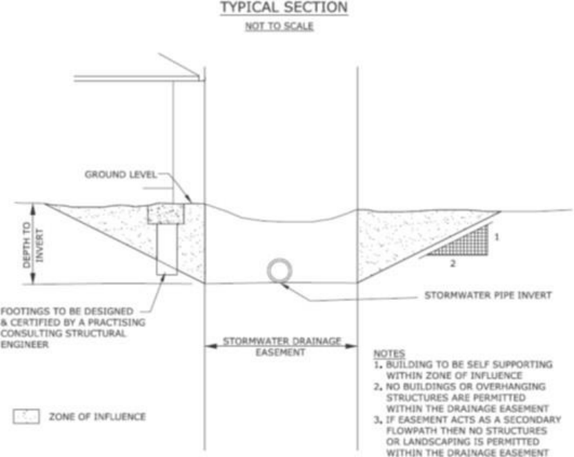

#### 3.1.14 BUILDING ADJACENT TO DRAINAGE EASEMENT / STORMWATER PIPES

#### 3.1.14.1 Objective

Ensure the integrity of the stormwater drainage systems, natural watercourses and any structures built in the near vicinity is maintained.

#### 3.1.14.2 Recommended Application

In general no buildings/structures or overhanging structures will be permitted over a drainage easement of Council stormwater pipe/culvert.

#### 3.1.14.3 Deemed to Comply

Council requires the construction of piers when building near to a drainage easement/Council stormwater pipe. Before building approval will be granted, full engineering details of the proposed piers and beams for all footings within the influence region of the drainage easement are to be submitted to Council by a suitably qualified practising Structural Engineer.

No excavation is permitted within 2 metres of any drainage easement unless approval has been granted by the Director City Services.

#### Depth of Piers

All piers along the drainage easement boundary/Council stormwater pipe shall have a minimum depth equal to the level of the invert of the stormwater pipe or culvert. The pier depth may be decreased by 500mm for each increment in distance of 1 metre from the boundary of the easement, or at an angle equal to the natural repose of the soil (saturated) as determined by a qualified practising Structural/Geotechnical Engineer.

Where an easement contains an existing watercourse or open drain to a depth greater than 1.5 metres the pier depth shall be determined as 0.5 metres below the actual invert of the open drain or watercourse.

Where a drainage easement is at present unpiped or proposed to be piped but there is not a detailed design for the proposal to pipe an easement a depth to the invert of a future pipeline of 1.5 metres shall be assumed unless otherwise specified by Council.

#### Engineering Details Required

The Consulting Engineer is to certify on the submitted plans that the piers are adequate to support the structure in the event of the easement/Council stormwater pipe being excavated along or within the easement boundary.

At the completion of construction of the piers and beams, a Certificate of Compliance will be required from the Consulting Engineer stating that all work has been carried out in accordance with the approved engineering plans. The following information is to be shown on the plans:

▪ Plan view of proposed building(s) in the region of the drainage easement and the

▪ extent of any excavation also showing pier locations and depths.

▪ Boundary of drainage easement of plan view.

▪ Limits of the Zone of Influence on plan view.

▪ Typical sections across Zone of Influence from the drainage easement.

▪ Section across Zone of Influence at the closest point between the drainage easement and foundation if it is different to the typical cross section.

▪ Engineering details of structural elements suitably dimensioned.

If the applicant proposes to modify the Zone of Influence from the standard, the following signed certification by the applicant’s engineer is required:

▪ "I certify that the footings of this building as designed are adequate to support and protect the building from damage in the event that disturbance or settlement occurs within the Zone of Influence."

A typical section showing the zone of influence is shown in Figure 8, attached below.

#### Figure 8 - Building adjacent to a drainage easement

> [Picture on page 53: a picture, saved as a picture (images/ch-03-01-floodplain-management-and-water-cycle-management-page-53-2.gif, 150 dpi).]
