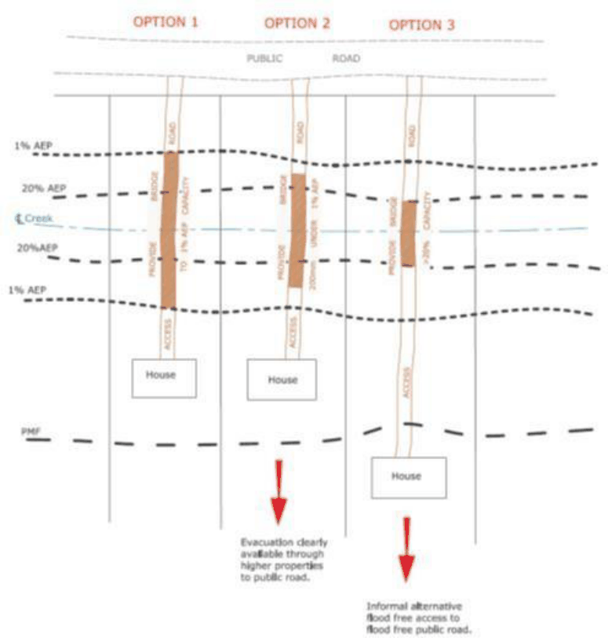

#### 3.1.15 PROVIDING ACCESS TO RURAL PROPERTIES AFFECTED BY FLOODING

#### 3.1.15.1 Objective

To provide safe access and/or evacuation routes to and from rural properties to a public road during a 1% AEP flooding event

#### 3.1.15.2 Deemed to Comply

A qualified and experienced Consultant shall identify the following for the 1% AEP flood event affecting the property(s):

▪ the extent of the floodplain;

▪ the flood levels;

▪ mainstream and overbank velocities and depths over the floodplain along the proposed access route.

The Consultant report is to provide details of proposed pedestrian and vehicular access above the 1% AEP flood, it is desirable that at least 0.5 metre freeboard be provided. The site plans shall show the proposed location and floor level for dwelling(s), which shall be outside the 1% AEP floodplain.

The creek crossing shall be designed so that the construction of the creek crossing and its approaches must not raise flood levels for the 1% AEP event by more than 10mm (Council’s standard) at the adjoining property boundaries and this must be certified by a competent practising hydraulics engineer. The designed crossing shall not have a significant detriment to the creek environment and should incorporate environmental protection measures as appropriate.

#### Alternative Option 1 Requirements

If the standard requirements are considered to be unreasonable by the Council, then the Council may use its discretion to resolve that the following requirements could replace the standard requirements.

▪ A qualified and experienced Consultant shall identify the following for the 1% AEP flood event affecting the property(s):

▪ the extent of the floodplain;

▪ the flood levels;

▪ mainstream and overbank velocities arid depths over the floodplain along the proposed access route.

▪ The Consultant shall design the access which shall be covered by up to a maximum depth of 200mm in the predicted 1% AEP flood level.

▪ The creek crossing shall be designed so that the construction of the creek crossing and its approaches must not raise flood levels for the 1% AEP event by more than 10mm (Council’s standard) at the adjoining property boundaries and this must be certified by a competent practising hydraulics engineer. The designed crossing shall not have a significant detriment to the creek environment and should incorporate environmental protection measures as appropriate.

▪ Velocities shall not exceed the safe levels for car access through floodwaters.

▪ Flood depth indicators and delineation guide posts including flood warning signs shall be installed over the extent of the 1% AEP floodplain to identify the alignment of the access and depth of floodwaters over the road access. The signage shall warn people not to cross the access when covered by floodwaters.

▪ The access driveway is to be sealed over the full extent of the 1% AEP floodplain to prevent erosion and siltation of the creek.

▪ An alternative all weather, informal, practicable access is required to higher ground above the PMF event. Therefore the Consultant shall determine the flood flow and level for the PMF event and show the level on the subdivision plan.

▪ A message will be placed on the Section 10.7 Certificate notice for the property advising that the access is constructed to a level below Council’s flood standards.

#### Alternative Option 2 Requirements

If the above access requirements are found in specific circumstances to be very unrealistic and/or environmentally insensitive by the Council and also if Council does not have any proposal to upgrade its adjoining public roads to higher flood free standards, then the Council may use its discretion to resolve that the following requirements could replace the standard requirements.

▪ A qualified and experienced Consultant shall identify the following for the 1% AEP flood event affecting the property(s):

▪ the extent of the floodplain;

▪ the flood levels;

▪ mainstream and overbank velocities and depths over the floodplain along the proposed access route.

▪ The Consultant shall determine the storm durations and flood levels for the PMF, 1%, 2%, 5% and 20% AEP events for Council’s consideration.

▪ Dwelling(s) shall be located on land above the PMF and the extent is to be shown on the subdivision plan.

▪ Where the 1% AEP storm duration is less than 2 hours the proposed access is to be constructed to the highest of either the 20% AEP flood level or to the Councils adjoining road flood frequency.

▪ Where the access proposed is to be below the 20% AEP flood event or the 1% AEP storm duration exceeds 2 hours then an alternative practicable all weather informal access is required via adjoining property(s) to high ground and to a flood free public road. The access to be informally arranged.

▪ Flood depth indicators and delineation guide posts including flood warning signs shall be installed over the extent of the 1% AEP floodplain to identify the alignment of the access and depth of floodwaters over the access road. The signage should warn people not to cross the access when covered by floodwaters.

▪ The creek crossing shall be designed so that the construction of the creek crossing and its approaches must not raise flood levels for the 1% AEP event by more than 10mm (Council’s standard) at the adjoining property boundaries and this must be certified by a competent practicing hydraulics engineer. The designed crossing shall not have a significant detriment to the creek environment and should incorporate environmental protection measures as appropriate.

▪ A message will be placed on the Section 10.7 Certificate notice for the property advising that the access is constructed to a level below Council’s flood standards and that the property does not have safe flood free access up to Council’s standard. Access may therefore be denied in severe flood events. Alternate access shall be arranged to higher ground through adjoining property.

▪ Alternative access methods for emergency services should also be considered close to the proposed dwelling(s), i.e. a helicopter landing area.

▪ The access driveway is to be sealed over the full extent of the 1% AEP floodplain to prevent erosion and siltation of the creek.

#### Figure 9 - Illustration of the three rural access strategies

> [Picture on page 56: a picture, saved as a picture (images/ch-03-01-floodplain-management-and-water-cycle-management-page-56-2.gif, 150 dpi).]
