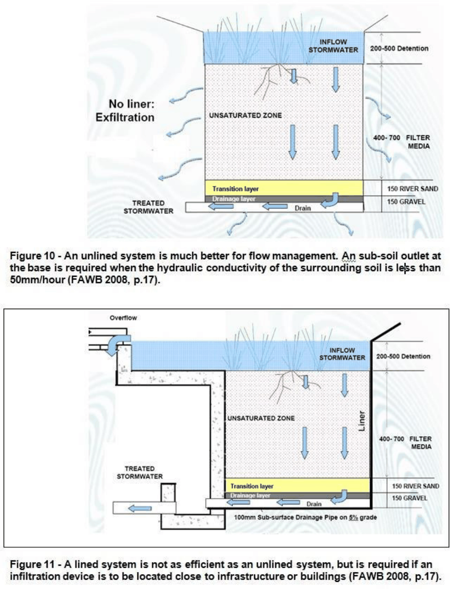

#### 3.1.16 HELPFUL RESOURCES

#### 3.1.16.1 Water Smart Practice Notes

Water Smart Practice Notes provide the detail to apply the best-practice guiding principles and requirements of some of the targets within this plan. They are available on-line from the Hunter Central Coast Regional Environmental Management Strategy (HCCREMS) website:

| 1 | The WaterSmart Home | 706kb PDF |
|---|---|---|
| 2 | Site Planning | 1Mb PDF |
| 3 | Drainage Design | 508kb PDF |
| 4 | Rainwater Tanks | 786kb PDF |
| 5 | Infiltration Devices | 606kb PDF |
| 6 | Paving | 574kb PDF |

| 7 | Landscape Stormwater Measures | 863kb PDF |
|---|---|---|
| 8 | Water Efficient Landscape Practices | 978kb PDF |
| 9 | Wastewater Reuse | 464kb PDF |
| 10 | Groundwater | 444kb PDF |
| 11 | Site Discharge Index | 1Mb PDF |

#### 3.1.16.2 Estimation of soil infiltration Rates

Hydraulic conductivity can be roughly estimated by digging a test hole on site, filling with water, and measuring time it takes for the water level to fall a certain depth (in mm/hr). Note that this method will certainly over-estimate the actual hydraulic conductivity, given that water can infiltrate through both the bottom and the sides of the hole. However it will certainly give an indication of whether the soil type is unsuitable for infiltration. More accurate measurements of hydraulic conductivity can be made by laboratory testing, or by more advanced in-situ test methods 12.

Hydraulic conductivity ranges for common soils are as follows:

#### Table 6 Soil Properties

| Soil Type | Hydraulic Conductivity | Distance to Footings |
|---|---|---|
| Sandy soils | > 180mm/hr | 1 metre |
| Sandy clays | from 3.6mm/hr to 180mm/hr | 2 metres |
| Medium clays | from 3.6mm/hr to 3.6mm/hr | 4 metres |
| Heavy clays | < 3.6mm/hr | 5 metres |

Soils with a hydraulic conductivity in the range of 100-400mm/hr are often capable of managing runoff from small-moderate storms without overflow. The optimum soil type is loamy sand.

Soils with a hydraulic conductivity less than 50mm/hr are not able to effectively manage storm runoff; however ponded water will still eventually soak away.

Sandy soils may have a very high initial porosity (hydraulic conductivity) of up to 2000mm/hr. However they are prone to surface clogging - especially by clays and silts during construction.

#### 3.1.16.3 Specification for rain-garden or bioretention filter media

The preferred filter media type is loamy sand. Filter media should (FAWB 2008, p.35):

▪ Be well graded and contain no gaps in the particle size range.

▪ Have a particle size distribution (% w/w) of:

▪ Clay & silt <3%

▪ Very fine Sand 5-30%

▪ Fine sand 10-30%

▪ Medium-course sand 40-60%

▪ Coarse sand 7-10%

▪ Fine Gravel <3%

▪ Contain less than 5% w/w of organic matter and less than 100 mg/kg of phosphorus (to avoid leaching of nutrients).

▪ Not be hydrophobic

▪ Not contain dispersive clays

▪ Be free of rubbish, toxicants, declared plants and local weeds

Biofilters will experience a drop in hydraulic conductivity immediately following construction, mainly due to compaction. However, infiltration capacity will recover due to plant activity, provided the system is not overloaded with silt. Plants with large diameter roots are better than those with fine roots at maintaining infiltration capacity.

#### 3.1.16.4 Specification for selection of plants

Some plants are much better at removing nutrients than others. The filter media is important for the removal of solids (total Suspended Solids and Gross Pollutants) and for the health of the plants:

▪ Native plant species that are suitable for use in stormwater management measures can be found in Practice Note 7

▪ Water efficient landscaping practices and species can be found in Practice Note 8

▪ A mix of species is preferred to promote biodiversity

▪ The majority of plants should be made up of plants that are efficient at Nitrogen removal, such as Carex species, Juncus species, Melaleuca species, or Goodenia ovata. The remainder can be chosen for aesthetic or biodiversity outcomes.

▪ Plants are essential to maintain hydraulic conductivity

▪ Species with thick roots help, such as Melaleuca species

▪ The effect grows with time as the plants are established

▪ Higher density planting results is less weed invasion and lower maintenance.

> [Picture on page 59: a picture, saved as a picture (images/ch-03-01-floodplain-management-and-water-cycle-management-page-59-1.gif, 150 dpi).]

Reference

12 Appendix A in Argue (2004). A much more reliable in-site measurement of hydraulic conductivity can be found in Appendix B of FAWB (2008).
