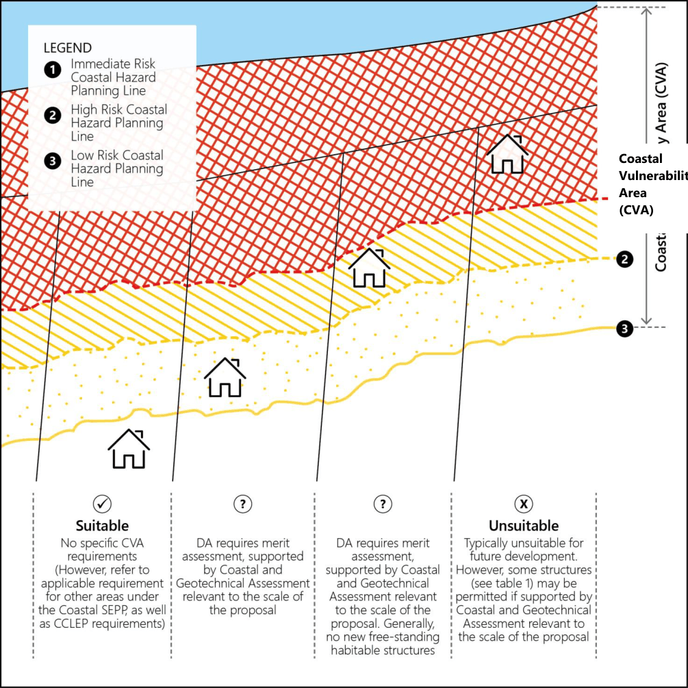

#### 3.2.2 INTRODUCTION

This Part applies to the lands within the CVA from Budgewoi Beach in the North to Yumbool Point in the South (within the former Wyong Shire). The CVA is defined as including lands seaward of the former Low Risk Coastal Hazard Planning Line, and also including the landward extent of the identified Geotechnical Hazard Zones and the Combined Bluff, Beach and Dune Zones.

Note:  Applicants for development on these lands should lodge a Coastal Hazard Enquiry Form with Council so that Council can provide the accurate position of the hazard line from the GIS versions of the maps.

Development proposals for new development, modifications or extensions to existing developments will be subject to controls and may be restricted within the identified hazard areas and zones. All applications will need to:

▪ investigate and address the potential hazard(s);

▪ not contribute any increased level of risk to other lands; and

▪ demonstrate the suitability of the proposed development within the zone.

#### 3.2.2.1 Identification of Coastal Hazards

This Part is based on the Wyong Shire Coastal Zone Management Plan, 2011 (WSCZMP). The two supporting reports for this plan, available on Council’s website, are:

Wyong Coastal Hazard Study, SMEC Australia, October 2010;

Report on the Geotechnical Issues associated with the Coastline Hazard Management Study, Shirley Consulting Engineers, Pty Ltd, May 2010.

These reports recognise the distinction between hazards associated with sand dunes (erosion risk), and those associated with cliffs, bluffs and rock formations (geotechnical hazards). It should also be noted that some lands are affected by both.

Development on land within the Coastal Zone which is landward of the CVA, whilst covered by other controls detailed within the State Environmental Planning Policy (Resilience and Hazards) 2021 and the CCLEP 2022, are not constrained by coastal process issues and there are no specific coastal hazard management requirements.

#### 3.2.2.1.1 Coastal Erosion Risk

Coastal erosion hazard studies have not been completed for the entire length of some beaches. Council and The NSW Office of Environment and Heritage (OEH) identified key locations for which hazard studies would be prepared, at the outset of the WSCZMP 2011 project. Generally, these locations correspond with areas of residential development or locations of community infrastructure. Based on the assessment recommended by OEH, Council’s coastal hazard mapping shows areas, outside and including the recognised “hotspots” (or “Authorised Locations”), which are considered to be subject to Immediate Risk Coastal Erosion Hazard along the coast. Severe coastal erosion could occur in these areas at any time. Having defined the Immediate Risk Hazard Line, the High Risk Hazard and Low Risk Hazard lines and zones have been predicted.

#### 3.2.2.1.2 Geotechnical Risk

Geotechnical assessments have been conducted of cliffs and bluffs along the former Wyong Shire Council coastline where geotechnical processes are likely to affect residential development, public or private

infrastructure or recreational access. These locations are also represented on Council’s coastal hazard mapping.

#### 3.2.2.1.3 Wave Run-Up Risk

Wave run-up analysis for the design storm (26 May 1974) has indicated that wave run-up level along the former Wyong Shire coastline is generally around 6m to 7m AHD, with higher values for North Entrance where the run-up level can reach up to around 8.1m AHD. Specific values for each beach are included in Table 4 within the Wyong Coastal Hazard Study, SMEC Australia, October 2010.

This analysis indicates that some overtopping may occur at Blue Lagoon Caravan Park at Bateau Bay, at the southern end of Blue Bay, at South Entrance swimming pool, along Curtis Parade at North Entrance and along Hargreaves Beach. However, the impact to houses and roads would be limited, owing to the dissipation of wave run-up by the dune system.

#### 3.2.2.1.4 Other Areas

Where a development is proposed on a site(s) where incomplete information is currently available, Council requires that a Coastal Hazard Definition Study (which may include a Geotechnical Report) be prepared by a Coastal Engineer, before an application prepared by a Civil Engineer can be considered.

The following requirements shall be addressed with the application:

a identification of the location of the Coastal Hazard Planning Lines and Stability Zones for Immediate Risk, High Risk and Low Risk hazard lines on the site, addressing:

i general stability of the site and locality in respect to the effect of the proposal on adjacent structures and land;

ii stability of the site and locality in a severe storm event.  Reference should be made to the reports identified above.  The following factors are to be considered:

▪ oceanic inundation as a result of elevated sea levels, wave setup & run-up;

▪ beach scour levels and dune scarp stability; and

▪ the effect of the proposal on adjacent structures.

iii stormwater disposal from buildings with the objective being to prevent water concentration and bank scouring;

b all options, including locating the proposal some distance from the identified High Risk Coastal Hazard Planning Line or Geotechnical Hazard Zone, must be examined. Development should be located

landward of these areas unless it can be demonstrated that there is no other suitable option.

#### 3.2.2.2 Coastal Hazard Planning Lines

Council will use the planning system to reduce the exposure of development to coastal processes over time within the CVA (refer Figure 2 below for general principles) and to thereby reduce the associated risk.

> [Picture on page 7: a picture, saved as a picture (images/ch-03-02-coastal-hazard-management-page-7-4.gif, 150 dpi).]
> Words printed on the picture (title and legend, copied from the PDF):
> Coastal
> Vulnerability
> Area
> (CVA)

#### Figure 2: Coastal Hazard Planning Lines – General Principles

Diagram adapted from NSW Department of Planning 2010

The following Table 1 indicates development types (non-exhaustive) which may be considered on merit within the Risk Zones of the CVA, via the Development Assessment process. The Risk Zone lies seaward of the relevant Risk Planning Line.

Coastal Vulnerability Area

| Outside Coastal Hazard Planning Area | Low Risk Coastal Hazard Planning Zone | High Risk Coastal Hazard Planning Zone | Immediate Risk Coastal Hazard Planning Zone |
|---|---|---|---|
| Merit Assessment as per Land Use Tables for the relevant Zone within CCLEP, 2022, together with compliance with provisions relating to Coastal Management Areas within State Environmental Planning Policy (Resilience and Hazards) 2021 & the Coastal Management Act 2016. Note: The Act and SEPP define the following CMAreas in order of hierarchy of controls (highest to lowest): • Coastal Wetlands and Littoral Rainforests Area; • Coastal Vulnerability Area; • Coastal Environment Area; and • Coastal Use Area. | • New single dwellings • Maintenance work to existing dwellings / developments • Works to make existing developments relocatable • New ancillary residential development - sheds, garages, swimming pools, timber gazebos, timber decks & viewing platforms • New commercial developments • Tourist development • Caravan parks (tourist sites) • Recreation facilities • Landscaping structures, paving or drainage works | • Removal of an existing dwelling and replacement with a new single dwelling within, and/or landward of, the pre-existing dwelling footprint. • Additions and alterations within, or landward of, the pre- existing dwelling footprint. • Maintenance work to existing dwellings / developments, e.g., re- cladding • Works to make existing developments relocatable • Timber decks & viewing platforms (max. 20m², max. 1m from ground) • Timber gazebos (max. 20m²) • Sheds, garages, swimming pools and ancillary development no further seaward, or closer to the hazard, than the principal dwelling. • Tourist development • Caravan parks (tourist sites) • Recreation facilities • Coastal Protection Works – groynes, seawalls, break-walls, beach nourishment • Access Pathways – boardwalks / tracks • Timber & wire fencing & railings • Landscaping structures, paving, drainage works • Community facilities (such as surf club buildings) | • Removal of an existing dwelling and replacement with a new single dwelling within, and/or landward of, the pre-existing dwelling footprint. • Additions and alterations within, or landward of, the pre- existing dwelling footprint. • Maintenance work to existing dwellings / developments, e.g., re-cladding • Works to make existing developments relocatable • Timber decks & viewing platforms (max. 20m², max 1m from ground) • Timber gazebos (max. 20m²) • Sheds, garages, swimming pools and ancillary development no further seaward, or closer to the hazard, than the principal dwelling. • Coastal Protection Works – groynes, seawalls, break- walls, beach nourishment • Access Pathways – boardwalks / tracks • Timber & wire fencing & railings • Landscaping structures, paving or drainage works • Community facilities (such as surf club buildings) |

#### Table 1:  Development Type by Risk Zone

Coastal Vulnerability Area

The following Table 2 indicates the circumstances in which documentation is required to support applications for the development types within Table 1, particularly where a variation to the adopted Planning Lines is sought. Such proposals will be considered on merit, via the Development Assessment process.

| Outside Coastal Hazard Planning Area | Low Risk Coastal Hazard Planning Zone | High Risk Coastal Hazard Planning Zone | Immediate Risk Coastal Hazard Planning Zone |
|---|---|---|---|
| Assessment as appropriate to site conditions. | Coastal and Geotechnical Assessment is required addressing the location, type of coastal hazard and scale of development. Lightweight structures, supported by existing structures or new pad footings, will not require a Geotechnical Report. | Coastal and Geotechnical Assessment suitable to the scale of the proposal is required for new buildings and major additions and alterations requiring continuous footings, slab (including pools) and or masonry construction. Lightweight structures, supported by existing structures or new pad footings, will not require a Geotechnical Report. | Coastal and Geotechnical Assessment suitable to the scale of the proposal is required for new buildings and for major additions and alterations requiring continuous footings, slab (including pools) and or masonry construction. |

#### Table 2:  Submission Requirements

#### OBJECTIVES

▪ To manage development in Coastal Vulnerability Areas using precautionary planning tools to reduce coastal hazard risks

▪ To protect against or manage coastal hazards on sites where this is feasible, affordable and without adversely impacting the locality or the broader environment

▪ To complement and reinforce the objectives and requirements of Clause 2.9 of State Environmental Planning Policy (Resilience and Hazards) 2021

▪ To protect beach amenity and public safety

#### REQUIREMENTS

#### 3.2.2.2.1 Coastal Erosion Hazard (A)

Selected development may be considered with appropriate coastal/geotechnical assessment within the various Coastal Hazard Risk Zones (refer to Table 1 as a guide) within the CVA. The principles to be applied for sites subject to erosion hazard include:

a Generally, no new freestanding development, other than works for erosion control and controlled beach access, will be considered seaward (or closer to the hazard) of existing development within the Immediate Risk Coastal Hazard Planning Zone, which extends from the Pacific Ocean Mean High Water Mark to the Immediate Risk Coastal Hazard Planning Line (red).

b Generally, no new habitable development will be considered within the Immediate or High Risk Coastal Hazard Planning Zones, which extend from the Pacific Ocean Mean High Water Mark to the High Risk Coastal Hazard Planning Line (amber), unless supported by Coastal and Geotechnical Assessments which establish that adequate protection or adaptation measures can be designed and implemented (approved by either Council or the NSW OEH);

c Where the removal and replacement of a dwelling within the pre-existing dwelling footprint is proposed, a supporting Coastal and Geotechnical Assessment Statement suitable to the scale of the proposal will be required.  (Note: This is not a significant Coastal Engineering Study, it is a Statement from an appropriately qualified professional);

d Proposals for new freestanding structures requiring continuous footings, slab (including pools) and or masonry construction within the High Risk Coastal Hazard Planning Zone, which extends from the Immediate Risk Coastal Hazard Planning Line (red) to the High Risk Coastal Hazard Planning Line (amber), will require a supporting Coastal and Geotechnical Assessment Statement suitable to the scale of the proposal. Lightweight structures, supported by existing structures or new pad footings, will not require a Geotechnical Report;

e Floor levels for new development seaward of the High Risk Coastal Hazard Planning Line (amber) must consider the 1% AEP storm wave run-up level for each beach (refer Sections 1.4.4 and 2.1.3, and Table 4 within the Wyong Coastal Hazard Study, SMEC Australia, October 2010);

f Geotechnical Assessments suitable to the scale of the proposal may also be required for new structures within the Low Risk Coastal Hazard Planning Zone, which extends from the High Risk Coastal Hazard Planning Line (amber) to the Low Risk Coastal Hazard Planning Line (yellow), e.g., for major structures requiring continuous footings, slab (including pools) and or masonry construction;

g Council will not approve new subdivisions, vulnerable development (including child care centres, nursing homes and hospitals) or other development that intensifies land use seaward (or closer to the hazard) of the Low Risk Coastal Erosion Hazard Planning Line (yellow); and

h Construction and maintenance of sea walls to protect existing private assets affected by coastal recession will be considered on a merit basis, and will be referred for consideration by relevant NSW government agencies as required by the Coastal Management Act, 2016 (e.g., OEH).

#### 3.2.2.2.2 Geotechnical Hazard (B)

As identified above, selected development may be considered with appropriate coastal/geotechnical assessment within the various Coastal Hazard Risk Zones (refer to Table 1 as a guide) within the CVA. The following additional controls apply to areas mapped as being subject to Geotechnical Hazards:

a Generally, no new development, other than stabilisation works and controlled access works, will be considered seaward (or closer to the hazard) of existing development within the Immediate Risk Coastal Hazard Planning Zone, which extends from the Pacific Ocean Mean High Water Mark to the

(red) Immediate Risk Coastal Hazard Planning Line. Where a minor freestanding structure is proposed, a supporting Coastal and Geotechnical Assessment Statement suitable to the scale of the proposal will be required.  (Note This is not a significant Coastal Engineering Study, it is a Statement from an appropriately qualified professional)

b Generally, no new dwellings will be approved seaward (or closer to the hazard) of the High Risk Coastal Hazard Planning Line (amber). Where the removal and replacement of a dwelling requiring

continuous footings, slab (including pools) and or masonry construction within the pre-existing dwelling footprint is proposed, a supporting Coastal and Geotechnical Assessment Statement suitable to the scale of the proposal will be required. (Note: This is not a significant Coastal Engineering Study, it is a Statement from an appropriately qualified professional);

c Any proposal for other new habitable development requiring continuous footings, slab (including pools) and or masonry construction within the area bounded by the Immediate Risk Coastal Hazard Planning Line (red) and the Low Risk Coastal Hazard Planning Line (yellow) shall be accompanied by appropriate Coastal and Geotechnical assessments of the subject site and a Structural Engineer’s Design for the proposed development that addresses the identified geotechnical hazards.

d Any proposal for new development requiring continuous footings, slab (including pools) and or masonry construction within an identified Geotechnical Hazard Zone (green hatching) shall be accompanied by appropriate geotechnical assessments of the subject site and a Structural Engineer’s Design for the proposed development that addresses the identified geotechnical hazards. Lightweight structures, supported by existing structures or new pad footings, will not require a Geotechnical Report

e Council will not approve new subdivisions, vulnerable development (including child care centres, nursing homes and hospitals) or other development that intensifies land use between the High Risk Coastal Hazard Planning Line (amber) and the Low Risk Coastal Hazard Planning Line (yellow); and

f Construction and maintenance of sea walls to protect existing private assets affected by coastal recession hazards will be considered on a merit basis.

#### 3.2.2.2.3 Combined Bluff, Beach and Dune Zone Hazard (C)

The following additional control applies to areas mapped as being Bluff, Beach and Dune Zones:

a Any proposal for new development requiring continuous footings, slab (including pools) and or masonry construction within an identified Bluff, Beach and Dune Hazard Zone, hatched blue on Council’s coastal hazard mapping, shall be accompanied by appropriate geotechnical assessments of the subject site and a Structural Engineer’s Design for the proposed development.

#### 3.2.2.3 Requirements for Geotechnical Assessment Reports

a The following matters are required to be addressed in any Geotechnical report submitted with an application to Council:

i Professional assessment on the suitability of the proposed development considering surficial soil instability problems, land stability issues, future bluff recession hazards and the design life of the proposed structure.

ii Description of the geotechnical assessment process adopted and the work undertaken to provide the assessment, considering:

▪ study of geological and topographic maps of the area;

▪ consideration of the information made available by the client about the site and its surrounding area, (including previous instability, building distress, and drainage problems) and the development proposals;

▪ visual appraisal of the site and the surrounding areas, including signs of instability, soil and rock exposures, seepage and vegetation;

▪ collection of basic topographic and geological measurements at the site, (viz: slope angles, substrata, bedrock type & depth, etc.); and

▪ production of a documented sketch geological model of the site.

iii A site description, including vegetation, bedrock outcrops, site seepage & groundwater, existing development, etc.

iv Description of site substrata and identification of the geological formations present in accordance with standard geological practice (e.g. Tuggerah Formation (Rnu) or Patonga Claystone (Rnp) etc.)

v The depth to weathered bedrock over the site generally and within the building area in particular.

vi The site slopes observed (expressed in degrees) and maximum site slope. Delineation of the site into areas of common slope and measured slope angles in the various areas.

vii A “Risk Assessment” of the various parts of the land in accordance with the Australian Geomechanics Society Guidelines – “Landslide Risk Management” (2007) or as subsequently amended. Delineation of the land into areas where different degrees of risk are determined, together with a site classification in accordance with AS 2870 - 2011 (or latest amended edition).

viii A statement of the effect of the proposed site development on the site, and adjoining land, stability.

ix An assessment of the stability of the land immediately surrounding and above/below the site and possible effects of instability (e.g. a rock fall) on the adjoining/nearby land on the site.

x Sufficient detailed information and recommendations for a structural engineer and/or civil engineer to provide a design for the development to accommodate any instability, or potential instability, considered to affect the land and/or related land.

b For areas affected by high or immediate hazard, Council also requires the following:

i A site plan indicating relevant geological features & location of proposed development on the land relative to those features (preferably at a scale of 1:200);

ii At least one geological section through the site and proposed development (preferably at a scale of 1:200); and

iii Logs of boreholes put down to determine depth of soil/weathered rock strata. The borehole to penetrate the site strata to bedrock and at least one borehole to be within the building area of the site

c Geotechnical reports are to be prepared by a “Geotechnical Engineer”, meaning any geotechnical engineer and/or engineering geologist who is listed on the National Professional Engineer’s Register, Level 3 (NPER-3), or a current Member or Fellow of the Australian Institute of Geoscientists. The Geotechnical Engineer must have a minimum of five years practice as a geotechnical engineer, or engineering geologist, with appropriate experience in assessing geotechnical hazards in coastal environments and in advising on building works in regions underlain by Terrigal Formation, Patonga Claystone, Tuggerah Formation and Munmorah conglomerate geological strata, or who is able to demonstrate considerable relevant experience with similar geology. The geotechnical engineer should be familiar with the Engineers Australia Code of Ethics, Sustainability Charter, legal responsibilities and duty of care. The Geotechnical Engineer shall also be covered by appropriate professional indemnity insurance with a cover of at least $2,000,000 and provide the Council with proof of the currency of such insurance policy(s) with the geotechnical report.

d Council’s current climate change considerations and sea level rise projections at the time of application.

### PART C: SOUTHERN AREA (FORMER GOSFORD LGA)
