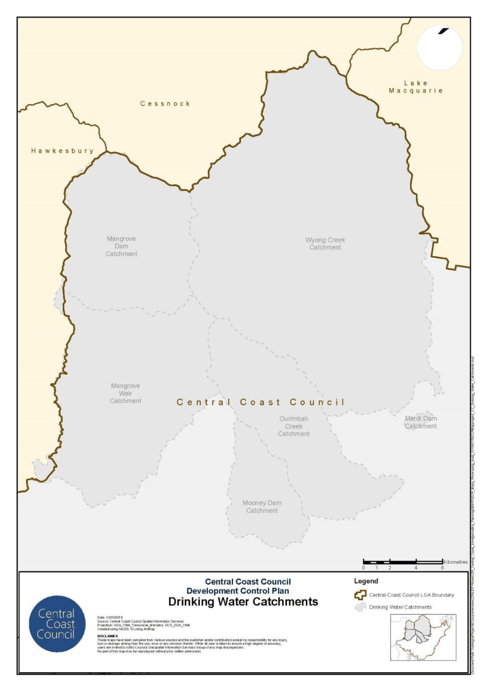

#### 3.4.1 INTRODUCTION

The Central Coast’s potable water supply comes from harvesting water flows from streams and groundwater sources within its Drinking Water Catchment.

Development and use of land within the Drinking Water Catchment has the potential to impact the quality and quantity of water available for this purpose.

These impacts have the potential to result in higher likelihoods of disease (and/or deaths) in plant and animal populations, but can also create additional treatment requirements and costs for the provision of safe and clean drinking water for the Central Coast.

#### 3.4.1.1 Objectives of this Chapter

The objectives of this chapter are to:

▪ Provide further guidance for the implementation of Clause 7.2 Drinking Water Catchments of Central Coast Local Environmental Plan (LEP) 2022.

▪ Ensure that the adverse environmental, health and financial impacts of development are minimised by ensuring development has a neutral or beneficial effect on the water supply sources within the Drinking Water Catchments.

#### 3.4.1.2 Relationship to other Chapters and Policies

This chapter is to be read in conjunction with other relevant requirements of this Development Control Plan.

Particular attention is to be given to Chapter 3.3 Onsite Sewage Management. Where reticulated sewer is not provided wastewater management must be addressed in accordance with the requirements of Chapter 3.3 for a High Risk Property.

#### 3.4.1.3 Application

The provisions of this chapter apply to any development of land identified as “Drinking Water Catchment” on the Drinking Water Catchment Map of Central Coast LEP 2022.

> [Picture on page 2: a picture, saved as a picture (images/ch-03-04-water-catchment-areas-page-2-1.gif, 150 dpi).]

#### Figure 1 Drinking Water of Central Coast LGA
