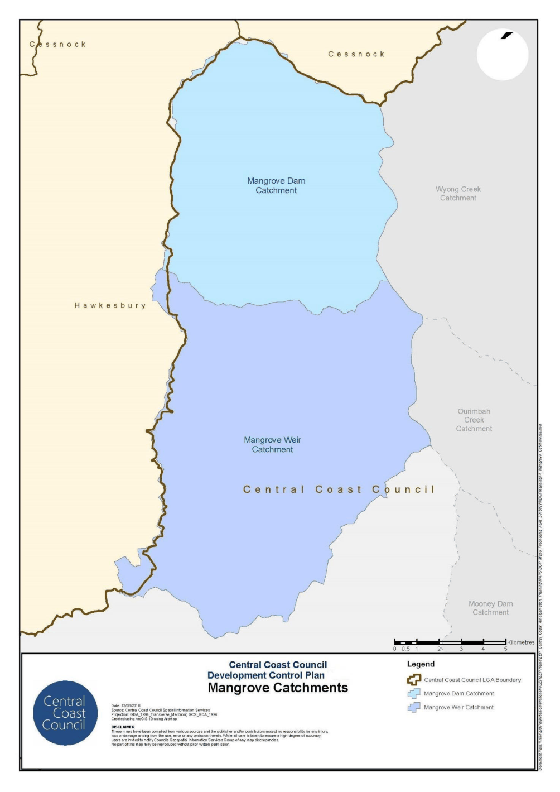

#### 3.4.2 DEVELOPMENT REQUIREMENTS

#### 3.4.2.1 Development within Mooney Dam, Ourimbah Creek, Mardi Dam and Wyong Creek Catchments

#### OBJECTIVES

▪ To ensure that developments within the Mangrove Dam, Mooney Dam, Ourimbah Creek, Mardi Dam and Wyong Creek Catchments have a neutral or beneficial effect on water quality and quantity.

▪ To protect the natural environment.

#### REQUIREMENTS

a Any application for development within the Mangrove Dam, Mooney Dam, Ourimbah Creek, Mardi Dam and Wyong Creek Catchments is to be supported by a Water Quality Management Plan which demonstrates that the proposed development will have a neutral or beneficial effect on water quality and quantity.

b The Water Quality Management Plan must be inclusive of (but not limited to) the following:

i Conceptual details of the proposed building and site drainage.

ii Details of how liquid wastes (Process wastewater, excluding domestic wastewater) will be handled, including drainage plans, treatment requirements including Biological Oxygen Demand (BOD), Suspended Solids (SS), salts and nutrients in the waste and disposal details.

iii Surface Water Protection Assessment, this is needed to ensure that any surface runoff, including polluted storm water runoff from the proposed development is contained, before treatment and disposal on the property, to ensure that no pollutant is allowed to discharge from the property

iv Demonstrated consideration of Clause 7.2(3) of Central Coast LEP 2022

c Existing native vegetation, particularly within riparian corridors is to be retained.

d Re-vegetation of riparian corridors is encouraged.

#### 3.4.2.2 Development in Mangrove Catchment

Raw water from the Mangrove Catchment (figure 2) is transferred to the directly to the Somersby Water Treatment Plant (WTP).  There is no intermediary treatment or storage.

The nature of existing land uses within this catchment present a low risk of human infectious viruses, bacteria and protozoa.  This means that the raw water does not require pre-treatment.

Intensification of development and land uses within the catchment may present additional contamination risks to the water sourced from this locality. Such development may result in the requirement for additional treatment processes prior to the raw water transfer to the Somersby WTP.

> [Picture on page 4: a picture, saved as a picture (images/ch-03-04-water-catchment-areas-page-4-1.gif, 150 dpi).]

#### Figure 2 Mangrove Catchment

#### OBJECTIVES

▪ To ensure that any proposed development within the Mangrove Catchment has a neutral or beneficial effect on water quality and quantity

▪ To ensure that any the costs associated with any upgrade requirements to the Somersby WTP are identified and sourced prior to development consent being granted

▪ To protect the natural environment

#### REQUIREMENTS

a Prior to seeking development consent in this locality, consultation with the Water Authority is required to determine any potential upgrade requirements to the Somersby WTP. Any additional treatment requirements are to be included and costed within any subsequent development application for development in the locality.

b Any development within the Mangrove Catchment  is to be supported by a Water Quality Management Plan which includes (but is not limited to):

i Conceptual details of the proposed building/site drainage.

ii Details of how liquid wastes (Process wastewater, excluding domestic wastewater) will be handled, including drainage plans, treatment requirements including (BOD), Suspended Solids (SS), salts and nutrients in the waste and disposal details.

iii A Groundwater Protection Assessment which demonstrates a neutral or beneficial effect on the groundwater quality from the development.  The report is to be based on the National Water Quality Management Strategy Guidelines for Groundwater Protection in Australia and is required to address the likely impact on water supply bores in the vicinity and the need to safeguard them. Groundwater shall be protected from the impacts of any contaminated surface waters.

iv A Water Quality Plan in accordance with ISO 9001 to ensure that there is a negligible or beneficial effect on the existing environment during all stages of the development and for the life of the development.

v A Surface Water Protection Assessment which demonstrates how surface runoff, including polluted storm water runoff from the proposed development is contained, before treatment and disposal on the property, to ensure that no pollutant is allowed to discharge from the property.

vi Surface runoff shall not compromise the Natural Resource Management Ministerial Council (NRMMC), National Water Quality Management Strategy Guideline document for Fresh and Marine Waters, Section:

▪ Protection of Aquatic Ecosystems;

▪ Primary Industries;

▪ Recreational Water Quality and Aesthetics;

▪ Drinking Water.

c Demonstrated consideration of Clause 7.2(3) of Central Coast LEP 2022.

d Any development which results in a need to upgrade the Somersby WTP is to provide the necessary capital for this purpose.

e Existing native vegetation, particularly within riparian corridors is to be retained.

f Re-vegetation of riparian corridors is encouraged.
