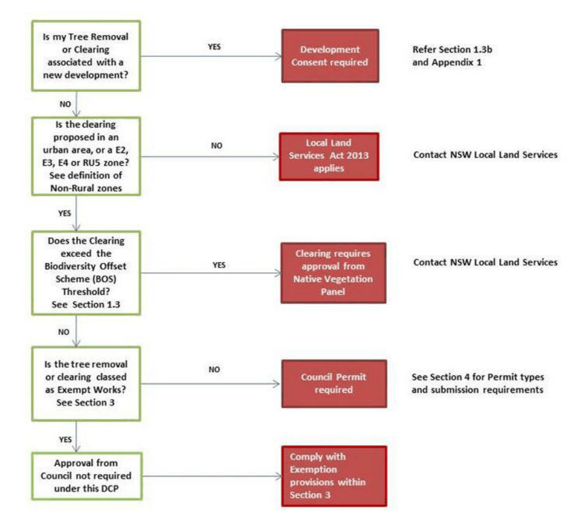

#### 3.5.1 INTRODUCTION

Trees beautify our properties and our streetscape, add value to property, provide shade and shelter, absorb excess runoff, prevent soil erosion, and absorb carbon dioxide from our atmosphere producing oxygen for us to breathe.  They provide food and shelter for insects, reptiles, mammals and birds and contribute to local biodiversity.  There are many social, economic and ecological benefits to the preservation of trees.

Council also recognises that in certain circumstances vegetation, including trees, require pruning or removal. This Chapter identifies trees and vegetation Council seeks to preserve, as well as the method required should a landowner seek to remove a tree or vegetation on privately owned land.

Prior to any action, it is important to accurately identify the species of tree or vegetation proposed to be pruned

or removed.  Landowners should be aware that the Biodiversity Conservation Act 2016 contains Schedules which identify threatened and protected plants and ecological communities, and that the Act prohibits actions that affect threatened species and their habitats.  A Biodiversity Conservation Licence is required from the NSW Office of Environment and Heritage (OEH) prior to the conduct of any such actions.

Trees which are identified as having local significance on the Central Coast are listed on Council’s Significant Tree Register. Council has identified these trees as they either have significant amenity values or are functionally important links in the wildlife food chain and encourages pruning and retention of these trees where practical, rather than removal.  Except as provided by Section 3 Exemptions, a Permit is required for any such actions on listed trees. Council’s Significant Tree Register is maintained on Council’s website.

Whilst terms used in this Chapter are defined in Section 5.0 Definitions, the following are of particular importance:

“vegetation” means a tree or other vegetation, including understorey and groundcover plants, whether or not it is native to New South Wales (i.e., it was established in New South Wales before European settlement).

“tree” means a perennial plant with at least one self-supporting woody or fibrous stem, which:

a Is 3 metres or more in height; or

b Has a trunk diameter of 75 mm or more measured at 1.4 metres above ground level.

“remove vegetation”, “removal of vegetation”, “vegetation removal” and “clear vegetation” mean any one or more of the following:

a cut down, fell, uproot, kill, poison, ringbark, burn or otherwise destroy the vegetation, or

b prune, lop or otherwise remove a substantial part of the vegetation.

#### 3.5.1.1 Aims and objectives of the Chapter

▪ To declare certain vegetation to be vegetation to which Part 2.3 of State Environmental Planning Policy

(Biodiversity and Conservation) 2021 Chapter 2 Vegetation in Non-Rural Areas applies, such that a permit from the Council is required to remove that vegetation.

▪ To protect trees on privately owned land that contribute positively to the amenity, scenic landscape characteristics and ecological values of the Central Coast Local Government Area.

▪ To facilitate the removal of undesirable species, weeds, dangerous trees and inappropriate plantings, and to encourage their replacement with suitable local native species.

▪ To minimise unnecessary injury to, or destruction of, trees and vegetation.

#### 3.5.1.2 Land-Use Zones to which this Chapter Applies and Does Not Apply

a This Chapter applies to land within the Central Coast Local Government area which has one of the following zonings:

| Zone RU5 Village | Zone SP2 Infrastructure |
|---|---|
| Zone R1 General Residential | Zone SP3 Tourist |
| Zone R2 Low Density Residential | Zone SP4 Enterprise |
| Zone R3 Medium Density Residential | Zone RE1 Public Recreation |
| Zone R5 Large Lot Residential | Zone RE2 Private Recreation |
| Zone E1 Local Centre | Zone C2 Environmental Conservation |
| Zone E2 Commercial Centre | Zone C3 Environmental Management |
| Zone E3 Productivity Support | Zone C4 Environmental Living |
| Zone E4 General Industrial | Zone B3 Commercial Core (Gosford City Centre) |
| Zone MU1 Mixed Use | Zone B4 Mixed Use (Gosford City Centre) |
| Zone W4 Working Waterfront | Zone B6 Enterprise Corridor (Gosford City Centre) |
| Zone SP1 Special Activities |  |

b This Chapter does not apply to land within the following zones within the Central Coast Local Government area:

▪ C1 National Parks and Nature Reserves;

▪ RU1 Primary Production;

▪ RU2 Rural Landscape;

▪ RU3 Forestry;

▪ RU6 Transition;

▪ W1 Natural Waterways; and

▪ W2 Recreational Waterways.

c Any person considering clearing or removing vegetation on land within the Central Coast Council Local

Government area to which this Chapter does not apply must refer to Part 5A of the Local Land Services

Act 2013 and is advised to contact the NSW Government Local Land Services, Greater Sydney Region, for further information (Phone: 1300 795 299).

#### 3.5.1.3 Vegetation Removal to which this Chapter Does Not Apply

This Chapter does not apply to:

a Removal of vegetation on any land which is identified on the Biodiversity Values Map, or which otherwise exceeds the Biodiversity Offset Scheme (BOS) threshold. See Appendix 1. Approval to remove vegetation

above the BOS threshold must be obtained from the Native Vegetation Panel under the Local Land

Services Act 2013.

b Removal of vegetation authorised under a development consent granted under the Environmental

Planning and Assessment Act 1979;

c Removal of vegetation from public land by or on behalf of a public authority (Note: this Chapter applies to the removal of vegetation from public land by any other person).

#### 3.5.1.4 When do you Need a Permit From Council to Remove Vegetation?

Sections 2 and 3 of this Chapter identify when you need a permit from Council under Part 2.3 of State

Environmental Planning Policy (Biodiversity and Conservation) 2021 to remove vegetation. The following flow chart is provided to assist understanding but is not a substitute for the provisions of Sections 2 and 3.

> [Picture on page 4: a picture, saved as a picture (images/ch-03-05-tree-and-vegetation-management-page-4-1.gif, 150 dpi).]

#### Figure 1: When is a permit required from council to remove vegetation?
