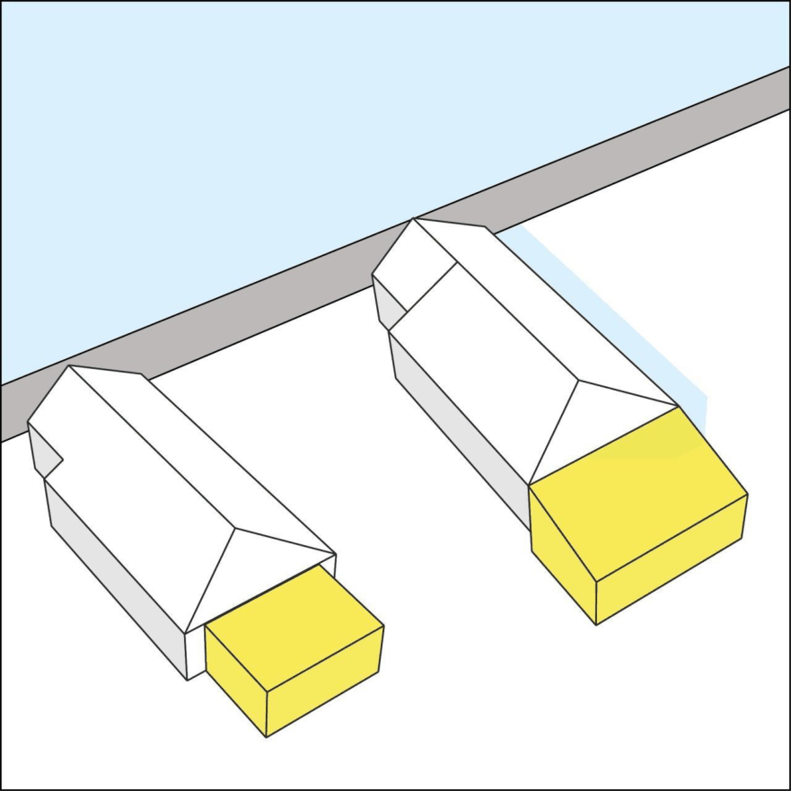
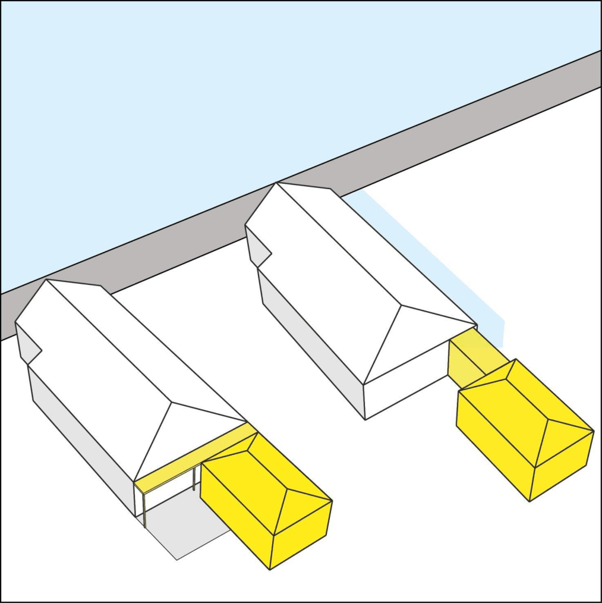
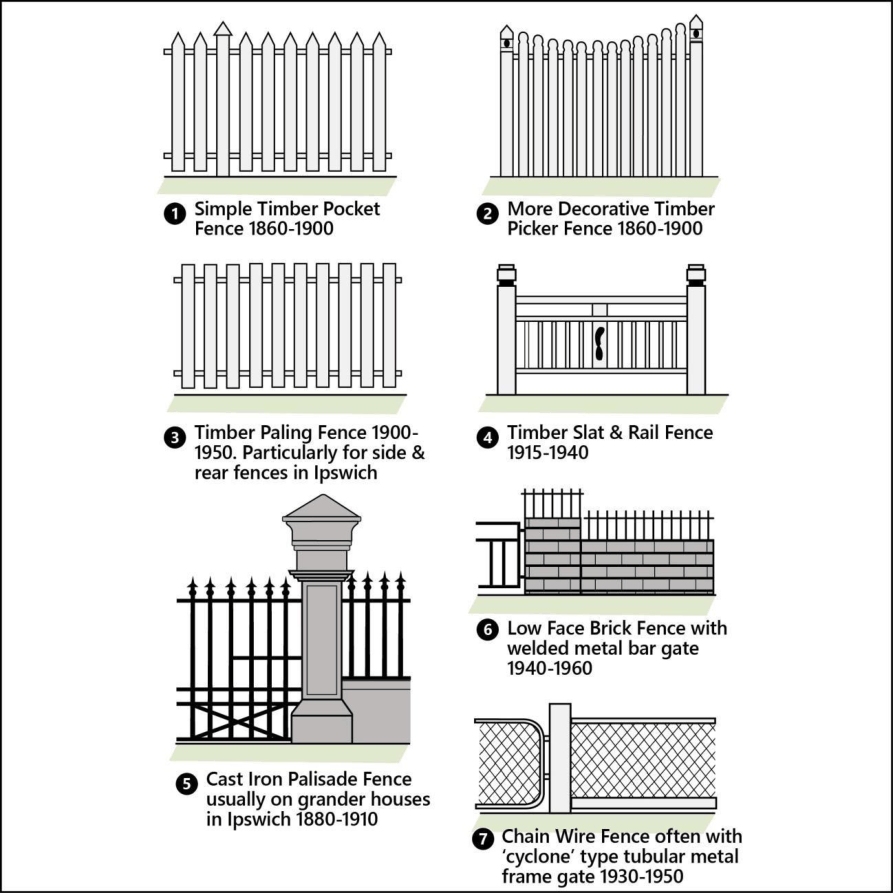
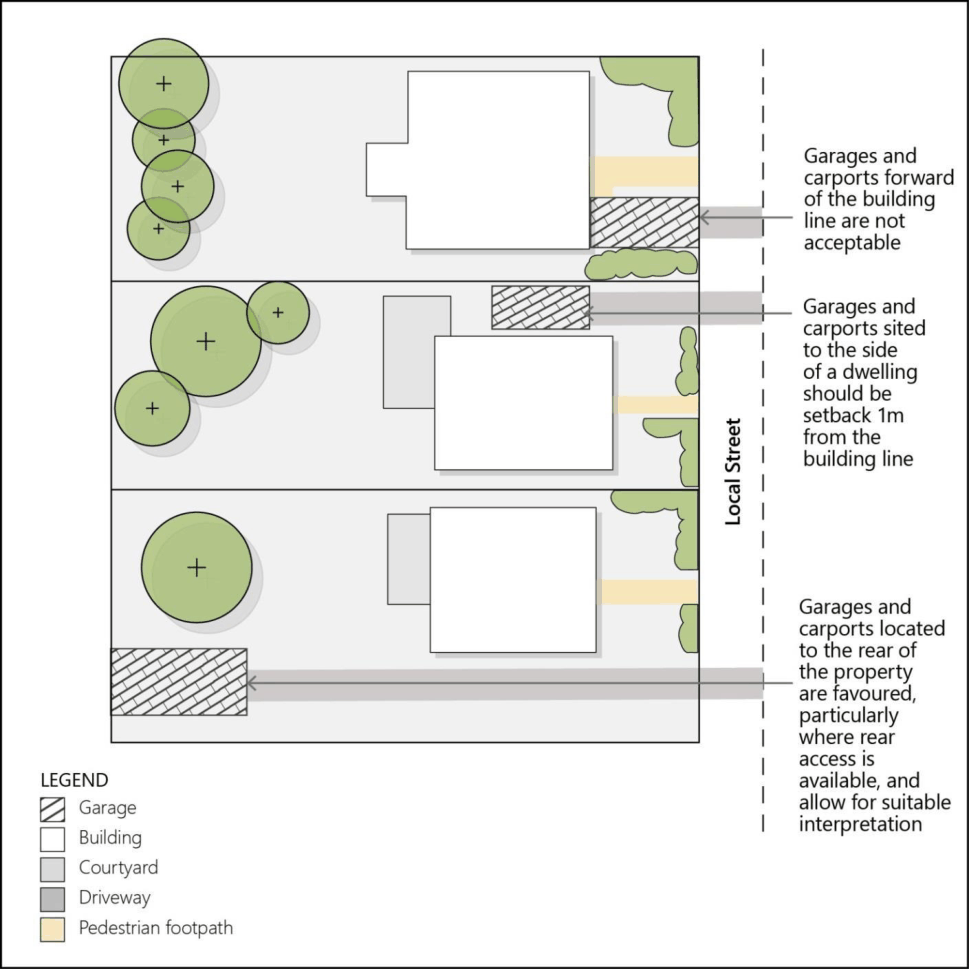
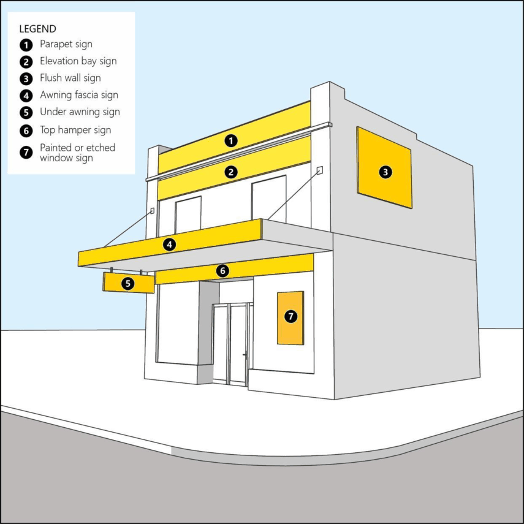
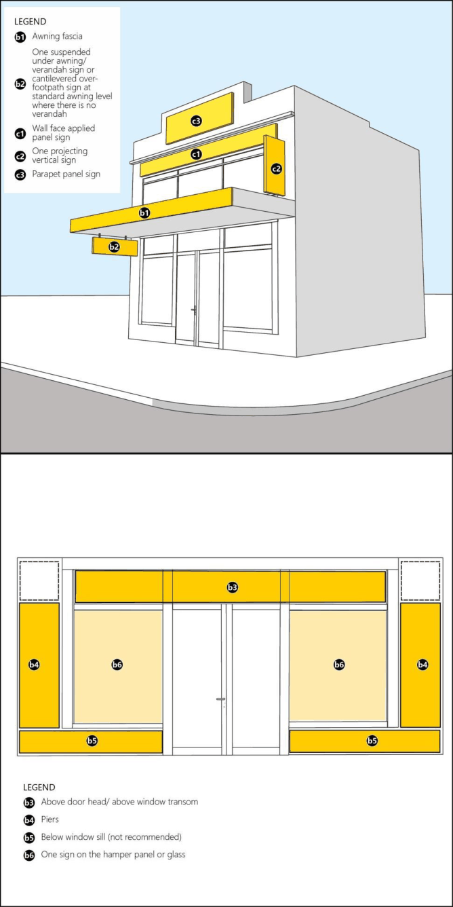

#### 3.6.3 GENERAL HERITAGE & DEVELOPMENT GUIDELINES

#### 3.6.3.1 Demolition and Replacement Development

a An application for the full or partial demolition of a heritage item, or structure within a Heritage Conservation Area will only be considered when the following documentation supports the application:

i a development application for the development of an appropriate replacement building;

ii a Heritage Impact Statement that includes options for adaptive reuse;

iii a demolition report that considers the structural stability and future viability of the building in the form of a structural engineer’s report;

iv a quantity surveyor statement comparing the cost of demolition and cost of retention where demolition is sought primarily on economic grounds; and

v other consultant’s report(s) as required, for example, archaeologist report, historian report, archival record.

b Submitting the necessary reports or justifications does not imply that the consent authority will agree to the proposed demolition.

c Where demolition is permitted, an archival record must be submitted to Council prior to commencement of demolition. Details on the requirements for preparing an archival record are provided in this Chapter.

#### 3.6.3.2 Tree Removal

a Applications for the removal of any tree within the curtilage of a heritage item or within a Heritage Conservation Area are to be accompanied by a Heritage Impact Statement. An arborist report prepared by a suitably qualified professional will be required by Council.

b Any works that may impact on the health or longevity of trees within a heritage item or a Heritage Conservation Area must identify the impact of the development on existing tree(s) and proposed methods of tree retention.

c The above requirements are limited to trees or other vegetation that the Council is satisfied does not present a risk to human life or property.

#### 3.6.3.3 Relocation of Structures

a Structures should be retained in their present location. The relocation of a structure will only be considered if it is determined that:

i. the structure is designed to be readily removable, or has a history of previous moves (e.g. prefabricated dwellings); or

ii. the structure does not have a strong association with its present site.

b Prior to consent being granted to the relocation of a structure the applicant is to demonstrate, to Council’s satisfaction, that:

i. the structure will be moved to an appropriate setting and given an appropriate use;

ii. the relocated structure will not impact on any place or any item of heritage significance once relocated;

iii. the relocated structure does not confuse or impact on the history of its new site and can be interpreted as a relocated structure; and

iv. a structural engineering report is to be included that verifies that the structure can be relocated without adversely impacting on the fabric or structural integrity.

#### 3.6.3.4 Essential Maintenance

Council may waive the requirement for a development application where works can be demonstrated to be essential maintenance only. For the purposes of this Plan:

a essential maintenance includes works required to be undertaken because of structural inadequacy or concerns about public safety;

b reconstruction approved as part of essential maintenance shall be limited to the form of the existing structure, or to a known earlier form in accordance with the definition of reconstruction contained in this Plan.

#### 3.6.3.5 Alterations and Additions

a Alterations and additions to heritage items should:

i avoid changes which distort the significance of the place or falsify evidence of its history. New work should not mimic the original or significant fabric and should be discernible as new work;

ii consider the contribution of all periods of development or use to the heritage significance of a place and provide justification where significant elements are to be removed;

iii avoid addition of new features on the front facades of buildings, or which obscure the view of the item from a public place;

iv ensure changes to fabric are reversible where possible and their effect on the heritage fabric and other characteristic features is minimised;

v ensure an appropriate setting is maintained;

vi ensure structures are retained in their present location where the location contributes to the significance and interpretation of the heritage item. If a structure does not have strong association with its present site or location Council may consider removal to be appropriate;

vii ensure where possible, extensions are located to the rear and are sympathetically designed.

#### 3.6.3.5.1 Roofs

a New buildings should have roofs that are sympathetic with the size, shape, pitch, height, bulk and materials of the existing roof.

b Roofs of extensions should relate to the existing roof in materials, shape and pitch, replacement materials shall match existing or use approved alternatives.

c Roof additions should generally be confined to the rear of the existing building and should not alter the essential form and character of single storey buildings.

d Dormer windows to attic rooms are generally inappropriate unless these cannot be seen from the street. Windows of suitable scale to gable ends and gablets and in-plane flat skylights are generally acceptable on rear faces of roofs and where these will not be visible from the street. Dormer windows or gablets are only suitable for styles up to the Federation era and should not be excessively large for the roof surface relative to the main roof form or differ in pitch to the existing roof and should generally be located to the rear.

e Attic rooms in extensions shall be generally contained within the existing roof form and must not form a dominant feature visible on the principal elevations.

f A habitable attic room may be created providing the existing roof volume is sufficiently large and the roof profile is generally maintained.

g Commercial buildings or mixed use buildings roofs should be gabled, hipped or hidden from the street by parapets. Where there is no parapet roof pitch shall be similar to the significant streetscape.

h Retain and restore parapets to existing commercial buildings where they exist.

i Packaged air conditioners and mechanical exhaust fans and grills shall not be placed on street facades or on any part of the building that can be seen from the street.

j Skylights, solar heating panels, satellite dishes and other non-traditional elements are considered to be intrusive and should not be located where visible from the street and other public spaces.

#### 3.6.3.5.2 Basement Addition

a Before initiating any basement additions, carefully consider the type of materials to be removed, access for machinery and equipment, the removal of piers and installation of alternative supporting structures, drainage and the possible need for retaining walls. Care must be exercised to ensure adequate underfloor cross ventilation and to avoid water seepage or rising damp. Engineering advice is recommended and will probably be required.

b Additional considerations include the placement of stairs and their effect on other areas of the house, the appearance of new windows and exterior doors which should be designed in terms of the overall appearance of the building and retention of most of the original foundation.

c Due to its constraints, this form of addition is not highly recommended though sometimes garages can be accommodated in undercroft areas.

d Ensure archaeological sites or potential archaeological sites are not adversely affected by the proposed development.

#### 3.6.3.5.3 Doors and Windows

a Where possible, retain and repair/restore original doors and windows. Authentic reconstruction using similar material to the original is encouraged where repair of the original doors and windows is not possible.

b Original leadlight and coloured glass panes should be kept.

c Modern aluminium windows are generally not permissible.

d The design of windows and doors in new development should be drawn from traditional characteristic door and window patterns.

e Replacement windows and doors must match the original characteristic pattern and materials.

f New doors and window openings should reflect the existing style, size, proportion, position and where possible match all sill and head heights of existing doors and windows.

#### 3.6.3.5.4 Walls

a Alterations of the form and materials of principal elevations are not favoured. Removal of the external skin or rendering of exterior walls is not favoured unless associated with acceptable reconstruction works and unpainted surfaces should not be painted.

b Matching materials shall be used in repairing the fabric of external surfaces.

c New development shall use materials similar to or compatible with that of the original building.

#### 3.6.3.5.5 Wing Addition

a Wing additions must be added at the side or rear of the building in a manner which minimises disruption to the main elevation and the streetscape. Wing additions must not compromise the heritage significance or interpretation of the place.

b The size and slope of the land and the form of the house will usually dictate the location of the wing, which is generally better suited to asymmetrical buildings.

c Where the original design produced an irregular plan and roof shape, an additional wing, gablet or dormer to one side may reinforce this theme. The additions should:

i not be located in the same elevation plane as the original work;

ii not project forward of the main façade and may ideally be setback behind the main façade a distance equivalent to the depth of the front setback.

d Side additions should not remove the possibility of car access to the rear of the site unless there is alternative rear lane access.

e The existing roof form and pitch should be repeated and new detailing should reflect the gables, hips, eaves, ventilation, window hoods and other projections of the main roof.

#### 3.6.3.5.6 Lean-To Addition

a Where lean-to additions are constructed at the rear and are not visible from the street, materials should be sympathetic with the significant building or building elements but need not match the original.

b The size of the lean-to addition will be limited by the need to provide adequate head height, depending on land slope.

c Light access can be improved with a lean-to addition by adding gablets or skylights to the rear face of the roof.

> [Picture on page 13: a picture, saved as a picture (images/ch-03-06-heritage-conservation-page-13-1.gif, 150 dpi).]

#### Figure 1 Examples of appropriate lean-to additions

#### 3.6.3.5.7 Pavilion Addition

a A pavilion addition involves constructing a separate block element which may repeat the general form of the original house. A pavilion addition may be an appropriate design solution where the original design would be diminished by a lean to or wing addition, or where the use of either of these would result in the loss of natural light or views.

b Pavilions may be connected to the main building by a breezeway or small utility area, such as a laundry or bathroom.

c Pavilions may be an appropriate design solution for long and/or narrow allotments and can be functionally integrated with landscaping to provide internal courtyards.

> [Picture on page 14: a picture, saved as a picture (images/ch-03-06-heritage-conservation-page-14-1.gif, 150 dpi).]

#### Figure 2 Examples of appropriate pavilion additions

#### 3.6.3.5.8 Chimneys and Other Roof Structures

a All chimneys should be retained internally and externally and, where necessary, repaired, even if the fire place is no longer used: demolition of chimneys is not favoured unless necessary for critical structural reasons and preceding construction.

b Skylights or other structures attached to the exterior roof, such as solar hot water heaters, ventilators, satellite dishes and the like, shall not be located where visible on the principle elevations of buildings.

#### 3.6.3.5.9 Sheds and Outbuildings

a In considering any application for permission to erect a shed or outbuilding, Council shall consider:

i. the proposed form, scale, size, materials and colours;

ii. the location of the proposed structure in relation to the principal building, boundaries and other details of the site;

iii. the relative prominence and visibility of the proposed structure from the street frontage or frontages of the site and neighbouring properties;

iv. the desirability of, or need for, landscaping such as screening or planting, to reconcile a proposed structure with its intended site.

b Preferred shapes, roof form and materials are:

i. simple plan shapes, square or rectangular, without complicated or interconnected shapes and with doors and windows of appropriate vertical proportions;

ii. simple hipped, gabled or skillion roof forms of the smallest practicable scale in a given situation, the use of lean-to or skillion roofs over any forms attached to the main part of the structure will help minimise scale;

iii. building materials that have been traditionally used in the locality and/or the main building.

#### 3.6.3.5.10 Internal Works

Development consent is needed for structural changes to the interior of heritage items. Alterations to the room layout of heritage items are to ensure that the original room configuration remains discernible and can be interpreted.

#### 3.6.3.5.11 Window Sunhoods, Blinds, Awnings, Skirts

In altering heritage houses, original sunhoods, blinds, awnings and skirts should be retained and repaired. Authentic construction or reconstruction is supported.

#### 3.6.3.5.12 Fences

a Original fences are to be retained and repaired where possible.

b Fence details should be simple rather than complex and match the style of the house.

c Open or partially transparent fence styles such as picket or palisade fences are to be no higher than 1200mm with posts and piers no higher than 1500mm along the primary street frontage.

d New solid fences of any material on front alignments are generally not acceptable.

e Solid masonry fences no higher than 900mm in height above footpath level (excluding the height of any retaining wall) are acceptable where this matches the built form appropriately.

f New side and rear fences are to be no higher than 1800mm.

> [Picture on page 16: a picture, saved as a picture (images/ch-03-06-heritage-conservation-page-16-1.gif, 150 dpi).]

#### Figure 3 Typical fence picket details

#### 3.6.3.5.12 Garden Elements including Paving and Driveways

a Surviving original garden elements should be retained, repaired and maintained. Appropriate reconstruction of lost garden elements is encouraged.

b Garden design elements and plant species should, where possible, apply the same style as the established gardens within the grounds (curtilage) of the item.

#### 3.6.3.5.13 Verandahs

a Removal of verandahs is not favoured. Authentic construction or reconstruction is supported.

b In altering existing buildings, original verandahs should be kept, repaired and respected. Additional verandahs should not compete with the importance of the original and should be simple in design.

#### 3.6.3.5.14 Garages and Carports

a New garages and carports should:

i have regard to the effect on their sites. They should generally be located behind the existing principle buildings, unless there are no other alternative off-street locations;

ii be of simple appropriate design, attuned to the design of the individual building to which they are functionally attached and not overly elaborate.

b Attachment of garages and carports to the buildings they service is generally not favoured and will only be acceptable where:

i the structure is located at the rear of the building and is not visible from the surrounding streets;

ii the structure forms part of a basement level (which in all other respects meets with the guidelines) or it is well setback from the front facade and unobtrusively attached.

c Rear lane access shall be used wherever available.

d The retention, repair and restoration of significant older garages is encouraged.

> [Picture on page 17: a picture, saved as a picture (images/ch-03-06-heritage-conservation-page-17-12.gif, 150 dpi).]

#### Figure 4 Garage locations

#### 3.6.3.6 Colour Schemes and Materials

The following requirements apply to development that proposes changes to the material, colour, texture or finish of a heritage item:

a Details of the proposed colour scheme are to be provided with the Development Application.

b Applicants are to demonstrate how colour selection has been informed by original finishes and colours; paint scrapings and early photographs may enable building owners to approximate early or sequential and appropriate colour schemes.

c Materials are to be used in building elements that reflect their characteristic usage, e.g. stone for foundations.

d Rendering and/or painting original face bricks and sandstone is not permitted, unless evidence is submitted to Council that their condition has been irreversibly altered.

e Applicants should refer to the commercial ranges of ‘traditional’ or ‘heritage’ colours from major paint suppliers to assist in selecting authentic colour schemes.

f Applicants should ensure that new finishes are compatible with the existing substrate and prior applied finishes. The following Heritage Council publication is to be consulted: Maintenance Series 7.2: Paint Finishes; researching and uncovering authentic paint schemes and how to conserve them. This is available for download from www.environment.nsw.gov.au/heritage/publications/

g Historic Colour Scheme Characteristics – the following descriptions provide guidance to applicants on the characteristic colour schemes of heritage building types of a particular era and should be referenced when proposing changes to materials and colour schemes:

i Vernacular Rural Buildings: 1880 – 1900 – Generally painted weatherboards, galvanised iron walls and roofs with pink beige and buff timber, unpainted brick and stone and unpainted sheet

iron. Windows were generally cream with red or green frames;

ii Federation and Edwardian era: 1900 - 1915 – Unpainted face brick walls and sandstone foundations. Pressed red brick or red-ochre dressed front elevations. Polychromatic brickwork including contrasting blues or buffs for arched lintels and string courses. Cheaper, variable common bricks were used for the lesser elevations. Strong colours used in trims, timberwork painted in a light colour;

iii Inter War: 1915 - 1930 – The Bungalow dominated housing with lower sections, below eaves or window sills, face brick with upper sections roughcast or shingled gable. Exteriors used no more than two colours with a green or red contrasted with a pale cream, off white or beige;

iv Art Deco and Modern style buildings, particularly commercial premises were predominantly either natural materials such as brick and stone with strong horizontal and vertical courses and mouldings, or rendered facades in white and off white with pale colours to contrast the applied mouldings.

#### 3.6.3.7 Building Orientation

a Generally, buildings should be constructed to the street alignment.

b If, in Council’s opinion, an existing setback makes a positive contribution to the streetscape then it shall be retained.

c The front façade of buildings shall be orientated towards the street.

d Corner buildings should ‘turn’ the corner with their main point of entry either on the corner itself or on the street to which it fronts the road.

#### 3.6.3.8 Architectural Elements

a Original characteristic architectural elements are to be retained. Alterations to these elements or the use of materials or the adaptation for access for example, should be sympathetic. Architectural styles which detract from this character will not be permitted.

b The reinstatement of original characteristic architectural elements that have been removed is encouraged. Where a building is part of a “set‟, other, more intact, buildings in that set can provide guidance as to appropriate reinstatement works.

c Alterations and additions to buildings within a ‘set’ are not to diminish the coherency of that set.

d Maintenance, reinstatement work and alterations and additions to existing buildings is to be of a material matching the original construction.

e Individual architectural features are not to be removed or obscured.

#### 3.6.3.9 Commercial Development

#### 3.6.3.9.1 Shopfronts

a Original shopfronts are to be retained; restoration and reinstatement of original shop-fronts is encouraged.

b Alterations to glazed area, fixed canopies, awnings, blinds or security screens are to maintain the narrow-fronted vertical proportions of the building facade.

c Security screens, where considered necessary, are to be placed behind the glass shop-front and should be in an architectural style and materials sympathetic to the style of the building. Only open grill security screens will be considered.

d Original shopfront glazing or tiling is not to be painted out or obscured.

e Exposed vents, pipes and the like should not be visible from the street.

f Alterations and additions to existing buildings should incorporate remnants of original shopfronts into new layouts.

g New shopfronts should reflect the typical details and finishes which set the significant character of the streetscape.

h Alterations and additions to existing buildings should retain non-typical shopfronts which indicate the former use of a place, unless there is sufficient historic information to allow accurate reconstruction of an earlier form.

i The use of traditional gloss ceramic tiles to shopfronts is encouraged.

#### 3.6.3.9.2 Shop Awnings

a Retail/commercial buildings shall generally have awnings. The materials, height and architectural styling should match traditional adjacent awnings.

b Retain existing awnings on all commercial buildings, encouraging their conservation and reconstruction of missing details where appropriate.

c Awnings on all new buildings, or alterations and additions to existing buildings must avoid modern or pseudo-historic materials and details, such as aluminium lace, metal pipe framing or tightly rolled bull nosed iron.

d Awnings on new buildings must correspond to the building by extending to adjacent awnings to provide continuous weather protection for pedestrians beneath.

e Awnings should not run unbroken across adjacent buildings where they are clearly of different construction, even though they may now function as one.

f New or reinstated awnings must be set back from the kerb by approximately 300-600mm, or otherwise as required by Council policy, to minimise the risk of damage by motor vehicles.

g Where the base of posts has rotted, galvanised steel brackets or straps may be used to support the post, however these should be no more than 5-10cm high and clad in a skirting type profile. If the post has rotted beyond retention it should be replaced with one of a similar timber species, size and detailing to match.

h Alterations and additions to existing buildings must be of an appropriate style and detail for the design of the building where the original awning is reconstructed.

i Suspended awnings must not be adapted with false posts to imitate traditional verandahs.

j Sunblinds as traditional practical features are encouraged in appropriate locations.

#### 3.6.3.10 Signage

The materials, colours and design of signage varied in different historical periods. Generally, in the period of development which gave heritage buildings and/or heritage conservation areas their character and significance, colours were muted and signs were placed consistently on particular and limited locations on the building. Subsequently, signage has become larger and more dominant and is generally positioned with less cognisance of the form and design of the building and adjacent streetscape. These later elements are now seen as intrusive.

#### 3.6.3.10.1 Permissible Signs

The following sign types are permissible with consent:

a business identification signs.

b building identification signs.

c Wayfinding signage.

d Heritage Interpretation signage

#### 3.6.3.10.2 Unsuitable Signs

a In accordance with State Environmental Planning Policy (Industry and Employment) 2021 Chapter 3 Advertising and Signage, advertising signs, advertising display areas, and advertising structures are not permitted within a Heritage Conservation Area. Advertising on or within the curtilage of a heritage item is considered unsuitable.

b Signs types which must not be used include:

i internally illuminated neon signs, flashing lights or flashing/scrolling signs, except on a small scale within shopfront windows;

ii projecting wall signs;

iii ridge signs, or mid-span on verandah roof;

iv sky signs raised on poles above the roof;

v 3-dimensional signs;

vi signs mounted on vehicles, trailers or shipping containers that stand continuously stationary for the purpose of advertising on either public or private land.

#### 3.6.3.10.3 Existing Signs

a Any existing signage identified as contributing to heritage significance should be retained, including building name or date lettering, former business names, and advertising signs.

#### 3.6.3.10.4 Location of Signs

a The use of traditional signage locations, font sizes and styles on all existing or new buildings is encouraged.

b Signage is to be fixed to buildings in a manner which will eliminate damage to significant building fabric and be reversible, e.g., when fixing to brickwork or stone ensure that the fixing method is located in brick mortar joints and not into the face of the masonry. Mortar joints are easily repairable when signs are removed. The method of attachment is to be detailed in any application for signage on heritage items. Signs for retail and commercial buildings are to be restricted to the types identified in Figure 5 as follows.

> [Picture on page 22: a picture, saved as a picture (images/ch-03-06-heritage-conservation-page-22-1.gif, 150 dpi).]

#### Figure 5 Sign types

c Signs must be located and designed so that:

i. they do not obscure the architectural features of a building;

ii. they are capable of being moved or replaced without damaging building fabric;

iii. the overall number of signs on any one building is reduced, and has consistency in terms of proportions, colour and style;

iv. lettering is in a traditional style consistent with the age of the building and/or any original signage.

d The cumulative visual impacts of signage should be assessed and the number of signs limited appropriately to avoid visual clutter of individual premises and the streetscape.

e Where a building contains more than two tenants, a directory of tenants should be provided at the ground-floor level in order to minimise the amount of advertising on the building.

c Unobtrusive painted signs to upper-storey windows may be permitted at Council’s discretion to identify tenants when appropriate wall surfaces or other areas for advertising are not available.

d Painted signs on shopfront windows must not dominate, obscure the transparency or clutter the shopfront windows.

e The erection of roof mounted signs, above-awning signs, projecting wall signs, pylon or pole signs is not supported.

f Decorative forms, mouldings and other distinguishing and significant features of a building must not be obscured by signage.

#### 3.6.3.10.5 Number of Signs Permitted

a The number of signs per site is a principal mechanism for controlling appearance. Business owners are advised to consider the general streetscape, the visual conflict between signs on adjoining buildings and the equity between businesses in the vicinity. The general options and recommended limits are as follows:

b forecourt and footpath: one free-standing sign;

c ground floor façade (refer to Figure 6):

i awning fascia (b1);

ii one suspended under awning/verandah sign or cantilevered over-footpath sign at standard awning level where there is no verandah (b2);

iii above door head/above window transom (b3);

iv piers (b4);

v below window sill (not recommended) (b5);

vi one sign on the hamper panel or glass (b6);

vii one decal sign on the shopfront window glass or masonry beside the door;

d Permitted Signs: - b1, b2, and b6 plus numbers b3 or b4 (i.e. on the ground floor façade there should be a maximum of four signs) – refer to Figure 6.

e upper level signs (refer to Figure 6):

i wall face applied panel sign (c1);

ii one projecting vertical sign (c2);

iii parapet panel sign (c3).

f Permitted Signs: c3 and c1 or c2 – refer to figure 6.

> [Picture on page 24: a picture, saved as a picture (images/ch-03-06-heritage-conservation-page-24-1.gif, 150 dpi).]

#### Figure 6 Sign locations

#### 3.6.3.10.6 Sign Area

a In general, there are no standard sizes for signs in heritage areas. They may vary according to the design and history of the building or its environment. The following will be utilised for guidance in applications for buildings which are contemporary or in assessing existing signs:

i signs are to be designed to an appropriate size and scale for the building on which it is to be erected;

ii the total area of signs mounted parallel to the façade of a building will, in general be less than 4 square metres in area for smaller properties and not more than 6 square metres for larger properties;

iii signs suspended beneath awnings or verandahs will be less than 1 square metre in area on each face;

iv signs on shop windows should not exceed 25% of the window area. Window signs shall be of a professional quality, discreet and should not unduly obscure the interior of the building;

v the total area of signs on a building will be less than eight square metres.

b The following conditions apply with regard to these restrictions and exceptions:

i heritage photographs should be utilised to demonstrate specific applications;

ii internally illuminated signs are restricted to the under awning location. This is both to be fair to retailers and to ensure visibility;

iii it is good retail practice to limit window signs in number and area, thus allowing customers to view the merchandise;

iv corporate and franchise colour schemes and signs will be considered in relation to the overall colour scheme of the building and must abide by the heritage principles;

v signs shall not be erected directly on top of an awning, roofline or verandah;

vi signs that detract from the architectural appearance of the building will not be permitted;

vii all signs must be maintained in good condition and repaired within 6 weeks of notification.

#### 3.6.3.10.7 Style, Colour and Lettering

a The style, lettering (font), materials, colours and design of signage should reflect the style and character of the building.

b Corporate logos and colour schemes to buildings are regarded as signage and will not be permitted where in conflict with the other provisions of this section. Corporate image requirements should be adapted to suit the specific site, and should not dominate the character of the building.

c Buildings and awnings should not be painted in bright obtrusive colours to attract attention and as a form of advertising.

d Signs should be painted and externally spot lit.

e Signs should not be painted on previously unpainted surfaces of significant buildings.

f Internally lit signs are permitted where this is consistent with the history of the building.

g For all signage fixed to a building, wording should be restricted to the name and nature of the business. More detailed description of individual products for sale should be restricted to smaller removable panels e.g. sandwich board signs and chalkboard signs.

h Signs on parapets must be restricted to the name of the building/business, and be located so as to respect the symmetry or grid of the façade.

#### 3.6.3.11 Car Parking

Development is to ensure that provisions for car parking do not impact on the heritage significance of a building, site or area.

a Provisions for car parking are to demonstrate that consideration has been given to the following options which must be considered in order of priority:

i locate at the rear of the site, with access from a rear lane;

ii locate at the rear of the site, with access from the street frontage;

iii locate at the side of the principle building, well setback from the building facade;

iv uncovered paved area within the front setback (preferably to the side of the building);

v street parking;

vi open, sympathetically designed carport within the front setback offset to the building elevation.

b Front garages are strongly discouraged, no matter how sympathetic. They generally obscure views of the main building and break up the established setback line in the street.

#### 3.6.3.12 Adaptive Re-use

a Any proposal involving the adaptive reuse or change of use of a heritage item is to demonstrate that:

i the new use requires minimal alterations to significant fabric and building elements, and that any changes to these are reversible or have minimal impact on the heritage significance of the item;

ii alterations and/or additions required to support the new use do not obscure the understanding of the building’s significant use;

iii the significance of the place can be interpreted;

iv any internal changes do not compromise the heritage significance of the external appearance of the building or any significant internal elements;

v the introduction of new services will not have a detrimental impact on significant fabric or spaces; and

vi the new use is consistent with the management recommendations provided in the Heritage Inventory Assessment Report.

b The significant use of the building should be interpreted on site. Interpretation of the significant use may include the use of historic artefacts, retention of historic internal layouts, the in situ retention of machinery and signage, or artistic interpretation.

c Reinstatement of lost heritage significant fabric (e.g. windows, decoration, verandahs, garden elements etc.) is encouraged.

d Changes to fabric should be reversible, where possible, and their effect on the heritage fabric and other characteristic features should be minimised. Non-reversible changes to a heritage item will only be considered where there is no alternative way of retaining the place as a viable asset. New work is to be identifiable as such.

e New additions and adjacent or related new construction will be undertaken in such a way that, if they are removed in the future, the essential form and integrity of the place is unimpaired.
