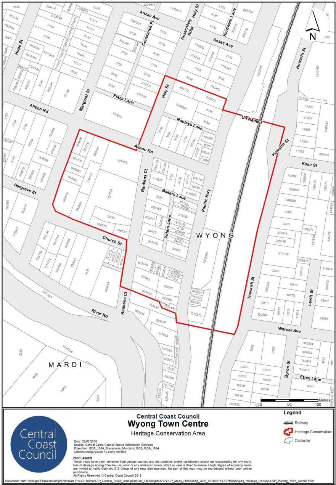
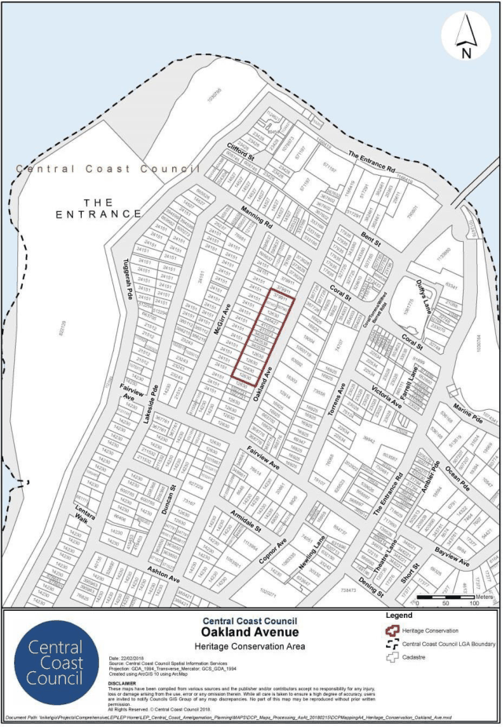
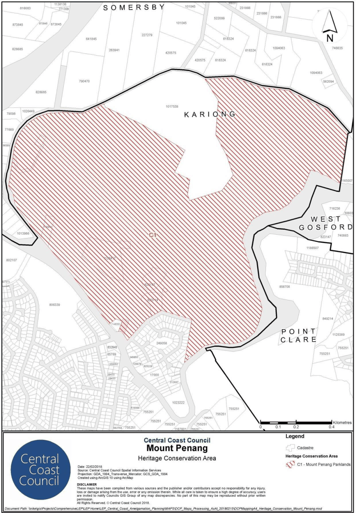

#### 3.6.4 DEVELOPMENT IN A HERITAGE CONSERVATION AREA

Heritage Conservation Areas are one whole heritage item in their own right. The Character of the Heritage Conservation Area comes from each of the many components of the area (buildings, landscape elements, fences, roads, railway etc.) and the relationships formed between these components.

Each component will vary in its contribution to the significance of the Heritage Conservation Area. This contribution needs to be assessed before the degree of change that can be accommodated can be determined. Depending on this determination, some components can be replaced (and may be encouraged to be replaced); some will need to be retained in their current form; while most will be able to grow and change to accommodate contemporary needs provided those changes are designed to also maintain the contribution of the property to the heritage significance of the Heritage Conservation Area.

#### 3.6.4.1 General Controls

A Development Application and accompanying Heritage Impact Statement will generally be required work within the Heritage Conservation Area. However, some works may be exempt from requiring Council approval under State Environmental Planning Policy (Exempt and Complying Development Codes) 2008. Applicants should refer to this Policy prior to submitting an application for development in a Heritage Conservation Area.

a Development within a Heritage Conservation Area is to be compatible with the surrounding built form and pattern of development by responding sympathetically to:

i existing form, massing, setbacks, scale and architectural style;

ii site topography and landscape;

iii views to and from the area;

iv surrounding neighbourhood character and streetscape, including buildings;

v existing subdivision patterns; and

vi established building lines.

b Alterations and additions are not to dominate or detract from the heritage significance of the building or Heritage Conservation Area.

c Alterations and additions are to respect the uniformity of properties which form part of a consistent row, semi-pair or group of buildings.

d Development is to respect and minimise the impact on any significant public domain features.

e Any application for development within a Heritage Conservation Area is to demonstrate consistency with an item’s Heritage Inventory Assessment Report where this is available; in particular, any unique management recommendations which are provided in the Report.

f Features that are present within the Heritage Conservation Area which are out of character with other traditional buildings in the locality should not be replicated.

g Development within a Heritage Conservation Area is to consider the characteristic forms in the environment and should aim to contribute to the appearance and unity of the streetscape.

h Where there is a uniform building setback within streets, alterations and additions are to respect the established pattern and not be located forward of adjacent buildings.

i Where variations in setbacks exist within the immediate vicinity and the streetscape, the larger setback will apply.

#### 3.6.4.2 Contribution to the Streetscape

Buildings located within a Heritage Conservation Area contribute to the streetscape in different ways and can be classified into three categories; contributory, neutral, and non-contributory. The definitions and controls for contributory, non-contributory and neutral buildings are provided below.

#### 3.6.4.2.1 Contributory Buildings

Contributory Buildings are those that make an important and significant contribution to the character of the Heritage Conservation Area. They have a reasonable to high degree of integrity and intactness, and date from a key development period of significance. They may be buildings which are from a significant historical period; highly or substantially intact; or altered yet recognisable and reversible. Contributory Buildings include all Heritage Items identified in Central Coast LEP 2022 and other buildings identified as such in a Heritage Impact Statement or Conservation Management Plan.

The primary objective of all work to contributory buildings should be the maintenance of the item’s heritage value, scale, form and significant physical fabric and to ensure that the cultural significance of the place is retained and enhanced. Work to contributory buildings is to demonstrate the following:

a a focus on the restoration of original elements and features;

b the retention of significant internal and external fabric of the building;

c the removal of unsympathetic alterations and additions;

d the appropriate use of colours and materials;

e any future use of the place shall be chosen based on its ability to retain its cultural significance;

f items in the vicinity of the proposed works are not compromised or impacted by the proposed works;

g individual heritage items are retained;

h the original form of the building is respected.

#### 3.6.4.2.2 Neutral Buildings

a Neutral Buildings are those that neither contribute to nor detract from the significant character of the Heritage Conservation Area. Neutral buildings may include those that do not belong to a key period of significance; are of contemporary design that is compatible with the significant character of the area;

or which are from a key period of significance but have been irreversibly altered. The objective of all new work to Neutral Buildings should be to enhance these buildings where appropriate and feasible. The following controls apply to work to neutral buildings:

i where retention of a neutral building is proposed the original form of the building is to be respected. Alterations and additions are not to dominate the original building form, but enhance it;

ii for neutral buildings that may relate to the areas historic development but have been substantially altered restoration may be preferable to new development, depending on the building’s context and significance. For this type of building, demolition is to be justified where restoration is not proposed;

iii where demolition is proposed, justification for the removal of the building is to be demonstrated in accordance with the requirements for demolition within this Chapter.

b Alterations and additions to buildings identified as ‘neutral’ should demonstrate the following:

i the removal of unsympathetic alterations and additions;

ii the appropriate use of colours and materials.

#### 3.6.4.2.3 Non-Contributory Buildings

Non-contributory Buildings are those that are aesthetically intrusive to the Heritage Conservation Area due to their inappropriate scale, bulk, setback, setting and/or materials. Such buildings are not representative of a key period of significance and detract from the character of the Heritage Conservation Area. Redevelopment of these sites with sympathetic buildings is highly desirable. The objective of all work to Non-Contributory Buildings should be to remove or minimise detracting elements or to replace the Non-contributory Building with one more sympathetic to the Heritage Conservation Area. The following controls apply to work on non-contributory buildings:

a New development should respond to the surrounding context and generally not seek to emulate the features of the detracting building it is proposed to replace.

b New development that is sensitive to the heritage values and intrinsic character, scale form and materials of the Heritage Conservation Area is encouraged.

c Alterations and additions to buildings identified as non-contributory should demonstrate the following:

i the removal of detracting elements;

ii the enhancement of the building.

d New development should:

i maintain opportunities for new buildings which address the character of the streetscape and Heritage Conservation Area generally;

ii maintain the scale of existing buildings, where appropriate, or the predominant scale in the vicinity.

e Replacement or enhancement development is to involve the removal of detracting elements and ensure that the site is more responsive to the surrounding context.

#### 3.6.4.3 Wyong Town Centre Heritage Conservation Area

#### 3.6.4.3.1 Statement of Significance

The Wyong Town Centre is a fine representative example of a town centre that retains good examples of civic, commercial and residential development of high integrity, constructed up until c.1945. It remains largely intact in terms of retaining its historical subdivision pattern, its natural prominence located above the River, its built fabric, main street commercial development, avenue tree planting and the prominence of the Railway and Station buildings. Collectively, the hilltop town square, civic built environment, transport links and natural features of the town centre contributes to it being a unique precinct that captures the historical development of an important town and one which retains its historical setting and character. The town centre retains examples of its historic development across a broad range of historic themes including Aboriginal heritage, European heritage, other cultural and social heritage, natural heritage and themes such as transport, agriculture, commerce, education, health, government and law and order. The Heritage Conservation Area is of historic, aesthetic, technical and cultural significance. Given its level of intactness and integrity, it is of high local heritage significance.

Further detail regarding the requirements for development proposals in the Wyong Town Centre Conservation area are located in Chapter 4.5: Wyong Town Centre.

> [Picture on page 31: a picture, saved as a picture (images/ch-03-06-heritage-conservation-page-31-1.gif, 150 dpi).]

#### Figure 7 Wyong Town Centre Heritage Conservation Area

#### 3.6.4.4 Oakland Avenue Heritage Conservation Area

#### 3.6.4.4.1 Statement of Significance

The Oakland Avenue area is a fine representative example of a residential precinct that retains good examples of housing constructed up until c.1950 of high integrity. The streetscape remains largely intact in terms of retaining the historical narrow lot subdivision pattern, the natural features located on rising ground away from the river, and simply built vernacular house designs with short garden settings. Collectively, the buildings and gardens contribute to it being a distinctive area that captures the historical development of a representative type of residential development that retains its historical setting and character. The streetscape is linear and single sided and provides the Heritage Conservation Area with historic, aesthetic and cultural significance. Given the level of intactness and integrity, the area is of high local heritage significance.

> [Picture on page 32: a picture, saved as a picture (images/ch-03-06-heritage-conservation-page-32-11.gif, 150 dpi).]

#### Figure 8 Oakland Avenue Heritage Conservation Area

#### 3.6.4.5 Mount Penang Heritage Conservation Area

#### 3.6.4.5.1 Statement of Heritage Significance

The Mount Penang Juvenile Justice Centre has been the most important juvenile detention centre in NSW for most of the twentieth century and is a direct continuation of the nineteenth century system of reformatory training ships. The design of the early buildings, their configuration and the layout of the site itself, as well as its agricultural and pastoral features, its remnant dairy and its landscaping collectively and individually illustrate juvenile penal philosophies and practices of the period and their subsequent evolution over eighty-five years of operation. The location of the Centre is a feature in the historical expansion of the City of Sydney into its rural hinterland and its operations are an element in the development of Gosford and the Central Coast.

Mount Penang also has significance for the local Aboriginal people both pre and post-contact, and during the time when Mount Penang was used as a juvenile detention centre and accommodated a number of Aboriginal detainees for whom the site would have profound associations.

The Centre has notable aesthetic qualities associated with its site and the available views, and layout of the low- scale buildings and the landscaping. The earlier buildings are attractive, human-scaled structures, which, while of an institutional character, utilise colonial homestead architecture, appropriate to their setting and construction techniques of particular interest. The earlier buildings reproduce these forms to reinforce the characteristic appearance of the complex, whilst the McCabe Cottages group is an excellent example of the Inter-War Functionalist architectural style.

The siting and relationship of buildings to each other and to the sports fields, paddocks and vistas are all components of the operational requirements and practices of the Centre. These provide technical information regarding juvenile detention and reformatory practices. Mount Penang is very important to the many boys and young men who were detained there over the course of nearly a century. For most detainees, Mount Penang is a place where the unforgettable occurred - experiences that strongly influenced the course of their lives. The place is significant to the many men and women who lived and worked at the former detention centre. For many of these people, it is a place of substantial personal and professional achievement. Mount Penang is also important to the local community as a landmark of historical and aesthetic importance. The place has functioned as a community meeting point, with many links between the wider community and the detainees and staff.

Further detail regarding the requirements for development proposals in the Mt Penang Heritage Conservation area are located in Chapter 5.3: Kariong, Mount Penang Parklands

> [Picture on page 34: a picture, saved as a picture (images/ch-03-06-heritage-conservation-page-34-1.gif, 150 dpi).]

#### Figure 9 Mt Penang Heritage Conservation Area
