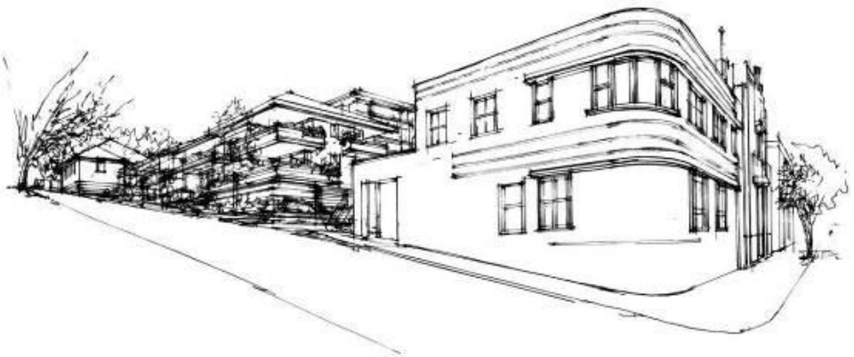
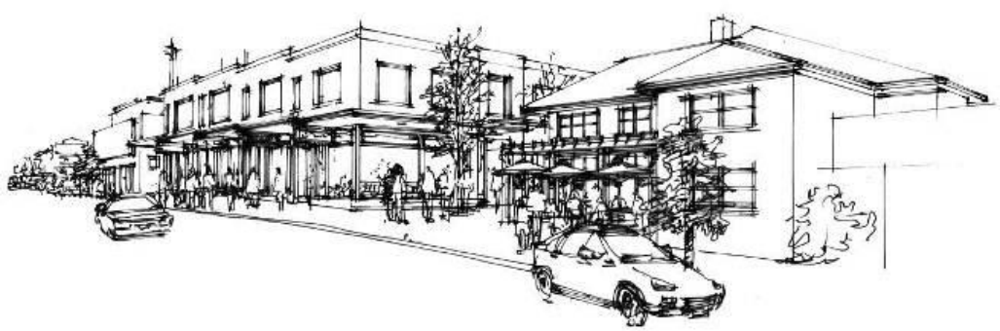

#### 3.6.5 INFILL DEVELOPMENT

Infill development refers to those buildings adjacent to or in the vicinity of heritage items as well as development within an identified Heritage Conservation Area. The following controls relate to the scale, bulk, siting, form, character, materials and colours and design of infill development:

#### 3.6.5.1 Character

a New development of the site is to respond to the character and significance of the heritage item or Heritage Conservation Area.

b In demonstrating the appropriateness of infill development to the existing historical character of the heritage item or Heritage Conservation Area, the applicant may be required to provide annotated diagrams, photographs and/or sketches to describe the factors which contribute to the character of the historic context (this will depend on the complexity of the new infill development and likely impact), including:

i topography of site and its surroundings;

ii distinctive landscape elements and quality;

iii the scale and form of the surrounding buildings;

iv street and subdivision patterns;

v setbacks of the buildings;

vi materials, building techniques and details; and

vii views, vistas and skylines.

#### 3.6.5.2 Design

a The design of new buildings should complement and not adversely impact on the design characteristics of existing heritage items, particularly adjacent to the site;

b New buildings and building elements should not mimic traditional styles but rather be sympathetic in design to their context, through appropriate scale, form and materials.

c Details that contribute to the historic character of the streetscape should be identified and used to inform the design of the new building.

d Modern details can reinterpret traditional details and create new relationships between the old and

new. This can be seen in the example of commercial heritage infill development in Figure 10 below. The horizontal masonry detailing on the existing building has been picked up in the horizontal detailing of the balconies of the adjoining new development.

> [Picture on page 36: a picture, saved as a picture (images/ch-03-06-heritage-conservation-page-36-1.gif, 150 dpi).]

#### Figure 10 Contextual design

#### 3.6.5.3 Bulk

In the case of new retail/commercial buildings, the bulk of the building should be divided into narrow and vertical elements reflecting the width of traditional shopfronts and parapets. On corner lots buildings should be splayed to address the corner.

#### 3.6.5.4 Form

The form of a building refers to its overall shape and volume and the arrangement of its parts. Infill design should be sympathetic with the predominant form of its neighbours. Where a building form is highly repetitive in an area, variations to this form appear discordant.

a New residential buildings should be sympathetic to the height, proportions, roof pitches and materials of Heritage Items, streetscapes and Heritage Conservation Areas.

b Infill buildings should respond to, or reinforce, existing ridge or parapet lines, roof slopes and other features such as party walls and chimneys.

c Annotate drawings, photographs of models or photomontages which describe the relationship between the proposed new development and the context may be required (this will depend on the complexity of the new infill development and likely impact), in terms of the following:

i predominant form of neighbours;

ii roof form and skyline, that is ridge and parapet lines, roof slopes, punctuation by party walls, chimneys and lanterns or skylights;

iii proportion and number of openings;

iv solid to void ratios;

v relationship between internal and external spaces.

#### 3.6.5.5 Scale

The scale of a building refers to its size in relation to surrounding buildings or landscape. Infill design should recognise the predominant scale (height, bulk, density, grain) of the setting and then respond sympathetically.

a Any subdivision of lots within a Heritage Conservation Area should reinforce the townscape pattern. Where a subdivision pattern contributes to the significance of a Heritage Conservation Area, consolidation of lots within it will have a negative impact on the place.

b Infill development must provide appropriate articulation of the elevations to ensure the scale and form of the development is sympathetic and does not dominate the streetscape as demonstrated in the figure below. The larger new development on the left is broken down by the columns and bays of the awning and windows and the building height mimics that of neighbouring development.

> [Picture on page 37: a picture, saved as a picture (images/ch-03-06-heritage-conservation-page-37-12.gif, 150 dpi).]

#### Figure 11 Sympathetic scale

#### 3.6.5.6 Siting

a New buildings should not be orientated across sites in a manner that is contrary to the established pattern.

b Where the facades in a streetscape create a more or less continuous line, this pattern of setback should be repeated with new development.

c Where there is an established pattern of side setbacks that contribute to the character of the streetscape, this should be continued with new development.

d Modern materials can be used if their proportions and details are sympathetic within the surrounding historic context.

e Details that contribute to the historic character of the streetscape should inform the design of new buildings.

f In residential areas, where side access is available, garages and carports should be located behind the front building line to minimise their impact on the streetscape.

g New fences, garden walls and other landscape treatments in the vicinity of a heritage item or Heritage Conservation Area should not detract from the identified heritage significance. Existing features that contribute to the heritage significance of the streetscape should be retained.

#### 3.6.5.7 Materials and Colour

a Use of characteristic materials within the existing area is encouraged in the construction of new buildings.

b Materials and colours of surrounding buildings should not be copied, but should be reinterpreted in new development.

c Modern materials can be used provided their proportions and details are harmonious within the surrounding context; colour, texture and tonal contrast can be unifying elements.

d Annotated drawings, photographs of models or photomontages which describe the relationship between the proposed new development and the context may be required (this will depend on the complexity of the new infill development and likely impact), in terms of the following:

i response to predominant materials, textures and colour palette, are they harmonious, complementary or contrasting;

ii commensurate quality of new materials to the existing building(s);

iii qualities of light and shadow;

iv hierarchy of material use, for example, solid masonry base and lightweight upper levels;

v relationship between skeleton or structure and skin.
