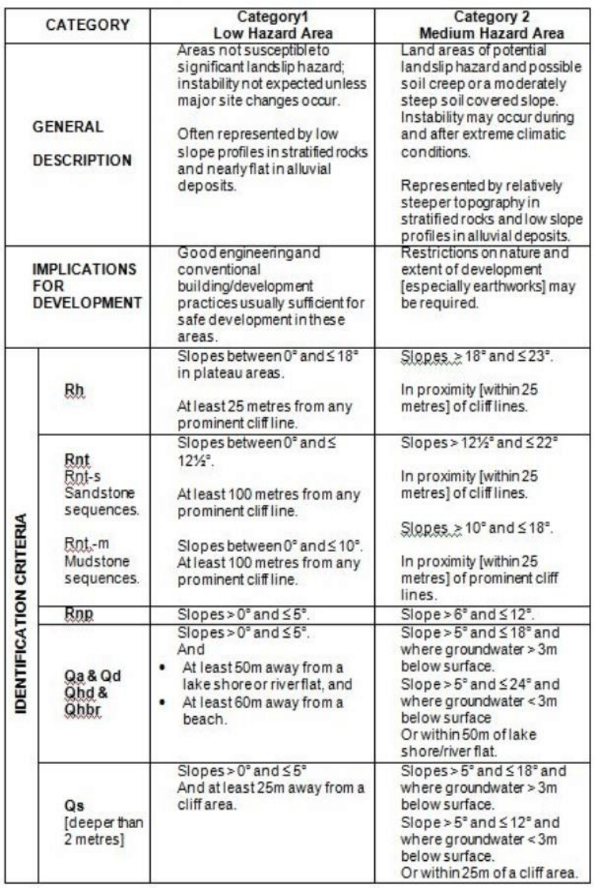
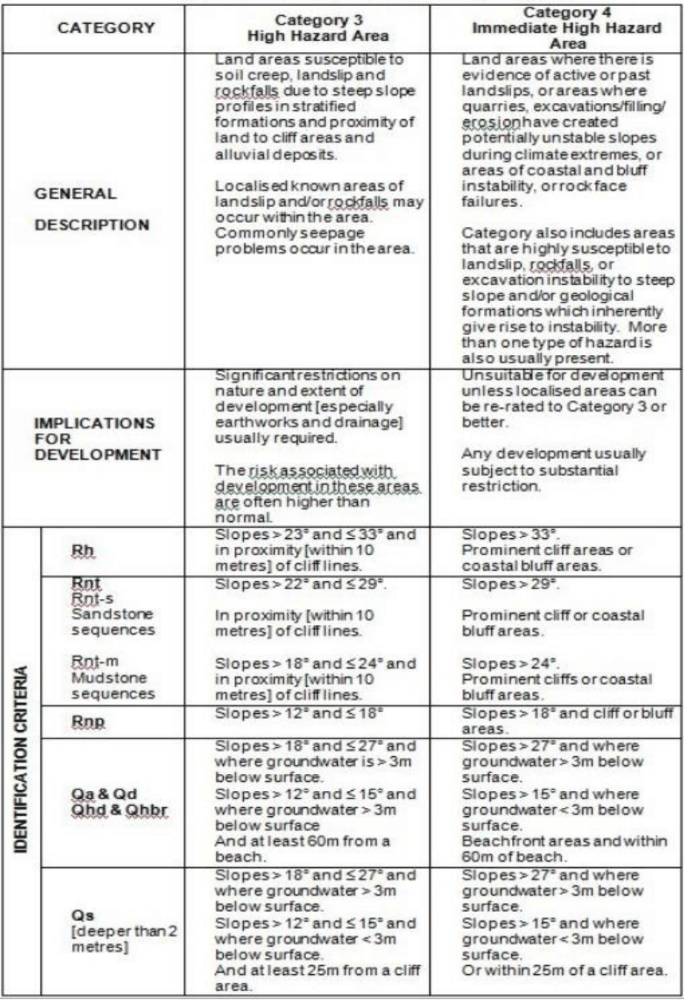
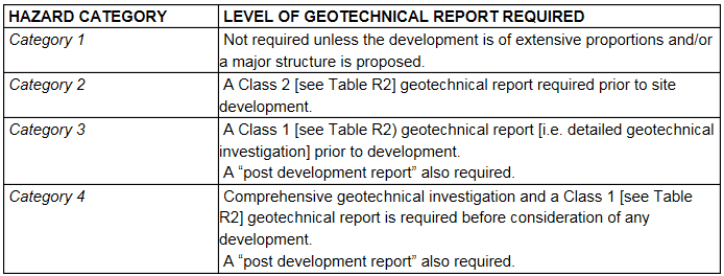
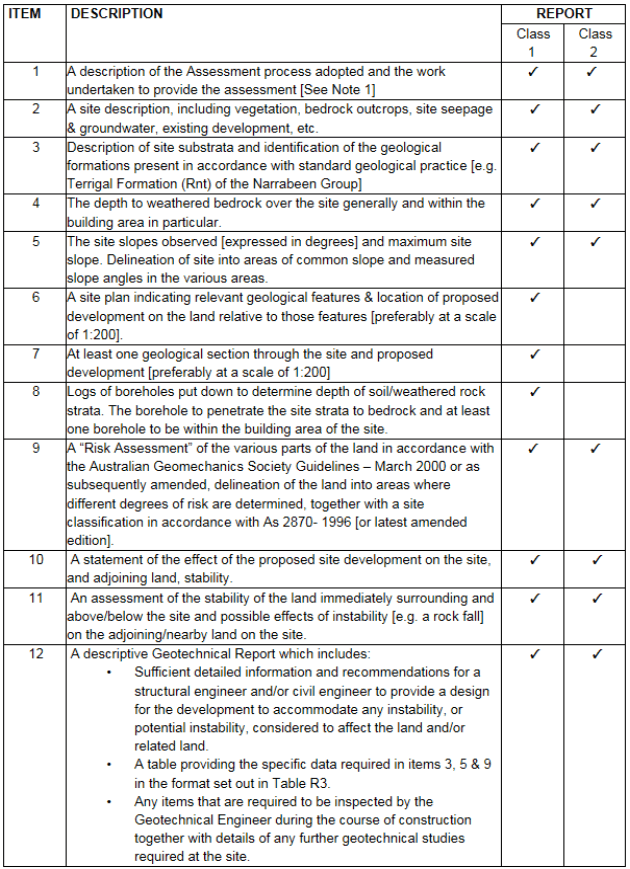
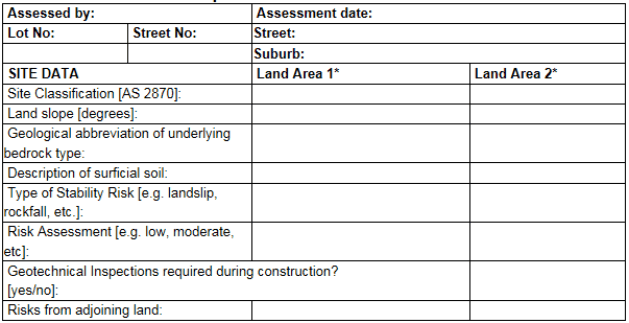

#### 3.7.1.2 Geotechnical Requirements

The purpose of this Chapter is to provide detailed guidelines for the submission of Geotechnical Reports to support Development Applications.

#### OBJECTIVES

▪ To provide a management strategy for development in areas identified as having landslip potential

▪ To provide guidelines on the content of geotechnical reports submitted to Council

#### REQUIREMENTS

#### 3.7.1.2.1 Landslip Hazard Assessment Matrix

a When assessing Development Applications, Council will consider the slip potential of a site through the review of any historic information held by Council or where potential geotechnical issues have been identified by reference to the following Matrices (Tables M1 & M2). Applicants are encouraged to contact Council prior to lodging development applications regarding sites that it is reasonable to consider that there may be potential landslip issues.

b The following geotechnical abbreviations have been used to describe the geological strata in Tables

M1 & M2:

▪ Rh

Hawkesbury Sandstone

▪ Rnp

Patonga Claystone

▪ Qs

High level Aeolian sand

▪ Qd, Qhd & Qhbr Dune and Barrier Sands

▪ Rnt

Terrigal Formation

▪ Rnt - s

Terrigal Formation – sandstone sequences

▪ Rnt - m

Terrigal Formation – mudrock sequences

▪ Qa

Alluvium, swamp and estuarine deposits

> [Picture on page 2: a picture, saved as a picture (images/ch-03-07-geotechnical-requirements-page-2-1.gif, 150 dpi).]

#### Table M1 – Low & Medium Hazard Areas

> [Picture on page 3: a picture, saved as a picture (images/ch-03-07-geotechnical-requirements-page-3-1.gif, 150 dpi).]

#### Table M2 – High & Immediate High Hazard Areas

#### 3.7.1.2.2 Geotechnical Reports

a Where this assessment indicates that a lot has a Hazard Category of 2 or above, Council will require that the Development Application be supported by a geotechnical report that considers geotechnical conditions, stability and impact of development on the stability on the site (and adjoining lots).

b Where this assessment indicates that a lot or part of a lot has a Hazard Category of 3 or above, Council will require that the Development Application be supported by a geotechnical report that considers geotechnical conditions, stability and impact of development on the stability on the site (and adjoining lots).

c Where this assessment indicates that a lot has a Hazard Category of 4, Council will require that a Development Application be supported by a comprehensive geotechnical report that considers geotechnical conditions, stability and impact of development on the stability on the site (and adjoining lots).

> [Picture on page 4: a picture, saved as a picture (images/ch-03-07-geotechnical-requirements-page-4-13.gif, 150 dpi).]

d The minimum information required in the geotechnical report is described in Table 3 below

#### Table 3

> [Picture on page 5: a picture, saved as a picture (images/ch-03-07-geotechnical-requirements-page-5-2.gif, 150 dpi).]

e The geotechnical data required in the geotechnical report is described in table 4 below.

> [Picture on page 5: a picture, saved as a picture (images/ch-03-07-geotechnical-requirements-page-5-4.gif, 150 dpi).]

#### Table 4

Note: additional land area columns to be added where site has more than two fundamental slopes;
