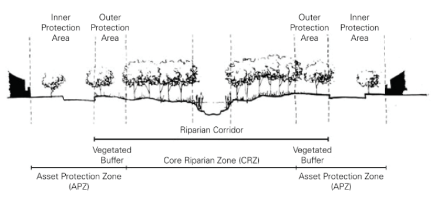
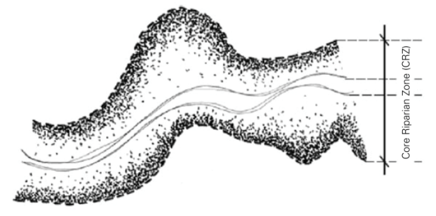
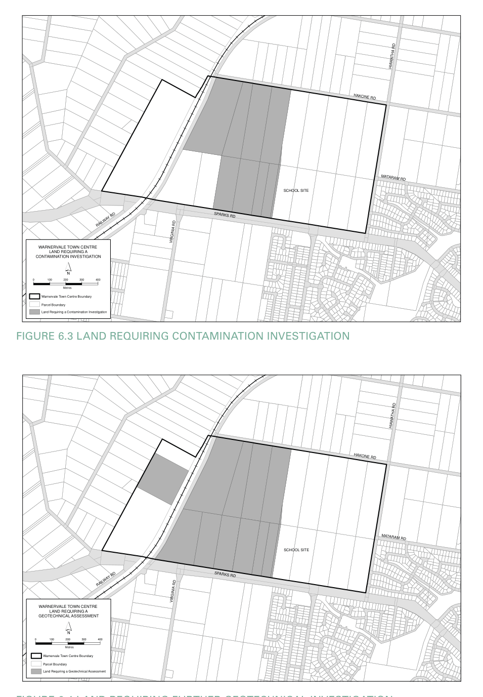
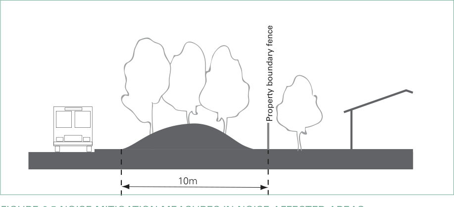

### 5 5.9 RESIDENTIAL FLAT BUILDINGS AND SHOP TOP HOUSING

Objectives

• To establish a high quality residential housing environment where all dwellings have a good level of amenity.

• To encourage a variety of housing forms.

Controls

a) Shop top housing and residential fl at buildings are to:

• be located generally within the Town Centre Civic and Civic Fringe precincts.

• be consistent with the guidelines and principles outlined in SEPP 65 – Residential Flat Development, except where controls are provided in Table 5 below.

• not signifi cantly impact upon the existing or future amenity of any adjoining land upon which residential development is permitted, with respect to overshadowing impact, privacy impact or visual impact.

b) Residential fl at buildings are to have a direct frontage to an area of the public domain, including streets and public open space.

Table 5: Controls for Shop Top Housing (residential component only) and Residential Flat Buildings (RFBs)

| Element | R1 zone | B2 and B4 zones |
|---|---|---|
| Street Frontage (min) | 30m | 30m |
| Primary Front Setback (min) | 4.5m | Ground and fi rst fl oor: refer to Section 5.3 of this DCP. Upper fl oors: 4m (average) up to 18m in height; 8m (average) above 18m Zero setback will be considered to service lanes subject to the application demonstrating a satisfactory level of amenity for residents and neighbours will be achieved. |
| Side Setback (min) | 2m | 0 |
| Rear Setback (min) | 6m | 4m |
| Boundary to public open space area (min) | N/A | 4.5m Buildings must address the adjoining public open space |
| Private Open Space (min) | 10m2 per apartment Min. depth 2m | 10m2 per apartment Min. depth 2m |
| Communal Open Space (min) | RFBs: 15% of site area | RFBs: 15% of site area |
| Landscaped Area (min) | 20% of site area | No minimum, however landscaping should be achieved in setback areas at ground level where possible. |
| Car Parking | 1 - 2 bedrooms: 1 space 3 or more bedrooms: 2 spaces 1 visitor space per 5 apartments Car parking spaces to be located below ground level or behind the building line and screened to minimise visual impact from the street. Bicycle parking spaces: 1 per 2 dwellings Visitor bicycle parking: 1 per 12 dwellings | 1 - 2 bedrooms: 1 space 3 or more bedrooms: 2 spaces 1 visitor space per 5 apartments Car parking spaces to be located below ground level or behind the building line and screened to minimise visual impact from the street. Bicycle parking spaces: 1 per 2 dwellings Visitor bicycle parking: 1 per 12 dwellings |

### 5.10 PLANTING ON STRUCTURES

The following controls apply in the Town Centre Civic Precinct where planting on roof tops or over car park structures are proposed. They apply particularly for communal open space required for mixed use and non-residential developments.

Objectives

• To contribute to the quality and amenity of open space on roof tops and internal courtyards .

• To encourage the establishment and healthy growth of trees and plantings.

• To minimise the use of potable water for irrigating planting on structures.

Controls

a) Areas with planting on structures are to be irrigated with an alternative water source.

b) Design for optimum conditions for plant growth by:

• providing soil depth, volume and area appropriate to proposed plant size,

• providing appropriate soil conditions and irrigation methods, and

• providing appropriate drainage.

c) Design planters appropriate to soil depth and plant selection by:

• ensuring planter proportions accommodate the greatest possible soil volume and depths to ensure tree growth, and

• providing square or rectangular planting areas rather than narrow linear areas.

d) Increase minimum soil depths in accordance with:

• the mix of plants in a planter, for example, where trees are planted in association with shrubs and groundcovers,

• the level of landscape management particularly, the frequency of irrigation,

• anchorage requirements of large and medium trees, and

• soil type and quality.

e) Provide suffi cient soil depth and area to allow for plant establishment and growth. The following minimum standards are recommended:

| Plant type | Min soil depth | Min soil volume |
|---|---|---|
| Large trees (over 8m high) | 1.3 m | 150 cu m |
| Medium trees (2m to 8m high) | 1.0 m | 35 cu m |
| Small trees (up to 2m high) | 800 mm | 9 cu m |
| Shrubs and ground cover | 500 mm | n/a |

f) Provide a minimum 200sqm publicly accessible area as a rooftop garden for retail, commercial and public buildings, where practical, in the Local Centre zone.  The rooftop garden should be designed and constructed according to best practice principles including access for maintenance. The building or strata manager, or the consent authority (if applicable), is to maintain the garden for the following purposes:

• green space for public enjoyment;

• demonstration of alternative, low water use agricultural practices; and

• thermal insulation for uses within the building.

### 5.11 SITE FACILITIES AND SERVICES

Objectives

• To design urban infrastructure as an integral part of urban design.

• To achieve a planned system of services, integrated with streetscape design to reduce maintenance time, damage and repair costs and contribute to the public domain.

• To ensure site facilities (such as clothes drying areas, mail boxes, recycling and garbage disposal units/areas, screens, lighting, storage areas, air conditioning units and communication structures) are unobtrusively integrated into development.

• To ensure that site services and facilities are adequate for the nature and quantum of development.

• To establish appropriate access and location requirements for servicing.

• To ensure service requirements do not have adverse amenity impacts.

Controls

a) Provide underground services for all domestic serving utilities, including electrical services.

Mail boxes

b) Provide mail boxes for residential buildings and/or commercial tenancies in accessible locations adjacent to the main entrance to the development. Mail boxes should be integrated into a wall where possible and be constructed of materials consistent with the appearance of the building.

c) Mail boxes shall be secure and large enough to accommodate articles such as newspapers.

Communication structures, air conditioners and service vents

e) Locate satellite dishes and tele-communications antennae, air conditioning units, ventilation stacks and any ancillary structures:

• away from the street frontage,

• integrated into the roofscape design and in a position where such facilities will not become a skyline feature at the top of any building, and

• adequately setback from the perimeter wall or roof edge of buildings.

f) A master antenna must be provided for residential apartment buildings. The antenna should be sited to minimise its visibility from surrounding public areas. Waste (garbage) storage and collection

g) All development is to adequately accommodate waste handling and storage on-site. The size, location and handling procedures for all waste, including recyclables, is to be determined in accordance with the consent authority’s waste policies and advice from relevant waste handling contractors.

h) Access for waste collection and storage is preferred from rear lanes, side streets or rights of ways.

i)  Waste storage areas are to be designed and located to:

• ensure adequate driveway access and manoeuvrability for any required service vehicles,

• not create any adverse noise impacts on existing developments or sensitive noise receptors such as habitable rooms of residential developments, and

• be screened from the public way and adjacent development that may overlook the area.

j) The storage facility must be well lit, easily accessible, on-grade for movement of bins, free of obstructions that may restrict movement and servicing of bins or containers and designed to minimise noise impacts.

k) Collection vehicles are to enter and depart in a forward manner. Reversing on site will only be permitted where there is no confl ict with pedestrians or other vehicles.

Location requirements for waste storage areas and access:

l) Where waste volumes require a common collection, storage and handling area, this is to be located:

• for residential buildings, at ground behind the main building setback and façade, or within a basement or enclosed car park, and

• for commercial, retail and other development, on-site in basements or at ground level within discrete service areas not visible from main street frontages.

m) Where above ground garbage collection is prohibitive or impractical due to limited street frontage, or would create an unsafe environment, an on-site basement storage area must be provided.

n) Where a mobile compaction vehicle is required to enter the site, the access and circulation area shall be designed to accommodate a vehicle with the following dimensions:

| Position | Dimension |
|---|---|
| Vehicle length | 12300mm |
| Vehicle width | 3500mm |
| Vehicle height – travel (Safe height in confi ned areas – top door closed and forks down) | 3800mm |
| Vehicle height – operation (Top door open with a bin at full tipping position) | 6000mm |

Service docks and loading/unloading areas

o) Provide adequate space within any new development for the manoeuvring, loading and unloading of service/delivery vehicles.

p) Preferably locate service access off rear lanes, side streets or rights of way.

q) Screen all service doors and loading docks from street frontages and from active overlooking from existing developments.

r) Design circulation and access in accordance with AS/NZS 2890.1 and AS 2890.2.

s) Service/delivery vehicles need to enter and leave service area in a forward manner and are to be separate from general parking and pedestrian areas. Fire service and emergency vehicles

t) For developments where a fi re brigade vehicle is required to enter the site, vehicular access, egress and manoeuvring must be provided to, from and on the site in accordance with the NSW Fire Brigades (FB) Code of Practice – Building Construction – NSWFB Vehicle Requirements.

### Environmental Management

This section outlines objectives and development controls for environmental management issues.

This section applies only to non-residential (retail and commercial) development, the public domain, public and private parks, and community facilities. State Environmental Planning Policy (Building Sustainability Index: BASIX) 2004 applies to residential development.

The controls in this section aim to:

• ensure the environmental impacts of new development are managed in a sustainable and economical way;

• provide an adequate and renewable supply of natural resources; and

• ensure a healthy environment.

### 6.1 WATER CONSUMPTION

The Central Coast is currently subject to extreme water supply shortages. Combined with the changes predicted to occur as a result of climate change, developing a safe and secure water supply without compromising the health of the region’s water sources is one of the region’s greatest challenges. Hence, a range of options need to be considered to develop a more secure water supply system; and future growth must be carefully managed.

By integrating water use effi ciency, water collection and water reuse measures into building and infrastructure design, development can help minimise demands on potable water supply.

Water can be conserved in two ways: by reducing mains water demand; and by re-using water otherwise lost as run off or wastewater.

This section includes controls relating to water consumption reduction, water capture, treatment options, and water re-use.

Objectives

• To reduce potable mains water demand from non-residential development by promoting water-effi cient appliances, alternative water sources for appropriate purposes, and wastewater reuse.

• To reduce wastewater disposal and encourage its reuse in retail, commercial, community and public development.

• To lower greenhouse gas emissions.

• To encourage innovation in the collection and reuse of alternative water sources.

Controls

General Applicants can submit alternative solutions to the controls in this section where it can be demonstrated that an equal or superior outcome will result. Water consumption reduction

a) Use an alternative water source for the irrigation of public or private open space.

b) Provide all irrigation of public and private open spaces by sub-surface, drip irrigation systems controlled by timers and soil moisture or rainfall sensors.

c) Provide for future supply of reticulated recycled water to non-residential development by installing:

• a reticulated alternative (that is, a “third pipe”) network to all non-residential allotment boundaries;

• pipe network sizing capable of supplying:

– all residential demand for toilet fl ush and laundry cold water;

– all non-residential toilets and urinals in the Local Centre zone; and

– other non-potable water demands including, non-commercial car-washing, hose-down, laundry, and cooling towers.

d) All water fi xtures in non residential buildings including, public facilities should be rated to deliver maximum water fl ows of:

• 6 litres per minute for hand basins, and

• 9 litres per minute for showers

e) Provide other water effi ciency measures in non-residential buildings and public facilities including:

• all toilets to be provided with dual fl ush systems of no more than 6 litres per full fl ush and 3 litres per half fl ush.

• manual or sensor operated, low volume fl ush systems fi tted to all urinals (excluding waterless, or ultra water-effi cient urinals),

• trigger nozzles on all hoses and kitchen dishwashing facilities, and

• automatic shut off for all public hand basin taps.

f) Locate all non-residential hot water systems as close as practical to the hot water end-use (for example, aquatic centre shower facilities). Alternative water supplies and treatment options

a) Potable water must not be drawn on for the following uses in non-residential development, unless as a backup supply:

• toilet and urinal fl ushing,

• fi re service testing,

• clothes laundering,

• hosing-down,

• car washing.

b) As long as “fi t for purpose” treatment measures appropriate to the water source and the water end-use are applied, alternative water sources for non potable uses may include:

• rainwater harvested from roofs, or

• treated

– waste water,

– stormwater or

– greywater (such as collected from showers, hose-down, car-wash or laundry facilities).

c) Gravity feed is a preferred characteristic of the treatment options. If it cannot be achieved, localised, modular treatment technologies should be used rather than centralised treatment, to avoid the use of unnecessary water pumping energy.

• Preferred localised, modular treatment options include:

– subsurface fl ow wetlands;

– suspended growth systems including, activated sludge systems;

– fi xed growth systems, including trickle fi lters, rotating biological contactors;

– re-circulating media fi lters (fi xed fi lm bio-reactor);

– sand and depth fi ltration;

– membrane fi ltration including micro, ultra, nano fi ltration and reverse osmosis; and

– membrane bioreactor.

Cooling towers

a) Cooling towers, or other forms of evaporative coolers for the provision of cooled air to, or the rejection of heat from heating, ventilation, air conditioning, chilling or refrigeration systems, must (except in cases of emergency, such as failure of the particular water supply), draw 100% of their water use from an alternative water supply.

Suitable, alternative water supplies include:

• harvested rainwater or

• appropriately treated:

– waste water,

– stormwater or

– greywater (such as collected from showers, hose-down, car-wash or laundry facilities).

### 6.2 INTEGRATED WATER CYCLE MANAGEMENT AND WATER SENSITIVE URBAN DESIGN

The WTC straddles the catchment divide between Porter’s Creek and Wallarah Creek in the most upstream reaches of both catchments. A number of important aquatic ecosystems are present within and downstream of the WTC. Many of the systems are sensitive to changes in hydrology. Water quality and quantity are therefore important issues requiring at source treatment as well as measures to be implemented within drainage corridors to detain and treat stormwater before it leaves the site.

Development within Warnervale Town Centre is to be guided by the principles of Water Sensitive Urban Design (WSUD). WSUD is to be adopted throughout the development to promote sustainable and integrated management of land and water resources incorporating best practice stormwater management, water conservation and environmental protection.

A WSUD Strategy is to be prepared for each development, outlining how the following provisions are to be met and optimised through the development. The WSUD Strategy is to comply with the requirements and deliver the various elements of the Warnervale Town Centre Integrated Water Cycle Management Strategy (IWCM), and other relevant council IWCM and WSUD Technical Guidelines.

As summarised in Table 5, various elements of the IWCM Strategy are categorised as ‘Private’ or ‘Public’ by their location (either, within the private allotment or, on public land), and responsibility/ ownership (either, privately owned/operated or, Council owned/operated). Individual developers or allotment builders will be responsible for the delivery (design, construction and establishment) of individual IWCM elements. The developer will then give the ‘private’ IWCM infrastructure to the owners or managers of the private land (owners’ corporation or building managers), and the ‘public’ IWCM infrastructure to Council. As part of the early conceptual design for individual development sites, developers must consult with the consent authority to resolve and confi rm the preferred responsibility and requirements for delivering the IWCM infrastructure.

Objectives

• To protect the key hydrologic characteristics of Porter’s Creek Wetland and Wallarah Creek.

• To recommend that hydrologic performance objectives for development within the Porter’s Creek Wetland and Wallarah Creek catchments are listed and preliminary storage requirements are provided as indicated on Figure 4.1 in section 4 Public Open Space.

• To guide development consistent with the principles of Water Sensitive Urban Design (WSUD).

• To ensure that stormwater runoff achieves best practice standards, through the development of an appropriate treatment train at a lot scale and streetscape.

• To limit changes in fl ow rate and fl ow duration within the receiving waterways as a result of development.

• To protect the receiving wetlands and waterway ecosystems through:

• Preservation of both the fl ooding and drying hydrology from the development area to the wetlands.

• Preservation of the pre-development fl ows within Wallarah Creek which infl uence stream disturbance (3mth and 1.5yr ARI ).

• To minimise impacts of fl ood fl ows discharging from the WTC on downstream waterways.

• To mitigate the impacts of urban development on stormwater quality through incorporating best practice stormwater management principles and strategies in development.

• To safeguard the environment by improving the quality of water run-off.

Controls

Wetland and Stream Hydrology Controls

a) All development within the Porter’s Creek and Wallarah Wetland Catchment, must attain the following:

• Preserve the pre-development 30 day low fl ow duration frequency curve for the dry season (October to January).

• Preserve the low fl ow spells frequency curve for the dry season.

• Preserve the pre-development 30 day high fl ow duration frequency curve for the dry season (October to January).

• Maximise collection and reuse of stormwater in line with the above points. The above requirements are deemed to be satisfi ed though the adoption of stormwater storages which are connected via pumps and pressure reticulation to the Regional IWCM Scheme.

b) In addition to the above point, all development within the Wallarah Creek Catchments must attain the following:

• Maximise collection and reuse of stormwater. In order to preserve as far as practical the pre-development hydrology (such as low/high fl ow durations and frequencies).

• Preserve the pre-development channel forming fl ows within Wallarah Creek for events up to an including the 2 year ARI storms.

• Mimic the pre-development peak fl ows within the Wallarah Creek for events up to and including the 2 year ARI storm which tent to cause erosion of localised sections of the bed and banks and dictate stream health.

• Post development fl ow duration should be no greater than 4 times the pre-development fl ow duration.

Stormwater Quality Controls

a) All stormwater from the Warnervale Town Centre development discharging into the hydrologic management systems (ie. stormwater storage) is to be treated in accordance with best practice:

• 85% reduction in the mean annual load of Total Suspended Solids (TSS).

• 65% reduction in the mean annual load of Total Nitrogen (TN).

• 45% reduction in the mean annual load of Total Phosphorus (TP).

• Retention of litter greater than 5mm for fl ows up to 50% of the one-year ARI peak fl ow.

• No visible oils for fl ows up to 50% of the on-year ARI peak fl ow.

b) All other stormwater from the Warnervale Town Centre development discharging  directly into ‘receiving environments’ (i.e. 7G wetlands, Porters Creek Wetland, Wallarah Creek) is to be treated in accordance with Wyong Shire Council’s Stormwater Management Plan:

• 90% reduction in the mean annual load of Total Suspended Solids (TSS).

• 50% reduction in the mean annual load of Total Nitrogen (TN).

• 50% reduction in the mean annual load of Total Phosphorus (TP).

• Retention of litter greater than 5mm for fl ows up to 50% of the one-year ARI peak fl ow.

• No visible oils for fl ows up to 50% of the one-year ARI peak fl ow.

c) Compliance with these standards to be determined through stormwater quality (MUSIC) modelling in accordance with the IWCM Strategy.

d) The confi guration and sizing of appropriate WSUD measures to meet the stormwater quality objectives should be identifi ed in accordance with the IWCM Strategy and documented for development application.

Appropriate Treatment Train

• A treatment train consists of a combination of treatment measures which address the range of particular size pollutants found in stormwater. The selection and order of treatment is important as well as the proximity of treatment to its source and the distribution of treatment throughout the catchment.

• For Warnervale Town Centre site a fi nal mix of “At Source’, ‘Streetscape’ and end of pipe’ treatment is to be defi ned by individual developers with the overall aim to treat stormwater to the required levels prior to delivery to the stormwater storages.

Accepted treatment measures include: rainwater tanks and harvesting, forecourt wetlands and bioretention systems, bioretention pods within lots and streetscape, permeable paving in carparks and some roads, proprietary gross pollutant traps, buffer strips and grass verge treatment. Council Development staff are to be consulted whilst formulation the treatment train strategy.

#### Table 6: Summary of WTC IWCM Strategy

| WATER CYCLE MANAGEMENT ELEMENT | Private (Private allotment owned and managed) | Public (Council owned and managed) |
|---|---|---|
| Demand management: AAA+ fi xtures and appliances, dual fl ush toilets, waterless urinals, water effi cient gardens (residential demand management in accordance with BASIX). |  |  |
| Rainwater Tanks: Residential tanks where required by BASIX to meet 40% potable water consumption reduction. Non-residential tanks where required to supply non-potable demand. |  |  |
| ‘At Source’ Stormwater Treatment: For large retail, commercial and apartment allotments, treatment systems integrated into landscapes and forecourts to collect runoff and facilitate treatment prior to discharge form the allotment. Eg. Bioretention pods and systems, roof top gardens, WSUD carparks, stormwater harvesting. |  |  |
| ‘Streetscape’ Stormwater Treatment: Integrated into road reserves to collect road and allotment runoff and facilitate treatment prior to discharge to stormwater drainage system and subsequently the stormwater storage eg. Bioretention pods, WSUD carparks, permeable paving (and swales where appropriate). |  |  |
| Stormwater Storage: Stormwater Storage sized in combination with rapid drawdown pump rate to remove excess stormwater and deliver the wetland hydrologic objectives. |  |  |
| Stream Disturbance Management Storage of 2 yr fl ows to preserve the current peak fl ows entering Wallarah Creek, ensure fl ow is delivered in a dispersed manner and protective of already scoured |  |  |
| zones. |  |  |

Development Application

All uses

a) Applicants must consult with the consent authority at an early, conceptual design stage to confi rm the IWCM Strategy requirements in relation to their development site. Water conservation aspects of those requirements will not apply to private dwellings built to be compliant with BASIX.  The IWCM Strategy discussions will provide the developer with the following:

• Confi rmation of the land use type to apply on the development site.

• Detail the relevant IWCM objectives and identify any variations from the IWCM Strategy.

• Details of the IWCM Infrastructure relating to the development and any variations from the IWCM Strategy

• Method for stormwater treatment systems and stormwater storage design if the catchment/ development areas vary from the IWCM Strategy.

• Indication of preferred delivery (construction, establishment and handover) model for the IWCM elements.

b) Following conceptual design, applicants must submit a WCM Plan to the consent authority as part of the Development Approval. The WCM Plan must provide the following:

• Description of the existing WTC including topography, vegetation and soils.

• Location in relation to the IWCM Strategy catchments and the stormwater storage to which the development drains.

• Description of the proposed development including, roof areas, landscaped areas (for irrigation), ground level hardstand and uses through the development site.

• Description of stormwater treatment strategy including, ‘at source’, ‘streetscape’ or ‘precinct’ scale elements to deliver the stormwater quality objectives. Results of performance assessment using the MUSIC model in accordance with the MUSIC Modelling Guidelines must be provided with the conceptual design including, size, depth, and landscape integration of the IWCM elements.

• Drainage strategy for the site to ensure runoff is delivered to the relevant stormwater storage. Construction Certifi cation

a) Undertake the design development and detailed design of the IWCM elements in accordance with Australian Runoff Quality and WSUD Technical Guidelines (ARQ, 2003), and with the design approach described in WTC IWCM Strategy.

b) Submit the following documentation for the design development and detailed design for Construction Certifi cation in addition to standard landscape and civil drawings:

• IWCM/WSUD Functional Design Report (describe key functional elements and provide relevant WSUD/IWCM Specifi cations);

• Construction and Establishment Methodology;

• Monitoring and Maintenance Plan. Construction and Establishment

a) Applicants must submit a site specifi c construction and establishment methodology as part of design development and detailed design. The methodology must be submitted with the Construction Certifi cation, and document the IWCM elements. Hard paved surfaces

a) Incorporate WSUD principles in the design of the public domain and private hard paved surfaces.

b) Use pipes and pits to direct drainage from streets and other impervious surfaces (including, car parks, paved outdoor areas, footpaths) into gross pollutant traps and oil and grit/sediment separators.

c) Pass collected stormwater through a fi ltration system for further treatment. Direct collected treated stormwater into bioretention trenches or holding tanks before reuse or, discharge to council’s trunk stormwater drains or to natural watercourses.

d) The types of pollutants, estimated pollutant loadings and level of pollutant retention of any stormwater discharged into natural watercourses should refl ect current best practice, and be consistent with the objectives and recommendations of the Australian Runoff Quality and WSUD Technical Guidelines.

### 6.3 RIPARIAN CORRIDORS

Objectives

• To protect the ecological function of vegetated riparian corridors.

• To retain, and where appropriate, modify and/or rehabilitate existing watercourses and riparian zones.

• To reduce the risk of stream erosion within Wallarah Creek and Porter’s Creek following development.

• To create a stable environment that enhances stream ecology.

• To provide habitat connectivity across the WTC.

• To allow for the use of the riparian corridor buffers for low impact recreational activities such as walking and cycling.

Controls

a) The tributary to the west of the railway corridor is to be protected through a core riparian corridor width of 40m minimum, with 15m buffers either side, forming a total corridor of 70m.

b) The Wallarah Creek tributary is to be protected through a core riparian corridor width of 60m minimum, with 10m minimum buffers either side, forming a total corridor of 80m minimum.

c) The vegetated buffers either side of the Core Riparian Zone (CRZ) can include the Outer Protection Area of the Asset Protection Zone (APZ). Refer to Figures 6.1 and 6.2.

d) Where there are important patches of vegetation, the setback width of CRZs should vary to incorporate existing endemic vegetation.

e) Stormwater infrastructure, water quality treatment ponds, pedestrian and cycleways and asset protection zones are to be located outside of the CRZ. These uses are permitted within the non-core riparian buffer if the impact on riparian functions is minimal and its integrity maintained and where they have been specifi cally identifi ed in the WSUD strategy for the site

f) The understorey can be cleared in the riparian zone to satisfy the requirements for an Outer Protection Area of the APZ, and bushfi re legislation.

g) The location of access ways to and within a riparian buffer is not to compromise the ecological integrity of any existing riparian vegetation, the stream-bed or bank stability.

h) The impact of pedestrian and cycleways and general access points to riparian corridors is to be minimised by using ecologically informed design principles (for example, elevated accessways that allow sunlight to penetrate and vegetation to grow beneath).

i) Development adjoining the riparian corridors will need to provide a fence to the boundary with the riparian corridor.

> [Picture on page 65: a picture, saved as a picture (images/ch-04-01-warnervale-town-centre-page-65-1.gif, 150 dpi).]

FIGURE 6.1 RIPARIAN CORRIDOR FEATURE ZONES

> [Picture on page 65: a picture, saved as a picture (images/ch-04-01-warnervale-town-centre-page-65-3.gif, 150 dpi).]

FIGURE 6.2 RIPARIAN CORRIDOR VARIABLE SETBACKS

### 6.4 TREE RETENTION AND BIODIVERSITY

Objectives

• Protection and enhancement of existing signifi cant trees, where possible.

• To improve or maintain biodiversity values.

• To maintain or improve as much existing vegetation as practicable.

• To reduce impacts of runoff from roads and impervious areas on adjacent lands.

• To manage weeds during and after construction, to prevent the spread of weeds.

Controls

a) Submit a tree survey plan with all subdivision applications. The tree survey plan is to identify the location, type and condition of all existing trees, and trees proposed to be removed and retained. Where trees are to be maintained, details of protection methods, during and after construction, are also required. Details are also to be provided to address wildlife that may be displaced and relocation of habitat (eg. fallen logs, hollows etc) into the riparian corridor and other suitable areas on the WTC site.

b) Where earthworks necessitate the removal of existing trees, applicants are required to comply with section 6.8 of this DCP.

c) Plant a range of endemic tree and shrub species throughout the WTC, in accordance with the landscape specifi cation.

d) Native vegetation (canopy level) shall be provided, where possible, within neighbourhood parks, riparian corridors and street verges to create a ‘stepping-stone corridor’ for terrestrial biodiversity. Details of any planting shall be provided within a detailed Landscape Plan submitted at DA stage.

e) Submit a weed management plan (if required by the consent authority), for subdivision applications which:

• identifi es weed control measures during and after development,

• requires land to be revegetated after disturbance or construction activities to reduce the likelihood of weed species growing on the WTC, and

• topsoils brought onto the WTC to be free of weeds before use.

### 6.5 BUSHFIRE HAZARD MANAGEMENT

Objectives

• To prevent the loss of life and property due to bushfi res, by discouraging the establishment of incompatible uses on bushfi re prone land.

• To encourage sound management of bushfi re prone land.

• To implement fi re management activities that reduce threats to life and property.

• To ensure ecological thresholds are not exceeded.

Controls

a) Asset Protection Zones (APZs):

• are to be located wholly within a development site;

• may incorporate roads;

• are to be located wholly outside of a Core Riparian Zone (CRZ), and outside the Heath Wrinklewort Reserve;

• may be located within the CRZ buffer but must not compromise the tree canopy;

• may be used for open space and recreation subject to appropriate fuel management;

• are to be established and maintained in accordance with the Planning for Bushfi re Protection 2006;

• may incorporate private residential land, but only within the building setback (no dwellings are to be located within the APZ), and

• are to be generally bounded by a perimeter fi re trail/road that is linked to the public road system at regular intervals in accordance with Planning for Bushfi re Protection 2006.

b) DAs for the WTC, and residential development or Special Fire Protection Purpose developments are subject to s100B of the Rural Fires Act 1997, and s 79BA of the EP&A Act 1979.

c) DAs are to address the requirements of Planning for Bushfi re Protection 2006.

d) Meet the standards of Planning for Bushfi re Protection 2006 for reticulated water. Water supply is to be via a ring main system, engineered to the requirements of Australian Standard 2419.1-1994 Fire Hydrant Installations.

e) Bushfi re Hazard Management measures are to be incorporated into Council’s Plans of Management for public domain and open space.

f) Where an allotment fronts and partially incorporates an APZ, it shall have an appropriate depth to accommodate a dwelling with private open space and the minimum required APZ. The APZ will be identifi ed through a Section 88B Instrument (Conveyancing Act 1919, as amended).

g) Temporary APZs, identifi ed through a Section 88B Instrument, will be required where development is proposed on allotments next to undeveloped land. The temporary APZ will not be required, and shall cease upon, development of the adjacent stage.

h) School buildings fronting bushland areas shall be setback 35 metres from the bushland boundary.

### 6.6 CONTAMINATION MANAGEMENT

Objectives

• To ensure that changes to land use do not increase the risk to public health or the biophysical environment.

• To avoid inappropriate restrictions on land use.

• To provide advice to support decision making and inform the community.

• To consider the likelihood of land contamination as early as possible in the planning process.

• To link decisions about the development of the land with the information available about contamination possibilities.

Controls

a) DAs for development on land identifi ed in Figure 6.3 need to be accompanied by a preliminary investigation in accordance with the contaminated land planning guidelines (under s145C of the AP&A Act ).

b) In considering a DA, the consent authority must be satisfi ed that land, where it is contaminated, is suitable in its contaminated state, or will be suitable after remediation, for the purpose for which the development is proposed to be carried out.

c) If land requires remediation to be made suitable for the purpose for which the development is proposed to be carried out, the consent authority must be satisfi ed that a site will be remediated before the land is used for that purpose.

d) Comply with a maximum 1 in 3 grade for embankments.

e) Submit a geotechnical assessment to the consent authority with a DA for development on land indicated in Figure 6.4.

f) If, under extraordinary circumstances, approval is given by the consent authority for cut and fi ll to exceed 1m in height:

• a report is required from a qualifi ed geotechnical engineer certifying the stability of the resulting slope and adequacy of retention therein;

• all details regarding proposed lot reshaping shall be shown on engineering plans submitted for approval including, but not limited to the following:

i) the proposed fi nished and existing surface levels of each lot. Lots shall be graded in accordance with the consent authority’s requirements for drainage.

ii) the location and type of all proposed retaining structures in accordance with the consent authority’s requirements for methods for retaining fi ll.

iii) where existing trees cannot be retained, comply with the consent authority’s requirements.

iv) batters generally in accordance with the consent authority’s requirements for the retention and extent of fi ll.

v) all longitudinal sections (sewer and inter-allotment drainage longitudinal sections) within terraced developments must refl ect the proposed fi nished surface levels and be designed accordingly.

> [Picture on page 68: a map, saved as a picture (images/ch-04-01-warnervale-town-centre-page-68-1.gif, 150 dpi); the street names and other small labels are on the picture.]
> Words printed on the picture (title and legend, copied from the PDF):
> WARNERVALE TOWN CENTRE
> LAND REQUIRING A
> 0 100 200 300 400
> Warnervale Town Centre Boundary
> Land Requiring a Contamination Investigation

FIGURE 6.3 LAND REQUIRING CONTAMINATION INVESTIGATION

> Words printed on the picture (title and legend, copied from the PDF):
> WARNERVALE TOWN CENTRE
> LAND REQUIRING A
> 0 100 200 300 400
> Warnervale Town Centre Boundary
> Land Requiring a Geotechnical Assessment

FIGURE 6.4 LAND REQUIRING FURTHER GEOTECHNICAL INVESTIGATION

vi) the proposed earthworks for preparation prior to cut and fi ll, fi ll material, compaction and testing of material, topsoiling, stabilising and revegetation, must comply with the above requirements.

g) Where earthworks necessitate the removal of existing trees, the site is required to be replanted with a minimum of six advanced saplings of suitable species. Planting is to be clear of the likely building location, a minimum of 2m from side or rear boundaries, and shall not be commenced until the earthworks have been completed and topsoiled.

### 6.7 RETAINING WALLS AND EARTHWORKS

Objectives

• To provide a consistent treatment for the provision of retaining walls.

• To accommodate proposed development on site without the need for excessive cut and fi ll or construction of high retaining walls.

• To encourage designs conforming to natural land forms.

• To ensure that building design is appropriate.

Controls

a) Construct retaining walls in consistent, visually recessive materials and colours.

b) Encourage landscaped embankments in preference to retaining walls and similar garden wall.

### 6.8 SOILS

Objectives

• To implement measures as part of development to prevent any degradation of the existing soil and groundwater environment.

• To minimise erosion and sediment loss during and after construction.

• To minimise water pollution from erosion siltation and sedimentation.

• To ensure that development does not contribute to environmental damage of water-courses and vegetation on the WTC and beyond.

• To minimise air and water pollution due to soil loss either through erosion or poor site practices

Controls

a) Development should be designed and constructed to effectively integrate with the natural topography of the site, minimising the need for excessive sediment disturbance.

b) Soil loss from a development site should be prevented through the installation and maintenance of effective site management practices.

c) An erosion and sediment control plan (ESC Plan) is required to be submitted with all DAs (including complying development) where the proposal involves site disturbance, excavation or fi lling (other than for minor building modifi cations) including:

• demolition

• excavation

• trenching

• building

d) The ESC Plan must make reference to the entire construction and post construction period. All devices must be installed prior to commencement of any other demolition or construction works on-site.

e) The ESC Plan is to be prepared according to the requirements of the NSW Department of Housing, Managing Urban Storm water: Soils and Construction, 2004, and Council’s Policy E1: Erosion and Sediment Control from Building Sites.

f) For large scale developments (greater than 5000sq m), more extensive controls will be required according to the requirements of the NSW Department of Housing’s controls referred to in (e) above.

g) Suspended solid concentrations in storm-water leaving the site shall not exceed more than 50mg/l.

h) All controls are to be maintained through the life of the works and shall be inspected and repaired at the end of each working day.

i) Dust control measures should be applied to reduce surface or airborne movement of sediment from exposed areas of the site.

j) All DAs for land identifi ed in Figure 6.4 require the submission of a geotechnical study to the consent authority.

> [Picture on page 70: a picture, saved as a picture (images/ch-04-01-warnervale-town-centre-page-70-16.gif, 150 dpi).]
> Words printed on the picture (title and legend, copied from the PDF):
> Property boundary fence
> 10m

FIGURE 6.5 NOISE MITIGATION MEASURES IN NOISE AFFECTED AREAS

### 6.9 ACOUSTICS

Objectives

• To minimise noise and vibration impacts from the railway corridor and Sparks Road.

• To establish appropriate built forms to mitigate noise and vibration impacts.

• To minimise noise impacts on residential uses, places of public worship, hospitals, educational establishments and other noise sensitive buildings in proximity to the railway corridor.

Controls

a) Provide noise mitigation measures to minimise noise from the railway corridor and Sparks Road. A landscaped acoustic buffer is to be provided between building boundary fences and the nearest road kerb along Sparks Road (refer to Figure 6.5).

b) Provide all practicable mitigation measures for rail noise and vibration as per the Rail Infrastructure Corporation and State Rail Authority Interim Guidelines for Councils: Consideration of Rail Noise and Vibration in the Planning Process, 2003, for development on land within 60m of the north-south rail corridor.

c) Reduce road noise impacts in accordance with the Roads and Traffi c Authority Environmental Noise Management Manual, 2001.

d) The environmental noise goal for new dwellings shall be 60dB(A) L10 18 hours at 1 metre from the facade of future dwellings or 45dB(A) L10 18 hours within those dwellings when tested in accordance with the Environmental Protection Authority’s Environmental Criteria for Road Traffi c Noise, May 1999. The consent authority may consider a variation of the external noise goal, based on an applicant’s sound economic and technical considerations and evidence that the internal noise standard specifi ed in AS/NZS 2107-2000 can be reasonably achieved for all affected new dwellings.

e) Submit a noise study prepared by an appropriately qualifi ed acoustic consultant with DAs for properties fronting Sparks Road and in the vicinity of access roads. The noise study is required to identify appropriate noise amelioration measures including dwelling design and acoustic buffer design. The design noise level shall be based upon estimated traffi c fl ows, speeds and percentage of heavy goods vehicles expected in the next ten years (this information will be supplied by Council).

f) A landscaped acoustic buffer is to be provided along the southern boundary of the school on Sparks Road.

g) Noise amelioration mounds should be treated with stepped construction of subgrade to enable better keying of top soil to the sub-grade mounds. Top soil depth should be 200mm minimum and no slope should have a batter greater than 1:3. Mounds should be constructed with tree planting within batter grass treatments. Grasses should only be planted as a temporary measure so that tree establishment is not hindered by competition with grassing.

h) Any noise mitigation measures are to be located outside the Heath Wrinklewort Reserve.

i) Adopt other mitigation measures, where relevant in consultation with the consent authority.

j) Mitigate noise impacts on residential areas from non-residential uses by imposing operating hours and other operational measures, as appropriate.

### 6.10 WASTE AND RECYCLING

The minimisation of waste from development can reduce impacts on the public domain, contribute to building amenity and limit potential, harmful impacts on the environment. Waste management covers all development stages, from construction and use, to demolition. It also includes waste storage and collection.

Objectives

• To minimise waste generation and disposal to landfi ll by careful source separation, reuse and recycling.

• To avoid waste generation through design, material selection and building practices.

• To plan for the types, amount and disposal of waste generation during demolition, excavation and construction of developments.

• To ensure the effi cient storage and collection of waste, and the quality design of facilities.
