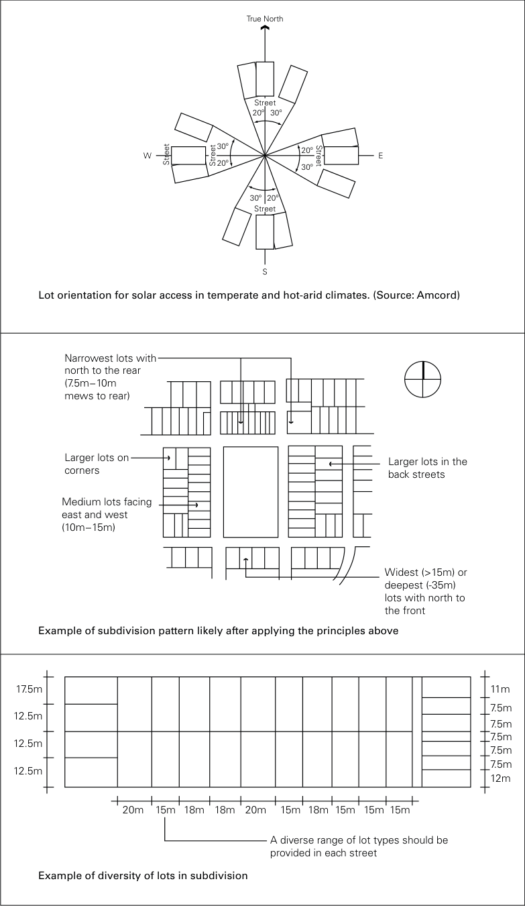

## 6 Controls

Non-residential development

a) DAs/PAs for all non-residential development must be accompanied by a waste management plan that addresses:

• best practice recycling and reuse of construction and demolition materials,

• use of sustainable building materials that can be reused or recycled at the end of their lives,

• handling methods and waste storage area locations such that handling and storage has no negative impact on the streetscape, building presentation or, amenity of occupants and pedestrians,

• procedures for the on-going sustainable management of green and putrescible waste, garbage, glass, containers and paper including, estimated volumes, required bin capacity and on-site storage requirements.

The waste management plan is to be prepared by a specialist waste consultant and is subject to approval by the consent authority.

Residential development

a) In developments not exceeding four dwellings, individual waste storage facilities may be permitted.

b) In development of more than six dwellings or, where the topography or distance to the street collection point makes access diffi cult for individual occupants, a collection and storage area is required. The storage area must be located in a position which is:

• not visible from the street,

• easily accessible to dwelling occupants,

• accessible by collection vehicles or adequately managed by the owners’ corporation to permit removal of bins to an approved collection point,

• has water and drainage facilities for cleaning and maintenance; and

• does not immediately adjoin private open space, windows or clothes drying areas.

c) Subject to Council’s collection policy, common garbage storage areas must be sized to accommodate either the number of individual bins required or a suffi cient number of larger bins of minimum dimensions as required by Council.

d) The size and number of the waste bins shall be determined having regard to the need for either, on-site access by collection vehicles or, the requirement for bins to be wheeled to the street for collection by a contractor. If transferred to the street for collection, the owners’ corporation or, a caretaker must be responsible for the movement of bins to the collection point.

The controls in this section relate to detached, semi-detached and multi-unit dwellings.

### Residential Development Controls

### 7.1 NEIGHBOURHOOD AND SUBDIVISION DESIGN

Objectives

• To establish a clear urban structure that maximises the ‘sense of neighbourhood’ and encourages walking and cycling over private car use.

• To establish a subdivision layout that utilises the residential development areas effi ciently, maximises the natural attributes of the site and clearly defi nes and reinforces the public domain.

• To ensure that all residential lots are afforded a high level of amenity in terms of solar access, views/ outlook and/or proximity to public and community facilities and parks.

• To provide a range of densities, lot sizes and house types to foster a diverse community and interesting streetscapes.

Controls

a) Residential neighbourhoods to have a mixture of lot sizes as shown in the examples in Figure 7.1.

b) Subdivision layout is to create a legible and permeable street hierarchy that responds to the natural site topography, the location of existing signifi cant trees and solar design principles.

c) Pedestrian connectivity within each residential neighbourhood is to be provided between the residential areas and public open space areas, public transport nodes, education and community/ recreation facilities.

d) Street blocks are to be generally a maximum of 250m long. Block lengths and widths are to be provided generally in accordance with the principles in Figure 7.1.

e) Lot orientation and confi guration is to be generally consistent with the subdivision principles shown at Figure 7.1. The preferred lot orientation is either on a north-south or east-west orientation as per Figure 7.1). Where other amenities such as views and outlook over open space are available, an alternative lot orientation can be considered.

f) The minimum lot size for standard dwelling lots is 250m2. The minimum depth of a lot is 17m.

g) Lots smaller than 250m2 are to be accompanied by plans for the proposed dwellings on these lots

(ie. an Integrated Development Application) to demonstrate that dwellings can be located in these lots to comply with the controls in this DCP .

### Residential Development Controls

> [Picture on page 74: a map, saved as a picture (images/ch-04-01-warnervale-town-centre-page-74-2.gif, 150 dpi); the street names and other small labels are on the picture.]
> Words printed on the picture (title and legend, copied from the PDF):
> Lot orientation for solar access in temperate and hot-arid climates. (Source: Amcord)
> Narrowest lots with
> north to the rear
> mews to rear)
> Larger lots on
> Larger lots in the
> Medium lots facing
> east and west
> Widest (>15m) or
> lots with north to
> Example of subdivision pattern likely after applying the principles above
> 20m 15m 18m 18m 20m 15m 15m 15m 15m
> A diverse range of lot types should be
> provided in each street
> Example of diversity of lots in subdivision

FIGURE 7.1 SUBDIVISION, LOT ORIENTATION AND LOT FRONTAGE VARIATION PRINCIPLES

### Explanatory Notes
