# Central Coast Development Control Plan 2022 - Chapter 4.1 Warnervale Town Centre

> This chapter is split into 2 section file(s), one per numbered heading, in the order they appear in the PDF.

Source PDF: [4.1_Warnervale-Town-Centre.pdf](https://planfortomorrow.sharepoint.com/sites/Planfortomorrow/Shared%20Documents/00%20NSW-Planning-Resources/dcp/central-coast-development-control-plan-2022/ch-04-01-warnervale-town-centre/4.1_Warnervale-Town-Centre.pdf)

### WARNERVALE TOWN CENTRE

### DEVELOPMENT CONTROL PLAN 2012

Warnervale Town Centre Development Control Plan ISBN 978 0 7347 5980 1

NSW Department of Planning and Infrastructure 2012 www.planning.nsw.gov.au

Disclaimer While every reasonable effort has been made to ensure that this document is correct at the time of printing, the State of New South Wales, its agents and employees, disclaim any and all liability to any person in respect of anything or the consequences of anything done or omitted to be done in reliance upon the whole or any part of this document.

Coloured Drawings by Tim Throsby

### Contents

1 INTRODUCTION

4 5.8 Mixed Use Buildings

### 1.1 Purpose

### 5.9 Residential Flat Buildings and Shop Top Housing

### 1.2 Name of Plan and Commencement

### 5.10 Planting on Structures

### 1.3 Land and Development Covered by this Plan

### 5.11 Site Facilities and Services

### 1.4 Relationship with Other Planning Documents

6   ENVIRONMENTAL MANAGEMENT 56

### 1.5 The Consent Authority

### 6.1 Water Consumption

### 1.6 Explanatory Notes

### 1.7 Monitoring and Review

### 6.2 Integrated Water Cycle Management & Water

Sensitive Urban Design

### 6.3 Riparian Corridors

2\. OVERVIEW

6

### 6.4 Tree Retention and Biodiversity

### 2.1 Regional Context

### 6.5 Bushfi re Hazard Management

### 2.2 Vision

### 6.6 Contamination Management

### 2.3 Character Precincts

### 6.7  Retaining Walls and Earthworks

### 2.4 Development Targets

### 6.8 Soils

3\. TRAFFIC AND MOVEMENT

15

### 6.8 Acoustics

### 3.1 Traffi c Management

### 6.10 Waste and Recycling

### 3.2 Street Hierarchy and Design

7 RESIDENTIAL DEVELOPMENT CONTROLS 71

### 3.3 Landscaping in the Road Reserve

### 7.1  Neighbourhood and Subdivision Design

### 3.4. Vehicles Footpath Crossings

### 3.5. Driveways and Manoeuvring Areas

### 3.6. On Site Parking

### 3.7. Pedestrian and Cycle Network

### 3.8. Pedestrian Amenity

### 3.9. Safety and Security

### 3.10. Equitable Access and Mobility

### 3.11. Public Transport

### 3.12. Transport Interchange

4\. PUBLIC OPEN SPACE

40

### 4.1 Design and Landscaping

### 4.2 Landscape Strategy and Design

5 BUILDING FORM

44

### 5.1 Active Street Frontages

### 5.2. Civic Square

### 5.3. Building Alignment/Street Setbacks

### 5.4. Street Frontage Heights

### 5.5. Awnings

### 5.6. Building Exteriors

### 5.7 Refl ectivity

> The PDF's contents list (page numbers of the printed document) is not repeated here - see Sections below.

### Page Intentionally Left Blank

### Introduction

### 1.1 PURPOSE

This Development Control Plan (DCP) has been prepared in accordance with Part 3, Division 6 of the Environmental Planning and Assessment Act 1979 (the Act), and Part 3 of the Environmental Planning and Assessment Regulation 2000. The DCP provides more detailed provisions to expand upon the relevant provisions of the Wyong Local Environmental Plan 1991 for development of the Warnervale Town Centre (WTC) Site. Under Section 79C of the Act, the consent authority is required to take into consideration the relevant provisions of this DCP in determining an application for development of the WTC. Variations to the controls in this DCP will be considered on merit, subject to justifications being provided in a Development Application for the departure from the controls, and demonstration that the impacts will be adequately managed.

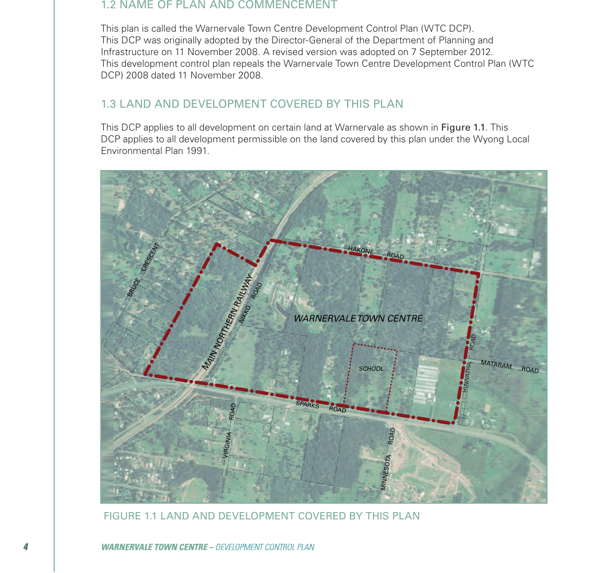

> [Picture on page 6: a map, saved as a picture (images/ch-04-01-warnervale-town-centre-page-6-13.gif, 150 dpi); the street names and other small labels are on the picture.]
> Words printed on the picture (title and legend, copied from the PDF):
> WARNERVALE TOWN CENTRE
> IN NORTHERN RAILWAY

### 1.2 NAME OF PLAN AND COMMENCEMENT

This plan is called the Warnervale Town Centre Development Control Plan (WTC DCP). This DCP was originally adopted by the Director-General of the Department of Planning and Infrastructure on 11 November 2008. A revised version was adopted on 7 September 2012. This development control plan repeals the Warnervale Town Centre Development Control Plan (WTC DCP) 2008 dated 11 November 2008.

### 1.3 LAND AND DEVELOPMENT COVERED BY THIS PLAN

This DCP applies to all development on certain land at Warnervale as shown in Figure 1.1. This DCP applies to all development permissible on the land covered by this plan under the Wyong Local Environmental Plan 1991.

FIGURE 1.1 LAND AND DEVELOPMENT COVERED BY THIS PLAN

### 1.4 RELATIONSHIP WITH OTHER PLANNING DOCUMENTS

This DCP should be read in conjunction with the relevant provisions of the Wyong Local Environmental Plan 1991 and other relevant state planning policies. This DCP should also be read in conjunction with relevant policies and chapters of Wyong Shire DCP 2005 (see Section 8.5). In the event of any inconsistency between this DCP and any other DCP or policy of council, this DCP will prevail.

State Environmental Planning Policies (SEPPs) apply to the WTC, where relevant.

The NSW Government’s State Plan and Metropolitan Strategy and the Central Coast Regional Strategy 2006-31 provide the strategic planning framework and context to this DCP.

### 1.5 THE CONSENT AUTHORITY

Wyong Shire Council is the consent authority for all development on the WTC, except for State signifi cant development (SSD) and State signifi cant infrastructure (SSI), as provided under State Environmental Planning Policy (State and Regional Development) 2011 (the SEPP).

Projects that fall into these categories will be assessed by the Department of Planning and Infrastructure.

Projects will only be assessed as SSD if they meet or exceed a specifi ed threshold. The SEPP has identifi ed that development for retail premises having a fl oor space area of more than 5,000 square metres and a Capital Investment Value of more than $10 million at Warnervale Town Centre will be assessed under the SSD system.

Compliance with the provisions of this DCP does not necessarily guarantee that consent will be granted to a Development Application (DA). Every DA will be assessed with regard to the aims and objectives of the Act, other matters listed in section 79C of the Act, this DCP, and any other relevant and applicable policies adopted by the consent authority.

### 1.6 EXPLANATORY NOTES

Terms used in this DCP are defi ned in the Wyong Local Environmental Plan 1991 and in the Glossary in Section 8 of this DCP. Section 8 also provides guidance to applicants on the lodgement of DAs. Further advice on lodgement procedures can be obtained from Council, additional explanatory notes and policies issued by Council, and from the Department of Planning and Infrastructure.

### 1.7 MONITORING AND REVIEW

Wyong Shire Council is required to keep the LEP provisions and DCP under regular and periodic review under Section 73 of the Act. Wyong Shire Council is committed to this process to ensure that the Plans continue to be useful and relevant. Wyong Shire Council will review the LEP provisions and DCP every fi ve years to ensure the objects of the Act are achieved to the maximum extent possible, having regard to relevant changing circumstances.

### Overview

### 2.1 REGIONAL CONTEXT

The Central Coast Regional Strategy recognises the regional signifi cance of the Warnervale Town Centre as a new retail, commercial and community growth centre to be developed over the next 25 years.

The WTC is located 5 km north of Wyong in the Wyong Local Government Area. It straddles the northern regional rail corridor and is approximately 1km east of the Wyong Employment Zone. It is bound by Hiawatha, Hakone and Sparks Roads and east of Bruce Crescent.

The WTC is 119 hectares and will service a broader future catchment of approximately 40,000 residents. It will accommodate between 6,000 residents and offer jobs, diverse community facilities, retail and commercial uses and public transport.

The WTC location plan is shown in Figure 2.1.

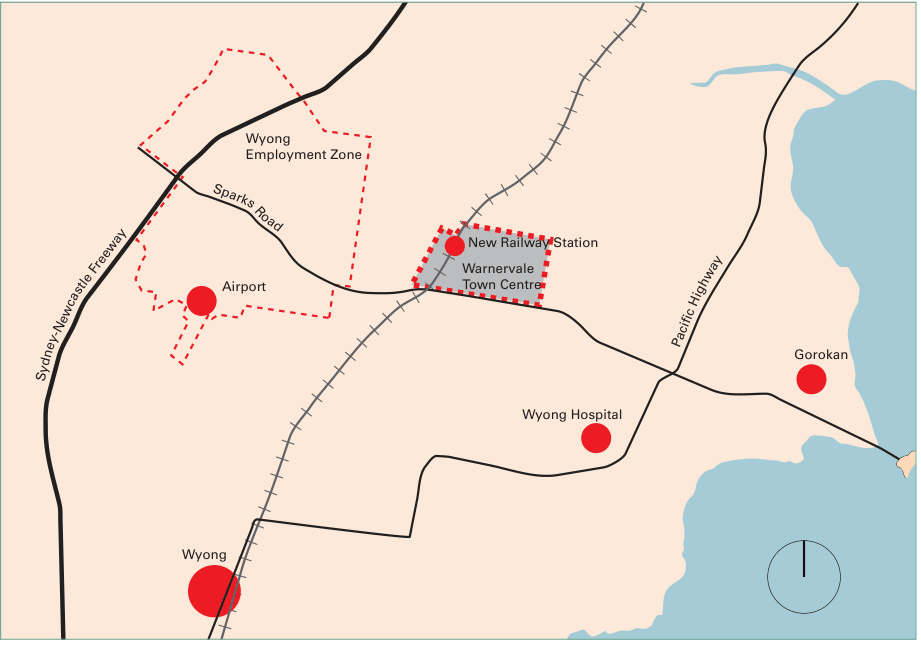

> [Picture on page 8: a map, saved as a picture (images/ch-04-01-warnervale-town-centre-page-8-12.gif, 150 dpi); the street names and other small labels are on the picture.]
> Words printed on the picture (title and legend, copied from the PDF):
> New Railway Station

FIGURE 2.1 TOWN CENTRE LOCATION

### 2.2 VISION

The WTC will be a compact, well connected, high quality urban area linked to the new North Warnervale railway station, encouraging use of public transport and pedestrian activity.

A Town Centre Civic Precinct complementing the railway station will provide a range of retail, commercial, and community facilities.

A broad range of dwelling types will be provided across the WTC site to provide for different household needs and higher housing densities than those traditionally delivered in Wyong Shire.

The site will retain or enhance its vegetated and natural characteristics, offering a high quality living environment. Large areas of open space will be provided, including Hill Top Park.

Key objectives are:

• To create a vibrant, pleasant safe town centre with housing, jobs, services, community facilities and entertainment for residents and visitors.

• To achieve a high standard public domain and architectural design quality.

• Integrate community facilities with the town centre.

• Encourage the use of walking, cycling and buses.

• Provide comfortable access grades throughout the town centre to ensure equity in accessibility.

• Provide a built form in a treed setting and refl ect the topography and environmental and visual features.

• To facilitate urban development that achieves highest environmental sustainability objectives.

• To provide a variety of housing types to cater for different household types and demographics, and improve affordability.

• Provide housing with a high standard of residential amenity.

• Promote recreation opportunities.

• Protect and enhance riparian corridors, nature conservation areas, signifi cant trees and local vegetation.

### 2Overview

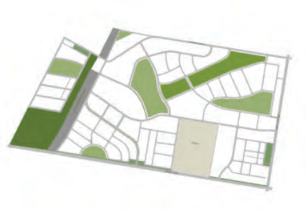

> [Picture on page 10: a picture, saved as a picture (images/ch-04-01-warnervale-town-centre-page-10-2.gif, 150 dpi).]

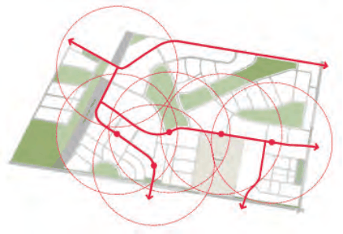

> [Picture on page 10: a picture, saved as a picture (images/ch-04-01-warnervale-town-centre-page-10-3.gif, 150 dpi).]

Figure 2.3: Protection of the environment Protected riparian corridors, nature conservation areas and habitat trees will contribute to the landscape character of the WTC.

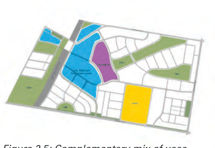

> [Picture on page 10: a picture, saved as a picture (images/ch-04-01-warnervale-town-centre-page-10-8.gif, 150 dpi).]

Figure 2.2: Well connected The WTC will be serviced by a new railway station and bus routes to surrounding districts The permeable street layout will promote walking to local services and attractions.

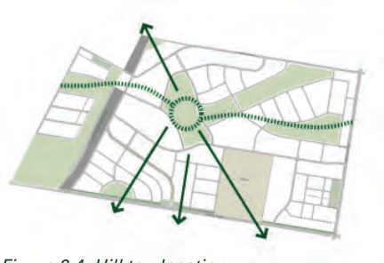

> [Picture on page 10: a picture, saved as a picture (images/ch-04-01-warnervale-town-centre-page-10-14.gif, 150 dpi).]

Figure 2.5: Complementary mix of uses The Town Centre will have a good provision of community, retail and entertainment facilities.

Figure 2.4: Hill top location The Town Centre Civic Precinct will be established on the elevated plateau focusing on the hill top park.

FIGURES 2.2-2.5: DESIGN PRINCIPLES

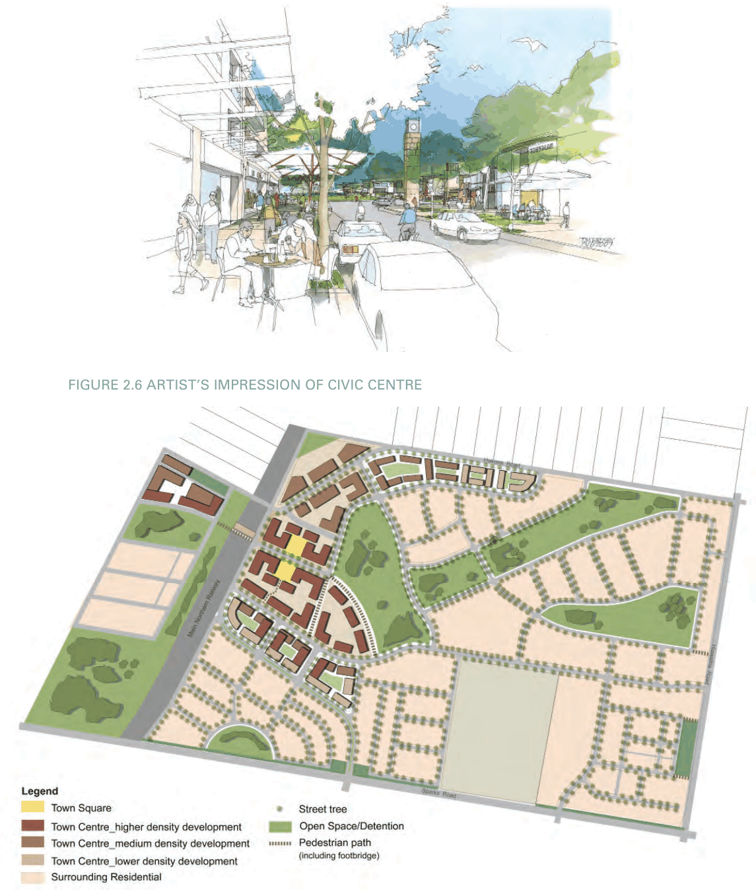

> [Picture on page 11: a picture, saved as a picture (images/ch-04-01-warnervale-town-centre-page-11-1.gif, 150 dpi).]

FIGURE 2.6 ARTIST’S IMPRESSION OF CIVIC CENTRE

FIGURE 2.7 ILLUSTRATIVE TOWN CENTRE PLAN

### 2.3 CHARACTER PRECINCTS

The WTC has the following distinct character precincts as shown in Figure 2.8:

a) Town Centre Civic and Civic Fringe Precincts

b) Town Centre Western Precinct

c) Residential Northern Precinct

d) Residential Western, Eastern and Southern Precincts

e) Open Space, Conservation Areas and Detention Basins The precinct character objectives are described below, and the controls in this DCP provide specifi c measures to reinforce the character of each precinct.

#### Town Centre Civic and Civic Fringe Precincts

The Town Centre Civic Precinct will be the heart of the Warnervale Town Centre. The focus will be on a well designed Main Street running east to west, linking the new railway station to Hill Top Park.

The Main Street will be framed by 4-6 storey mixed use buildings providing a range of retail and commercial uses with active street frontages. Pedestrian amenity will be enhanced by the provision of awnings, tree lined footpaths, and space for outdoor dining.

Community facilities are to be fully integrated with the town centre functions to optimise safety and access.

A Civic Square will be provided off Main Street providing a space for people to meet and gather.

The northern end of the town centre, on the eastern side of the rail line is favoured for bulky goods and other functions.

The Civic Fringe Precinct will allow for a mix of uses, including higher density residential dwellings, to complement the Civic Precinct and provide a transition to residential areas further south.

#### Town Centre Western Precinct

This precinct will have a range of uses and will be situated directly to the west of the proposed North Warnervale railway station. It will provide a mix of uses complementary to the Town Centre Civic Precinct. It will have its own identity focusing on the ridge top public park and small area of commercial, retail and residential development to the west of the railway station. A new bridge north of the train station will connect the Town Centre Civic Precinct to this precinct and provide direct connection to the transport interchange and commuter parking. A footbridge will connect to Main Street and the Civic Precinct. Buildings will be built to the street alignment with ground fl oor retail/commercial uses.

#### Residential Northern Precinct

The precinct has a signifi cant number of habitat trees requiring protection. This precinct will have a natural landscape character with sensitively designed residential buildings. Buildings will step down the hill from narrow local streets. Driveways will be narrow and discrete and car parking will be located within building footprints.

#### Residential Western, Eastern and Southern Precincts

The three precincts will be characterised by well designed dwellings offering diverse housing choice on landscaped streets. The precincts will be within walking distance of public transport and local parks.

#### Open space, conservation areas and detention basins

These areas encompass the Riparian Corridor, Western Ridge Park, Eastern Ridge Park, Heath Wrinklewort Environmental Conservation Reserve, Hill Top Park and other, smaller, local open space, some of which will act as stormwater detention areas.

These areas will offer recreation opportunities for local residents and the wider community. The WTC’s vegetated character including the ridgeline on the northeastern side of the school and the Heath Wrinklewort Reserve will be protected. Signifi cant habitat trees are to be retained where possible and substantial tree planting will reinforce the area’s vegetated character.

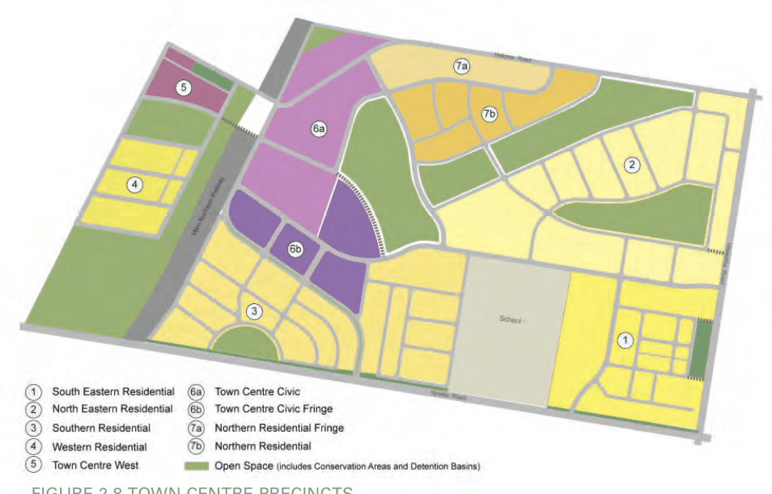

> [Picture on page 13: a picture, saved as a picture (images/ch-04-01-warnervale-town-centre-page-13-9.gif, 150 dpi).]

FIGURE 2.8 TOWN CENTRE PRECINCTS

### 2.4 DEVELOPMENT TARGETS

#### Residential Density

The population target for the WTC is 4,200 people and 1,646 dwellings. A mix of housing types and forms are to be provided across the WTC.

Objectives

• To provide appropriate densities in proximity to the Town Centre Civic Precinct and railway station in order to promote walking and cycling.

• To ensure the residential density targets identifi ed in the NSW Government’s Metropolitan Development Program and confi rmed in the Central Coast Regional Strategy 2006-31 are achieved.

• To provide a range of residential development densities and types including housing for seniors or people with a disability, to cater for changing demographics.

Controls

a) In order to ensure the population target is achieved, applicants are required to demonstrate to the consent authority (as part of a subdivision or development application), that the density targets shown in Table 1 will be achieved.

b) Where variation to the density target is proposed, an applicant is to demonstrate to the consent authority that those targets can be achieved on a per hectare basis, as a minimum.

a) The net residential densities for mixed use, medium and low density housing, and the indicative % target for each housing form and each precinct at Table 1.

#### Table 1: Net Residential Density Targets

#### No. of  lots/dwellings

| Precinct | Single | Attached | Apartment | Total |
|---|---|---|---|---|
| 1* | 120 | 10 | 0 | 130 |
| 2 | 200 | 110 | 0 | 310 |
| 3 | 270 | 0 | 0 | 270 |
| 4 | 85 | 40 | 0 | 125 |
| 5 | 0 | 0 | 44 | 44 |
| 6a |  |  | 376 | 376 |
| 6b |  | 56 | 104 | 160 |
| 7a |  |  | 136 | 136 |
| 7b | 95 | 0 | 0 | 95 |
| Total | 770 | 216 | 660 | 1646 |

\*excludes 1.3ha Medical Centre

#### Retail, business and bulky goods uses

Objectives

• To provide a range of retail, business, bulky goods and support uses to service the needs of people living, working and visiting the town centre, as well as the broader Warnervale area.

• To provide an impetus for the relocation of Warnervale railway station to the north of Sparks Road to provide an integrated public transport interchange for the North Wyong release areas.

• To maximise public transport access to the WTC.

#### Employment

Objectives

• To provide new jobs in a concentration of retail, community, entertainment, health and professional services servicing the local and broader population.

• To facilitate the achievement of the NSW Government’s regional centres and employment hierarchy.

Controls

a) Provide services including supermarkets, discount department store, shops, child care centres, schools, community facilities, banks, library, professional services, and medical centres.

b) Provide details with DAs (over $5 million and 1,000 m2) on the number and type of employment (operational and construction) to be generated.

#### Community Facilities

Objectives

• To provide a range of community facilities in locations accessible to residential areas and public transport.

• To provide a range of community facilities appropriate to the needs and demographics of the local population.

Controls

Community facilities including a library, community centre and cultural space are to be provided on the WTC site. The preferred location is within the Town Centre Civic or Civic Fringe Precincts.

#### Open Space

Objectives

• To provide a variety of open spaces to cater for a range of recreational, social and cultural activities.

• To develop designs for open spaces in recognition of their different functions, characteristics and environmental and natural qualities of the WTC.

Controls

a) Public open space to be provided include the following:

• Local parks (including Hill Top Park): 13ha

• Heath Wrinklewort Daisy Reserve: 8.4ha

• Riparian corridor: 5.7ha

• Civic Square: up to 2,700m2

b) Wyong Council’s Public Domain Plan is to be used for detailed design for parks, riparian corridors and environmental conservation areas.

### Traffi c and Movement

This section contains the objectives and development controls relating to the street network, street design standards, the pedestrian and cycleway network, and the public transport network.

### 3.1 REGIONAL TRAFFIC

Warnervale Town Centre will provide a major node for regional traffi c, this will generally occur via Hakone Road, Town Centre Entry Road and Sparks Road.

Links are also anticipated to the west (Warnervale Employment Zone) - for commercial purposes. The main traffi c generation occurs from the south and south-east regions, particularly private vehicles.

### 3.2 STREET HIERARCHY AND DESIGN

Objectives

• To provide a hierarchy of interconnected streets for safe, convenient, functional and legible access within and beyond the WTC.

• To ensure a hierarchy of streets clearly discernible through variations in carriageway width, on-street parking, incorporation of water sensitive urban design, street tree planting, pedestrian and cycling amenities.

• To provide comfortable gradients to ensure equitable access to residents and visitors.

• To retain views and vistas to landscape features and visual connections to nodal points and centres.

• To ensure street design and character responds to existing environmental conditions including signifi cant vegetation, topography and views.

• To minimise the need for cut and fi ll to assist in reducing subsoil and natural subsoil drainage disturbance.

• To optimise solar access opportunities for dwellings.

Controls

a) The street network is to be provided generally in accordance with the street hierarchy map at Figure 3.1 and street types map at Figure 3.2. First and second tier streets are required as shown. Variations to third tier streets are subject to consent of Council.

b) Street design is to be provided to generally refl ect the cross-sections shown in Figures 3.3–3.15. Widening of roads may be required at intersections, curves, for utility services etc.

c) Design all residential streets (minor collector roads, access road/places, and minor access road/ places) for 50km/h maximum. Applicants should consider traffi c management in a subdivision application by either, road layout or appropriate speed reducing devices to reduce traffi c speed.

d) Any proposal for street tree planting within a road carriageway is to be in accordance with section

3.3 of this DCP, and include:

• detailed design addressing access and manoeuvrability of articulated vehicles, service vehicles street sweepers and cars;

• consideration of safety for motorists, cyclists and pedestrians;

• the impact of the root system on the carriageway;

• ongoing maintenance of trees and carriageway; and

• the relationship with future driveway access points.

e) Footpaths are to be provided with a minimum width of 1.5m, and are to be setback 1m from the carriageway and 450mm from property boundaries.

f) Street lighting is to comply with the relevant standards.

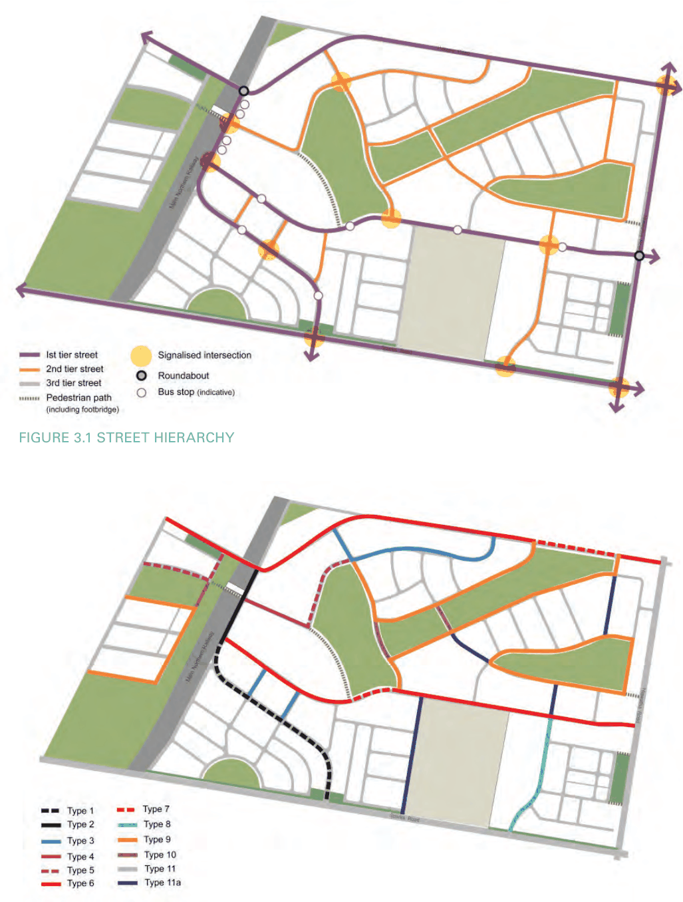

> [Picture on page 18: a picture, saved as a picture (images/ch-04-01-warnervale-town-centre-page-18-1.gif, 150 dpi).]

FIGURE 3.1 STREET HIERARCHY

FIGURE 3.2 STREET TYPES

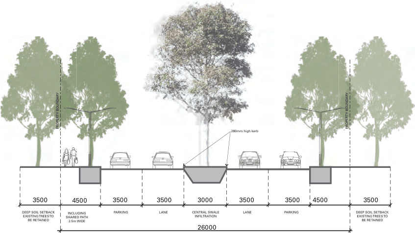

> [Picture on page 19: a map, saved as a picture (images/ch-04-01-warnervale-town-centre-page-19-1.gif, 150 dpi); the street names and other small labels are on the picture.]
> Words printed on the picture (title and legend, copied from the PDF):
> 280mm high kerb
> 3500 3500 4500 3500
> 4500 3500 3500 3000
> DEEP SOIL SETBACK
> DEEP SOIL SETBACK
> EXISTING TREES TO
> EXISTING TREES TO

LOOKING NORTH

NOTE: LANES WILL REQUIRE WIDENING ON CURVES TO SUIT LARGEST DELIVERY VEHICLE

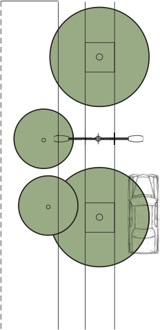

> [Picture on page 19: a picture, saved as a picture (images/ch-04-01-warnervale-town-centre-page-19-4.gif, 150 dpi).]

FIGURE 3.3 TYPE 1: TOWN CENTRE ENTRY STREET

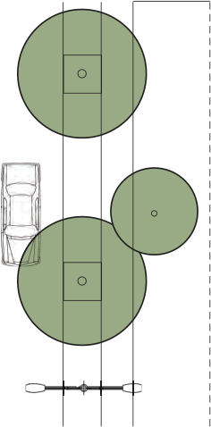

> [Picture on page 19: a picture, saved as a picture (images/ch-04-01-warnervale-town-centre-page-19-6.gif, 150 dpi).]

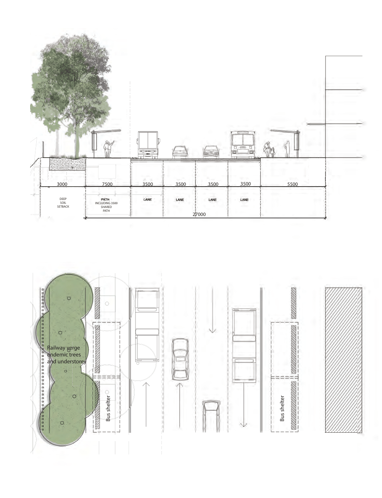

> [Picture on page 20: a map, saved as a picture (images/ch-04-01-warnervale-town-centre-page-20-1.gif, 150 dpi); the street names and other small labels are on the picture.]
> Words printed on the picture (title and legend, copied from the PDF):
> mm high kerb
> 280mm high kerb
> 3500 3500 3500
> 3600 3600 1800 1650 3500
> 3 0 1800 1650 3500
> A I G KERB
> KERB PATH & DEEP SOIL SETBACK
> DEEP SOIL SE
> GUTTER SHARED EXISTING TREES TO
> EXISTING TREES TO
> SERVICES BE RETAINED

FIGURE 3.4 TYPE 2: TRANSPORT INTERCHANGE

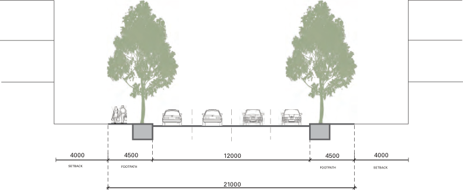

> [Picture on page 21: a picture, saved as a picture (images/ch-04-01-warnervale-town-centre-page-21-1.gif, 150 dpi).]
> Words printed on the picture (title and legend, copied from the PDF):
> 4000
> 4000
> 12000
> 4500
> 4500
> SETBACK FOOTPATH
> FOOTPATH SETBACK
> 21000

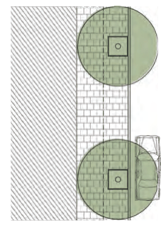

> [Picture on page 21: a picture, saved as a picture (images/ch-04-01-warnervale-town-centre-page-21-2.gif, 150 dpi).]

FIGURE 3.5 TYPE 3: MIXED USE/COMMERCIAL STREET

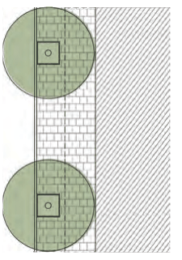

> [Picture on page 21: a picture, saved as a picture (images/ch-04-01-warnervale-town-centre-page-21-4.gif, 150 dpi).]

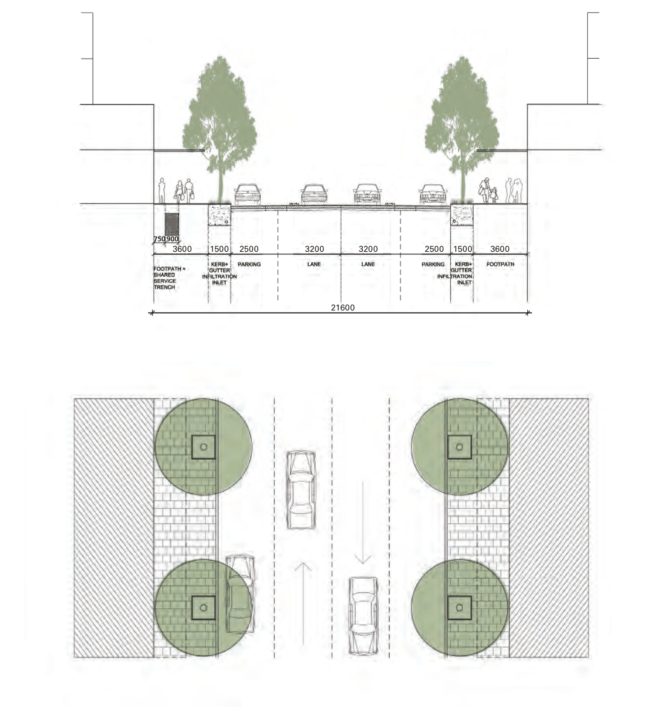

> [Picture on page 22: a map, saved as a picture (images/ch-04-01-warnervale-town-centre-page-22-1.gif, 150 dpi); the street names and other small labels are on the picture.]

FIGURE 3.6 TYPE 4: TOWN CENTRE MAIN STREET

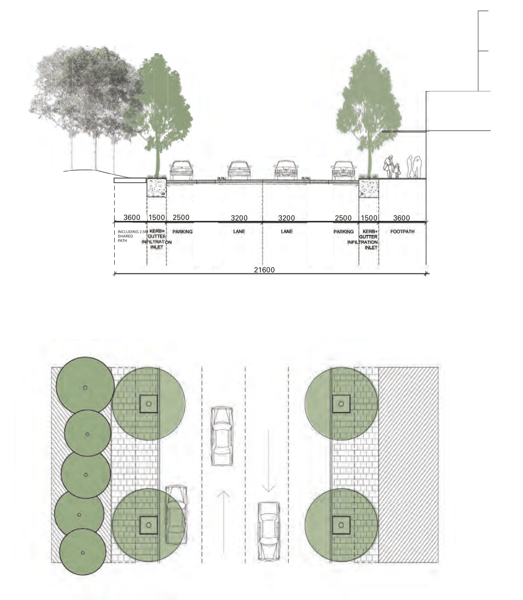

> [Picture on page 23: a map, saved as a picture (images/ch-04-01-warnervale-town-centre-page-23-1.gif, 150 dpi); the street names and other small labels are on the picture.]

FIGURE 3.7 TYPE 5: TOWN CENTRE PARK EDGE STREET

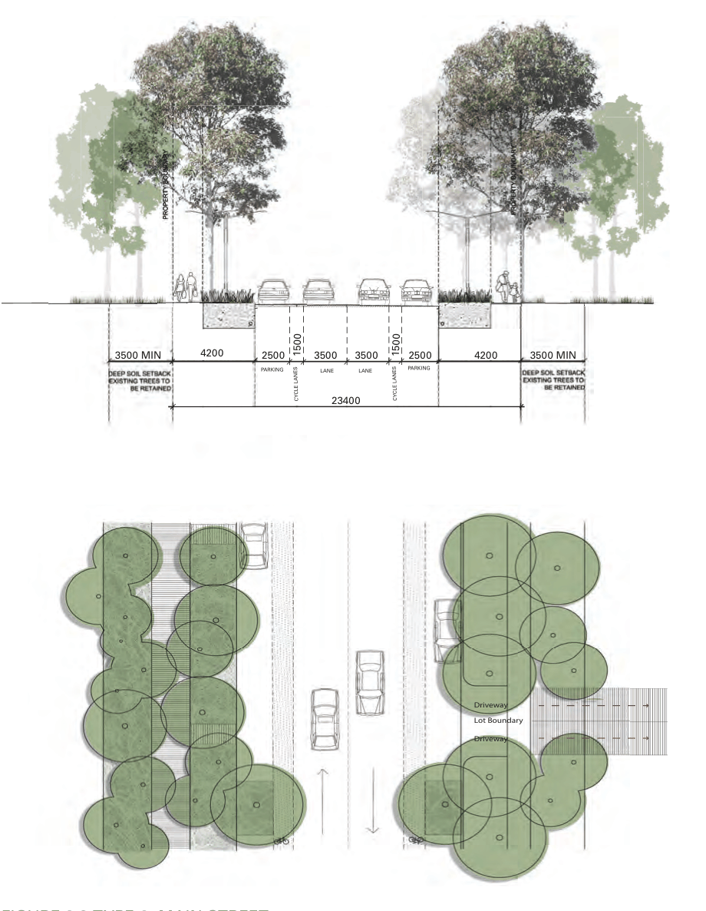

> [Picture on page 24: a map, saved as a picture (images/ch-04-01-warnervale-town-centre-page-24-1.gif, 150 dpi); the street names and other small labels are on the picture.]
> Words printed on the picture (title and legend, copied from the PDF):
> 3500 MIN 4200

FIGURE 3.8 TYPE 6: MAIN STREET

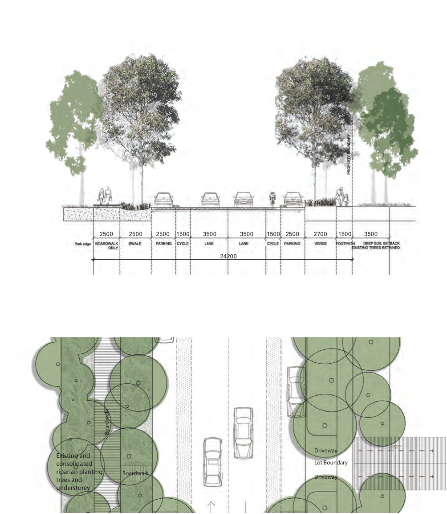

> [Picture on page 25: a map, saved as a picture (images/ch-04-01-warnervale-town-centre-page-25-1.gif, 150 dpi); the street names and other small labels are on the picture.]

FIGURE 3.9 TYPE 7: PARK EDGE STREET

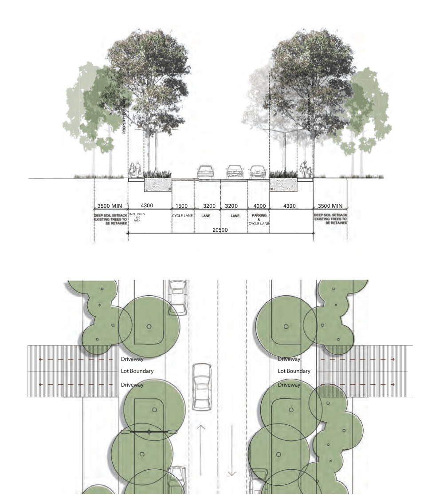

> [Picture on page 26: a map, saved as a picture (images/ch-04-01-warnervale-town-centre-page-26-1.gif, 150 dpi); the street names and other small labels are on the picture.]
> Words printed on the picture (title and legend, copied from the PDF):
> 3500 MIN 4300
> INCLUDING CYCLE LANE

FIGURE 3.10 TYPE 8 CONNECTOR STREET

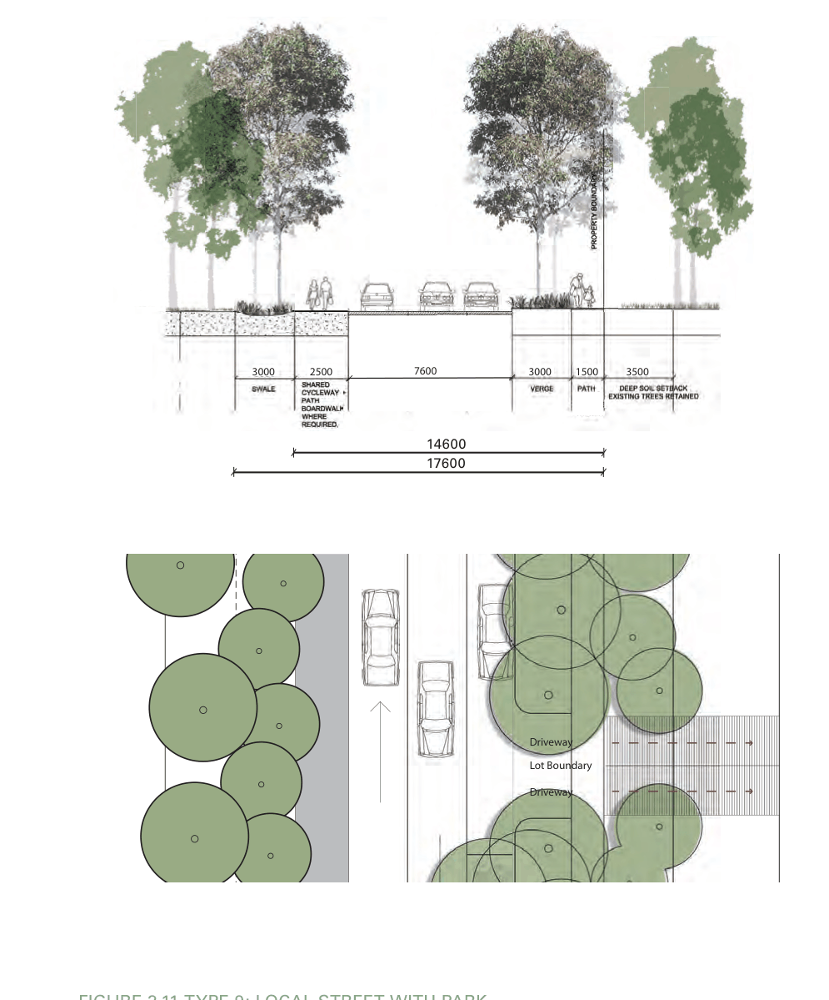

> [Picture on page 27: a map, saved as a picture (images/ch-04-01-warnervale-town-centre-page-27-1.gif, 150 dpi); the street names and other small labels are on the picture.]

FIGURE 3.11 TYPE 9: LOCAL STREET WITH PARK

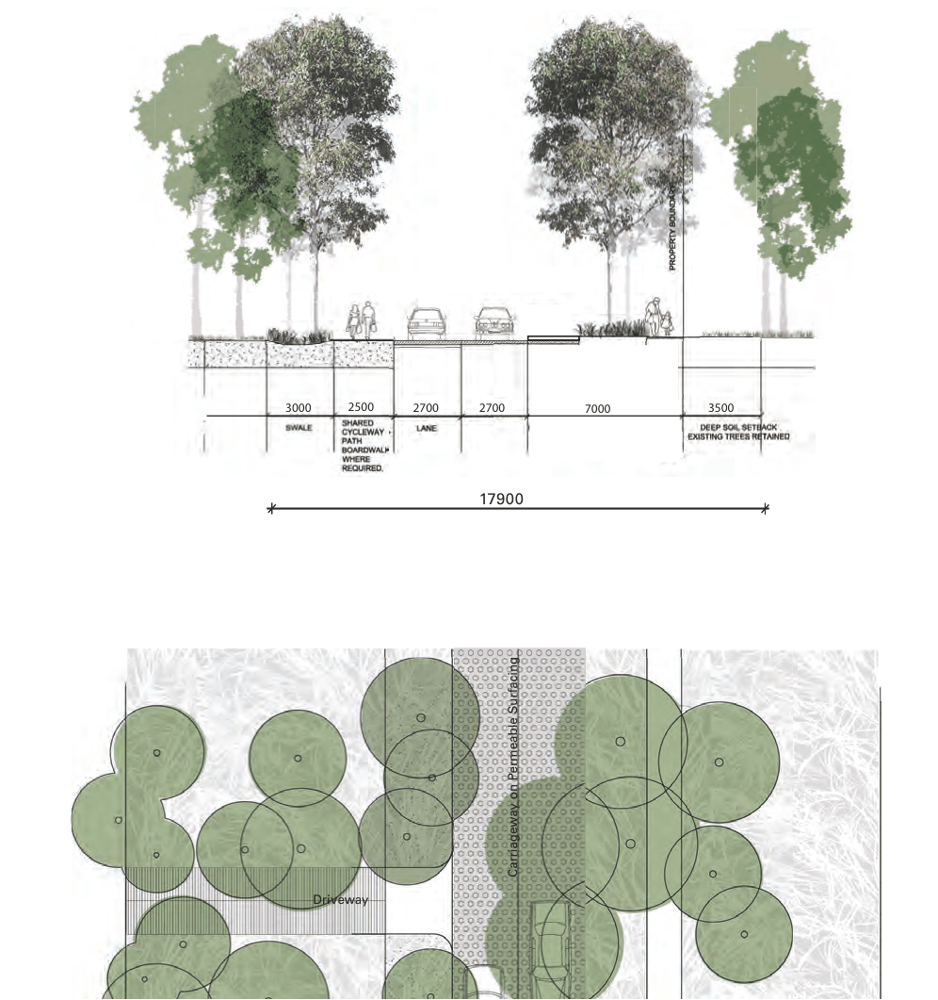

> [Picture on page 28: a map, saved as a picture (images/ch-04-01-warnervale-town-centre-page-28-1.gif, 150 dpi); the street names and other small labels are on the picture.]

> Words printed on the picture (title and legend, copied from the PDF):
> Carriageway on Permeable Surfacing

FIGURE 3.12 TYPE 10 FOREST STREET

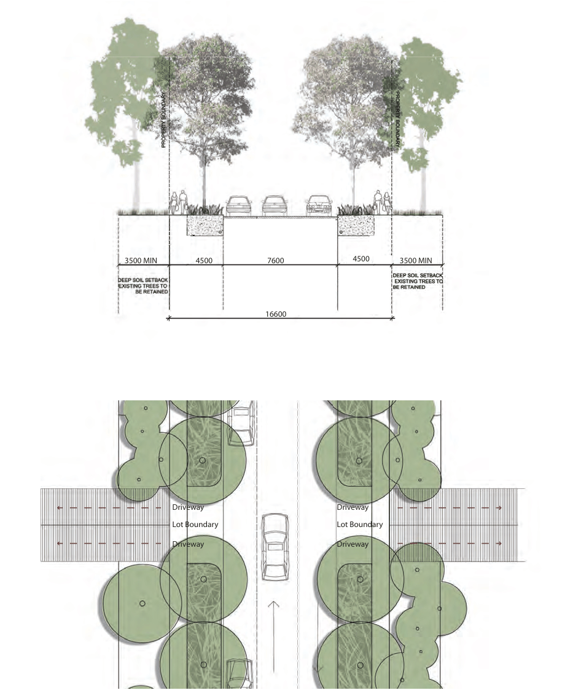

> [Picture on page 29: a map, saved as a picture (images/ch-04-01-warnervale-town-centre-page-29-1.gif, 150 dpi); the street names and other small labels are on the picture.]

FIGURE 3.13 TYPE 11: LOCAL STREET

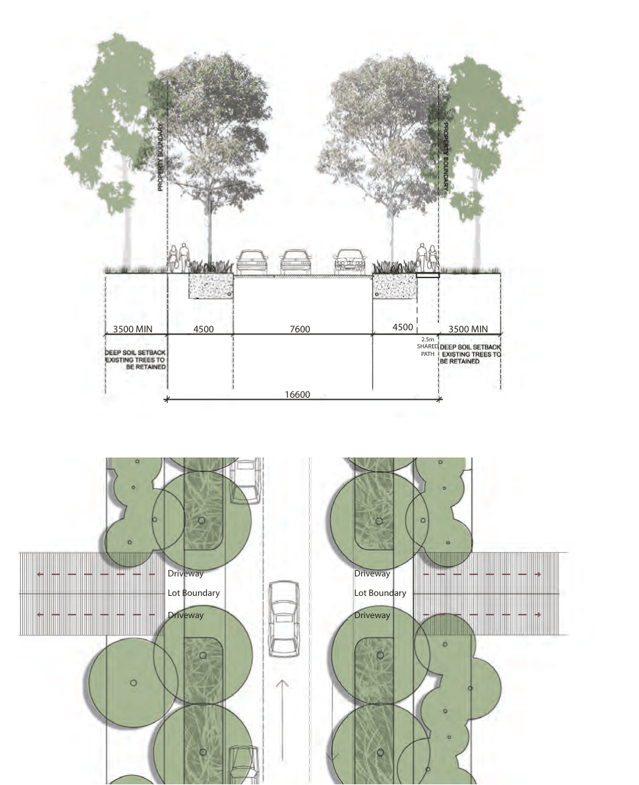

> [Picture on page 30: a map, saved as a picture (images/ch-04-01-warnervale-town-centre-page-30-1.gif, 150 dpi); the street names and other small labels are on the picture.]

FIGURE 3.14 TYPE 11A: LOCAL STREET WITH SHARED PATH

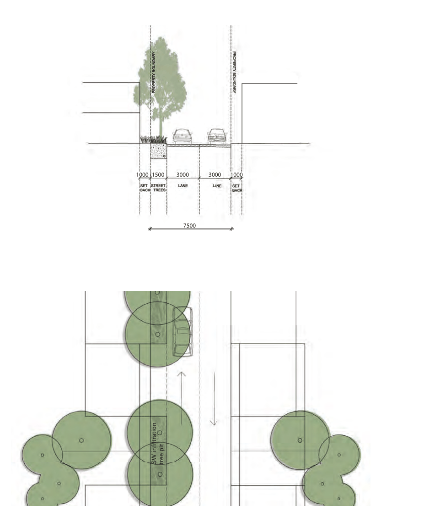

> [Picture on page 31: a picture, saved as a picture (images/ch-04-01-warnervale-town-centre-page-31-1.gif, 150 dpi).]
> Words printed on the picture (title and legend, copied from the PDF):
> 1000
> 1000
> 3000
> 3000
> 3000
> 3000
> 3000
> 1500
> 7500

> Words printed on the picture (title and legend, copied from the PDF):
> SW infiltration tree pit

FIGURE 3.15 TYPE 12: LANE

### 3.3 LANDSCAPING IN THE ROAD RESERVE

Objectives

• To integrate with the biodiversity values of the WTC.

• To contribute to high quality streetscapes.

• To consider public safety in the provision of landscaping.

• To consider stormwater drainage impacts.

• To ensure landscaping is considered at the development planning stage.

Controls

a) Provide street tree plantings in locations identifi ed in Figure 3.16 and in accordance with Figure 3.16.

b) Provide landscaping that:

• Distinguishes between public and private spaces and between different streets within the street hierarchy.

• Minimises the risk to utilities and services.

• Is durable and suited to the street environment.

• Maintains adequate sight lines for vehicles and pedestrians, especially at driveways and intersections.

• Does not obscure street lighting, or traffi c signals, or overhang the road carriageway so as to interfere with vehicles.

• Provides appropriate shade.

• Provides an attractive and interesting landscape character.

c) Landscaping details are to submitted with proposals for road construction and include the following:

• General layout of planting locations.

• Earthworks.

• Plant specifi es and sizes (at time of planting and at maturity).

• Vehicles, cyclist and pedestrian safety.

• Relationship to utilities and services.

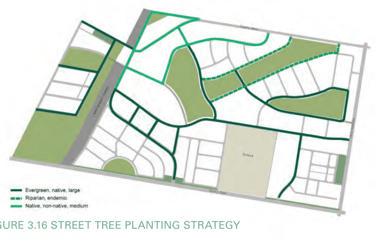

> [Picture on page 32: a picture, saved as a picture (images/ch-04-01-warnervale-town-centre-page-32-27.gif, 150 dpi).]

FIGURE 3.16 STREET TREE PLANTING STRATEGY

#### Key endemic vegetation communities

1\. Alluvial Floodplain Shrub Swamp Forest Narrabeen Blackbutt Shrubby Forest Narrabeen Buttonderry Footslopes Forest Dooralong Spotted Gum - Ironbark Forest

2.

#### Local streets + medians East West Streets Ridge Roads

Evergreen species, endemic to area, high canopy and dappled light

a

t

a

l

u

c

a

m

a

i

b

m

y

r

o

C

f

o

g

n

it

n

a

l

p

e

u

n

e

v

A

s

m

u

G

d

e

tt

o

p

S

f

o

e

v

o

r

G

Eucalyptus robusta

Suggested species Botanical Name

Common Name

Corymbia maculata

Spotted Gum

Eucalyptus paniculata subsp paniculata Grey Iron Bark Eucalyptus sideropholia Eucalyptus umbra

Broad leaved Mahogany

Eucalyptus teriticornis Forest red gum Eucalyptus citriodora

Lemon scented Gum

Eucalyptus robusta

Swamp Mahongany

Melaleuca quinquenervia Broad-leaved Paperbark

3.

#### Local streets Lanes

Narrow habit, evergreen, Native and non endemic species

Tristaniopsis laurina Backhousia citriodora

Eleocarpus reticulatus Tristaniopsis laurina

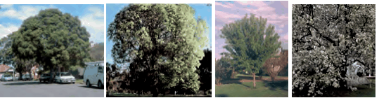

> [Picture on page 33: a picture, saved as a picture (images/ch-04-01-warnervale-town-centre-page-33-82.gif, 150 dpi).]

Suggested species Botanical Name

Common Name

Eleocarpus reticulatus Eleocarpus eummundi Tristania laurina Backhousia citriodora Backhousia myrtifolia Eucalyptus citriodora

Lemon scented Gum

4.

#### Main streets Nikko Street Commercial streets

Medium scaled trees, mix native + non native species, foliage or fl ower, hardy

Pyrus sp. Pyrus sp.

Lophostemon confertus Flindersia australis

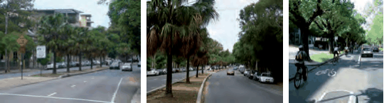

> [Picture on page 33: a picture, saved as a picture (images/ch-04-01-warnervale-town-centre-page-33-101.gif, 150 dpi).]

Suggested species Botanical Name

Common Name

Lophostemon confertus Brush Box Flindersia australis Stenocarpus sinuatus Pyrus ussuriensis

#### Central median planting

5.

Moore Park Road - example

Median planting Moore Park Road, Sydney Median planting Moore Park Road, Sydney Median planting St Kilda Road, Melb

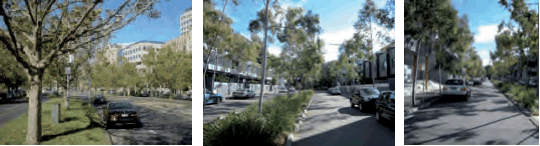

> [Picture on page 33: a picture, saved as a picture (images/ch-04-01-warnervale-town-centre-page-33-113.gif, 150 dpi).]

280mm high kerb x 200mm wide total width of median 3100mm

Median planting St Kilda Road, Melbourne Median planting Victoria Park, Sydney Median planting, Victoria Park, Sydn

FIGURE 3.17: SUGGESTED STREET TREE SPECIES

### 3.4 VEHICLE FOOTPATH CROSSINGS

Vehicular footpath crossings disrupt pedestrian movement and threaten safety. The design of vehicle access to buildings also infl uences public domain quality.

Overly wide and high vehicle access points detract from the streetscape and the active use of street frontages. The design and location of vehicle access to buildings should minimise confl icts on footpaths, particularly along pedestrian priority places, and visual intrusion and disruption of streetscape continuity.

Driveways and vehicle access should be designed in accordance with the provisions of Section 3.5 of this DCP and are to comply with AS and AS/NZS 2890.

Objectives

• Reduce vehicular access impacts on the public domain.

• To make vehicle access to buildings compatible with pedestrian movements.

Controls

a) One vehicle access point only (including service vehicle access and non-residential parking within retail/residential developments) will be generally permitted per development site.

b) Vehicular entries in the Town Centre Civic Precinct are restricted in Street Types 1-5.

c) Provide vehicle access points capable of shared access at a later date.

d) Vehicle access ramps parallel to the street frontage are not permitted.

e) Integrate vehicle entry points into the building design.

f) Doors to vehicle access points are to be roller shutters or tilting doors fi tted behind the building facade.

g) Vehicle entries are to have high quality fi nishes to walls and ceilings, as well as high standard detailing. No service ducts or pipes are to be visible from the street.

h) Porte cocheres are not favoured and may only be permitted for hotels subject to urban design, streetscape, and pedestrian amenity considerations. Where practicable, porte cocheres are to be internal to the building, with one combined vehicle entry and exit point, or one entry and one exit point on two different frontages of the development.

i) An indented porte cochere, with separate entry and exit points across the footpath, may be permitted in exceptional circumstances for buildings with one street frontage. This is provided that it is constructed entirely at footpath level and provides an active frontage at its perimeter.

j) Adhere to relevant standards for pedestrian sight distances.

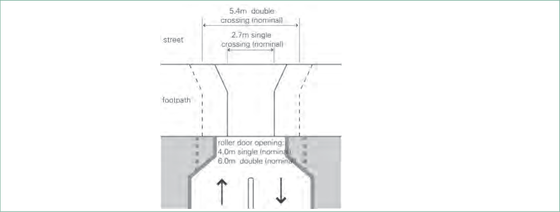

> [Picture on page 34: a picture, saved as a picture (images/ch-04-01-warnervale-town-centre-page-34-32.gif, 150 dpi).]

FIGURE 3.18 VEHICLE FOOTPATH CROSSINGS

### 3.5 DRIVEWAYS AND MANOEUVRING AREAS

Objectives

• To ensure vehicle access to buildings is compatible with pedestrian movements and the public domain.

• To provide vehicle entry points integrated into building design and architecture.

• To design vehicle access to appropriate traffi c and safety management standards.

• To minimise the number and width of vehicle crossings to retain streetscape continuity and reinforce a high quality public domain.

• To provide clear separation of usages for service vehicles private cars, and pedestrians/cyclists.

• To consider pedestrian safety in siting car park entries and, where practicable, allow for trolley storage bays.

• To minimise stormwater runoff from uncovered driveways and parking areas.

Controls

a) Driveways should be:

• Located in accordance with AS/NZS 2890.1:2004 and where possible sight distance should comply with Safe Intersection Sight Distance in accordance with Austroads (2009), Guide to Road Design Part 4A: Unsignalised and Signalised Intersections Table 3.2.

• Provided from lanes and secondary streets rather than the primary street, wherever practical.

• Located taking into account any services within the road reserve, such as power poles, drainage inlet pits and existing street trees.

• Set back a minimum of 1.5m from the relevant side property boundary where adjacent to residential development.

b) Integrate vehicle access with the building design so it is visually recessive.

c) Use high quality materials and fi nishes.

d) Clearly differentiate vehicular and pedestrian access.

e) Provide for all vehicles to enter and leave in a forward direction.

f) Comply with relevant Australian Standards for driveway widths and grades, car space dimensions, vehicular ramp width/grades, and passing bays.

g) Vehicular ramps less then 20m long within developments and parking stations must have a maximum grade of 1 in 5 (20%).

h) Site access ways to underground parking to minimise noise impacts on adjacent habitable rooms, particularly bedrooms.

### 3.6 ON-SITE PARKING

On site parking includes underground (basement), surface (at-grade) and above ground parking, including parking stations.

Objectives

• To provide adequate on-site parking for all land uses.

• Minimise the visual impact of on-site parking.

• To provide adequate space for parking and manoeuvring of vehicles (including service vehicles and bicycles).

• To enable the interim use of certain sites for at grade parking

• To promote the use of public transport, bicycles and walking.

Controls

a) On-site parking must meet the relevant Australian Standard (AS/NZS 2890.1 2004 and AS 2890.2:2002).

b) On-site vehicle, motorcycle and bicycle parking is to be provided in accordance with Table 2 and 3 below.

c) Provide appropriately designated and signed disabled parking spaces for people with disabilities in accordance with Table 4 below.

d) Provide bicycle parking/storage in developments, where indicated in Table 3.

e) Accommodate on-site parking underground, otherwise integrated into the building design.

f) Above ground parking is to be at the rear of shops, restaurants and the like. It is to be located behind the building line and screened from the public domain, where possible.

g) Natural ventilation should be provided to underground parking areas where possible, with ventilation grilles and structures integrated into the building façade and not located on the primary street façade.

#### Table 2 : Required parking rates

| Land use | Parking requirement |  |
|---|---|---|
| Residential |  |  |
| Backpackers’ accommodation | 1 space/ 5 occupants/lodgers plus 1 space for resident manager, plus 1 space/ 2 employees. |  |
| Dual occupancy | 1 space/ 1 and 2 bedroom dwellings; 2 spaces/ 3 bedroom dwelling or larger. |  |
| Dwelling houses | 1 space/ 1 and 2 bed. dwelling; |  |
|  | 2 spaces/ 3 bed. dwelling or larger( min 1 | garaged); |
|  | 2 spaces/ 3 bed. dwelling permitted on lots <200m2 |  |
| Residential fl at buildings | 1 space/ 1 and 2 bed. dwelling; 2 spaces/ 3 bed. dwelling and larger; Visitor parking: 1 space/ 5 dwellings. | Bicycle parking: 1 space/2 dwellings Visitor bicycle parking: 1 spaces/ 12 dwellings |
| Seniors’ Living | As per Seniors’ Living SEPP |  |
| Tourist and visitor | 1 space/ unit; |  |
| accommodation | Plus 1 space for the manager; Plus 1 space/ 2 employees; Additional space per 3 seats if public restaurant included. |  |
| Recreation |  |  |
| Aquatic centre | 30 spaces 500sqm GFA. |  |
| Bowling green | 30 spaces for fi rst green, plus 15 spaces/ Motorcycle parking: 1 space/25 car spaces, or part thereof. | additional green. |
| Entertainment facility | 1 space/10 seats for 75% of total seats, and 1 space/4 seats for 25% of total seats. |  |

| Registered club & pub | Car parking: 1 space/4sqm of bar area, plus 1 space/6sqm of lounge, beer garden, gambling area, plus 1 space/10 seats or 20sqm area of auditorium, plus 1 space/resident manager, plus 1 space/ 2 employees NOTE: Restaurants and dining rooms require additional parking at the relevant rate specifi ed in this Table below. Motorcycle parking: 1 space/ 25 car spaces, or part thereof |
|---|---|
| Recreation facility | 7 spaces/100sqm GFA Motorcycle parking: 1 space/25 car spaces or part thereof. Bicycle parking: 1 space/200sqm GFA. |
| Squash & tennis courts | 3 spaces per court |
| Health & community services |  |
| Art & craft centre | 1 space/15sqm GFA. |
| Child care centre | 1 space/40sqm GFA. |
| Educational Establishments | 1 space/ 2 staff; plus 1 space/ 30 students for high schools plus 1 space/ 5 students for higher education establishments; plus 1 bus standing area/ 200 students. |
| HACC facility | 1 space/25sqm. |
| Hospitals | 1 space/ 3 bed, plus 1 space/ 3 employees, plus 1 space/ professional staff. |
| Library | 1 space/100sqm GFA. |
| Medical Centre | 1 space/25sqm GFA. |
| Place of public worship | 1 space/ 10 seats, or 1 space/ 10sqm GFA, whichever is greater. |
| Youth centre | 1 space/15sqm GFA. |
| Retail & business premises |  |
| Bulky goods | 1 space/ 50sqm GFA. |
| Business premises | 1 space/ 30sqm GFA. |
| Neighbourhood shop | 1 space/ 20sqm GFA where the GFA of a neighbourhood shop, or cluster of shops, exceeds 200sqm. Otherwise no off-street parking is required. |
| Restaurant | 15 spaces/ 100sqm GFA, or 1 space/ 3 seats, whichever is lesser. |
| Retail premises | 1 space/20sqm GFA |
| Service stations | Minimum 4 spaces plus 6 spaces/service bay NOTE: Convenience stores and restaurants attached to a service station require additional parking at the relevant rate specifi ed in this Table. |

Access for the disabled

1 space/100 parking spaces; minimum 3.2m width.

Comply with Australian Standard 2890.1.

Where access for the disabled is required, parking shall be located adjacent to the building’s nearest disabled access. The path of travel from the parking area shall have adequate width and gradient.

Other uses For land uses not specifi ed in this Table, the Roads and Traffi c Authority guidelines will be applied to developments of a minor nature including, extensions. However, a traffi c impact statement (with recommendation for on-site car, motorbike and bicycle parking) is required with all major applications..

#### Table 3  On-site bicycle parking for non-residential development

| Use | Requirement |
|---|---|
| Retail | Provide the following minimum rates of bicycle parking Supermarkets: 1 space 750sqm of GFA for employees 1 space 1000sqm of GFA for shoppers Specialty shops: 1 space 300sqm of GFA for employees 1 space 300sqm of GFA for shoppers Neighbourhood shops: 8 bicycle spaces minimum |
| Commercial | Provide the following minimum rates of bicycle parking. Employee: 1 space 150sqm of GFA Visitor: 1 space 750sqm of GFA |
| Community Centres | 6 bicycle spaces at the community centre |
| Parks | 16 bicycle spaces at sports grounds |

### 3.7 PEDESTRIAN AND CYCLE NETWORK

Objectives

• To provide clear and safe pedestrian and cycleway access for the use of the community, within and beyond the WTC.

• To give priority to pedestrians.

• To promote walking and cycling in preference to motor vehicles.

• To provide walking trails in open space areas linking with residential and Town Centre Civic Precinct destinations.

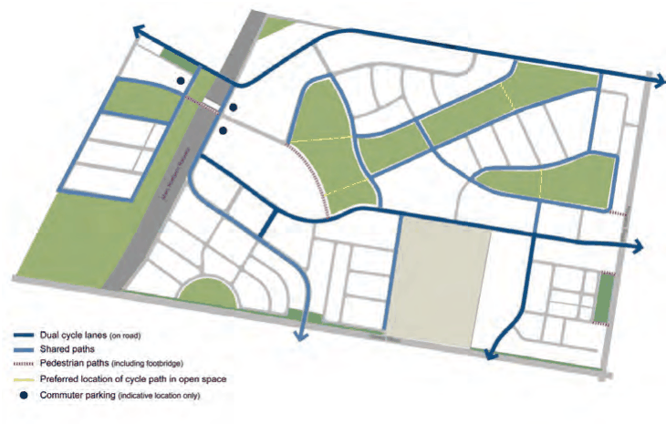

> [Picture on page 39: a picture, saved as a picture (images/ch-04-01-warnervale-town-centre-page-39-1.gif, 150 dpi).]

FIGURE 3.19 BUS, CYCLE AND PEDESTRIAN ROUTES

Controls

a) Key pedestrian and cycle routes are to be provided generally in accordance with Figure 3.19.

b) The design of cycle ways located within the street reserve is to be in accordance with Figures 3.3-3.15.

c) Provide footpath widths in accordance with street sections drawings in Figures 3.3-3.15.

d) All pedestrian and cycleway routes and facilities are to be consistent with the Austroads guides for cycleways; Guide to Road Design Part 3 Geometric Design AGRD03-09 and Guide to Road Design Part 6A Pedestrian and Cyclist Paths AGRD06A-09.

e) Pedestrian and cycle ways are to be constructed as part of the infrastructure works for each stage of development. The infrastructure staging needs to cover the primary routes as part of the essential street framework.

f) Provide adequate change and shower facilities for cyclists in commercial and retail development providing employment for 20 persons or more. Locate those facilities close to bicycle storage areas.

### 3.8 PEDESTRIAN AMENITY

Pedestrian amenity incorporates elements of individual developments that directly affect the quality and character of the public domain. The following pedestrian amenity provisions are intended to achieve a high quality of urban design and pedestrian comfort in the public spaces of the WTC. The pedestrian environment provides people with their primary experience of, and interface with the WTC. This environment needs to be safe, functional and accessible. It should also provide a wide variety of opportunities for social and cultural activities. The pedestrian environment is to be characterised by design excellence, high quality materials and standards of fi nish appropriate to a town centre. Roads, arcades and through site links should form an integrated pedestrian network, providing a choice of ground level routes for pedestrians. The controls in this section aim to increase the vitality, safety, security and amenity of the public domain by:

• encouraging ground level through site links;

• providing links between residential areas, community facilities, public transport and the Town Centre Civic Precinct;

• ensuring active street frontages and clear building street addresses;

• ensuring awnings on the Town Centre Civic Precinct street frontages; and

• protecting signifi cant views and vistas along streets.

### 3.9 SAFETY AND SECURITY

The design of buildings and public spaces has an impact on perceptions of safety and security, as well as providing potential opportunities for crime. A safe and secure environment encourages activity, vitality and viability, enabling a greater level of passive and active security.

Objectives

• Developments are to maximise safety and security for pedestrians.

• To reduce opportunities for crime through environmental design.

• To contribute to public domain safety.

• To encourage a sense of ownership of public and communal open spaces.

Controls

a) Address ‘Safer-by-Design’ principles (including the NSW Police ‘Safer by Design’ crime prevention though environmental design (CPTED) principles) in public and private domain design, and in all developments generally.

b) Provide a ‘safety by design’ assessment (CPTED) from a qualifi ed consultant for large scale retail and commercial development with a construction value of $10 million or over.

c) Design for passive surveillance of public and communal spaces, access ways, entries and driveways in building design.

d) Avoid blind corners and alcoves that provide concealment opportunities in pathways, stairwells, hallways and car parks.

e) Maximise the number of residential ‘front door’, ground level entries in mixed use buildings.

f) Provide entrances in visually prominent positions, which are easily identifi able, and with legible numbering.

g) Clearly defi ne the development boundary to strengthen the transition between public, semi-private and private space. This can be actual or symbolic, and can include landscaping, fences, and changes in paving material.

h) Provide adequate lighting to the relevant Australian standards to all pedestrian access ways, parking areas and building entries.

### 3.10 EQUITABLE ACCESS AND MOBILITY

Any new development must be designed to ensure that safe and equitable access is provided. This is of particular concern in Warnervale given the signifi cant percentage of the population aged 55 years or older, and the steep topography of parts of the WTC.

Objectives

• To provide safe and easy access to buildings.

• To enable use and enjoyment of spaces regardless of one’s age and physical condition.

• To contribute to the vitality and vibrancy of the public domain.

• To ensure buildings and places are accessible to people with a disability.

• To provide a safe and accessible public domain.

Controls

a) Make main building entry points clearly visible from primary street frontages.

b) Enhance building entry points as appropriate, with awnings, building signage or high quality architectural features, to improve clarity of building address and contribute to user amenity.

c) The design of facilities (including car parking requirements) for disabled persons must comply with the relevant Australian Standard (AS 1428 Pt 1 and 2, AS 2890-1 Off Street Carparking or as amended) and the Disability Discrimination Act 1992 (as amended).

d) Provide barrier-free access for a minimum of 20% of dwellings (and associated common areas) for every application for development.

e) Provide at least one main pedestrian entry with barrier free access to at least the ground fl oor in all development.

f) Provide continuous paths of travel from all public roads and spaces, as well as unimpeded internal access.

g) Provide durable materials commensurate with the standard of the adjoining public domain (street), with appropriate slip resistant materials, tactile surfaces and contrasting colours for all pedestrian access ways, entry paths and lobbies.

### 3.11 PUBLIC TRANSPORT NETWORK

Objectives

• To encourage the use of public transport within and beyond the WTC.

• To provide opportunities for transport choice and encourage easy transition between transport modes.

• To ensure clear, safe pedestrian and cycle links to public transport nodes.

• To ensure the railway station and associated development minimises impacts on the Heath Wrinklewort daisy.

Controls

a) Provision of bus routes, bus stops, and bus shelters will be determined by the bus operator in consultation with Council. Applications which include new roads are to consult with the local bus operator, and Council (as the local road authority) to confi rm potential bus routes and ensure the road carriageway is of suitable size to accommodate bus services.

b) Indicative bus routes and stops are provided on Figure 3.1.

### 3.12 TRANSPORT INTERCHANGE

a) A transport interchange is to be provided on the eastern side of the railway station, to include the following facilities:

• Bus stops

• Taxi ranks

• “Kiss n’ ride” drop off areas

• Bicycle parking and storage

b) Commuter carparking shall be provided in close proximity to the railway station, indicative locations are shown in Figure 3.19.

c) Adequate lighting, shelters, and seating are to be provided at the transport interchange to maximise public amenity and safety.

### Public Open Space

### 4.1 PUBLIC DOMAIN

Objectives

• To create a vibrant and safe areas of public open space.

• To provide public domain elements including public art in a coordinated manner with a unifying theme.

• To ensure high quality design and embellishment of all public open space.

• To provide a range of public open spaces to refl ect different characteristics, environmental values and functions.

• To ensure the conservation values of the WTC are protected, where possible, in any use of public open spaces.

• To retain elevated, visually sensitive land that contributes to the landscape character of the WTC.

• To provide a focus for social and recreational activity and public life.

• To meet the public open space and recreational needs of residents in an equitable manner

• To protect ridgeline vegetation.

Controls

a) Public open spaces are to be provided in accordance with the provisions at Table 4. Plans should be prepared in consultation with council, where council will be the owner of these areas of land.

b) Address alternative water source options to reduce potable water consumption in Plans of Management adopted for the public domain and open spaces listed in Table 4.

c) Provide easily accessible levels and coherent links between public squares and open space.

d) Address ‘Safer-by-Design’ principles (including the NSW Police ‘Safer by Design’ crime prevention though environmental design (CPTED) principles) in public domain design.

e) All signage is to comply with SEPP 64 and Wyong Advertising Signs DCP No. 50

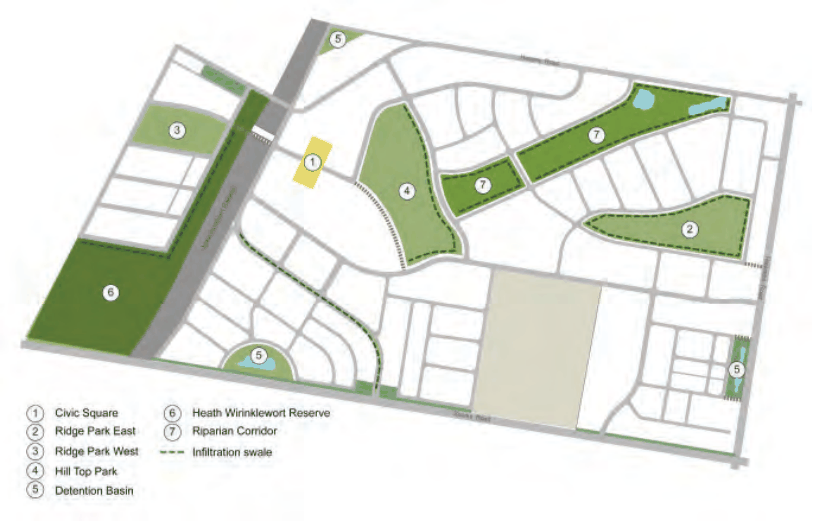

> [Picture on page 42: a picture, saved as a picture (images/ch-04-01-warnervale-town-centre-page-42-25.gif, 150 dpi).]

FIGURE 4.1 OPEN SPACE PROVISION

#### Table 4: Public open space

| Name | Objective | Controls |
|---|---|---|
| Hill Top Park | • To provide for active open space and community uses in an accessible landscaped setting. | • Retain and enhance the existing canopy where possible. • Provide community uses. • Capitalise on views to and from the park. • Maintain the landscaped, visual prominence of the hill. • Provide pedestrian and cycle connections to the riparian corridor. • Use the site’s topography to advantage and provide landscaped public carparking at the lower level, adjoining the riparian corridor. • Remediate former tip area. • Provide a strong and distinct tree edge to the park. • Provide good lighting to encourage night activities. |
| Riparian corridors | • To provide for the protection and management of riparian values. • To restrict development within the corridor to uses appropriate to riparian values. | • A Plan of Management is to be prepared in consultation with OEH for long term conservation and management of riparian corridors. • The Plan of Management is to include: – measures for the protection and rehabilitation of the riparian corridor; and – siting, design and management of adjacent development to minimise impacts on the ecological and hydrological functions of the corridor buffer. • No Asset Protection Zones (APZs) are to be located within the Core Riparian Zone. • Provide limited, formal walking trails in the riparian corridor buffer only, not the core riparian corridor. These can comprise “eco”/nature pathways, and interpretive signage, where appropriate. • Limit all non-pedestrian access (e.g. motor bikes, trial bikes, etc) and all informal access. |
| Heath Wrinklewort Reserve | • To conserve the Heath Wrinklewort. | • A Plan of Management is to be prepared in consultation with OEH for long term conservation and management of riparian corridors. • The Plan of Management is to include: – protection of the Heath Wrinklewort; and – management and monitoring arrangements. • No APZs are to be located within the Heath Wrinklewort Reserve. • Establish formal walking trails in the Heath Wrinklewort Reserve. These can comprise “eco”/nature pathways, and interpretive signage, where appropriate. • Limit all non-pedestrian access (e.g. motor bikes, trial bikes, etc) and all informal access. • Maintain existing landforms and minimise disturbance to existing vegetation. • Undertake ongoing weed control in accordance with a Plan of Management. • Orient adjoining development to the Heath Wrinklewort Reserve to provide passive surveillance. |
| Other public and private parks | • To reinforce the vegetated character of the WTC. • To provide visual and functional links with other adjacent open space areas where possible. • To provide amenity to surrounding residential areas. • To assist in providing connectivity for ecological values. | • Wyong Council is to prepare a Plan of Management for the Ridge Top Parks (East and West). • Retain existing tree canopy in any development of parks. • Supplement existing vegetation where necessary with native plantings (in accordance with Figure 4.2). • Provide pedestrian and cycle connections (refer to Figure 3.14). • Provide seating and other facilities in accordance with the specifi cations for a landscape plan set out below. • Provide stormwater quality and quantity treatment in accordance with IWCM and best practice WSUD. |

### Public Open Space

### 4.2 LANDSCAPE STRATEGY & DESIGN

Objectives

• To retain existing, native vegetation in public open space areas, where possible.

• To minimise potable water consumption.

• To integrate with the biodiversity values of the WTC.

• To complement the existing natural and visual values of the WTC.

• To contribute to high quality streetscapes and public domain.

• To consider public safety in the provision of landscaping.

• To ensure landscaping is considered at the development planning stage.

• To allow for drainage, capture, recycling and reuse.

Controls

a) Provide 50% minimum vegetation cover in landscaped public open space areas, comprising:

• local indigenous species;

• drought tolerant species; or

• a mixture of indigenous and drought tolerant species.

b) Provide water retaining media mixed into the soil for any exotic plantings.

c) Provide water conserving mulch comprising sustainable organic materials such as municipal green waste collection processed to the Australian Standard for Composting (AS44540).

d) Controls a) - c) above do not apply to water effi cient lawn areas or water retention/treatment areas.

e) Provide tree species requiring deep soil planting in public open space areas, and public facilities, (where possible).

f) Provide landscape design that:

• is consistent in distinguishing between public and private spaces;

• minimises risk to utilities and services;

• is durable and suited to the local environment;

• provides appropriate shade; and

• provides an attractive and interesting landscape character.

g) Submit a landscape plan with a superlot subdivision application to detail the treatment of the public domain and open space within the land subject to the subdivision application. The following is to be included:

• general layout

• earthworks

• plant species and sizes (at time of planting and maturity)

• safety features & lighting

• vehicular, cyclist and pedestrian safety

• utilities and services

• public art

• hard and soft landscaping treatments

• street furniture

• shade structures

• drinking fountains

• play equipment

• signage

• planter boxes

• feature fencing

• connections to cycleways and pedestrian paths

i) Identify and retain existing native vegetation and fauna habitat (for example large hollow bearing trees, nest trees and those important for protection of habitat areas), where possible.

j) Protect native vegetation where possible prior to, during and post development.

k) Any public water features are to use re- circulated, treated rainwater. Any moving displays are to be designed for minimal evaporative and splash water loss without compromising the use of water.

l) Integrate landscape design with WSUD systems, as detailed in Section 6 of this DCP.

### Building Form

Building form and character comprise the individual elements of building design that collectively contribute to the character and appearance of the built environment.

The building form development provisions in this section are intended to encourage high quality design for buildings primarily in the Town Centre Civic and Civic Fringe Precincts in the WTC. The resulting built form and character should contribute to an attractive public domain, and produce a desirable setting for its intended uses.

The controls in this section aim to:

• Establish the scale, dimensions and form of buildings appropriate for a town centre setting.

• Achieve an attractive and sustainable built form.

• Provide a strong defi nition of the public domain.

• Achieve active street frontages with good physical and visual connections between buildings and the street.

• Ensure consistent main street frontages for buildings with a common alignment.

• Provide for pedestrian comfort in all weather.

• Provide places that are easy to maintain.

• Ensure building depth and bulk is appropriate to the environmental setting and landform.

• Ensure building separation is adequate to protect amenity, daylight penetration and privacy between adjoining developments.

• Encourage mixed use development with residential components that achieve active street fronts and maintain good residential amenity.

• Achieve an articulation and fi nish of building exteriors that contribute to design excellence.

• Provide for a high quality landscape to contribute to the amenity of the WTC and a sustainable urban environment.

• Ensure building heights do not interfere with fl ight paths from Warnervale Aerodrome.

### 5.1 ACTIVE STREET FRONTAGES

Active street frontages promote an interesting and safe pedestrian environment. Busy pedestrian areas and non-residential uses such as shops, studios, offi ces, cafes, recreation and promenade opportunities, promote the most active street fronts. Residential buildings contribute positively to the street by providing a clear street address, and direct access from, and outlook over the street.

Objectives

• To promote pedestrian activity and safety in the public domain.

• To maximise active street fronts in the Town Centre Civic Precinct.

Controls

a) Active frontage uses at street level include the following:

• retail entries,

• shop fronts,

• glazed entries to commercial and residential lobbies, occupying less than 50% of the street frontage, to a maximum of 12 metres frontage,

• cafés or restaurants if accompanied by a street entry,

• active offi ce uses, such as reception, if visible from the street, and

• entries to public buildings.

b) Provide active street fronts on the ground level of all areas identifi ed in Figure 5.1.

c) Encourage active street fronts in commercial and mixed use development, by providing non-residential uses on ground level.

d) Provide active ground fl oor uses at the same general level as the footpath and directly accessible from the street.

e) Encourage the provision of openable shop fronts for ground fl oor restaurants, cafes and the like.

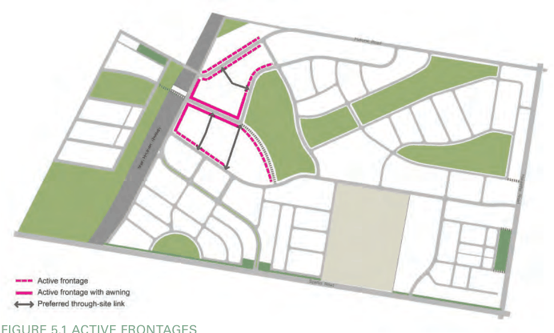

> [Picture on page 47: a picture, saved as a picture (images/ch-04-01-warnervale-town-centre-page-47-9.gif, 150 dpi).]
> Words printed on the picture (title and legend, copied from the PDF):
> FIGURE 5.1 ACTIVE FRONTAGES

### 5.2 CIVIC SQUARE

Objectives

•  To provide a generous, centrally located public square to cater for a variety of civic activities.

Controls

• Provide a north facing public square adjoining Main Street up to 2,700m2.

• Activate the square with retail functions, cinema foyers and various community uses.

• Allow for outdoor dining on the square.

• Provide on grade pedestrian links through the retail centre and from adjoining sites to arrive at the square.

• Landscape the square to provide shade in summer and sun in winter.

• Provide good lighting of the square to encourage night time use.

• Integrate high quality public art into the square.

### 5.3 BUILDING TO STREET ALIGNMENT AND STREET SETBACKS

Street setbacks and building alignments establish the front building line and help to create street proportions. They can contribute to the public domain by enhancing streetscape character and the continuity of street facades.

Street setbacks can also be used to enhance a building’s setting and address. They provide for landscape areas, entries and deep soil zones. In the Town Centre Civic Precinct, buildings are to be built to the street alignment to reinforce urban character and improve pedestrian amenity and activity.

Street setbacks offer comfortable wind conditions, view corridors, appropriate pedestrian scale, and good growing conditions for street trees.

Objectives

• To provide front setbacks appropriate to building function and character.

• To establish a street’s desired spatial proportions and defi ne the street edge.

• To create a public and private space transition.

• To locate active uses, such as shopfronts, closer to pedestrian activities.

• To allow an outlook to, and surveillance of, the street.

• To maintain sun access to the public domain.

Controls

a) Comply with street building alignment and street setbacks, as shown at Figure 5.2.

b) Properties adjoining Sparks or Hakone Roads are to provide a landscaped buffer for the entire property boundary, as shown on Figure 5.2.

c) Properties along Hakone Road are to allow for the widening of this road in accordance with specifi cation provided by Wyong Council.

d) Balconies may project up to 600mm into front building setbacks, provided the cumulative width of all balconies at that particular level totals no more than 50% of the horizontal width of the building façade, measured at that level.

e) Minor projections into front building lines and setbacks for sun shading devices, entry awnings and cornices are permissible.

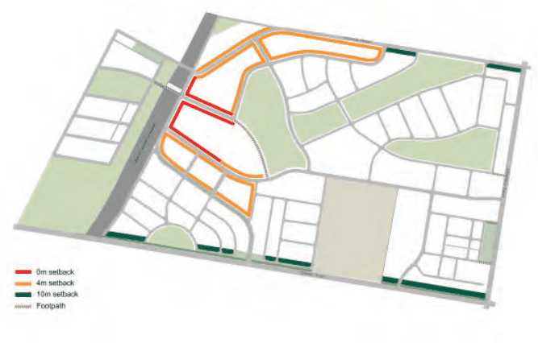

> [Picture on page 48: a picture, saved as a picture (images/ch-04-01-warnervale-town-centre-page-48-28.gif, 150 dpi).]

FIGURE 5.2 BUILDING TO STREET ALIGNMENT AND SETBACKS

Max. height 21m 8m average setback

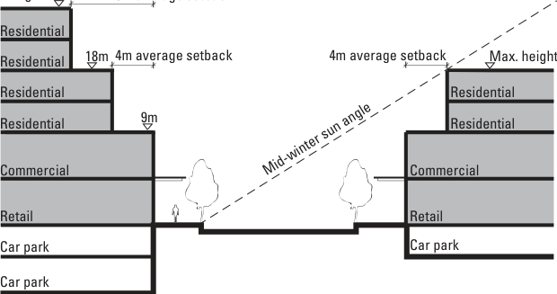

> [Picture on page 49: a map, saved as a picture (images/ch-04-01-warnervale-town-centre-page-49-2.gif, 150 dpi); the street names and other small labels are on the picture.]
> Words printed on the picture (title and legend, copied from the PDF):
> 4m average setback
> 4m average setback Max. height 18m
> Mid-winter sun angle

FIGURE 5.3 TYPE 4 STREET, SECTION THROUGH MIXED USE BUILDING

Max. height 21m

Max. height 21m

Max. height 21m

8m average setback

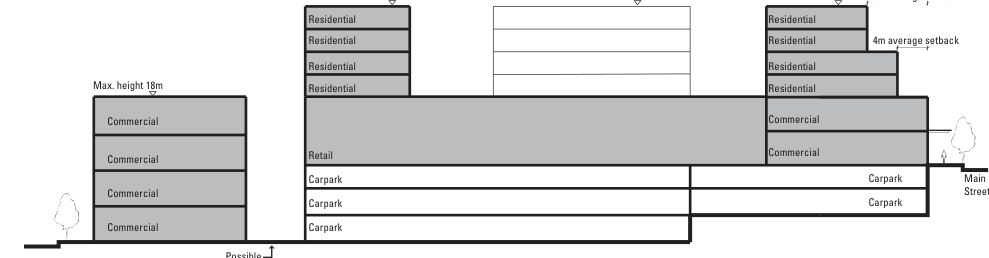

> [Picture on page 49: a map, saved as a picture (images/ch-04-01-warnervale-town-centre-page-49-8.gif, 150 dpi); the street names and other small labels are on the picture.]
> Words printed on the picture (title and legend, copied from the PDF):
> Residential 4m average setback
> Max. height 18m

Possible service lane

FIGURE 5.4 SECTION THROUGH RETAIL CENTRE (FROM TYPE 6 TO TYPE 4 STREETS)

3.5m min. setback

4m setback Max. height 18m

Residential

Max. height 12m

Residential

Residential

property boundary

property boundary Residential

Residential

Retail/Commercial

Residential

FIGURE 5.5 SECTION THROUGH MAIN STREET (TYPE 6)

### 5.4 STREET FRONTAGE HEIGHTS

Well framed streets are an important town centre characteristic. Street frontage heights are specifi ed to achieve a sense of street enclosure appropriate to the WTC’s natural setting, status as a town centre, and the function and character of different parts of the WTC.

Street frontage height controls apply within the Town Centre Civic Precinct. Street frontage heights refer to the height of the building directly addressing the street from the ground level up to the fi rst (if

any) setback.

Objectives

• To achieve comfortable, pedestrian, street environments in terms of daylight, scale, sense of enclosure and wind mitigation.

• To achieve a healthy environment for street trees.

• To reinforce the intrinsic character of the WTC whilst enabling fl exible building design.

• To protect solar access to key streets and public spaces.

• To encourage a strong architectural expression of buildings fronting Town Centre streets.

Controls

a) Comply with the minimum and maximum heights above ground level on the street front as shown in Figures 5.3-5.5.

b) Heights of buildings and all structures are not to exceed the maximum building height standards provided on the Obstacle Limitation Surface (OLS) map for Warnervale Aerodrome. Any buildings within the Warnervale Town Centre site that exceed these height controls will require referral and consent from the Civil Aviation Safety Authority.

### 5.5 AWNINGS

Awnings increase the useability and amenity of public footpaths by protecting pedestrians from the weather. They encourage pedestrian activity along streets. They also support and enhance the vitality of areas in conjunction with active edges such as retail frontages. Awnings provide a public presence and interface within the public domain, and contribute to a development’s identity.

Objectives

• To provide shelter for public streets where most pedestrian activity occurs.

• To address the streetscape by providing a consistent street frontage in the Town Centre Civic Precinct.

Controls

a) Continuous street frontage awnings are to be provided for all new developments as indicated in Figure 5.1.

b) Awnings should be horizontal in form and generally comply with the following:

• minimum 2.4m deep (dependent upon footpath width),

• soffi t height of between 3.2m and 4m,

• integrate with steps (should not exceed 700mm) for design articulation or to accommodate sloping streets with the building design,

• low profi le, with slim, vertical fascias or eaves (generally not to exceed 300mm height), and

• set back from kerb to allow for clearance of elements including street furniture, and trees (minimum 0.6m, typically 1.2m).

c) Match awning design with building facades, be complementary to awnings on adjoining buildings to maintain continuity.

d) Wrap awnings around corners for a minimum 6m.

e) Location and design to consider mature street trees and access to services.

f) Provide under-awning lighting to facilitate night use and to improve public safety. Recess lighting into the awning soffi t or, wall mount it onto the building.

g) Be self supporting not requiring posts, to minimise the impact on pedestrians.

### 5.6 BUILDING EXTERIORS

The creation of a high quality, public domain is dependent upon a consistent approach to the design of new development including, the articulation and fi nish to building exteriors.

Objectives

To ensure that new buildings in the WTC:

• contribute positively to the streetscape and public domain by means of high quality architecture, materials and fi nishes;

• provide richness of detail and architectural interest, especially at visually prominent parts, such as lower levels and roof tops;

• present appropriate design responses to adjoining development which complement the streetscape;

• clearly defi ne adjoining streets, street corners and public spaces and avoid ambiguous external spaces with poor pedestrian amenity and security;

• maintain a pedestrian scale in the articulation and detailing of lower levels; and

• contribute to a visually interesting ridgeline.

Controls

a) Consider adjoining buildings in the design of new buildings in terms of:

• appropriate alignment and street frontage heights,

• setbacks above street frontage heights,

• appropriate materials and fi nishes,

• facade proportions including, horizontal or vertical emphasis, and

• the provision of enclosed corners at street intersections.

b) Provide balconies and terraces, particularly on low rise parts and where buildings overlook parks. Gardens on the top of  roof areas of buildings are encouraged.

c) Articulate facades so that they address the street and add visual interest.

d) Construct external walls of high quality, durable materials and fi nishes with self-cleaning attributes, such as face brick work, rendered brick work, stone, concrete and glass.

e) Avoid fi nishes with high maintenance costs, those susceptible to degradation or corrosion, or fi nishes that result in unacceptable amenity impacts, such as refl ective glass.

f) Avoid expanses of single materials to assist articulation and visual interest. However, maximise glazing for retail uses, but break glazing into sections.

g) Limit sections of opaque or blank walls greater than 4m in length along the ground fl oor, to a maximum of 30% of a buildings frontage.

h) Highly refl ective fi nishes and curtain wall glazing are not permitted above ground fl oor level (see Section 8.11).

i) Submit a materials sample board and schedule with applications with a value in excess of $1 million or, for part of any development built to the street edge.

j) Minor projections up to 450mm from building walls above 3.6m (in accordance with those permitted by the BCA), may extend into the public space. This is provided that the projection is not defi ned as gross fl oor area, does not detract from signifi cant views and vistas, and provides a public benefi t, such as:

• expressed cornice lines that assist in enhancing the streetscape, and

• projections such as entry canopies that add visual interest and amenity.

k) The design of roof plant rooms, antennas, ducting, compressors, utilities and lift over-runs are to be integrated into a building’s architecture.

### 5.7 REFLECTIVITY

Refl ective materials used on building exteriors can result in undesirable glare for pedestrians, and potentially hazardous glare for motorists. Refl ective materials can also transfer additional heat load to other buildings. Thus, the excessive use of highly refl ective glass is discouraged.

Buildings with glazed roofs, facades or awnings should be designed to minimise hazardous or uncomfortable glare arising from refl ected sunlight.

Objective

• To restrict sunlight refl ection from buildings to surrounding areas and other buildings.

• To ensure amenity and safety for pedestrians and motorists.

Controls

a) New buildings and facades should not result in glare that causes discomfort or threatens safety of pedestrians or drivers.

b) New buildings and facades should not result in glare that causes discomfort or reduces amenity in adjacent residential areas or public domain.

c) Visible light refl ectivity from building materials used on new building facades should not exceed 20%.

d) A refl ectivity report analysing the impacts of potential solar glare on pedestrians and motorists may be required - subject to a proposal’s extent and nature of glazing and refl ective materials.

### 5.8 MIXED USE BUILDINGS

Mixed use buildings provide for a variety of activities within town centres. Uses within a building are best located in a pattern and layout suitable to the use mix: retail and business activity at ground level to assist street activation; and residential uses, requiring privacy and noise mitigation, located above street level. Mixed use development within the WTC is preferred in sustainable locations, close to public transport (the railway station and transport interchange), and central recreational areas such as the Hill Top Park.

Objectives

• To encourage a variety of mixed use developments in the Town Centre Civic Precinct.

• To create lively streets and public spaces in the town centre.

• To increase the diversity and range of shopping and recreational activities for workers, residents and visitors.

• To enhance public safety by increasing activity in the public domain.

• To minimise potential confl icts and achieve compatibility between different uses.

• To ensure that the design of mixed use buildings addresses residential amenity, the public domain and the street.

• To create separate, legible and safe access and circulation in mixed use buildings.

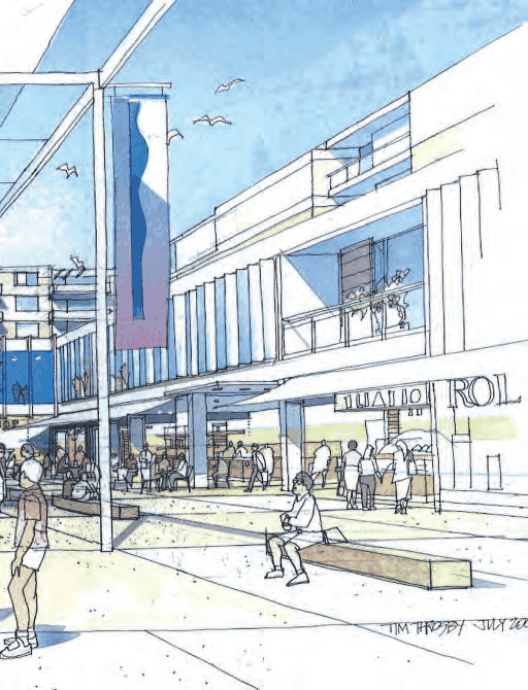

> [Picture on page 53: a picture, saved as a picture (images/ch-04-01-warnervale-town-centre-page-53-5.gif, 150 dpi).]

RESIDENTIAL

COMMERCIAL

RETAIL

FIGURE 5.6 MIXED USE BUILDINGS

Controls

a) Provide fl exible building layouts for variable tenancies or uses within buildings for mixed use blocks as indicated in Figure 5.6.

b) Provide minimum fl oor-to-ceiling heights of 3.3m for commercial offi ce and other uses such as retail facing streets and pedestrian lanes, and 2.7m for residential.

c) Avoid blank walls at ground level.

d) Separate service requirements, such as loading docks, from residential access, and the main street frontage.

e) Clearly separate and distinguish commercial and residential entries.

f) Locate clear, residential and commercial entries directly from the public street.

g) Provide security access controls to all entrances into private areas, including car parks and internal courtyards.

<!-- sections -->
## Sections

1. [5 5.9 RESIDENTIAL FLAT BUILDINGS AND SHOP TOP HOUSING](01-5-5-9-residential-flat-buildings-and-shop.md)
2. [6 Controls](02-6-controls.md)
