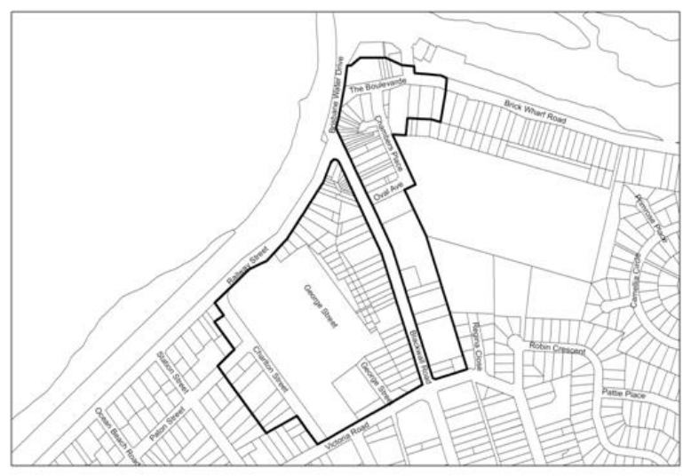
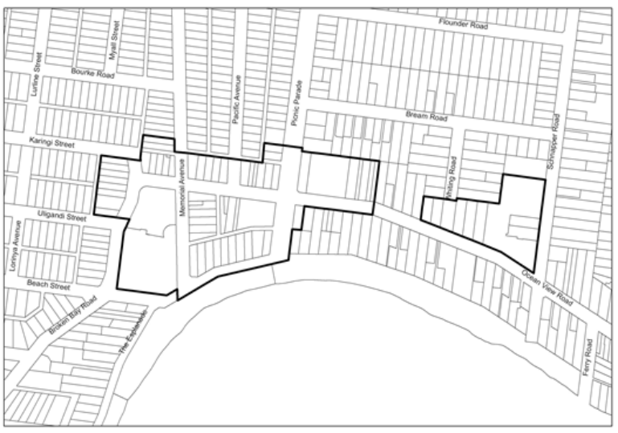
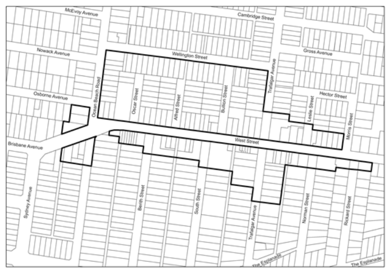

### 4.2 PENINSULA CENTRES

#### 4.2.1 WHERE THIS CHAPTER APPLIES

This chapter applies to all development that requires consent, including alterations and additions to existing structures on properties within the B2 Zone within Woy Woy Town Centre, Ettalong Beach and Umina Beach Village Centres as shown on the maps below.

> [Picture on page 1: a picture, saved as a picture (images/ch-04-02-peninsula-centres-page-1-6.gif, 150 dpi).]

#### Figure 4.2.1: Woy Woy Town Centre

> [Picture on page 1: a picture, saved as a picture (images/ch-04-02-peninsula-centres-page-1-8.gif, 150 dpi).]

#### Figure 4.2.2: Ettalong Beach Village Centre

> [Picture on page 2: a picture, saved as a picture (images/ch-04-02-peninsula-centres-page-2-1.gif, 150 dpi).]

#### Figure 4.2.3: Umina Beach Village Centre
