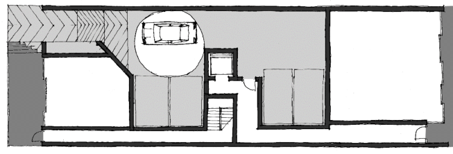

#### 4.2.5 BUILDING FORM

#### 4.2.5.1 Street Frontage

#### OBJECTIVES

▪ Encourage consolidation of existing properties that have narrow street frontages in order to facilitate efficient use of land.

▪ Incorporate best-practice urban design by ensuring that street frontages are wide enough to conceal car parking and delivery areas behind street level shopfronts.

▪ Ensure that street frontages are sufficient to accommodate building services and corridor access for above-ground storeys.

▪ Ensure that street frontages are sufficient to accommodate residential floorplans which provide a reasonable level of amenity.

#### CONTROLS

a Where street frontages are 20m or more wide, Clause 4.3A of Central Coast LEP 2022 provides for additional building height.

b For the purposes of Clauses 4.3A and 4.4B in Central Coast LEP 2022 and this clause, "street frontage" refers to the street frontages nominated on the Height of Building and Floor Space Ratio Map in Central Coast LEP 2022. Where more than one frontage is nominated on the map the applicant may select the frontage to which this clause applies.

c The minimum frontage for additional height has been fixed to accommodate active street frontages plus building services:

i Nearly-continuous bands of shopfronts along all streets,

ii Shopfronts along at least half of any laneway frontage,

iii Ramp access to basement parking and delivery areas,

iv Corridors to lift lobbies and stairs,

v Cupboards for building services and/or garbage stores.

> [Picture on page 6: a picture, saved as a picture (images/ch-04-02-peninsula-centres-page-6-1.gif, 150 dpi).]

Figure 4.2.4: Site plan illustrating the minimum frontage allotment. A typical allotment fronting Street and Lane (layout subject to appropriate details and dimensions)
